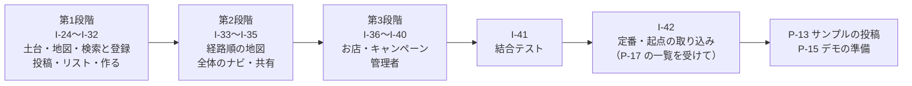

# 実装引き継ぎ（旅ノート金沢）

最終更新：2026-10-30（要件定義書 v11 に対応。v11 の実装は8章から）

## 0. この文書について

この文書は、旅ノートサイト「旅ノート金沢」（仮）を実装する Claude に向けたもの。あなた（Claude）は、これまでの検討の会話を見ていない。必要なことはすべて、この文書と要件定義書に書いてある。

| ファイル | リポジトリでの置き場所 | 役割 |
|---|---|---|
| 要件定義書.md | `docs/requirements.md` | 何を作るか。要件の唯一の正 |
| 実装引き継ぎ.md（この文書） | `docs/handoff.md` | どう進めるか。背景、準備、作業の順番、Issue の中身、つまずきやすい点 |

- この文書と要件定義書が食い違う場合は、要件定義書に従う
- 要件定義書に書かれていないことで、画面の動き・データの形・ライブラリの選択に関わるものは、自分で決めずに作業を止めて人に確認する
- 関数の内部の名前、ファイル内の細かい構成など、外から見た動きと契約（12.2）に影響しないものは、要件定義書の方針に沿って自分で決めてよい

あなたの仕事：要件定義書 13.2 の Issue を順に実装すること。担当範囲に分けず、1人ですべての範囲を作る。

- 初期実装（I-01〜I-21）と雪の茶屋街の見た目（I-22、I-23）は終わっている。6章と7章はその記録として残す
- **今回の仕事は、v11 の Issue I-24〜I-42 を実装すること。** 進め方は8章、Issue の本文は9章、人が行う作業は10章にある
- v11 の Issue は GitHub に登録しない（2026-10-30 PM 決定）。9章・10章の本文を Issue の代わりに使う（8.5）
- 3章の Issue ごとの流れと、4章のつまずきやすい点は、v11 でも同じように守る

## 1. 背景

### 1.1 プロジェクト

- 大学の授業「プロジェクトデザイン実践（PD実践）」のチーム課題。チーム番号 CCCA305A-1、5人（PM1人、実装担当1人、メンバー3人）。実装は実装担当が Claude を使って行う
- テーマは「金沢らしさを観光客に広めるには」。観光客が兼六園、ひがし茶屋街、近江町市場などの一部に集中し、それ以外の場所が知られていないことが問題
- 解決策として、観光客が旅行プランをブロックで組み立て、投稿・検索・コピーできるサイトを作る。定番以外のスポットを含むプランを目立たせる
- 対象は金沢市内のスポットだけ。スマホのブラウザを基準にし、（v11）タブレットと PC でも使えるようにする
- （v11）地図で写真を見てスポットを探し、行きたい場所をリストに保存し、プランを作って経路順を地図で確かめ、当日は全体のナビで Googleマップを開き、行った場所を投稿する、という流れを足す。お店の割引キャンペーンと、それを管理する管理者の機能も足す（要件定義書 0.2）

### 1.2 変えてはいけない決定と、その理由

要件定義書を読むと不自然に見えるかもしれないが、検討の結果そうしたもの。AIが「改善」として変えがちなので、理由と一緒に挙げる。

| 決定 | 理由 | 要件定義書 |
|---|---|---|
| サイトはログイン必須。S-12 以外は未ログインで開けない。（v11）例外は共有されたプラン S-24 だけ | PMの決定。各画面はログイン済みを前提に作ってよい | 3章、BR-14、BR-30、11.3 |
| 移動手段はデータベースに保存しない。到着側のスポットブロックが `transport_mode` として持ち、画面で移動手段ブロックを生成する | 移動手段ブロックだけが残る、などの壊れたデータが起きないようにするため | BR-04、9.2（plan_blocks） |
| 経路は Googleマップの URL で開くだけ。区間ごとの URL が基本。（v11）全体のナビでは、徒歩・車・自転車に限って全体を1本の URL でも開く。公共交通は区間ごとだけ | Googleマップは経由地を指定すると公共交通機関（バス）を選べない。1区間なら選べる | BR-16、BR-23、10.8 |
| Googleマップは URL を開くだけ。APIキーを使う機能は使わない | 費用とキー管理を避けるため | 8.1 |
| （v11）定番は、Web の情報でよく取り上げられる場所（6つ以上の情報源のうち半分以上に載る場所）を開発側が調べて登録したもの。そのあと利用者が登録するものは定番以外。以前の「公式モデルコースの6件で固定」（K19）は取り消した | 「定番以外」に、数で説明できる根拠を持たせるため | BR-17、9.7 |
| 金沢駅は「起点（hub）」で、定番以外の判定に使わない | 金沢駅を定番以外にすると、ほぼ全プランが「定番以外を含む」になってしまう | BR-02 |
| 作成画面は1つの画面の3ステップ。途中で自動保存（データベース）しない | 公開中のプランを編集した瞬間に非公開になるのを防ぐため。途中の内容は localStorage に一時保存する | 11.4、BR-15 |
| 独自のサーバーは作らない。ブラウザから Supabase を直接呼び、RLS で守る | 構成を単純にするため | 8.2、9.4 |
| 画面から Supabase を直接呼ばず、必ず `src/api/` の関数を通す | 後で担当に分かれたとき、データの扱いを揃えるため | 10.1 |
| モックを先に作り、`VITE_USE_MOCK` で本物と切り替える | データベースより先に画面を作れるようにするため | 9.6、9.7 |
| （v11）v11 で足した決まり | 8.2 にまとめた | 8.2 |
| 絵文字を使わない。アイコンは lucide-react だけ | チームのデザインルール | 7.1、7.3 |
| カードの左側だけに色線を引くデザインを使わない（上側だけの線や影での代用も不可） | チームのデザインルール | 7.4 |
| 下部タブにホームはない。ホーム、ログイン画面、作成画面には下部タブを出さない。（v11）下部タブは地図・探す・作る・マイページの4つで、出す画面は 6.1 のとおり。PC では左の縦のメニューにする | PMの決定 | 6.1、7.8 |
| スポットIDは振り直さない。不要になったスポットは削除せず `is_active = false` | プランのブロックがスポットIDを参照しているため | BR-17 |
| 利用後アンケートはサイトに入れない | 効果検証は別のGoogleフォームで行う | 1.2 |
| 8.1 以外のライブラリを入れない。（v11）追加は maplibre-gl だけ（承認済み）。QRコードなどのライブラリは使わない | 書き方を揃えるため。ライブラリの追加は PM の承認が必要 | 8.1 |

## 2. 始める前に人が用意するもの（P-01）

作業を始める前に、次がそろっているかを人に確認する。そろっていないものがあれば、作業を始めずに依頼する。（初期実装の前に済んでいる。v11 で追加で確かめることは 8.1）

| No | 用意するもの | 確認のしかた |
|---|---|---|
| 1 | Node.js（LTS）、npm、git、GitHub CLI（`gh`、ログイン済み）、Supabase CLI | `node -v`、`gh auth status`、`supabase --version` |
| 2 | GitHub の公開リポジトリ（代表者の個人アカウント、空でよい）。手元に clone 済み。他のメンバーをコラボレーターに招待済み | `gh repo view` |
| 3 | Supabase のプロジェクト（リージョンは東京を推奨） | Project URL と公開用キー（anon key または publishable key）を人から受け取る |
| 4 | Supabase の認証設定：メール（Email）でのログインを有効、メール確認（Confirm email）をオフ、パスワードの最小文字数を8 | 人に管理画面で設定してもらう |
| 5 | Supabase CLI のログイン（`supabase login`）と、プロジェクトへの接続（`supabase link --project-ref {プロジェクトID}`） | データベースのパスワードの入力が必要なので、人に実行してもらう |
| 6 | Vercel にリポジトリを連携（フレームワーク：Vite）。環境変数 `VITE_SUPABASE_URL`、`VITE_SUPABASE_ANON_KEY`、`VITE_USE_MOCK` を登録 | I-19 が終わるまでは `VITE_USE_MOCK=true` にしておく（データベースがなくても動くように） |
| 7 | `docs/requirements.md` と `docs/handoff.md` | 人から2つのファイルを受け取り、I-01 で配置する |

守ること

- 管理者用のキー（service_role / secret key）は受け取らない。どこにも書かない
- データベースのパスワードやアクセストークンをファイルに書かない。チャットにも貼ってもらわず、人にコマンドを実行してもらう
- `.env.local` はコミットしない

## 3. 進め方

### 3.1 最初にやること

1. この文書と `docs/requirements.md` を最後まで読む
2. 8.1 の準備がそろっているか確認する
3. v11 の Issue は GitHub に登録しない。9章の Issue を、作業の単位として上から使う（8.5）
4. I-24 から順に実装する

（初期実装のときは、2章の準備、5章の手順で I-01〜I-21 と P-01〜P-09 を登録し、I-01 から実装した）

### 3.2 Issue ごとの流れ

| 手順 | 内容 |
|---|---|
| 1 | 要件定義書の該当箇所（Issue の「要件定義書」欄）を読み直す |
| 2 | main を最新にして、ブランチ `{種類}/{Issue ID}-{内容}` を作る。種類は `feat`（機能）、`fix`（修正）、`chore`（設定など）。例：`feat/I-24-responsive`（要件定義書 12.3） |
| 3 | 実装する。業務ルールに関わる処理には `// BR-04` のように番号を書く |
| 4 | `npm run lint`、`npm run typecheck`、`npm test`、`npm run build` を通す |
| 5 | コミットする。形式は `種類(対象): 内容`（例：`feat(S-04): いいねボタンを追加`） |
| 6 | push して `gh pr create` でプルリクエストを作る。本文の最初に対象の Issue の ID（例：I-24）を書く（v11 は GitHub の Issue がないので `Closes` は書かない）。続けて 12.3 のひな形の項目（スマホ幅の画面の写真、読み込み中・0件・エラーの確認を含む）を書く |
| 7 | CI が通ったら、確認をする人（PM かメンバー）に知らせる。取り込み（Squash and merge）は確認した人が行い、自分では取り込まない（12.3）。直すように言われたら、同じブランチで直して push する |
| 8 | Issue の「終わりの条件」をすべて満たしたことを確認する |

- 取り込まれるのを待つ間に、前の Issue の変更が要らない範囲で次の Issue を進めてよい。前の Issue の変更が要るときは、取り込まれてから main を最新にして始める
- 1つのプルリクエストは1つの Issue だけを扱う。大きい Issue は、同じ Issue のプルリクエストを複数に分けてよい（最後のものに `Closes` を書く）
- Vercel のプレビューURLで画面を確認できる場合は確認する

### 3.3 人に頼むこと・確認すること

| 場面 | 頼むこと |
|---|---|
| 秘密の値が必要 | Supabase の URL と公開用キー、データベースのパスワードが必要なコマンドの実行 |
| スマホでの確認 | 実機での表示、Googleマップのアプリでの経路表示、長押しドラッグ（P-06） |
| 要件に書かれていないことで、動き・データの形・ライブラリに関わるもの | 作業を止めて、選択肢と推奨案を添えて PM に確認する |
| 要件定義書の誤りや矛盾に気づいた | 直さずに PM に伝える。要件定義書（`docs/`）は PM が直す |

### 3.4 完了の報告

（初期実装のときの報告。v11 の報告は 8.6）

I-21 が終わったら、PM に次を報告する。

- 本番URL
- 閉じた Issue の一覧
- 結合テスト（IT-01〜IT-09）の結果の表
- 残っている不具合や、要件どおりにできなかった点
- 人が行う作業（P-02〜P-09）のうち、残っているもの
- スポットデータの取り込み方（`npm run import-spots` の使い方と、生成した SQL の実行方法）

## 4. つまずきやすい点

AIが古い書き方や別の書き方を混ぜやすいところ。実装前に確認する。

| 対象 | 注意点 |
|---|---|
| React Router | パッケージは `react-router`。`createBrowserRouter` と `RouterProvider` で定義する（書き方は公式ドキュメントのデータルーターの例に従う）。loader / action と framework モードは使わない。未保存の確認には `useBlocker` を使える |
| TanStack Query | v5 の書き方。`useQuery({ queryKey, queryFn })`、読み込み中は `isPending`。`useInfiniteQuery` には `initialPageParam` と `getNextPageParam` が必要 |
| dnd-kit | `@dnd-kit/core`、`@dnd-kit/sortable`、`@dnd-kit/utilities` だけを使う。`@dnd-kit/react` と `@dnd-kit/modifiers` は使わない。スマホは `TouchSensor` に長押し（delay 250ミリ秒、tolerance 5px）を設定する |
| Vite の環境変数 | `VITE_` で始まるものだけが `import.meta.env` で読める。`.env.example` に3つを書く |
| Vercel | SPA なので `vercel.json` で全パスを `index.html` に向ける（`{"rewrites":[{"source":"/(.*)","destination":"/"}]}`） |
| スマホの表示 | 高さは `100dvh`。下部タブと下部ボタンは `env(safe-area-inset-bottom)` を考慮する |
| Supabase のビュー | `create view plan_summaries with (security_invoker = true) as ...`。付けないと RLS が効かない |
| Supabase の RLS | すべてのテーブルで RLS を有効にし、ポリシーは `to authenticated` で書く。`anon` には何も許可しない |
| Supabase の関数 | RPC は `security invoker`。中で `auth.uid()` を確認する。作成後に `revoke execute ... from public, anon` と `grant execute ... to authenticated` を行う |
| 検証エラー | `save_plan` では `raise exception using errcode = 'P0001', message = 'TITLE_REQUIRED'` のように、メッセージに検証コード（10.6）をそのまま入れる。api 側でコードを読み取って `ValidationIssue` に変換する |
| プロフィールの自動作成 | `auth.users` への追加をきっかけに `profiles` を作るトリガー関数は `security definer`、`set search_path = ''`。表示名は登録時に `signUp` の `options.data.display_name` で渡す |
| 認証のエラー | Supabase Auth のエラーの `code` で判定する（ログイン失敗は `invalid_credentials`、登録済みは `user_already_exists` または `email_exists`）。判定できないものは UNKNOWN |
| Storage のポリシー | `storage.objects` に対して、`bucket_id = 'plan-images'` かつ `(storage.foldername(name))[1] = auth.uid()::text` で本人のフォルダだけに書き込みと削除を許す |
| 写真の縮小 | `createImageBitmap` と canvas で長辺1280pxに縮め、`toBlob(..., 'image/jpeg', 0.8)`。読み込めない画像（ブラウザが対応しない形式など）は BR-13 のメッセージ |
| 日付 | `Intl.DateTimeFormat('ja-JP', { timeZone: 'Asia/Tokyo' })` で YYYY/MM/DD |
| 経路URL | 値は `encodeURIComponent`。移動手段と travelmode の対応表は `mapsUrl.ts` の1か所にまとめる（T2 の結果で自転車を徒歩に変えられるように） |
| 範囲チェック | ブランチ名は `GITHUB_HEAD_REF`、変更ファイルは `git diff --name-only origin/main...HEAD`（checkout で `fetch-depth: 0`）、ラベルはイベントのデータ（`GITHUB_EVENT_PATH`）から読む |
| 初期データの投入 | `supabase db push` はリモートに seed を流さない前提で考える。タグと 9.7 の13件のスポットはマイグレーションの中で `insert ... on conflict (id) do update` する |
| 型の生成 | `supabase gen types typescript --project-id {プロジェクトID} > src/types/database.ts` |
| モック | 0.3秒ほどの待ち時間を入れて、読み込み中の表示を確認できるようにする。ログイン状態は localStorage（キー `travel-note:mock-session`）に保存し、再読み込みしても続くようにする |
| 絵文字 | 画面の文字、データ、メッセージだけでなく、コードのコメントやコミットメッセージにも使わない |

## 5. Issue の登録

### 5.1 ラベル

```bash
gh label create claude --color 2B4C7E --description "Claude が実装する Issue"
gh label create human --color B8892B --description "人が行う作業"
gh label create pm-approved --color 2E7D4F --description "PMが承認した contract の変更（範囲チェックで使う）"
```

### 5.2 登録のしかた

- 6章と7章の各 Issue を、上から順に1件ずつ登録する
- タイトルは見出しの `[I-01] リポジトリの初期設定` の形をそのまま使う
- 本文は、その見出しの下の内容（次の見出しの前まで）をそのまま使う
- ラベルは本文の「ラベル」の行のとおり

```bash
# 例：本文を一時ファイルに書き出してから登録する
gh issue create --title "[I-01] リポジトリの初期設定" --label claude --body-file /tmp/I-01.md
```

登録が終わったら、I- / P- の ID と GitHub の Issue 番号の対応表を作り、`[I-01]` の Issue にコメントとして残す。プルリクエストの `Closes #番号` にはこの番号を使う。

## 6. Claude が実装する Issue（初期実装。I-01〜I-21 は終わっている。記録として残す）

初期実装のときの本文。ブランチ名と取り込みの決まりは、今は 3.2 のとおり（`init/` のブランチと、自分での取り込みはやめた）。v11 の Issue は9章。

### [I-01] リポジトリの初期設定

ラベル：claude ／ 先に終わっている必要があるもの：P-01 ／ 要件定義書：8.1、8.3、11.1、12.4

やること

- [ ] リポジトリ直下に Vite の `react-ts` テンプレートでプロジェクトを作る
- [ ] 8.1 の依存関係をすべて入れ、`package-lock.json` をコミットする。`.nvmrc` に Node.js の LTS のバージョンを書く
- [ ] `tsconfig` を strict にし、`@/` を `src/` の別名にする（tsconfig と vite.config の両方）
- [ ] ESLint と Prettier を設定する。ESLint の `no-restricted-imports` で、`@supabase/supabase-js` を `src/lib/supabase.ts` と `src/api/` 以外から読み込めないようにする
- [ ] npm スクリプト：`dev`、`build`、`preview`、`lint`、`typecheck`、`test`（vitest run）、`format`、`import-spots`
- [ ] `vercel.json`（全パスを index.html へ）
- [ ] `.env.example`（8.3 の3つ。値は空）。`.gitignore` に `.env.local`
- [ ] 11.1 のフォルダを作る（空のフォルダには `.gitkeep`）
- [ ] `CLAUDE.md`（12.4 の内容をそのまま）、`docs/requirements.md`、`docs/handoff.md` を置く
- [ ] `README.md`：起動方法、環境変数、モックと本物の切り替え方

終わりの条件

- [ ] `npm run lint`、`npm run typecheck`、`npm test`、`npm run build` がすべて通る
- [ ] Vercel の本番URLで空の画面が表示される

### [I-02] CI・範囲チェック・プルリクエストのひな形

ラベル：claude ／ 先に終わっている必要があるもの：I-01 ／ 要件定義書：12.2、12.3

やること

- [ ] `.github/workflows/ci.yml`：プルリクエストで、`.nvmrc` の Node.js を使い、`npm ci`、lint、typecheck、test、build、範囲チェックを実行する
- [ ] `scripts/check-scope.mjs`：12.2 の表を設定として持ち、ブランチの接頭辞ごとに変更してよいファイルを判定する。`init/` は全範囲可、`contract/` は `pm-approved` ラベルがあれば全範囲可、接頭辞が表にないブランチは失敗。失敗時は範囲外のファイル名を表示する
- [ ] `.github/pull_request_template.md`（12.3 の項目）
- [ ] P-02 で人が設定するブランチ保護の内容（必須チェックの名前など）を、P-02 の Issue にコメントで書く

終わりの条件

- [ ] `init/` のプルリクエストで CI が通る
- [ ] 試しに `browse/` のブランチで `src/api/` を変更したプルリクエストを作ると、範囲チェックで失敗する（確認後、そのプルリクエストは閉じてブランチを消す）

### [I-03] デザイントークンと共通の関数

ラベル：claude ／ 先に終わっている必要があるもの：I-01 ／ 要件定義書：7.1〜7.3、6.5、BR-12、10.8、11.6

やること

- [ ] `src/styles/variables.css`：7.2 のすべての変数
- [ ] `src/styles/global.css`：初期化、文字の種類、背景色、`100dvh`、safe-area
- [ ] `src/lib/icons.ts`：7.3 の対応表（下部タブ、ブロック、移動手段、タグの slug、操作、状態）
- [ ] `src/constants/messages.ts`：6.5 の文言、6.4 のトーストと失敗のメッセージ、10.6 の検証メッセージ
- [ ] `src/lib/format.ts`：`formatDate`、`formatRoute`、タイトルが空のときの「無題のプラン」（BR-12）
- [ ] `src/lib/mapsUrl.ts`：`buildDirectionsUrl`（10.8）
- [ ] 11.6 の format と mapsUrl のテスト

終わりの条件

- [ ] テストが通る
- [ ] 色や余白の値が variables.css 以外に書かれていない

### [I-04] 型定義・APIの形・モック

ラベル：claude ／ 先に終わっている必要があるもの：I-01 ／ 要件定義書：9.7、10.1〜10.3、10.7、11.2

やること

- [ ] `src/types/models.ts`：10.7 のとおり
- [ ] `src/api/errors.ts`：`ApiError`、`ErrorCode`、元のエラーからの変換（10.2）
- [ ] `src/api/queryKeys.ts`：11.2 のキー
- [ ] `src/api/` の各ファイル：10.3 の全関数。`VITE_USE_MOCK` が true ならモック、false なら本物を呼ぶ。本物の中身は I-19 で作る（それまでは「未実装」のエラーを投げる）
- [ ] `src/api/mock/`：9.7 のデータをそのまま入れ、メモリ上で動くモックを作る。検索は BR-01、ランキングは BR-11 の並び順。自分のプランへのいいねは FORBIDDEN。写真のアップロードはブラウザ内の一時URLを返す
- [ ] モックのログイン：どのメールアドレスとパスワードでもテスト太郎としてログインし、状態を localStorage に保つ（4章）
- [ ] 11.6 のモックの並び順のテスト

終わりの条件

- [ ] 9.7 の「このデータで確認できること」の並び順がテストで確認できる
- [ ] typecheck が通る

### [I-05] 共通部品と仮ロゴ

ラベル：claude ／ 先に終わっている必要があるもの：I-03 ／ 要件定義書：7.4、7.6、6.1

やること

- [ ] 7.6 の共通部品をすべて作る（`AppLayout`、`PageHeader`、`BottomTabBar`、`Logo`、`Button`、`IconButton`、`TagChip`、`TagSelector`、`PlanCard`、`PlanCardSkeleton`、`StatusLabel`、`EmptyState`、`ErrorState`、`SegmentedControl`、`BottomSheet`、`ConfirmDialog`、`useToast`）
- [ ] `Logo` はサイト名「旅ノート金沢」の文字を太字で表示する仮ロゴ。後で画像に差し替えられるよう、中身は部品の中だけで完結させる
- [ ] `PlanCard` は 7.6 の表示内容をすべて持つ
- [ ] アイコンだけのボタンには aria-label、飾りのアイコンには aria-hidden

終わりの条件

- [ ] 7.6 の引数で使える
- [ ] 絵文字と、左側だけの色線（border-left による強調）がない

### [I-06] ルーティング・レイアウト・ログイン必須の仕組み

ラベル：claude ／ 先に終わっている必要があるもの：I-04、I-05 ／ 要件定義書：6.1、6.3、11.3、11.5、BR-14

やること

- [ ] `App.tsx`：11.5 の全ルート。`QueryClientProvider`、`AuthProvider`、トーストの Provider を置く
- [ ] 全画面の空のページ（S-01〜S-12、NotFound）。ページは画面IDのフォルダに置く（11.1）
- [ ] `useAuth`、`RequireAuth`：`/login` 以外はすべて RequireAuth。未ログインなら `redirect` を付けて `/login` へ。`isLoading` の間は読み込み中の表示
- [ ] api の `UNAUTHORIZED` を受けたら、トーストを出して `/login` へ移す（TanStack Query の共通のエラー処理で行う）
- [ ] 下部タブを出す画面・出さない画面・選択状態（6.1）
- [ ] ヘッダーのサイト名からホームへ（S-02、S-10、S-11）
- [ ] 画面が変わったら一番上へスクロール

終わりの条件

- [ ] モックで、ログインしていない状態で `/ranking` を開くと `/login?redirect=%2Franking` に移る
- [ ] 下部タブが S-02、S-03、S-04、S-10、S-11 にだけ出る

### [I-07] S-12 ログイン・登録

ラベル：claude ／ 先に終わっている必要があるもの：I-06 ／ 要件定義書：6.4 S-12、BR-05、BR-14

やること

- [ ] 6.4 S-12 の表示と動き（ロゴ、ログインと新規登録の切り替え、入力欄ごとのエラー、パスワードを忘れた場合の案内）
- [ ] 成功したら `redirect` へ（`/` で始まり `//` で始まらないものだけ）、なければ `/`
- [ ] ログイン済みで開いたら `/` へ

終わりの条件

- [ ] モックでログインし、開こうとしていた画面に移る
- [ ] BR-05 の入力の誤りが表示される

### [I-08] lib/blocks.ts とテスト

ラベル：claude ／ 先に終わっている必要があるもの：I-04 ／ 要件定義書：BR-03、BR-04、BR-06、BR-07、10.3、10.6、11.6

やること

- [ ] `normalizeBlocks`、`toDisplayBlocks`、`validatePlan`、`planToEditorState`（コピー時は BR-07）
- [ ] 11.6 のテスト
- [ ] モックの `savePlan` で `validatePlan` を使い、失敗したら VALIDATION のエラーを投げる

終わりの条件

- [ ] テストが通る

### [I-09] ブロックの部品（表示モード・編集モード）

ラベル：claude ／ 先に終わっている必要があるもの：I-05、I-08 ／ 要件定義書：7.5、7.6、BR-04、BR-16

やること

- [ ] `BlockList`、`SpotBlockCard`、`MoveConnector`、`CommentBlockCard`（`src/components/blocks/`）
- [ ] 表示モード：7.5 の見た目。移動手段の「経路を見る」で `buildDirectionsUrl` の URL を新しいタブで開く
- [ ] 編集モード：長押しドラッグ（dnd-kit）、上へ・下へ、削除、移動手段の選択、コメントの入力（N/500）。状態は持たず、操作は引数の関数で親に知らせる

終わりの条件

- [ ] モックの mock-plan-1 が 7.5 の見た目で表示される
- [ ] 移動手段ブロックは、2つ目以降の各スポットの直前に1つずつ出る

### [I-10] S-01 ホーム

ラベル：claude ／ 先に終わっている必要があるもの：I-06 ／ 要件定義書：6.4 S-01、BR-11

やること

- [ ] 6.4 S-01 の表示と動き（ロゴ、マイページのアイコン、説明、2つのボタン、定番以外ランキング上位3件、出典）
- [ ] 読み込み中・0件・エラーの表示

終わりの条件

- [ ] モックで、定番以外ランキングが mock-plan-1、mock-plan-4 の順に出る
- [ ] 下部タブが出ない

### [I-11] S-02 検索条件・S-03 検索結果

ラベル：claude ／ 先に終わっている必要があるもの：I-06 ／ 要件定義書：6.4 S-02・S-03、BR-01

やること

- [ ] S-02：タグの選択（テーマ・天気のまとまり、アイコン付き）、選択のクリア、URL の `tags` から選択状態を復元
- [ ] S-03：条件の表示、件数、カード一覧、「もっと見る」（`useInfiniteQuery`）、0件の表示

終わりの条件

- [ ] モックで「写真」を選ぶと mock-plan-1 が mock-plan-2 より先に出る
- [ ] S-03 から「条件を変える」で、選択状態のまま S-02 に戻る

### [I-12] S-04 プラン詳細

ラベル：claude ／ 先に終わっている必要があるもの：I-09、I-11 ／ 要件定義書：6.4 S-04、BR-07〜BR-09、BR-16

やること

- [ ] 6.4 S-04 の表示と動き（コピー元の表示、いいね、コピーして編集、本人用メニュー、経路を見る）
- [ ] いいねは押した瞬間に表示を変え、失敗したら戻す（BR-08）。自分のプランではボタンを出さない
- [ ] 見つからない場合の表示

終わりの条件

- [ ] モックのテスト太郎で、mock-plan-2 にいいねボタンが出ない。mock-plan-4 に「テスト太郎さんのプランをもとに作成」が出る
- [ ] mock-plan-3 の URL を他人として開くと「見つかりません」（モックで利用者を切り替えて確認できない場合は、本物の API で I-21 のときに確認する）

### [I-13] S-06 ブロック編集・S-07 スポット選択

ラベル：claude ／ 先に終わっている必要があるもの：I-09 ／ 要件定義書：6.4 S-06・S-07、11.4、BR-03、BR-04、BR-15

やること

- [ ] `PlanEditorPage`（`/plans/new`、`/plans/:planId/edit`、`step` で切り替え）と、11.4 の状態（useReducer）
- [ ] 新規、編集、コピー（`from`）の読み込み
- [ ] S-06 の表示と操作。ブロック数の表示、30個の上限
- [ ] S-07：ボトムシート、名前の絞り込み、エリアと「定番以外だけ」の絞り込み、エリアごとの見出し、直前と同じスポットの無効化
- [ ] 一時保存（localStorage）、復元の確認、未保存で離れるときの確認（BR-15）
- [ ] 下書き保存（公開中のプランの編集では出さない）

終わりの条件

- [ ] スポット3つとコメント1つを追加し、並べ替えても BR-04 が守られる
- [ ] 再読み込みすると復元の確認が出る

### [I-14] S-08 投稿情報・S-09 投稿確認

ラベル：claude ／ 先に終わっている必要があるもの：I-13 ／ 要件定義書：6.4 S-08・S-09、BR-06、BR-09、BR-13

やること

- [ ] S-08：タイトル（N/50、コピー時は元のタイトルを例文に）、タグ、スポットごとの写真（選んだ時点で縮小してアップロード）
- [ ] S-09：公開条件の確認結果と、直すステップへのボタン。プレビュー。「公開する」または「更新する」
- [ ] 保存後は一時保存を消し、履歴を置き換えて S-04 へ
- [ ] RPC からの検証エラーを確認結果に表示

終わりの条件

- [ ] モックで、新規作成から公開まで通る。スポット1つでは公開できず、理由が出る

### [I-15] S-10 ランキング

ラベル：claude ／ 先に終わっている必要があるもの：I-06 ／ 要件定義書：6.4 S-10、BR-11

やること

- [ ] 総合・定番以外の切り替え（URL の `type`）、説明文、順位付きカード、0件の表示

終わりの条件

- [ ] モックで総合が mock-plan-2、mock-plan-1、mock-plan-4 の順

### [I-16] S-11 マイページ

ラベル：claude ／ 先に終わっている必要があるもの：I-06 ／ 要件定義書：6.4 S-11、BR-09、BR-10

やること

- [ ] 表示名、ログアウト、2つのタブ（URL の `tab`）
- [ ] 自分のプラン：状態ラベル、カードのメニュー（編集、非公開に戻す、削除）、確認ダイアログ
- [ ] いいねしたプラン：取り消しボタン
- [ ] 0件の表示

終わりの条件

- [ ] モックのテスト太郎で、mock-plan-2 と「無題のプラン」（mock-plan-3）が出る。いいねしたプランに mock-plan-1 と mock-plan-4 が出る
- [ ] ログアウトすると S-12 に移る

### [I-17] Supabase：テーブル・RLS・トリガー・Storage・初期データ

ラベル：claude ／ 先に終わっている必要があるもの：I-04、P-01 ／ 要件定義書：9.1〜9.5、9.7

やること

- [ ] `supabase/migrations/` に、9.2 のテーブル、制約、インデックスを作るマイグレーション
- [ ] `updated_at` を更新するトリガー、登録時に `profiles` を作るトリガー
- [ ] 9.4 の RLS（すべて `authenticated` のみ）
- [ ] Storage のバケット `plan-images` とポリシー（9.4）
- [ ] タグ（9.2）と 9.7 の13件のスポットを入れるマイグレーション
- [ ] 人に `supabase db push` を実行してもらい、反映を確認する
- [ ] `src/types/database.ts` を生成する

終わりの条件

- [ ] 管理画面でテーブル、ポリシー、初期データ（タグ11件、スポット13件）が確認できる

### [I-18] Supabase：ビュー・RPC

ラベル：claude ／ 先に終わっている必要があるもの：I-17 ／ 要件定義書：9.3、10.4〜10.6、BR-01、BR-06、BR-09

やること

- [ ] ビュー `plan_summaries`（`security_invoker = true`）
- [ ] RPC `search_plans`（BR-01 の並び順、total_count）
- [ ] RPC `save_plan`（10.5 の順番、BR-06 と BR-09、10.6 の検証コード）
- [ ] 実行権限は `authenticated` のみ
- [ ] `src/types/database.ts` を生成し直す

終わりの条件

- [ ] テスト用の利用者で、保存、検索、公開時の検証エラーが期待どおりに動く（確認に使ったSQLか手順をプルリクエストに書く）

### [I-19] 本物の API の実装と切り替え

ラベル：claude ／ 先に終わっている必要があるもの：I-18、I-07、I-10〜I-16 ／ 要件定義書：10.1〜10.3、10.2、BR-10、BR-13

やること

- [ ] 10.3 の全関数を Supabase で実装する（名前の変換、写真のURLへの変換、エラーの変換）
- [ ] `uploadPlanImage`：縮小、JPEG 変換、`{ユーザーID}/{ランダムなID}.jpg` へのアップロード
- [ ] `deletePlan`：写真を消してからプランを削除（写真の削除に失敗しても続ける）
- [ ] `.env.local` と Vercel の `VITE_USE_MOCK` を false にする（Vercel は人に依頼）
- [ ] テスト用のアカウントを2つ作り、全画面を本物のデータで動かす

終わりの条件

- [ ] `VITE_USE_MOCK=false` で全画面が動く
- [ ] モックに戻しても動く

### [I-20] スポットデータの取り込みスクリプト

ラベル：claude ／ 先に終わっている必要があるもの：I-17 ／ 要件定義書：9.6、BR-17

やること

- [ ] `scripts/import-spots.mjs`（追加のライブラリなし）：`supabase/data/spots.csv` を読み、9.6 の確認を行い、`supabase/seed/spots.sql`（id をキーにした upsert）を作る
- [ ] `npm run import-spots` で実行できるようにする
- [ ] 9.7 の13件を `supabase/data/spots.csv` に入れ、スクリプトの動作を確認する
- [ ] 使い方を README に書く（CSV の書き出し方、実行、生成した SQL を SQL Editor か psql で実行する手順）

終わりの条件

- [ ] 13件の CSV から SQL ができる。わざと誤った行（緯度が範囲外、spot_type が不正）を入れると行番号と理由を出して止まる

### [I-21] 結合テストと修正

ラベル：claude ／ 先に終わっている必要があるもの：I-19、I-20 ／ 要件定義書：14、15

やること

- [ ] 本物のデータで、14章の IT-01〜IT-09 を確認できる範囲で実施する（ブラウザのスマホ幅表示を使ってよい）
- [ ] 見つかった不具合を直す（不具合ごとにプルリクエストを分けてよい）
- [ ] 結果の表（シナリオ、結果、備考）をこの Issue にコメントする
- [ ] 実機で確認が必要なもの（IT-09 の Googleマップのアプリ、T1〜T3）は P-06 に引き継ぐ
- [ ] 3.4 の完了の報告を PM に行う

終わりの条件

- [ ] IT-01〜IT-08 が通る（IT-09 は P-06 で確認）
- [ ] I-01〜I-20 がすべて閉じている

## 7. 人が行う作業の Issue（初期実装）

### [P-01] 開発環境の準備

ラベル：human ／ 担当：実装を動かす人 ／ 先に終わっている必要があるもの：なし

この文書の2章の No.1〜7 をすべて行う。

### [P-02] 確認・取り込みをする人の決定

ラベル：human ／ 担当：PM ／ 先に終わっている必要があるもの：なし

実装担当のプルリクエストを確認して取り込む人（PM かメンバー）を決め、この Issue に書く。GitHub のブランチ保護などの設定はしない。プルリクエストを作った人は自分で取り込まない（要件定義書 12.3）。

### [P-03] オープンデータの確認（T4）

ラベル：human ／ 担当：PM ／ 先に終わっている必要があるもの：なし

（v11）PR #63 で済んだ（金沢市オープンデータ「文化財一覧」「公園一覧」、CC BY）。

金沢市の観光施設のオープンデータがあるかを確認する。ある場合は、利用条件（ライセンス、出典の書き方）と、名前・緯度経度・紹介文の列があるかを確認し、結果を要件定義書の 9.6 に書く。

### [P-04] スポットデータ集め

ラベル：human ／ 担当：PM（メンバーも協力） ／ 先に終わっている必要があるもの：P-03

（v11）PR #63 で済んだ（定番以外の20件、id 14〜33）。これ以後の開発側の登録は P-17 と I-42 で行う。

要件定義書 9.6 の列で共有スプレッドシートを作り、スポットを集める。最初の13行は 9.7 のモックのスポット（id 1〜13）。定番は 9.7 の6件だけ。集め終わったら CSV で書き出し、`supabase/data/spots.csv` として取り込みを依頼する（I-20 の仕組みを使う）。

### [P-05] ロゴ画像の作成と差し替えの依頼

ラベル：human ／ 担当：PM ／ 先に終わっている必要があるもの：なし

ロゴを SVG で作る（絵文字は使わない）。できたら、`Logo` 部品の中身を画像に差し替える作業を依頼する。

### [P-06] スマホ実機での動作確認（T1〜T3）

ラベル：human ／ 担当：PM ／ 先に終わっている必要があるもの：I-12、I-13

要件定義書 16.2 の T1〜T3 と、14章の IT-09 を iPhone と Android の実機で確認し、結果をこの Issue に書く。自転車の経路が出ない場合は、`mapsUrl.ts` の対応表を徒歩に変える作業を依頼する。

### [P-07] サンプル投稿15件

ラベル：human ／ 担当：全員 ／ 先に終わっている必要があるもの：I-21

各メンバーのテスト用アカウントで、画面からプランを投稿する。合計15件程度、半分以上は定番以外のスポットを含める。写真は自分たちで撮ったものだけを使う。

### [P-08] 効果検証用の Googleフォーム

ラベル：human ／ 担当：PM ／ 先に終わっている必要があるもの：なし

「金沢らしさを知れたか」「定番以外に行きたくなったか」を聞くフォームを作る。サイトには入れない。

### [P-09] 発表前の最終確認

ラベル：human ／ 担当：PM、担当4 ／ 先に終わっている必要があるもの：P-07

発表の前日に、Supabase のプロジェクトが停止していないことを確認し、本番URLで IT-01 と IT-02 を通す。

## 8. v11 の追加の実装

v11 では、JPHACKS で作った TravelSeek の考え方を取り入れた機能（地図、場所の検索と登録、行きたい場所のリスト、スポットの投稿、経路順の地図、全体のナビ、プランの共有）と、お店・管理者・キャンペーンの機能を足す。画面はレスポンシブにする。何を足すかの全体は要件定義書 0.2 にある。I-01〜I-23 は終わっているので、今あるコードの上に足していく。

v11 から作業を始めるときに読む順番

1. この文書の 0章、1章、3章、4章（初期実装からの決まりで、v11 でも同じ）
2. 要件定義書の 0.2（v11 の概要）、6.1、6.2、7.8、8.1、9章、10章、11章、12章
3. この章（8章）
4. 9章の Issue を、取りかかる前に1つずつ読む

### 8.1 始める前に確かめること

| No | 確かめること | 確かめ方 |
|---|---|---|
| 1 | `docs/requirements.md` と `docs/handoff.md` が v11 になっている（PR「docs: 要件定義書 v11 と実装引き継ぎ」が取り込まれている） | 要件定義書の冒頭が「最終更新：2026-10-30（v11。検討事項はすべて決定。…）」になっているか。なっていなければ、PM に `docs/` ブランチで入れてもらう |
| 2 | 検討事項がすべて決まっている | 要件定義書 16.1 が「なし」になっているか |
| 3 | 環境変数 `VITE_PLACE_SEARCH_ENABLED=true` が Vercel に登録されている | 人に登録してもらう（I-27 までに） |
| 4 | T5（Nominatim でどれくらい見つかるか）が終わっている | I-28 を始める前に PM に聞く。結果によっては要件が変わる |
| 5 | 管理画面での操作と、`supabase db push` などの秘密の値が要るコマンドは人が行う | 今までと同じ（2章） |
| 6 | PR #63（金沢市オープンデータの定番以外の20件、id 14〜33）が取り込まれ、本番で `supabase/seed/spots.sql` が実行されている | `supabase/data/spots.csv` が33件になっているか。本番の件数は人に確かめてもらう |

### 8.2 v11 で変えてはいけない決定と、その理由

AI が「改善」として変えがちなので、理由と一緒に挙げる。1.2 の決定も引き続き守る。

| 決定 | 理由 | 要件定義書 |
|---|---|---|
| 金沢限定。地図は金沢市の範囲の外へ動かせない。スポットは金沢市内だけ（例外はデモ用の金沢工業大学1件だけ） | 目的が金沢の魅力を伝えること | 1.3、BR-17、BR-24、9.7 |
| 地図は OpenFreeMap（maplibre-gl）、場所の検索は OpenStreetMap の Nominatim。Google の Places API や、APIキーが要る地図は使わない | 費用とキーの管理を避けるため。Places API は規約で名前などを保存できない | 8.1、17 |
| Nominatim は「OpenStreetMap で探す」ボタンを押したときだけ呼ぶ。入力のたびの候補は出さない。全体で1秒に1回まで、結果を覚えて同じ問い合わせをしない、出典を出す、環境変数で止められる | Nominatim の公開サーバーの利用条件 | BR-19 |
| 利用者はスポットの名前を入力・変更できない。名前は OpenStreetMap のものだけ。見つからない場所は登録できない | 実際と違う名前や、不適切な名前を防ぐため | BR-20 |
| 同じ場所を2回登録しない（同じ osm_ref、または50m 以内の同じ名前なら、既存のスポットを使う） | 「兼六園」が2つに分かれると、リストやプランや投稿が分散するため | BR-20、10.9 |
| 利用者が登録したスポットは「定番以外」。定番は開発側が Web の調査（6つ以上の情報源の半分以上に載る場所）で決めて登録する | 「定番以外」に、数で説明できる根拠を持たせるため | BR-17、9.7 |
| 地図（S-13）には写真のあるスポットだけを出す。経路順の地図、S-07、S-15 では、写真がなくても色の丸で出す | 地図は写真で行き先を選ぶ場所にするため。プランやリストの場所が消えると分かりにくいため | BR-24 |
| 経路順の地図は、スポットを並び順に直線で結ぶだけ。道のりや所要時間は出さない。短い順の提案は作らない | 経路は Googleマップに任せる。提案は今後の候補（19章） | BR-22 |
| 全体のナビで全体を1本で開けるのは、徒歩・車・自転車だけ。公共交通は区間ごとの URL だけ | Googleマップは経由地のある経路で公共交通を出せないため | BR-16、BR-23 |
| 移動手段ブロックは今のまま（既定は徒歩） | PMの決定 | BR-04 |
| リストは本人だけが見る。人に見せるのはプランで、ログインなしで見られる、見るだけの共有リンクにする | PMの決定 | BR-18、BR-30 |
| キャンペーンの対象は、端末の現在地で確かめる（お店のスポットから100m 以内、位置の誤差100m 以下、投稿のスポットがお店のスポット）。位置は保存しない（距離だけ残す）。QRコードは使わない | 個人の情報を持たないため | BR-28 |
| 特典は1人1キャンペーン1回、受け取った日のうちだけ有効で、お店の人が使用済みにする。位置のごまかしは許容する | その日にその施設を使うことに変わりがないため | BR-28 |
| 特典が出た投稿には「キャンペーン参加」のラベルを自動で付ける。特典は投稿の内容にかかわらず出す。お店は投稿の内容への頼みを書けない | ステルスマーケティングの規制（景品表示法）への対策 | BR-21、BR-27 |
| お店は申請と管理者の承認でなる。最初のキャンペーンだけ申請と一緒に審査し、あとはお店が承認なしで変えられる（管理者はあとから止められる） | PMの決定 | BR-26、BR-27 |
| 管理者の role は、実装担当が Supabase の管理画面で設定する。画面から管理者を作る機能は作らない | PMの決定 | BR-25 |
| role による出し分けは画面でも行うが、守るのはデータベースの RLS と RPC。利用者が自分で role を変えられない | 画面だけで隠しても、データベースに直接要求を送れるため | 9.4、10.9 |
| maplibre-gl は `src/components/map/` の中だけで使う | 地図の部品を1か所にまとめるため | 8.1、11.1 |
| 写真は撮影場所などの情報を消してから保存する | 個人の情報を守るため | BR-13 |
| ステマ対策のラベル、絵文字なし、lucide-react のアイコンだけ、左側だけの色線なし、生成AIの画像なし | チームのデザインルール | 7章 |

### 8.3 つまずきやすい点（v11）

| 対象 | 注意点 |
|---|---|
| maplibre-gl の読み込み | 地図の部品の中で `maplibre-gl/dist/maplibre-gl.css` も読み込む。地図は高さのある親要素の中に置かないと表示されない。画面を離れるときに `map.remove()` を呼ぶ。地図を使う画面に入ったときだけ読み込む（`React.lazy` と動的 import。15 の地図の速さ） |
| 出典 | maplibre-gl が自動で出す出典を消さない（`attributionControl: false` にしない）。OpenStreetMap の出典の文字も消さない（BR-24） |
| 金沢市の範囲 | 地図は `maxBounds` に BR-19 の四角の範囲を少し広げたものを入れる。範囲の数字は `lib/geo.ts` の1か所に置き、地図、`isInKanazawa`、Nominatim の viewbox で同じものを使う |
| Nominatim をブラウザから呼ぶ | ブラウザでは User-Agent を変えられないので、Referer（サイトの URL）で名乗る形になる。`format=jsonv2`、`addressdetails=1`、`accept-language=ja`、`limit=10`、`viewbox` と `bounded=1` を付ける。1秒に1回は、前の呼び出しからの時間をはかって待つ（連打しても順に1回ずつ） |
| Nominatim を Node.js から呼ぶ（I-42） | User-Agent にサイト名とリポジトリの URL を入れる。1秒に1回まで。結果はファイルに残し、同じ名前を何度も調べない |
| 金沢市かどうか | `address.city` に入らないことがあるので、`display_name` に「金沢市」が入っているかで判定する（9.8）。四角の範囲には野々市市なども入る |
| 現在地 | `navigator.geolocation.getCurrentPosition` を、ボタンを押したときだけ呼ぶ。`enableHighAccuracy: true`。`coords.accuracy`（m）も一緒に RPC に渡す。HTTPS でしか動かない（Vercel と localhost は動く）。断られたときと取れなかったときの表示を作る（6.4 S-17、BR-28） |
| 距離の計算 | PostGIS などの拡張は使わない。球面の2点間の距離（ハバーサインの式）を、TypeScript（`lib/geo.ts`）と SQL の関数の両方で同じ式で書く |
| 写真の撮影場所の情報 | canvas に描き直して `toBlob(..., 'image/jpeg', 0.8)` で作り直せば、撮影場所を含む情報（EXIF）は残らない。保存した写真で確かめる |
| security definer の RPC | v11 の RPC は `security definer`（10.9）。`set search_path = ''` を付け、テーブル名は `public.` を付けて書く。最初に `auth.uid()` を確かめる。実行は `authenticated` にだけ許す。`get_shared_plan` だけは `anon` にも許す |
| role を守る | profiles の role を利用者が更新できないようにする（RLS の更新の条件か、列ごとの権限で role を外す）。role を変えられるのは `review_application` と管理画面だけ |
| 利用者のスポットの id | `create sequence spots_user_id_seq start 100001`。開発側の id（1〜99999）とぶつけない |
| 全体のナビの URL | 経由地は `|`（`%7C`）でつなぐ。11か所を超えたら分ける（10.8）。モバイルのブラウザでは経由地が3か所までになるので、アプリで開くことを前提にした説明を出す（BR-23） |
| 幅の区切り | CSS Modules のメディアクエリには CSS 変数が使えない。7.8 の幅の区切りの数字だけは直接書いてよい（ほかの値は variables.css の変数） |
| 長押しドラッグと地図 | S-06 で、地図をなぞる操作とブロックの長押しドラッグがぶつからないようにする（地図とブロック一覧の領域を分ける。T7） |
| 共有のページ | `/shared/:token` は RequireAuth の外に置く。ログインしていないので、`getSharedPlan` のほかの API を呼ばない（呼ぶと UNAUTHORIZED で S-12 に飛ばされる） |
| 管理者・お店の画面 | 画面の出し分けは `RequireRole`（11.5）。見られないときは「このページは見られません」（6.2） |

### 8.4 進め方

- 3.2 の流れで、9章の Issue を上から順に進める。0.2 の段階（第1段階 I-24〜I-32、第2段階 I-33〜I-35、第3段階 I-36〜I-41）のとおり
- I-42 は I-41 のあと、PM から定番・起点の一覧（P-17）を受け取ってから始める。デモの利用者が使い始める前（P-13 の前）に終える
- 取り込みは作った人以外が行う（12.3）。取り込まれるのを待つ間に、前の Issue の変更が要らない範囲で次の Issue を進めてよい
- モックを先に作り、本物は同じ Issue の中で作る（v11 の型・API・モックは I-27、I-37。データベースは I-26、I-36）。`VITE_USE_MOCK=true` でも false でも動くようにする
- 人に頼むこと・確かめることは 3.3 に加えて、次のとおり

| 場面 | 頼むこと |
|---|---|
| Nominatim の利用条件のページを読み直して、内容が変わっていた（I-28 の前、発表の前） | PM に伝える |
| T5〜T10 の結果を知りたい | PM に聞く（P-11） |
| 管理者のアカウントの role を admin にする | 実装担当が Supabase の管理画面で行う（P-14） |
| 本番のデータベースでスポットを取り込む、写真を `spot-covers` に上げる | 実装担当が行う（I-42） |
| 要件定義書の誤りや足りないところに気づいた | 直さずに PM に伝える。PM が新しい検討事項（K64 から）として決める |



### 8.5 Issue の扱い

- v11 の Issue は GitHub に登録しない（2026-10-30 PM 決定）。9章と10章の本文を Issue の代わりに使い、「やること」と「終わりの条件」で進み具合を確かめる
- ブランチ名、コミット、プルリクエストに Issue の ID を書く。ブランチ名は `feat/I-24-responsive`、プルリクエストの題名は `feat(I-24): レスポンシブの土台` のような形
- 1つの Issue を複数のプルリクエストに分けるときは、本文に「I-24 の1つ目（全2つ）」のように書く
- 結果の表や「確かめてほしい行」など、Issue にコメントしていたものは、プルリクエストの本文に書き、PM に伝える
- 初期実装のときに登録した P-01〜P-09 の Issue は PM が整理した（P-02 は題名を直した。P-03・P-04 は PR #63 で済んだので閉じた）

### 8.6 完了の報告（v11）

I-41 が終わったら、PM に次を報告する。I-42 が終わったら、取り込んだ件数と「確かめてほしい行」の扱いを追加で報告する。

- 本番URL
- 閉じた Issue の一覧（I-24〜I-41）
- 結合テスト（IT-10〜IT-20）の結果の表
- 残っている不具合や、要件どおりにできなかった点
- 人が行う作業（P-11〜P-17）のうち、残っているもの
- 管理者のアカウントの role の設定方法と、お店の申請からキャンペーンまでの試し方

## 9. v11 で Claude が実装する Issue

### [I-24] レスポンシブの土台

ラベル：claude ／ 先に終わっている必要があるもの：P-10（終わっている） ／ 要件定義書：6.1、7.8、12.4、12.5、15

やること

- [ ] リポジトリの `CLAUDE.md` を、要件定義書 12.4 の内容に更新する
- [ ] 7.8 の幅の区切り（スマホ〜767px、タブレット 768〜1023px、PC 1024px〜）を決まった1か所に書き、各画面の CSS Modules で使う
- [ ] `AppLayout`：タブレットは中央に最大幅720px の1列。PC は下部タブの代わりに左の縦のメニュー（幅220px）を出す。左のメニューの項目は下部タブと同じものにする（4つへの変更は I-30）
- [ ] 今ある画面（S-01〜S-12）を、7.8 の並べ方でタブレットと PC に合わせる
- [ ] トーストと下部の固定ボタンが、PC の左のメニューと重ならないようにする

終わりの条件

- [ ] 今ある全画面が、幅375px、768px、1280px で崩れない
- [ ] スマホ幅の見た目と動きが、今と変わらない

### [I-25] 地図の土台

ラベル：claude ／ 先に終わっている必要があるもの：P-10（終わっている） ／ 要件定義書：8.1、BR-24、7.2、7.6、11.1、15

やること

- [ ] maplibre-gl を入れる（K41 で承認済み）。ESLint の `no-restricted-imports` で、`src/components/map/` の外から読み込めないようにする
- [ ] `MapView`、`MapAttribution`（7.6）。背景は OpenFreeMap の liberty（`https://tiles.openfreemap.org/styles/liberty`）。出典を出す（BR-24）
- [ ] 表示の範囲を金沢市に絞る（`maxBounds`。範囲の数字は `lib/geo.ts` に置く）
- [ ] 写真のピン：写真を丸く切り抜き、縁の色で種類を分ける（7.2 の `--color-pin-*`。定番以外は藍、定番は灰、起点は墨）。キャンペーン中のお店の札（Ticket）を出せる引数を用意する
- [ ] 写真のないスポットを、縁の色だけの丸で出せる引数（S-13 では使わない。BR-24）
- [ ] 写真の束：引いて見たときに重なるピンを、代表の写真と「+N」にまとめる。押すとその範囲を拡大する
- [ ] 地図を使う画面に入ったときだけ maplibre-gl を読み込む
- [ ] 確認用に、モックのスポットを MapView で出せるようにする（ページは I-30 で作るので、確認が終わったら仮の入口は消す）

終わりの条件

- [ ] モックのスポットが地図に出て、金沢市の外へ動かせない
- [ ] 地図を使わない画面の読み込みに maplibre-gl が入っていない（ビルドの出力で確かめる）

### [I-26] データベース：スポットの拡張・リスト・スポットの投稿・プランの共有

ラベル：claude ／ 先に終わっている必要があるもの：P-10（終わっている） ／ 要件定義書：9.1〜9.5、9.7、9.8、10.9、BR-17〜BR-21、BR-30

やること

- [ ] spots に v11 の列と制約を足す（9.2：source、osm_ref、address、place_kind、created_by、is_demo、cover_image_path、created_at。name の重複不可をやめる。チェック制約）。連番 `spots_user_id_seq`（100001 から）
- [ ] デモ用のスポット（金沢工業大学、id 90001。9.7）をマイグレーションで入れる
- [ ] テーブル lists、list_spots、spot_posts、spot_post_images と、plans の share_token（9.2）。上限（リスト1人20個、1つ30件など）はトリガーで確かめる
- [ ] ビュー spot_summaries（`security_invoker = true`。9.3）
- [ ] 9.4 の v11 の RLS。Storage のバケット `spot-post-images` と `spot-covers` とポリシー（9.4。`spot-covers` は画面からの書き込みを許さない）
- [ ] RPC `register_spot`、`save_spot_post`、`get_shared_plan`（10.9）。`save_spot_post` のキャンペーンの部分（特典の発行）は I-36 で足すので、この Issue では投稿と写真の保存だけにする
- [ ] 人に `supabase db push` を実行してもらい、`src/types/database.ts` を作り直す

終わりの条件

- [ ] 今あるプランとスポット（id 1〜33）が、id を変えずにそのまま見られる
- [ ] テスト用の利用者で、`register_spot` の重複の防止（同じ osm_ref、50m 以内の同じ名前）と、金沢市の外での OUT_OF_AREA を確かめる（確かめた SQL か手順をプルリクエストに書く）
- [ ] ログインしていない状態では、`get_shared_plan` のほかのテーブルと RPC にアクセスできない

### [I-27] 型・API・モックの追加（第1・第2段階の分）

ラベル：claude ／ 先に終わっている必要があるもの：I-26 ／ 要件定義書：9.7、10.1〜10.3、10.7、11.2、11.6、8.3

やること

- [ ] `src/types/models.ts` に v11 の型を足す（10.7）
- [ ] 10.3 の v11 の関数のうち、第1・第2段階の分を、モックと本物の両方で作る：`getSpot`、`searchPlaces`、`registerSpot`、リストの関数、スポットの投稿の関数、`getPlansBySpot`、`createShareLink`、`stopShareLink`、`getSharedPlan`。`getSpots` は利用者のスポットも含める
- [ ] `src/api/places.ts` の `searchPlaces` は Nominatim を呼ぶ（BR-19。8.3 のつまずきやすい点）。`VITE_PLACE_SEARCH_ENABLED=false` のときは PLACE_SEARCH_DISABLED を返す
- [ ] 9.7 の「デモ用のスポット」と「v11 のモックの追加データ」をモックに入れる
- [ ] 11.2 のクエリキーを足す
- [ ] `lib/geo.ts`、`lib/route.ts`、`lib/places.ts` と、11.6 の v11 のテスト
- [ ] `.env.example` に `VITE_PLACE_SEARCH_ENABLED` を足す。Vercel への登録は人に頼む

終わりの条件

- [ ] 11.6 の v11 のテストが通る
- [ ] `VITE_USE_MOCK` の true と false の両方で typecheck と build が通る

### [I-28] S-16 場所を探すと、スポットの登録

ラベル：claude ／ 先に終わっている必要があるもの：I-27 ／ 要件定義書：6.4 S-16、BR-19、BR-20、9.8、16.2 T5

やること

- [ ] 始める前に、T5 の結果を PM に聞く。BR-19 の Nominatim の利用条件のページを読み直し、変わっていたら PM に伝える
- [ ] `PlaceSearch`（7.6）と S-16：まずこのサイトのスポットを名前で絞り込み、「OpenStreetMap で探す」ボタンで Nominatim を呼ぶ。出典を出す
- [ ] 候補の表示（名前、場所の種類、住所）。すでにこのサイトにある場所は、このサイトのスポットとして出す。50m 以内にスポットがあれば「近くに〇〇があります」と先に見せる（BR-20）
- [ ] 選んだ候補を呼び出した画面に返す。スポットの登録（`registerSpot`）は、リストに入れたとき・プランに加えたとき・投稿するときに行う（「登録」だけのボタンは作らない）
- [ ] 止めているとき、失敗したとき、見つからないときの表示（6.5、BR-20 の「見つからない場所は、チームに連絡してください」）
- [ ] S-16 を開く入口は、あとの Issue で各画面（S-07、S-13、S-15、S-17、S-19）に付ける。この Issue では仮の入口で確かめてよい

終わりの条件

- [ ] 同じ場所を別の利用者が選んでも、スポットが1つになる
- [ ] バス停やレンタサイクルの貸し出し場所が候補に出ない。金沢市の外の場所は登録できない
- [ ] 1秒に2回以上 Nominatim を呼ばない（ボタンを連打して、ブラウザの開発ツールで確かめる）

### [I-29] S-17 スポットの投稿、S-05 スポット詳細、S-11 の「自分の投稿」

ラベル：claude ／ 先に終わっている必要があるもの：I-28 ／ 要件定義書：6.4 S-05・S-11・S-17、BR-13、BR-21

やること

- [ ] S-17：スポットを選ぶ（S-16 を開ける）、写真1〜4枚（必須）、ひとこと1〜300文字（必須）、写真の注意書き、投稿・編集・削除（BR-21）
- [ ] `uploadSpotPostImage`：縮小と、撮影場所などの情報を消すこと（BR-13。8.3）
- [ ] S-05：スポットの情報（種類、デモのラベル）、投稿の一覧（20件ずつ）、このスポットを含む公開中のプラン（5件）、「ここに投稿」。「リストに保存」は I-31 で付ける。キャンペーンの表示は I-37 で付ける
- [ ] `SpotPostCard`（7.6）
- [ ] S-11 に「自分の投稿」のタブ（非表示にされた投稿にはその表示）

終わりの条件

- [ ] IT-15 のうち地図を除く手順が通る
- [ ] 保存された写真に撮影場所の情報がない

### [I-30] S-13 地図、下部タブの変更、S-01・S-02 の入口

ラベル：claude ／ 先に終わっている必要があるもの：I-24、I-25、I-29 ／ 要件定義書：6.1、6.4 S-01・S-02・S-13・S-14、BR-24、7.6

やること

- [ ] 下部タブを4つ（地図、探す、作る、マイページ）にし、出す画面・出さない画面と選択状態を 6.1 のとおりにする。PC の左のメニューも同じ
- [ ] S-13：写真のあるスポットだけをピンで出す（BR-24）、「定番以外だけ」の切り替え（URL の `minor`）、選んでいるピン（URL の `spot`）、ピンを押すと `SpotSheet`（7.6）、場所を探す（S-16）
- [ ] S-01 と S-02 から、ランキング（S-10）と地図への入口（6.4）
- [ ] 「作る」タブは `/create`（S-14）へ。S-14 の「リストから作る」の部分は I-31 で作るので、この Issue では「新しく作る」だけの S-14 でよい

終わりの条件

- [ ] 写真のないスポットが S-13 に出ない。投稿したスポットは、その写真のピンになる
- [ ] IT-10 のうち、リストに入れる手前までの手順が通る

### [I-31] S-14 作る、S-15 リスト、リストを選ぶシート、S-04 の「スポットをリストに保存」

ラベル：claude ／ 先に終わっている必要があるもの：I-30 ／ 要件定義書：6.4 S-04・S-14・S-15、BR-18、11.4

やること

- [ ] S-14：「新しく作る」と「リストから作る」（リストの一覧、新しいリスト）。`/lists` も同じ内容（6.2）
- [ ] S-15：リストのスポット（写真がなくても色の丸で出す地図を含む）、印を付けて「このリストでプランを作る」（URL は 6.2）、名前の変更・削除、スポットを外す、場所を探して足す
- [ ] `AddToListSheet`、`ListCard`（7.6）。S-05 と S-13 の `SpotSheet` からリストに保存できるようにする。すでに入っていれば「リストに入っています」
- [ ] S-04 の「スポットをリストに保存」（`createListFromSpots`）
- [ ] リストから作ったときのブロックの作り方（BR-18。移動手段は徒歩）と、作成画面の状態の `listId`（11.4）

終わりの条件

- [ ] IT-10 が通る。IT-13 のうち、リストからプランを作るところまでが通る
- [ ] 上限（リスト20個、1つ30件）でメッセージが出る

### [I-32] S-07 スポット選択の変更

ラベル：claude ／ 先に終わっている必要があるもの：I-31 ／ 要件定義書：6.4 S-07、BR-18

やること

- [ ] 「すべて」「リスト」のタブ（上に大きく）。「リスト」ではリストのチップで絞り込む
- [ ] 「すべて」でも、リストに保存したスポットに印とリストの名前を出す
- [ ] 一覧と地図の切り替え（見出しの右に小さく）。地図では写真がなくても色の丸で出し、リストのスポットを強調する
- [ ] 場所を探して（S-16）足す。足したスポットはその場で登録する
- [ ] 今ある絞り込み（エリア、定番以外だけ、直前と同じスポットを選べない）を残す

終わりの条件

- [ ] IT-12 が通る

### [I-33] 経路順の地図

ラベル：claude ／ 先に終わっている必要があるもの：I-25、I-32 ／ 要件定義書：BR-22、6.4 S-04・S-06、7.8、16.2 T7

やること

- [ ] `RouteMap`（7.6）：スポットを並び順の番号のピンにして直線で結ぶ（`toRouteStops`）。写真がなくても色の丸で出す
- [ ] S-06 の上に、開け閉めできる地図（初めは開く）。直線距離の合計、並べ替える前との差、直線距離であることの説明（i）、地図を閉じる（6.4 S-06）
- [ ] PC では、ブロック一覧と地図を左右に並べる（7.8）
- [ ] S-04 にも経路順の地図を出す
- [ ] 地図の操作とブロックの長押しドラッグがぶつからないようにする（8.3）

終わりの条件

- [ ] IT-13 が通る
- [ ] ブロックを並べ替えると、すぐ地図と距離が変わる

### [I-34] S-18 全体のナビ

ラベル：claude ／ 先に終わっている必要があるもの：I-33 ／ 要件定義書：BR-23、6.4 S-18、10.8、11.6

やること

- [ ] `buildWholeRouteUrls` と 11.6 のテスト（10.8）
- [ ] S-18：全体を1本で開く（徒歩・車・自転車を選ぶ）、現在地から開く、長いときは分けた URL を順に並べる、区間ごとの URL、公共交通は区間ごとだけであることの説明（BR-23）
- [ ] 全体のナビの移動手段は `lib/mapsUrl.ts` の1か所の一覧で持つ（公共交通を足せるように）
- [ ] S-04 から S-18 への入口

終わりの条件

- [ ] IT-14 が通る（Googleマップのアプリでの確認は P-11 の T8）

### [I-35] プランの共有

ラベル：claude ／ 先に終わっている必要があるもの：I-34 ／ 要件定義書：BR-30、6.4 S-04・S-24、11.5

やること

- [ ] S-04 の共有（作成者だけ）：リンクを作る、コピー、止める。下書きでも作れる
- [ ] S-24（`/shared/:token`）：ログインなしで、プラン、経路順の地図、全体のナビが見られる。いいね・コピー・編集はない。止められたときは「このプランは共有されていません」
- [ ] S-24 は RequireAuth の外に置き、`getSharedPlan` だけを使う（8.3）

終わりの条件

- [ ] IT-16 が通る

### [I-36] データベース：利用者の種類・お店・申請・キャンペーン・特典・管理者の記録

ラベル：claude ／ 先に終わっている必要があるもの：I-35 ／ 要件定義書：9.1〜9.4、10.9、BR-25〜BR-29

やること

- [ ] profiles に role（user / official / admin）を足す。利用者が自分で role を変えられないようにする（8.3）
- [ ] テーブル shop_applications、shops、campaigns、campaign_rewards、admin_actions（9.2）と、バケット `campaign-images`
- [ ] 9.4 の RLS。担当者の名前と連絡先は、本人と管理者だけが読める
- [ ] RPC `check_campaign_eligibility`、`use_reward`、`submit_application`、`review_application`、`admin_set_status`。`save_spot_post` に、キャンペーンの確かめと特典の発行を足す（10.9。位置は保存せず、距離だけ残す）
- [ ] 人に `supabase db push` を実行してもらい、型を作り直す

終わりの条件

- [ ] 一般の利用者が role を変える要求を送っても変わらない（IT-19 の一部）
- [ ] テスト用の利用者で、申請 → 承認 → 現在地を渡して投稿 → 特典の発行 → 使用済み、までを SQL で確かめる（手順をプルリクエストに書く）

### [I-37] 型・API・モックの追加（第3段階の分）、RequireRole

ラベル：claude ／ 先に終わっている必要があるもの：I-36 ／ 要件定義書：10.3、10.7、11.5、9.7、6.2、K47

やること

- [ ] 10.7、10.3 の第3段階の型と関数を、モックと本物の両方で作る。`getCurrentUser` が role を返す
- [ ] `RequireRole`（11.5）と「このページは見られません」（6.2）
- [ ] 9.7 のモックの追加データ（利用者の種類、お店、キャンペーン、申請）
- [ ] キャンペーンの見せ方：地図のピンの札、S-05、S-07、プランのスポットブロックに「キャンペーン中」を出す（K47）

終わりの条件

- [ ] モックのテスト太郎（一般）、テスト花子（管理者）、`mock-user-shop`（お店）で、開ける画面が 6.2 のとおりになる

### [I-38] S-19 お店の申請、S-20 お店の管理

ラベル：claude ／ 先に終わっている必要があるもの：I-37 ／ 要件定義書：6.6 S-19・S-20、BR-26、BR-27

やること

- [ ] S-19：申請フォーム（お店のスポットを選ぶ、お店の情報、担当者、最初のキャンペーン、サムネイルの写真）。審査中・却下（理由）の表示。S-11 から申請の状態が分かるようにする（BR-26）
- [ ] `CampaignForm`、`CampaignPanel`（7.6）
- [ ] S-20：お店の情報の変更、キャンペーンの作成・変更・終了（承認なし、同時に1つ、期間は最長90日）、特典の数と使用済みの数（BR-27）

終わりの条件

- [ ] IT-17 のうち、申請とお店の管理の部分が通る（審査の画面は I-40）

### [I-39] 位置の確認と特典

ラベル：claude ／ 先に終わっている必要があるもの：I-38 ／ 要件定義書：6.4 S-17、6.6 S-23、BR-21、BR-28、16.2 T10

やること

- [ ] S-17 で、投稿のスポットがキャンペーン中のお店のスポットのとき、「現在地で確かめる」ボタンを出す。押したときだけ現在地を取り、`checkCampaignEligibility` で確かめ、対象ならキャンペーンの説明を出す（BR-28）
- [ ] 投稿のときに確かめた位置を `saveSpotPost` に渡す。位置は保存も、ほかへの送信もしない
- [ ] 特典が出た投稿に「キャンペーン参加」のラベル（BR-21）
- [ ] S-23：特典の画面（当日のみ有効）、お店の人が押す「使用済みにする」
- [ ] 現在地が取れないとき、断られたとき、遠いとき、誤差が大きいときの表示（6.4 S-17、BR-28）

終わりの条件

- [ ] IT-18 が通る（実際の場所での確認は P-11 の T10 と P-15）

### [I-40] S-21・S-22 管理者の画面

ラベル：claude ／ 先に終わっている必要があるもの：I-37 ／ 要件定義書：6.6 S-21・S-22、BR-29

やること

- [ ] S-21：申請、お店、投稿のタブ（URL の `tab`）。お店とキャンペーンの停止、投稿の非表示、スポットの使用中止
- [ ] S-22：申請の審査（承認、却下と理由）
- [ ] どの操作も admin_actions に残る（RPC が記録する）

終わりの条件

- [ ] IT-17 が通る

### [I-41] v11 の結合テストと修正

ラベル：claude ／ 先に終わっている必要があるもの：I-35、I-39、I-40 ／ 要件定義書：14（IT-10〜IT-20）、15、12.5

やること

- [ ] 本物のデータで、IT-10〜IT-20 を実施する（幅375px、768px、1280px）。初期実装の IT-01〜IT-08 も、壊れていないかを通す
- [ ] 見つかった不具合を直す（不具合ごとにプルリクエストを分けてよい）
- [ ] 結果の表（シナリオ、結果、備考）をプルリクエストの本文に書き、PM に伝える
- [ ] 実機や現地での確認が要るもの（T6〜T10）は P-11 に引き継ぐ
- [ ] 8.6 の完了の報告を PM に行う

終わりの条件

- [ ] IT-10〜IT-20 と IT-01〜IT-08 が通る（実機が要るものは P-11）
- [ ] I-24〜I-40 がすべて閉じている

### [I-42] 定番・起点の一覧からスポットデータを作って取り込む

ラベル：claude ／ 先に終わっている必要があるもの：I-41、P-17 ／ 要件定義書：BR-17、9.4、9.6、9.7、9.8、19.4

やること

- [ ] `scripts/import-spots.mjs` に v11 の列（osm_ref、place_kind、address、cover_image、basis）と確かめ（9.6 の段階3）を足す。basis はデータベースに入れない。cover_image があれば `cover_image_path` を `spot-covers/{id}.jpg` にする
- [ ] PM から受け取った `定番一覧.csv` と `情報源一覧.csv`（19.4）を読み、足りない列を補って `supabase/data/spots.csv` に行を足す。checked は FALSE にする
  - 緯度・経度、osm_ref、住所、place_kind：Nominatim で調べる（8.3。place_kind は 9.8 の表で付ける）
  - area：位置と住所から、9.6 のエリア一覧のどれかを選ぶ
  - description：PM が書いていなければ、60文字程度の下書きを自分の言葉で書く（観光サイトの文章を写さない）
  - id：登録済みのスポット（id 1〜33）と同じ場所はその id のまま。新しい場所は、`spots.csv` にある最大の id（90001 を除く）の次から順に振る（90001 はデモ用のスポットが使っている）
  - spot_type：category から（定番は major、起点は hub）
- [ ] 開発側の登録済みのスポット（id 1〜33）のうち、一覧に入らなかったものの spot_type を minor にする（K61。紹介文とエリアはそのまま）。デモ用のスポット（90001）は変えない
- [ ] 19.4 の「確かめてほしい行」と、basis の数が情報源の半分に届かない行を PM に渡して（プルリクエストの本文などで）、確認を待つ
- [ ] PM が checked を TRUE にしたら SQL を作り、本番のデータベースで実行してもらう。写真は長辺1280px に縮めて撮影場所の情報を消し、`spot-covers/{id}.jpg` の名前で管理画面から上げてもらう（9.4）

終わりの条件

- [ ] 本番に定番と起点が入り、写真のある定番が地図（S-13）に出る
- [ ] 「定番以外を含む」（BR-02）の判定とランキングが、新しい種類で正しく出る
- [ ] PM に、取り込んだ件数を報告し、P-13（サンプルの投稿）を始めてよいと伝える

## 10. v11 で人が行う作業の Issue

P-10（v11 の検討事項への回答と、maplibre-gl の追加の承認）は 2026-10-30 に終わったので登録しない。

### [P-11] 動作確認 T5〜T10

ラベル：human ／ 担当：PM ／ 先に終わっている必要があるもの：T5 は I-28 の前、T6 は I-30、T7 は I-33、T8・T9 は I-34、T10 は I-39 の後

要件定義書 16.2 の T5〜T10 を行い、結果を実装担当に伝える。T5 は、Nominatim のサイト（https://nominatim.openstreetmap.org/ ）で、チームが行きたい定番以外の場所を20件ほど手で探して、見つかった数を数えればよい。結果が要件の前提と違う場合（見つからない割合が大きい、現在地の誤差が100m を超えるなど）は、PM が新しい検討事項として要件定義書に書く。

### [P-12] 定番と起点のチームの写真

ラベル：human ／ 担当：PM（メンバーも協力） ／ 先に終わっている必要があるもの：なし

定番と起点、デモ用のスポット（金沢工業大学）の、地図のピンに使う写真を撮る。1か所に1枚。チームが撮ったものだけを使い、生成AIの画像は使わない。撮れたものから、P-17 の `定番一覧.csv` の photo の列にファイル名を書く。写真のない定番は地図（S-13）に出ないだけで、ほかの画面では使える。

### [P-13] サンプルのスポットの投稿

ラベル：human ／ 担当：全員 ／ 先に終わっている必要があるもの：I-29、I-42

チームで撮った写真で、定番以外を中心に15件程度のスポットの投稿をする。定番の取り込み（I-42）が終わってから行う（先に投稿すると、定番の場所が利用者のスポット＝定番以外として入ってしまうため）。

### [P-14] 管理者アカウントとお店役のアカウントの準備

ラベル：human ／ 担当：PM、実装担当 ／ 先に終わっている必要があるもの：I-36

管理者用とお店役（金沢工業大学）用の利用者を、サイトの登録画面から作る。管理者用の利用者の role を、実装担当が Supabase の管理画面で admin にする。デモ用のスポット（金沢工業大学）の位置が正しいかを地図で確かめる。

### [P-15] キャンペーンのデモの準備

ラベル：human ／ 担当：PM ／ 先に終わっている必要があるもの：I-39、P-14

お店役のアカウントで金沢工業大学として申請し（キャンペーンつき）、管理者のアカウントで承認する。大学の中から投稿して、特典の画面が出ること、使用済みにできることを練習する。

### [P-16] 教員への確認

ラベル：human ／ 担当：PM ／ 先に終わっている必要があるもの：なし

デモで金沢工業大学をお店の役にすることと、特典つきの投稿の表示（「キャンペーン参加」のラベル）について、教員に確認する。

### [P-17] 定番・起点の調査と一覧づくり

ラベル：human ／ 担当：PM（メンバーも協力） ／ 先に終わっている必要があるもの：なし（I-42 で使うので、I-41 が終わるころまでに）

要件定義書 9.7 の決まりで Web の情報を調べ、19.4 の形式で `定番一覧.csv` と `情報源一覧.csv` を作り、写真と一緒に実装担当に渡す。Excel で作ってよいが、渡すときは「CSV UTF-8」で保存する。

- 情報源を先に6つ以上決め、各情報源の「おすすめ」「定番」の一覧か、人気順の上位20件に載っている場所を数える。半分以上に載る場所を定番にする
- 呼び方の違いは同じ場所とし、中の施設は外側の場所にも数える（K63）。そうしたときは note に書く
- AI が挙げた情報源は、実際にページを開いて、その場所が載っていることを確かめる
- I-42 で Claude が補った内容（位置、紹介文、確かめてほしい行）を確かめ、`spots.csv` の checked を TRUE にする
- デモの利用者が使い始める前（P-13 の前）に終える
