# 旅ノートサイト 要件定義書

チーム CCCA305A-1 / プロジェクトテーマ：金沢らしさを観光客に広めるには

最終更新：2026-10-30（v11。検討事項はすべて決定。それまでの案は Notion に v07〜v10 として保存。変更の記録は「18. 変更履歴」）

## 0. この文書の使い方

- この文書が要件の唯一の正。今後の変更はすべてこのファイルを上書きして行う
- これまでの「機能要件_画面遷移.md」「機能要件_画面遷移_MVP.md」「技術選定_API設計_v1〜v3.md」の内容はすべてこの文書に統合した。以後は参照しない
- リポジトリには `docs/requirements.md` として置き、AIに作業させるときは必ず読ませる
- **v11 の検討事項はすべて決まった（2026-10-30。K28〜K63 は17章）。** v11 の実装（I-24 以降）は、「実装引き継ぎ.md」の8章からの手順で始める
- 今回は作らないが、あとで検討・追加するものは「19. 今後の検討・追加事項」にまとめた

ID の種類

| 接頭辞 | 意味 | 例 |
| --- | --- | --- |
| F- | 機能 | F-11 ブロックでプランを組み立てる |
| S- | 画面 | S-06 ブロック編集 |
| BR- | 業務ルール（画面をまたぐ決まりごと） | BR-04 移動手段の扱い |
| IT- | 結合テストのシナリオ | IT-02 作成から公開まで |
| K- | 検討事項（未確定） | K01 |
| Q- | 過去の確認事項（決定済み） | Q15 |
| T- | 実装前の動作確認 | T1 |
| I- / P- | Issue（13.2）。I- は Claude が実装するもの、P- は人が行うもの | I-13 S-06 ブロック編集 |

コード、ブランチ名、プルリクエスト、AIへの指示では、この ID で対象を指定する。

### 0.1 チーム体制

5人で開発する。実装は、実装担当の1人が Claude を使ってすべての範囲を行う。画面ごとに担当を分けない（13.1）。

| 役割 | 人数 | 主な仕事 |
| --- | --- | --- |
| PM | 1 | 要件定義書の管理、検討事項の決定、ライブラリ追加の承認、結合テストの進行、スポットデータの取りまとめ |
| 実装担当 | 1 | Claude を使って全範囲を実装する。Supabase の管理（パスワードの再設定、停止の確認など）も行う。誰が担当するかはPMが決める |
| メンバー | 3 | スポットデータ集め、スマホでの動作確認、サンプル投稿 |

プルリクエストの確認と取り込み（マージ）は、作った人以外が行う（12.3）。実装担当が作ったプルリクエストは、PMかメンバーが確認して取り込む。

### 0.2 v11 の変更の概要

JPHACKS で作った TravelSeek の機能のうち、このサイトの目的（定番以外の金沢を知ってもらう）に合うものを取り入れる。TravelSeek のコード（Next.js、Tailwind CSS）は技術構成が違うので持ってこず、考え方と画面の流れだけを取り入れる（8.1）。このサイトは金沢限定で、地図の範囲も金沢市だけにする。

| 区分 | 内容 |
| --- | --- |
| 追加（TravelSeek から） | 地図でスポットを見る（OpenFreeMap）、スポット名で場所を探して登録する（OpenStreetMap Nominatim）、行きたい場所のリスト、スポットの投稿、スポット詳細、全体のナビ、経路順の地図 |
| 追加（新しい要望） | お店の official アカウント（申請フォーム → 管理者が承認）、管理者アカウント（金沢市の職員を想定）、お店の近くから投稿した人への割引キャンペーン（6.6） |
| 変更 | プランの作り方を2つにする：「新しく作る」（地図に登録されたすべてのスポットから選ぶ。リストに保存したものを上に出して目立たせる）と「リストから作る」。スポットは開発側の登録（定番など）に加えて、利用者も投稿で登録できる。利用者が登録するスポットは定番以外。下部タブは「地図、探す、作る、マイページ」の4つにし、ランキングは「探す」とホームから開く |
| 追加（画面） | レスポンシブ対応。スマホを基準にしたまま、タブレットと PC でも使いやすく並べる（7.8） |
| そのまま | ブロックでのプラン作成（スポット、移動手段、コメント。並べ替えはドラッグ）、移動手段ブロック（既定は徒歩）、経路は Googleマップの URL で開くだけ、プランの投稿・検索・コピー・編集・いいね・ランキング、ログイン必須 |
| 取り消す過去の決定 | K18（全体の経路表示と地図表示は作らない）、1.3 の範囲外だった「スポット詳細画面」「利用者によるスポットの追加」「管理画面」、Q4 の「ブックマーク機能は作らない」（リストがその役割を持つ） |

リストは「行きたい場所を保存しておく入れ物」で、プランを作るための必須の手順ではない。プランのコピーや既存のプランの編集も、これまでどおりできる。

距離が短くなる順番の提案は、今回は作らない（2026-10-30 に PM が決定。19章）。

実装の順番を整理するため、3つの段階に分ける（日程の区切りではなく、作る順番）。

| 段階 | 内容 | Issue |
| --- | --- | --- |
| 第1段階 | レスポンシブの土台、地図、場所の検索と登録、スポットの投稿とスポット詳細、リスト、作る画面、スポット追加の画面の変更、下部タブの変更 | I-24〜I-32 |
| 第2段階 | 経路順の地図、全体のナビ、プランの共有 | I-33〜I-35 |
| 第3段階 | 利用者の種類（一般・お店・管理者）、お店の申請と承認、キャンペーン、位置の確認と特典、管理者の画面 | I-36〜I-40 |
| 実装のあと | 定番と起点の登録。PM が調べて作った一覧（19.4）から、Claude が位置や紹介文を補って取り込む | I-42 |

スポットの投稿を第1段階に入れるのは、地図のピンに投稿の写真を使う（K38）ため、投稿がないと地図ができないから。

利用者の流れ（v11）

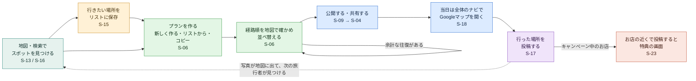

## 1. プロジェクト概要

### 1.1 背景と目的

| 項目 | 内容 |
| --- | --- |
| 問題点 | 金沢を訪れる観光客は多いが、金沢らしさを知っている人は少ない。観光客は兼六園、ひがし茶屋街、近江町市場などの一部に集中し、それ以外の場所が知られていない |
| 真の課題 | 定番以外の情報発信が少ない。多様な文化資源が利益優先の情報発信の中で埋もれている。多様な移動手段が示されていない |
| 解決策 | 観光客が旅行プランを投稿・検索・コピーできる旅ノートサイト。定番以外のスポットを含むプランを目立たせる。v11 からは、地図の上で定番以外のスポットを見つけてリストに集め、実際に行った人の投稿を次の旅行者が見られるようにする。お店のキャンペーンで、行った場所を投稿するきっかけを作る |
| 目標 | 県内県外を問わず9割の人に金沢らしさを知ってもらう |

### 1.2 MVPで確かめること

- タグ検索で、定番以外のスポットを含むプランに出会えるか
- ブロックを並べる操作で、旅行プランを迷わず組み立てられるか
- 使った人が「金沢らしさを知れた」と感じるか（サイトの外のGoogleフォームで確認する）
- （v11）地図とスポットの投稿から、定番以外のスポットを見つけてリストに入れるか
- （v11）経路順の地図を見て、ブロックを並べ替えて余計な往復を減らせるか
- （v11）キャンペーンが、行った場所を投稿するきっかけになるか

### 1.3 範囲

| 範囲内（MVP） | 範囲外 |
| --- | --- |
| タグによるプラン検索と閲覧 | フリーワードでのプラン検索 |
| ブロックによるプラン作成、下書き、公開 | カテゴリ別ランキング |
| 他人のプランのコピー | サイト内アンケート |
| いいね、ランキング（総合、定番以外） | 金沢市外のスポット |
| 金沢市内のスポット（金沢駅などの交通の起点を含む） | メール送信（確認メール、パスワード再設定、申請結果の通知） |
| マイページ（自分のプラン、いいねしたプラン、自分の投稿） | サイト内での経路計算（移動時間、乗り換え）。経路は Googleマップに任せる |
| メールアドレスとパスワードでのログイン | 公共交通での全体のナビ（将来、金沢で導入するときに公共交通のデータをもらえたら足せる作りにしておく。BR-23） |
| （v11）地図でスポットを見る、スポット名で場所を探す | リストの共有、共同編集 |
| （v11）利用者によるスポットの登録（金沢市内、OpenStreetMap にある場所だけ） | スポットの投稿へのいいね・コメント |
| （v11）行きたい場所のリスト、プランの共有 | 通報の機能（管理者が直接非表示にする。6.6） |
| （v11）スポット詳細、スポットの投稿 | キャンペーンの効果の集計画面、お店への支払い・精算 |
| （v11）プラン全体の経路順の地図、全体のナビ（Googleマップの URL。徒歩・車・自転車） | 表示名の変更、退会、多言語、通知 |
|  | 距離が短くなる順番の提案（19章） |
| （v11）お店の official アカウント、管理者アカウント、キャンペーン（6.6） |  |

目的が金沢の魅力発信であるため、扱うスポットは金沢市の区域内に限る。スポットのデータの作り方は 9.6、利用者による登録は BR-20。

### 1.4 想定する利用者

| 利用者 | 内容 |
| --- | --- |
| 観光客（一般） | 金沢を訪れる、または訪れる予定の観光客。旅行の計画中と旅行中に、スマホのブラウザで使う |
| お店（official） | 金沢市内のお店・施設。申請して管理者に承認されると official アカウントになり、キャンペーンを載せられる（6.6） |
| 管理者 | 金沢市の自治体の職員を想定。お店の申請を審査し、不適切なキャンペーンや投稿を止める（6.6）。授業では、チームの1人が管理者の役を務める |

## 2. 用語集

画面の文言とコード上の名前を揃えるための対応表。AIへの指示もこの用語を使う。

| 用語 | 意味 | コード上の名前 |
| --- | --- | --- |
| プラン | 1回の旅行の行程。ブロックの並びとタイトル、タグを持つ | `Plan` |
| ブロック | プランを構成する部品 | `Block` |
| スポットブロック | 訪れる場所を表すブロック | `SpotBlock`、`type: 'spot'` |
| 移動手段ブロック | スポット間の移動を表すブロック。データベースには保存せず、画面で生成する | `MoveBlock`、`type: 'move'` |
| コメントブロック | 自由記述のブロック | `CommentBlock`、`type: 'comment'` |
| スポット | プランやリストに入れられる場所。開発側が登録したもの（登録済みスポット）と、利用者が場所の検索から登録したもの（利用者のスポット）がある（BR-17、BR-20） | `Spot`、`source: 'curated' \| 'user'` |
| 場所の検索 | スポット名で場所を探すこと。まずこのサイトのスポットを探し、なければ OpenStreetMap Nominatim で探す（BR-19） | `searchPlaces` |
| 場所の候補 | Nominatim の検索結果の1件。まだスポットとして登録されていない | `PlaceCandidate` |
| 地図 | OpenFreeMap の背景地図に、スポットのピンを置いたもの。表示する範囲は金沢市だけ（BR-24） | `MapView` |
| リスト | 行きたい場所を保存しておく入れ物。本人だけが見られる。プランを作るときに、保存したスポットが上に出る（BR-18） | `List` |
| スポットの投稿 | 実際に行ったスポットについての、写真とひとこと。プランとは別に投稿する（BR-21） | `SpotPost` |
| 経路順の地図 | プランのスポットを並び順に番号付きのピンと直線でつないだ地図。道のりではなく、順番を確かめるためのもの（BR-22） | `RouteMap` |
| 全体のナビ | 当日の全体のルートを Googleマップで見る画面。全体を1本で開くURLと、区間ごとのURLを置く（BR-23） | — |
| 利用者の種類 | 一般、お店（official）、管理者の3種類（6.6） | `role: 'user' \| 'official' \| 'admin'` |
| お店 | 管理者に承認され、1つのスポットと結び付いた official アカウント（6.6） | `Shop` |
| 申請 | お店が official アカウントになるために出すもの。管理者が承認または却下する | `ShopApplication` |
| キャンペーン | お店が載せる割引などの特典と、そのお知らせ。お店の近くからそのお店のスポットに投稿した人が受けられる | `Campaign` |
| 位置の確認 | 投稿するときの端末の現在地（GPS）が、キャンペーン中のお店の近くかを確かめること（BR-28） | `checkCampaignEligibility` |
| 特典の画面 | キャンペーンの対象者が投稿したあとに出る、お店で見せる画面 | `CampaignReward` |
| スポットの種類 | 定番、定番以外、起点の3種類 | `spotType: 'major' \| 'minor' \| 'hub'` |
| 起点 | 金沢駅などの交通の拠点。定番以外の判定に使わない | `'hub'` |
| エリア | スポットのおおまかな地域。公式観光サイトの分け方に合わせる（9.6） | `area` |
| 定番 | Web の情報で金沢の観光スポットとしてよく取り上げられ、開発側が定番として登録したスポット（BR-17、9.7） | `'major'` |
| 定番以外を含む | プランに定番以外のスポットが1つ以上あること | `hasMinorSpot` |
| 移動手段 | 徒歩、バス、自転車、車 | `TransportMode: 'walk' \| 'bus' \| 'bicycle' \| 'car'` |
| タグ | 検索に使う固定のキーワード | `Tag` |
| 下書き | 本人だけが見られる状態 | `status: 'draft'` |
| 公開 | 誰でも見られる状態 | `status: 'published'` |
| 非公開に戻す | 公開中のプランを下書きに戻すこと | `unpublish` |
| いいね | プランへの評価。マイページから見返せる | `Like` |
| コピー元 | コピーして作ったプランの元のプラン | `sourcePlan` |
| 作成者 | プランを作った利用者 | `author` |
| 表示名 | 利用者が登録時に決める名前 | `displayName` |

## 3. 利用者と権限

サイトはログイン必須。ログインしていない状態では、ログイン・登録画面（S-12）以外は表示しない（K24、BR-14）。

| 操作 | 未ログイン | ログインユーザー | 作成者本人 |
| --- | --- | --- | --- |
| ログイン・新規登録（S-12） | できる | — | — |
| S-12 以外の画面 | できない（S-12 へ移る） | できる | できる |
| 公開プランの検索・閲覧・ランキング・経路を見る・コピーして編集 | — | できる | できる |
| 新規作成・下書き保存・公開 | — | できる | — |
| 下書きの閲覧 | — | できない | できる |
| 編集・非公開に戻す・削除 | — | できない | できる |
| いいね | — | できる | できない（自分のプランには不可） |

v11 で増えるもの（「作成者本人」は、そのリストや投稿を作った人）

| 操作 | 一般 | お店（official） | 管理者 |
| --- | --- | --- | --- |
| 地図・スポット詳細・スポットの投稿を見る | できる | できる | できる |
| 場所の検索、スポットの登録（BR-20） | できる | できる | できる |
| リストを作る・見る・変える | 自分のリストだけ | 自分のリストだけ | 自分のリストだけ |
| スポットの投稿（BR-21） | できる。編集・削除は自分の投稿だけ | できる（自分のお店のスポットには投稿できない） | できる |
| お店の申請（S-19） | できる | — | — |
| 自分のお店の情報・キャンペーンを変える（S-20） | — | できる。管理者の承認はいらない | — |
| 申請の審査、お店・キャンペーンの停止、投稿の非表示（S-21） | — | — | できる |

- お店と管理者も、一般の利用者と同じ画面（プランの作成、いいねなど）をすべて使える
- 管理者は、他人のリストと下書きのプランを見られない（見る必要がないため）

## 4. 機能要件

### 4.1 機能一覧

| ID | 機能 | 内容 | 画面 |
| --- | --- | --- | --- |
| F-01 | キーワード検索 | 固定タグを複数選択して検索する | S-02 |
| F-03 | 検索結果一覧 | 一致したプランをカードで表示する（BR-01） | S-03 |
| F-04 | 定番以外の優先表示 | 一致数が同じなら定番以外を含むプランを上位に出す（BR-01） | S-03 |
| F-05 | プラン詳細の閲覧 | ブロック形式でプランを表示する | S-04 |
| F-06 | スポット詳細の閲覧 | スポットの情報、投稿、そのスポットを含むプラン、キャンペーンを見る（v11） | S-05 |
| F-07 | Googleマップで経路を開く | 移動手段ブロックごとに、その1区間の経路URLを生成して開く（10.8、BR-16） | S-04, S-06, S-18 |
| F-08 | 全体のナビ | 全体を1本の URL（徒歩・車・自転車）で開く。区間ごとの URL も並べる（BR-23、v11） | S-18 |
| F-09 | 経路順の地図 | プランのスポットを並び順に番号付きのピンと直線で地図に出し、直線距離の合計と、並べ替える前との差を表示する（BR-22、v11） | S-06, S-04 |
| F-11 | ブロックでプランを組み立てる | スポット、移動手段、コメントのブロックを並べる（BR-03） | S-06 |
| F-12 | スポットブロックの追加 | 登録されたすべてのスポットから選んで追加する。リストに保存したスポットを上に出し、どのリストに保存したかを表示する（v11 で変更） | S-07 |
| F-13 | ブロックの並べ替え・削除 | 長押しドラッグまたは上下ボタンで並べ替える。削除する | S-06 |
| F-14 | 移動手段ブロック | スポットの間に自動で入り、移動手段を選ぶ（BR-04） | S-06 |
| F-15 | コメントブロック | 自由記述のブロックを追加する | S-06 |
| F-16 | 他のプランをコピーして編集 | 表示中のプランを作成画面に取り込む（BR-07） | S-04, S-06 |
| F-17 | 下書き保存 | 非公開のまま保存する | S-06, S-08 |
| F-18 | 投稿情報の入力 | タイトル、タグ、スポットごとの写真を入力する | S-08 |
| F-19 | 投稿 | 公開条件を確認して公開する（BR-06） | S-09 |
| F-21 | 総合ランキング | いいね数の多い順（BR-11） | S-10 |
| F-22 | 定番以外ランキング | 定番以外を含むプランだけのランキング（BR-11） | S-10, S-01 |
| F-24 | いいね | いいねを付ける・取り消す（BR-08） | S-04, S-11 |
| F-31 | ユーザー登録・ログイン | メールアドレスとパスワード（BR-14） | S-12 |
| F-32 | マイページ | 自分のプラン、いいねしたプラン、自分の投稿を見る。自分のプランの編集・非公開・削除 | S-11, S-04 |
| F-34 | 地図でスポットを見る | 金沢市の地図にスポットのピンを出し、押すとスポットの情報をシートで出す（BR-24、v11） | S-13 |
| F-35 | 場所の検索 | スポット名で、このサイトのスポットと OpenStreetMap の場所を探す（BR-19、v11） | S-16 |
| F-36 | スポットの登録 | 場所の候補を選んで、新しいスポットとして登録する（BR-20、v11） | S-16 |
| F-41 | リストの作成・名前の変更・削除 | 行きたい場所のリストを作る（BR-18、v11） | S-14, S-15 |
| F-42 | リストへの追加・リストから外す | スポットをリストに入れる・外す（BR-18、v11） | S-05, S-13, S-15, S-16 |
| F-43 | リストからプランを作る | リストのスポットを選んで、まとめてスポットブロックにする（BR-18、v11） | S-14, S-15, S-06 |
| F-45 | プランの共有 | プランの共有リンクを作り、LINE などで送る（BR-30、v11） | S-04, S-24 |
| F-44 | プランのスポットをリストに保存 | 表示中のプランのスポットを、新しいリストにまとめて入れる（v11） | S-04 |
| F-51 | スポットの投稿 | 写真、ひとことを入れて、スポットについて投稿する（BR-21、v11） | S-17 |
| F-52 | スポットの投稿の編集・削除 | 自分の投稿を直す・消す（BR-21、v11） | S-17, S-05, S-11 |
| F-61 | お店の申請 | お店の情報と最初のキャンペーンを申請フォームで出す（BR-26、v11） | S-19 |
| F-62 | 申請の審査 | 管理者が申請を承認・却下する。承認すると申請した利用者がお店になる（BR-26、v11） | S-21 |
| F-63 | キャンペーンの管理 | お店がキャンペーンを作る・変える・終える。管理者の承認はいらない（BR-27、v11） | S-20 |
| F-64 | 位置の確認 | キャンペーン中のお店に投稿するとき、端末の現在地がお店の近くかを確かめる（BR-28、v11） | S-17 |
| F-65 | 特典の受け取り | キャンペーンの対象者が投稿すると、お店で見せる特典の画面が出る（BR-28、v11） | S-17, S-23 |
| F-66 | 管理者による停止 | 管理者がお店、キャンペーン、スポットの投稿を止める・非表示にする（BR-29、v11） | S-21 |

欠番：F-02（フリーワード検索）、F-23（カテゴリ別ランキング）、F-33（利用後アンケート）は範囲外。F-10（短い順の提案）は19章に回した。F-06（スポット詳細）は v11 で範囲内に戻した。

## 5. 業務ルール

画面をまたいで守る決まりごと。実装では該当する BR 番号をコメントに書く。

### BR-01 検索

- 選んだタグのどれか1つでも一致したプランを出す（OR検索）
- タグを1つも選ばない場合は、公開中のプランをすべて出す
- 並び順：①一致したタグ数が多い順 ②定番以外を含むプランが先 ③いいね数が多い順 ④公開日時が新しい順 ⑤プランIDの順（並びを安定させるため）
- 20件ずつ表示し、「もっと見る」ボタンで次の20件を読み込む
- 該当件数を表示する
- 対象は公開中のプランだけ

### BR-02 定番以外を含む

- プランのスポットブロックに、種類が「定番以外（minor）」のスポットが1つ以上あれば「定番以外を含む」とする
- 「起点（hub）」のスポット（金沢駅など）は判定に使わない

### BR-03 ブロックの構成

- データベースに保存するブロックはスポットとコメントの2種類。移動手段ブロックは画面で生成する（BR-04）
- 1プランに保存できるブロックは30個まで（スポットとコメントの合計。移動手段ブロックは数えない）
- コメントブロックはどの位置にも置ける（先頭や末尾も可）
- 同じスポットを1プランに複数回入れてよい（例：金沢駅に戻る）。ただし、コメントを除いて隣り合う位置に同じスポットは置けない
- コメントブロックは追加時に末尾に入り、並べ替えで好きな位置に動かす

### BR-04 移動手段

v11 でも変えない（K28 で決定。移動手段ブロックは残し、既定は徒歩）。

- 移動手段は「そのスポットへ何で来たか」として、到着側のスポットブロックが持つ
- 最初のスポットブロックの移動手段は空（null）。2つ目以降は必ず値を持つ
- 新しく追加したスポットの移動手段は「徒歩」
- 並べ替えで最初になったスポットは移動手段を空にし、最初でなくなったスポットは「徒歩」にする
- 画面では、2つ目以降の各スポットブロックの直前に移動手段ブロックを表示する。間にコメントがある場合も、次のスポットの直前に表示する
- この整え方は `lib/blocks.ts` の `normalizeBlocks()` で行い、ブロックを変更するたびと保存の直前に必ず呼ぶ

### BR-05 入力の制限

| 項目 | 制限 | 前後の空白 |
| --- | --- | --- |
| タイトル | 50文字以内。公開時は1文字以上 | 取り除く |
| コメント | 1〜500文字 | 取り除く。保存時に空のコメントブロックは自動で取り除く |
| 表示名 | 1〜20文字。他の人と同じでもよい | 取り除く |
| メールアドレス | メールアドレスの形式 | 取り除く |
| パスワード | 8〜72文字 | そのまま |
| 写真 | 1スポットブロックにつき1枚。画像ファイルのみ | — |

### BR-06 保存時と公開時の確認

| 確認 | 下書き保存 | 公開・更新 |
| --- | --- | --- |
| ブロックが30個以下 | 確認する | 確認する |
| タイトルが50文字以内 | 確認する | 確認する |
| コメントが500文字以内 | 確認する | 確認する |
| タイトルがある | 確認しない | 確認する |
| スポットが2つ以上 | 確認しない | 確認する |
| タグが1つ以上 | 確認しない | 確認する |
| 隣り合う同じスポットがない | 確認する | 確認する |

画面（`validatePlan()`）とデータベース（`save_plan`）の両方で同じ確認をする。エラーのコードとメッセージは 10.6 で共通にする。

### BR-07 コピー

| 引き継ぐもの | 引き継がないもの |
| --- | --- |
| スポットブロック、移動手段、コメントブロック、タグ | タイトル（空にする。入力欄の例文に元のタイトルを表示）、写真 |
- コピーしたプランには、コピー元のプランIDを記録し、詳細画面に「〇〇さんのプランをもとに作成」と表示する
- コピー元が削除された場合、記録は空になり表示も消える。コピー元が非公開になった場合も表示しない
- 自分のプランもコピーできる

### BR-08 いいね

- 1人1プランにつき1回。もう一度押すと取り消す
- 自分のプランにはいいねできない（ボタンを出さず、数だけ表示する）
- 押した瞬間に画面の表示を切り替え、失敗したら元に戻してエラーを通知する

### BR-09 公開と非公開

- 初めて公開したとき、または非公開から再び公開したときに、公開日時を現在時刻にする
- 公開中のプランを編集して更新しても、公開日時は変えない（更新日時だけ変わる）
- 非公開に戻すと、状態を下書きにして公開日時を空にする。いいねは残す
- 非公開のプランは、検索、ランキング、他の人の「いいねしたプラン」に出ない
- 公開中のプランを編集している間も、保存するまでは元の内容が公開され続ける

### BR-10 削除

- 確認ダイアログを出してから削除する。元に戻せない
- プラン、ブロック、タグの対応、いいねを一緒に削除する
- そのプランの写真も削除する（失敗しても削除自体は完了させる）
- このプランをコピー元にしているプランは残り、コピー元の記録だけが空になる
- 削除はマイページ（S-11）からだけ行える

### BR-11 ランキング

- 対象は公開中のプランだけ。期間は全期間
- 総合：いいね数が多い順、同数なら公開日時が新しい順
- 定番以外：定番以外を含むプランだけを同じ順で並べる
- 上位20件を表示し、1位から順に番号を振る（同数でも番号は分けない）
- ホーム（S-01）には定番以外ランキングの上位3件を表示する

### BR-12 表示の形式

| 項目 | 形式 | 例 |
| --- | --- | --- |
| 日付 | 日本時間で YYYY/MM/DD | 2026/10/14 |
| いいね数 | 数字のみ | 12 |
| ルートの要約 | 最初の3スポットを「→」でつなぎ、残りは「ほかN件」 | 金沢駅 → 近江町市場 → 国立工芸館 ほか2件 |
| タイトルのない下書き | 「無題のプラン」 |  |
| 作成者 | 「〇〇さんのプラン」 | ひろとさんのプラン |

日付とルートの要約は `lib/format.ts` の関数で作り、各画面で独自に書かない。

### BR-13 写真

- 選んだ画像はブラウザで長辺1280px以下に縮小し、JPEG（品質0.8）に変換してからアップロードする
- アップロードはファイルを選んだ時点で行う（ログインが必要）
- 保存先は `plan-images/{ユーザーID}/{ランダムなID}.jpg`
- 読み込めない画像は「この画像は読み込めません」と通知する
- 写真を変更・削除しても、古いファイルはMVPでは消さない（プラン削除時だけ消す）
- （v11）スポットの投稿の写真（BR-21）とキャンペーンの画像（BR-27）も、同じ縮小と変換を行う。保存先は `spot-post-images/{ユーザーID}/{ランダムなID}.jpg`、`campaign-images/{ユーザーID}/{ランダムなID}.jpg`
- 縮小のときに描き直すので、撮影場所などの写真の情報（EXIF）は残らない。残らないことを I-29 で確かめる

### BR-14 ログイン

- メールアドレスとパスワードで登録・ログインする。メールは送信しない（Supabaseのメール確認はオフ）
- 登録するとすぐにログイン状態になる
- ログイン状態はブラウザに保持され、閉じても続く
- パスワードを忘れた場合は、チームに連絡してもらい、実装担当がSupabaseの管理画面で再設定する
- サイトはログイン必須。ログインしていない状態で S-12 以外の画面を開くと、開こうとしたURLを `redirect` に付けて S-12 に移る
- ログイン後は、開こうとしていた画面に移る（`redirect` がなければホーム）。戻り先は `/` で始まるサイト内のURLだけを受け付ける（`//` で始まるものは不可）
- ログアウトすると S-12 に移る
- ログインの有効期限が切れた状態で操作した場合（API が UNAUTHORIZED を返した場合）も、S-12 に移る

### BR-15 未保存の変更

- 作成画面（S-06〜S-09）の編集内容は、変更のたびにブラウザ（localStorage）に自動で一時保存する（11.4）
- 保存せずに作成画面から離れようとしたら、「編集内容が保存されていません。移動しますか？」と確認する
- 作成画面を開いたときに一時保存が残っていれば、「前回の編集内容を復元しますか？」と聞く
- 保存に成功したら一時保存を消す

### BR-16 経路の見せ方

v11 で変更（K18 を取り消す）。経路と移動手段はすべて Googleマップに任せ、このサイトは URL を作るだけにする。サイトの中で移動時間や乗り換えを計算しない（公共交通の経路をサイトの中で正しく出すことは、TravelSeek でもできなかったため）。

| 見せ方 | 内容 | ルール |
| --- | --- | --- |
| 区間の経路 | 移動手段ブロックの「経路を見る」で、前後2つのスポットだけの1区間を開く | 経由地を使わないので、バスを含むすべての移動手段で経路と所要時間が出る（10.8） |
| 全体のナビ | 当日の全体のルートを見る画面。全体を1本の URL（徒歩・車・自転車）で開き、区間ごとの URL も並べる | BR-23 |
| 経路順の地図 | このサイトの中で、スポットを並び順に直線でつないで見せる | 道のりではない。順番を確かめるためのもの（BR-22） |

- Googleマップは、経由地を指定すると公共交通機関（バス）の経路を出せない（徒歩・車・自転車だけになる）。そのため、全体を1本で開くのは徒歩・車・自転車のときだけにする（BR-23）

### BR-17 スポットデータ

- 対象は金沢市の区域内のスポットだけ
- スポットIDは一度振ったら変えない・使い回さない（プランのブロックが参照しているため）
- 一覧から外したいスポットは削除せず、「使用中止」（is_active = false）にする。新しいプランでは選べなくなるが、すでに使っているプランでは表示される
- （v11）スポットには、開発側が登録したもの（`source = 'curated'`）と、利用者が場所の検索から登録したもの（`source = 'user'`、BR-20）がある。どちらも同じようにリスト・プラン・投稿に使える
- 開発側が登録するのは、定番、起点（金沢駅などの交通の拠点）（K49）、デモ用のスポット（K53）だけ。定番は、Web の情報で金沢の観光スポットとしてよく取り上げられるものを開発側が調べて決める（K58 で決定。K19 は取り消し）。選び方は 9.7（K60 で決定）。v11 より前に P-04 で金沢市オープンデータから登録した定番以外の20件（id 14〜33、PR #63）は残す
- 定番の調査のあとに利用者が登録するものは、すべて定番以外とする（K34、K40）。「定番以外＝調べた定番の一覧に入らなかった場所」と説明できるようにするため
- すでに開発側で登録したスポット（v06 までの13件と、P-04 の20件。id 1〜33）の種類も、調査の結果で付け直す。調査で定番に入らなかったものは、開発側の登録のまま種類を定番以外にする。紹介文とエリアもそのまま（K61 で決定）
- 開発側の登録は、実装が終わったあと、デモの利用者が使い始める前に終える（K59 で決定）。PM が定番・起点の一覧（19.4 の形式）を作って渡し、位置、住所、エリア、紹介文などは実装担当の Claude が補ってスポットデータにする（P-17、I-42）。利用者が先に登録した場所からの切り替えは考えない
- 実際に金沢市で使うときは、定番の決め方を金沢市の担当者と相談する（19.1 A-09）
- デモで使う金沢工業大学（野々市市）は、デモ用のスポットとして開発側が登録する（K53 で決定）。`is_demo = true` を付け、スポット名の横に「デモ」のラベルを出す。マイグレーションの初期データとして入れ、スプレッドシートには入れない（データは 9.7 の「デモ用のスポット」）。金沢市の外にあるスポットはこれだけにする
- 開発側の登録の作り方は 9.6。開発側の登録の id は 1〜99999、利用者の登録の id は 100001 からの連番にして、ぶつからないようにする
- 開発側の登録のスポットには、地図のピンに使う写真（チームが撮ったもの）を1枚付ける（K50 で決定）
- PM は利用者のスポットを、紹介文やエリアを付けて開発側の登録に切り替えられる。スプレッドシートに、その利用者のスポットの id（100001 以上）のまま行を足して取り込むと、`source` が 'curated' になる。新しく足す開発側の行の id は 1〜99999 にする

### BR-18 リスト（v11）

リストは「行きたい場所を保存しておく入れ物」。プランを作るための必須の手順ではない（2026-10-30 に PM が決定）。

- リストは本人だけが見られる。共有はしない（プランは共有できる。BR-30）
- 1人20個まで、1つのリストに30スポットまで。名前は1〜30文字（前後の空白を取り除く）
- 同じスポットを同じリストに2回は入れられない。すでに入っていれば「リストに入っています」と知らせて何もしない
- リストの中の並びは、入れた順（新しいものが下）。並べ替えはしない（順番はプランで決める）
- リストを消しても、プランは消えない（プランはリストを参照しない）
- 使用中止のスポットは、リストに残っていれば「使用中止」のラベルを付けて表示し、プランには追加できない
- リストに入れる場所：S-05、S-13 のピンのシート、S-16 の結果、S-04 の「スポットをリストに保存」（プランのスポットを新しいリストにまとめて入れる。リストの名前はプランのタイトル（30文字まで）、同じスポットは1つにまとめる）

プランの作り方（作る画面 S-14 から）

| 作り方 | 流れ | スポットを選ぶ範囲 |
| --- | --- | --- |
| 新しく作る | S-14「新しくプランを作る」→ 空の S-06 → 「スポットを追加」（S-07） | 地図に登録されたすべてのスポット。リストに保存したものを上に出し、地図でも目立たせ、どのリストに保存したかを表示する（K56） |
| リストから作る | S-14 のリストのカード → S-15「このリストでプランを作る」→ プランに入れるスポットに印を付ける（初めは全部に印）→ 印を付けたスポットを、リストの並びのまま S-06 のスポットブロックにする | 最初のブロックはリストから。そのあとの「スポットを追加」は「新しく作る」と同じ（そのリストのものをいちばん上に出す） |
| コピーして作る | S-04「コピーして編集」（BR-07） | 同上 |
| 既存のプランの編集 | S-11 や S-04 の「編集」 | 同上 |

### BR-19 場所の検索（v11）

OpenStreetMap Nominatim の公開サーバーを使う。利用条件（https://operations.osmfoundation.org/policies/nominatim/ ）を守るため、次を必ず守る。条件は変わることがあるので、I-28 を始める前と発表の前に読み直す。

| 利用条件 | このサイトでの守り方 |
| --- | --- |
| 1秒に1回まで（すべての利用者の合計） | 検索は「検索」ボタンを押したときだけ。1人の画面では、前の検索から1秒たつまでボタンを押せなくする。利用者が少ない授業の範囲では合計でも1秒1回を超えない見込み。超えそうなら K35 の B 案に切り替える |
| 入力しながらの候補表示（自動補完）に使わない | 入力中は、このサイトのスポットだけを画面の中で絞り込んで出す。Nominatim は呼ばない |
| アプリを名乗る（Referer か User-Agent） | ブラウザが送る Referer（サイトの URL）で名乗る。Referer を消す設定（`referrerpolicy="no-referrer"` など）をしない |
| 結果を保存して同じ問い合わせを繰り返さない | 同じ言葉の検索結果は、画面を開いている間 TanStack Query で覚えておき、もう一度は呼ばない（11.2） |
| 出典を表示する | 検索結果の下に「場所の情報：© OpenStreetMap contributors」 |
| 個人の情報を送らない | 検索欄には場所の名前だけを入れるよう案内する。現在地や利用者の情報は送らない |
| 運営者がいつでも止められる | 環境変数 `VITE_PLACE_SEARCH_ENABLED=false` で検索を止められるようにし、止めている間は「現在、場所の検索は利用できません」と表示する（このサイトのスポットの絞り込みは使える） |

- 呼び方はブラウザから直接（K35 で決定）
- 探す範囲は金沢市だけ。問い合わせに金沢市を囲む範囲（緯度 36.4〜36.7、経度 136.5〜136.9）を付けて範囲の外を出さないようにし、さらに結果の住所（`display_name`）に「金沢市」が入っているものだけを残す。この範囲には野々市市なども入るため、住所での確かめが必ず要る。市の名前は `address.city` に入らないことがある（2026-10-30 に金沢工業大学で確認すると `address.administrative` に入っていた）ので、`address.city` だけで判定しない
- バス停、信号、レンタサイクルの貸し出し場所など、観光の場所でない結果は出さない（9.8 の除く種類）。名前が同じでもこれらが混ざるため（2026-10-30 の試しの検索で確認）
- 結果は最大10件。名前、住所（短くしたもの）、場所の種類（「観光名所」「博物館」「寺社」など）を出す
- 先にこのサイトのスポットを探し、同じ名前があれば上に出す。「見つからないときは」として Nominatim の検索ボタンを出す

### BR-20 スポットの登録（v11）

K34 で決定。

- 利用者は、場所の候補（Nominatim の結果）を選んで新しいスポットとして登録できる。登録はリストに入れたとき、プランに加えたとき、投稿するときに、まとめて行う（「登録」だけのボタンは作らない）
- スポットの名前と位置は OpenStreetMap のものをそのまま使い、利用者は名前を入力・変更できない（実際と違う名前や不適切な名前を防ぐため）。名前は50文字まで
- 見つからない場所は登録できない。「見つからない場所は、チームに連絡してください」と案内する
- 金沢市の外の場所は登録できない（データベースでも確かめる）
- 同じ場所を2回登録しない
  - OpenStreetMap の ID（`osm_ref`、例：`node/2146147847`）が同じスポットがあれば、それを使う
  - 50m 以内に名前が同じスポットがあれば、それを使う（開発側の登録の「兼六園」と利用者の「兼六園」が分かれないように）
  - どちらでもないが 50m 以内にスポットがあるときは、「近くに〇〇があります。同じ場所ならこちらを選んでください」と既存のスポットを先に見せる
- 利用者のスポットの種類は「定番以外（minor）」にする（K34 で決定。定番は開発側が先に登録しておく）。紹介文とエリアは空。PM が必要に応じて「起点」に変えたり、紹介文を付けたりする（BR-17）
- 登録した人は記録するが、画面には出さない
- 利用者は自分が登録したスポットを消せない（他の人のリストやプランが使っているため）。不適切なものは管理者が使用中止にする

### BR-21 スポットの投稿（v11）

K36 で決定。

- 投稿は「スポット」「写真」「ひとこと」で作る。写真は1〜4枚（1枚以上は必須）、ひとことは1〜300文字（前後の空白を取り除く）
- スポットは、地図・スポット詳細・場所の検索から選ぶ。検索で選んだ候補は、このとき登録する（BR-20）
- 投稿するとすぐに、ログインしているすべての利用者に見える。下書きはない
- 自分の投稿は、写真とひとことを直せる。スポットは変えられない（消して投稿し直す）
- 消すときは確認ダイアログを出す。写真も消す（失敗しても削除自体は完了させる）
- 投稿へのいいね・コメントは作らない
- 写真について画面に出す注意：「人の顔がはっきり写った写真や、他の人が撮った写真は載せないでください」「生成AIで作った画像は載せないでください」「写真は地図のピンやスポット詳細に表示されます」
- 投稿の写真は、そのスポットの地図のピンに使う（BR-24）。投稿があるスポットは地図に出る
- 管理者は投稿を非表示にできる（BR-29）。非表示の投稿は本人と管理者だけが見られる
- キャンペーン中のお店のスポットへの投稿は BR-28 も守る。お店の official アカウントは、自分のお店のスポットには投稿できない

### BR-22 経路順の地図（v11）

K30 で決定。距離が短くなる順番の提案は、今回は作らない（19章）。

- プランのスポットブロックを、並び順に番号付きのピン（1、2、3…）で地図に出し、隣どうしを直線でつなぐ。コメントブロックは地図に出さない
- 写真のないスポットも、経路順の地図には縁の色だけの丸で出す（地図 S-13 とは違い、プランのスポットはすべて出す）
- 同じスポットが2回出てくるとき（金沢駅に戻るなど）は、ピンを1つにして番号を並べる（例：「1・5」）
- 地図の範囲は、すべてのピンが入るように合わせる
- 地図の上に「直線 約N.Nkm」を出す。道のりではないので「直線」と必ず書く
- 並べ替えたら、すぐに地図と合計を直し、前の並びとの差を「−0.8km」「+0.3km」のように出す（差は直前の1回分だけ。次に地図を動かすか3秒たつと消す）
- 距離の計算は画面の中で行い、外部の API は呼ばない（`lib/geo.ts`）

### BR-23 全体のナビ（v11）

K29 で決定。当日の全体のルートを Googleマップで見るための機能とする。

- プランの詳細（S-04）の「全体のナビ」で S-18 を開く。下書きのプランでも本人なら使える
- 全体を1本で開く：経由地をつないだ1本の URL を作る。移動手段は徒歩・車・自転車から選ぶ（初めは徒歩）。公共交通は、Googleマップが経由地のある経路で公共交通を出せないため選べない（BR-16）
  - Googleマップの経由地は、スマホのブラウザでは3か所まで、アプリでは9か所までのため、経由地は9か所までにする。それを超えるときは、URL を「1〜11番目」「11〜21番目」のように分けて（前の到着地を次の出発地にする。10.8）、ボタンを2つ以上出す
  - 「スマホではGoogleマップのアプリで開いてください（ブラウザでは経由地が3か所までしか出ません）」と書く
  - 出発地は最初のスポット。「現在地から始める」を選ぶと、出発地を付けずに開く（Googleマップが現在地を使う）
- 区間ごとの URL：区間（「1 金沢駅 → 2 近江町市場」）を順に並べ、それぞれにプランの移動手段（バスを含む）と「開く」を置く。区間の URL は移動手段ブロックの「経路を見る」と同じもの（10.8）
- 将来の余地：金沢で導入するときに公共交通のデータ（路線、時刻表）をもらえたら、公共交通でも全体のルートを出せるようにする。そのため、全体を1本で開くときの移動手段の選択肢は `lib/mapsUrl.ts` の1か所の一覧で持ち、選択肢を足すだけで画面に出る作りにする。今は作らない（1.3）

### BR-24 地図の表示（v11）

- 背景の地図は OpenFreeMap（キー不要）の「liberty」の形を、maplibre-gl で表示する（8.1）
- このサイトは金沢限定。地図の表示範囲は金沢市だけにし、それより外へは動かせない（MapLibre の `maxBounds` に BR-19 の範囲を少し広げたものを入れる）。一番引いたときでも金沢市全体が入る程度にする
- 地図の右下に出典を出す：「© OpenFreeMap © OpenMapTiles Data from OpenStreetMap」（maplibre-gl が自動で出すものを消さない）
- ピンの見た目（K38 で決定）：投稿の写真を丸く切り抜いたピン（TravelSeek と同じ）。写真は、そのスポットの表示中の投稿のいちばん新しい写真。開発側の登録のスポットで投稿がまだないものは、チームの写真を使う（K50 で決定）。写真の縁の色で種類を分ける（定番以外は藍、定番は灰、起点は墨）。キャンペーン中のお店は、ピンの右上に小さな札（Ticket）を付ける
- 地図（S-13）に出すのは、写真のあるスポットだけ（表示中の投稿があるもの、またはチームの写真があるもの）（K50 で決定）。経路順の地図、S-07、S-15 の地図では、写真のないスポットも縁の色だけの丸で出す（プランやリストに入っている場所が地図から消えると分かりにくいため）
- 引いて見たときにピンが重なる所は、maplibre-gl のまとめる機能で「写真の束」（代表の写真と「+N」）にする。束を押すとその範囲を拡大する
- 「定番以外だけ」の切り替えを置く
- スポットの数が1,000を超えるまでは、使用中のスポットをすべて読み込んでから地図に出す
- 地図の読み込みに失敗したら「地図を読み込めませんでした」と再読み込みボタンを出す。地図が出なくても、スポットの一覧やプランの作成は使えるようにする
- 写真の読み込みに失敗したピンは、縁の色だけの丸にする
- 地図は重いので、地図を使う画面に入ったときに読み込む（React の `lazy`）

### BR-25 利用者の種類（v11）

- 利用者の種類は、一般（user）、お店（official）、管理者（admin）の3つ。登録した人は一般になる
- お店になるのは、申請が承認されたときだけ（BR-26）。お店のアカウントは1つのお店（1つのスポット）と結び付く
- 管理者は画面からは作れない。実装担当が Supabase の管理画面で、指定された利用者の種類を admin に変える（P-14。K45 で決定）
- 種類は `profiles.role` に持ち、データベースの権限（RLS）でも確かめる。画面の表示だけで守らない

### BR-26 お店の申請と承認（v11）

K43、K44 で決定。デモでは金沢工業大学がお店の役として申請する（K39）。金沢工業大学は金沢市の外にあるため、デモ用のスポットとして開発側が登録する（K53 で決定。BR-17）

- お店の人は、まず一般の利用者として登録し、ログインしてから申請フォーム（S-19）を出す。1人が出せる審査中の申請は1つ
- 申請に書くこと：お店のスポット（場所の検索で選ぶ。BR-20 で登録）、お店の名前、担当者の名前、連絡先（メールアドレスと電話番号）、お店の紹介（300文字まで）、最初のキャンペーン（任意。BR-27 の項目）
- 担当者の名前と連絡先は、申請した本人と管理者だけが見られる。画面にもほかの利用者にも出さない
- 1つのスポットに、お店は1つだけ。すでにお店があるスポットは申請できない
- 管理者は、内容を確かめて（必要なら電話などで本人に確かめて）承認または却下する。却下するときは理由を書く（200文字まで）。結果は申請した人のマイページに出る（メールは送らない）
- 承認すると、申請した利用者の種類がお店になり、お店（`shops`）ができ、最初のキャンペーンがあればそのまま公開される
- 却下された人は、直して申請し直せる

### BR-27 キャンペーン（v11）

K44、K46 で決定。

- キャンペーンの項目：題名（30文字まで）、特典の内容（例：「お会計から10%引き」。50文字まで）、お知らせ文（200文字まで）、説明（500文字まで。条件や注意を書く）、画像（1枚、任意。サムネイルとして使う）、期間（開始日と終了日。終了日は開始日から90日以内）
- お店は、承認のあとはキャンペーンを自由に作る・変える・終えることができる。管理者の承認はいらない（最初のキャンペーンだけは申請と一緒に管理者が見る）
- 1つのお店で同時に行えるキャンペーンは1つ。期間は最長90日（K46 で決定）
- 画像は、お店が撮ったもの・権利を持つものに限り、生成AIで作った画像は使わない（7.1）。画面にその注意を書く
- 管理者は、不適切なキャンペーンを止められる（BR-29）。止められたキャンペーンは、お店にだけ「管理者が停止しました」と表示し、お店は直しても再開できない（管理者が再開する）
- キャンペーンは、来店する前、プランを考える段階で目に入るように出す（K47 で決定）：地図のピンの札（BR-24）、スポット詳細（S-05）のキャンペーンの欄、スポット追加（S-07）の行の「キャンペーン中」のラベル、プランのスポットブロック（S-04、S-06）の「キャンペーン中」のラベル
- 特典は、投稿の内容（良い・悪い）にかかわらず出す。お店は「良いことを書いてください」などの、投稿の内容への頼みをキャンペーンに書いてはいけない（BR-28 の広告の表示とあわせて、ステルスマーケティングにならないようにするため）

### BR-28 位置の確認と特典（v11）

K42 で、来店の確かめ方を端末の現在地（GPS）にすると決定。

- キャンペーンの対象者：次のすべてに当てはまる人（K51 で決定）
  - 投稿するスポットが、キャンペーン中のお店のスポットと同じ（PM の言う「投稿するお店のタグが合っている」をこう読んだ）
  - 投稿するときの端末の現在地が、お店のスポットから100m以内で、位置の誤差（精度）が100m以下
  - キャンペーンの期間中で、そのキャンペーンの特典をまだ受けていない
- 位置を取るのは、投稿画面（S-17）でキャンペーン中のお店のスポットを選んだときに、利用者が「現在地で確かめる」を押したときだけ。自動では取らない。押す前に「お店の近くにいるかを確かめるために現在地を使います。位置は保存しません」と出す
- 判定はデータベースの RPC で行う（緯度・経度と精度を送り、距離を計算する）。位置は保存しない。保存するのは「対象だった」ことと距離（m、整数）だけ
- 対象と分かったら、投稿画面の上にキャンペーンの画像、題名、特典の内容、お知らせ文、説明を出す。対象でないときは「お店から離れているため、特典の対象になりません（約Nm）」と出し、ふつうの投稿画面のまま
- 投稿するときに、もう一度現在地を取って RPC で確かめる（確かめてから移動した場合に備える）
- 位置をごまかすこと（位置の偽装）は防ぎきれない。特典はその日にその施設で使うものなので、ごまかしても施設を利用することには変わりがないとして、許容する（K42 の決定）
- 対象者が投稿すると、特典を1人1キャンペーン1回出し、特典の画面（S-23）を開く
- 特典は、受け取った日のうち（日本時間の23:59まで）有効。その日にその施設で使うことを想定するため
- 特典の画面には、お店の名前、特典の内容、受け取った日時、有効期限と、時計のように動く表示（画面の写真を使い回せないようにするため）を出す。お店の人は画面を見て、「お店の人が押す：使用済みにする」を押す。使用済みにしたら戻せない
- 特典は、マイページの「自分の投稿」から、有効な間はもう一度開ける
- キャンペーンで投稿したものには、投稿に「キャンペーン参加」のラベルを自動で付け、ほかの利用者にも見せる（特典をもらって書いた投稿だと分かるようにする。景品表示法のステルスマーケティングの決まりに合わせる。K48 で決定）
- お店は、自分のお店のスポットに投稿できない。管理者と一般の利用者は投稿できる
- 位置が取れない・位置の利用が許可されていない・お店から遠い場合でも、ふつうの投稿はできる（特典は出ない）

### BR-29 管理者の操作（v11）

- 管理者は S-21 で、申請の審査（BR-26）、お店の停止と再開、キャンペーンの停止と再開、スポットの投稿の非表示と再表示、スポットの使用中止ができる
- お店を停止すると、キャンペーンも止まる。お店の人の種類は一般に戻さない（再開できるように）
- 操作には、した人と日時を記録する（`admin_actions`）。理由は任意で書ける（200文字まで）
- 削除はしない（非表示・停止にとどめ、あとで確かめられるようにする）

### BR-30 プランの共有（v11）

K52 で決定。リストは共有しないが、プランは共有できるようにする。

- 自分のプラン（公開中・下書きのどちらも）について、S-04 の「共有」（Share2）で共有リンクを作れる
- 共有リンクは `https://kanazawa-trip.vercel.app/shared/{合言葉}`。合言葉は推測できない32文字
- 共有リンクを開いた人は、ログインしなくてもプランを見られる（S-24、見るだけ）。タイトル、ブロック、経路順の地図、区間の「経路を見る」、全体のナビを見られる。作成者の表示名は出す。いいね・コピー・編集はできない（ログインを案内する）
- サイトはログイン必須（K24）だが、この画面だけは例外にする。共有リンクで見られるのは、そのプランだけ
- 作成者は「共有を止める」でいつでも止められる。止めると以前のリンクは見られなくなる。もう一度作ると別のリンクになる
- 共有のしかたは、端末の共有シート（LINE など）。使えないブラウザではリンクをコピーする
- 共有ページは検索エンジンに載せない（`noindex`）

## 6. 画面仕様

### 6.1 共通レイアウト

| 要素 | 仕様 |
| --- | --- |
| 画面幅 | （v11）レスポンシブにする（7.8）。スマホは幅いっぱいの1列、タブレットは最大幅720pxの1列、PC は左の縦のメニューと、画面ごとに左右に並べる形 |
| ヘッダー | 高さ56px、上部に固定。左に戻るボタン（必要な画面のみ）、中央に画面名、右に画面ごとの操作 |
| ホームへの戻り方 | 下部タブにホームはない。S-02、S-10、S-11、S-13、S-14 のヘッダー左にサイト名「旅ノート金沢」を表示し、押すとホームへ移る |
| 下部タブ | 高さ64px、下部に固定。地図、探す、作る、マイページの4つ（K31 で決定）。ランキングは S-02 とホームから開く。PC では下部タブの代わりに画面の左に縦のメニューを出す（7.8） |
| 下部タブを出す画面 | S-02、S-03、S-04、S-05、S-10、S-11、S-13、S-14、S-15、S-20、S-21、S-22 |
| 下部タブを出さない画面 | S-01（ホームは独自の入口ボタンがあるため）、S-06〜S-09（作成画面は独自の下部ボタンがあるため）、S-12、S-17、S-18、S-19、S-23、S-24（入力や当日の操作に集中するため。S-24 はログインしていない人も見るため） |
| 下部タブの選択状態 | URLの先頭で判定。`/map` 地図、`/search` と `/ranking` 探す、`/create` と `/lists` 作る、`/mypage` マイページ（`/official`、`/admin` もマイページ）。S-04、S-05 ではどれも選択しない。「作る」は押すと作る画面（S-14）へ移る |
| 通知（トースト） | 画面下部（下部タブがあればその上）に表示し、3秒で消える。成功、エラー、お知らせの3種類 |
| 読み込み中 | 一覧はカードの形の灰色の枠（スケルトン）、ボタンは中に回転アイコン |
| エラー | 画面全体の読み込み失敗は「エラー表示」（アイコン、メッセージ、再読み込みボタン）。操作の失敗はトースト |
| 存在しないURL | 「ページが見つかりません」とホームへのボタン |

### 6.2 画面一覧

| 画面ID | 画面名 | URL | ログイン |
| --- | --- | --- | --- |
| S-01 | ホーム | `/` | 必要 |
| S-02 | 検索条件 | `/search?tags=2,3`（tags は任意） | 必要 |
| S-03 | 検索結果一覧 | `/search/results?tags=2,3` | 必要 |
| S-04 | プラン詳細 | `/plans/:planId` | 必要（下書きは本人のみ） |
| S-06 | ブロック編集 | `/plans/new?step=blocks`、`/plans/:planId/edit?step=blocks` | 必要 |
| S-07 | スポット選択 | S-06 の上に重ねて表示（URLなし） | 必要 |
| S-08 | 投稿情報入力 | 同上の `step=info` | 必要 |
| S-09 | 投稿確認 | 同上の `step=confirm` | 必要 |
| S-10 | ランキング | `/ranking?type=overall` または `type=minor` | 必要 |
| S-11 | マイページ | `/mypage?tab=mine` または `tab=liked` | 必要 |
| S-12 | ログイン・登録 | `/login?mode=login&redirect=戻り先`（mode は login または signup） | 不要 |
| S-05 | スポット詳細（v11） | `/spots/:spotId` | 必要 |
| S-13 | 地図（v11） | `/map?spot=:spotId&minor=1`（どちらも任意。spot は選んでいるピン、minor=1 は定番以外だけ） | 必要 |
| S-14 | 作る（v11） | `/create` | 必要 |
| S-15 | リスト詳細（v11） | `/lists/:listId` | 必要（本人のみ） |
| S-16 | 場所を探す（v11） | S-07、S-13、S-15、S-17、S-19 の上に画面いっぱいに重ねて表示（URLなし） | 必要 |
| S-17 | スポットの投稿（v11） | `/posts/new?spot=:spotId`（spot は任意）、`/posts/:postId/edit` | 必要（編集は本人のみ） |
| S-18 | 全体のナビ（v11） | `/plans/:planId/navi` | 必要（下書きは本人のみ） |
| S-19 | お店の申請（v11） | `/official/apply` | 必要（一般のみ） |
| S-20 | お店の管理（v11） | `/official` | 必要（お店のみ） |
| S-21 | 管理者の画面（v11） | `/admin?tab=applications`（tab は applications、shops、posts） | 必要（管理者のみ） |
| S-22 | 申請の審査（v11） | `/admin/applications/:applicationId` | 必要（管理者のみ） |
| S-23 | 特典の画面（v11） | `/rewards/:rewardId` | 必要（本人のみ） |
| S-24 | 共有されたプラン（v11） | `/shared/:token` | 不要（BR-30） |

- コピーして作るときは `/plans/new?step=blocks&from=:planId`
- （v11）リストから作るときは `/plans/new?step=blocks&list=:listId&spots=3,8,100002`（spots は S-15 で印を付けたスポットの id。リストの並び順）
- `step` がないときは `blocks` として扱う。`tags` は数字以外を無視し、小さい順に並べて扱う
- （v11）`/lists` は S-14 の「リストから作る」の一覧と同じ内容を出し、S-15 から戻る先にする（S-14 の中のリストの部分だけを大きく出す）
- （v11）お店でない人が S-20、管理者でない人が S-21・S-22 を開いたときは「このページは見られません」とホームへのボタンを出す

### 6.3 画面遷移図

#### 全画面の遷移図

全画面とその間の移動を1枚に描いたもの（v11）。下部タブ（地図、探す、作る、マイページ）とヘッダーのサイト名による移動は、多くの画面から同じようにできるため線を省き、下の表にまとめた。点線は外部のGoogleマップへの移動。サイトはログイン必須で、ログインしていない状態でどの画面を開いても S-12 に移り、ログイン後に開こうとしていた画面へ移る（BR-14）。例外は S-24（共有されたプラン）だけ。S-16（場所を探す）は重ねて開く画面なので、開く元を下の表にまとめた。

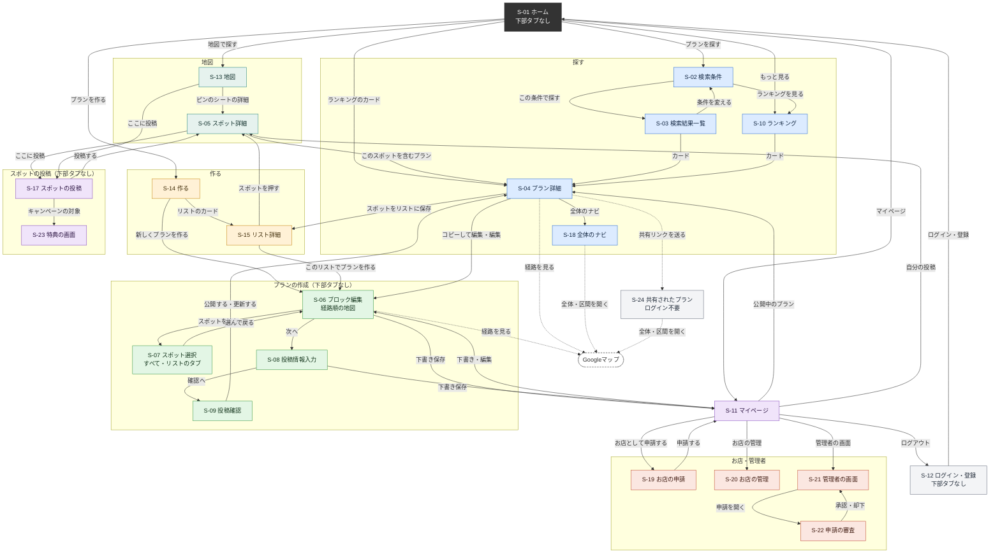

図から省いた移動

| きっかけ | 移動元 | 移動先 |
| --- | --- | --- |
| 下部タブ「地図」「探す」「作る」「マイページ」 | 6.1 の下部タブを出す画面 | S-13、S-02、S-14、S-11 |
| ヘッダーのサイト名 | S-02、S-10、S-11、S-13、S-14 | S-01 |
| ヘッダーの戻る | S-03、S-04、S-05、S-06〜S-09、S-15、S-17〜S-20、S-22、S-23 | 1つ前の画面（作成画面の中は前のステップ） |
| ログイン・登録の完了 | S-12 | 開こうとしていた画面（BR-14） |
| 「場所を探す」（S-16 を重ねて開く） | S-07、S-13、S-15、S-17、S-19 | 選んだら元の画面に戻る |
| 「リストに追加」（リストを選ぶシート） | S-05、S-13 のピンのシート、S-16 の結果 | その場でリストに入れる |

以下は目的ごとに分けた図。

#### 全体の地図

ホームの入口と下部タブから、4つの機能に移れる。ランキングは「探す」の中にある。

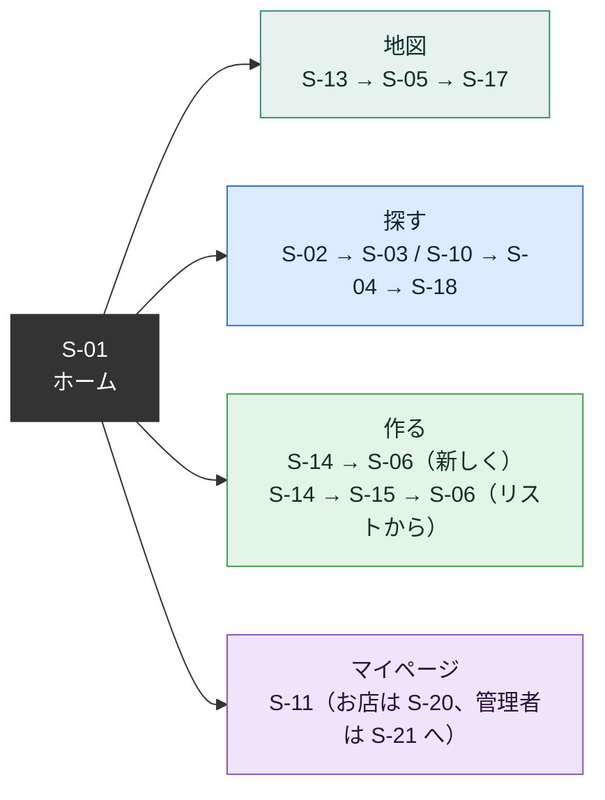

#### 地図で見つけてリストに保存する（v11）

```mermaid
flowchart LR
    S13["S-13<br>地図"]:::map
    SH["ピンのシート"]:::map
    S16["S-16<br>場所を探す"]:::map
    S05["S-05<br>スポット詳細"]:::map
    LS["リストを選ぶシート"]:::list
    S15["S-15<br>リスト詳細"]:::list

    S13 -->|写真のピンを押す| SH
    SH -->|詳細| S05
    S13 -->|検索欄| S16
    S16 -->|このサイトのスポット・場所の候補を選ぶ| SH
    SH -->|リストに追加| LS
    S05 -->|リストに追加| LS
    LS -->|入れたリストを開く| S15

    classDef home fill:#333333,stroke:#333333,color:#FFFFFF
    classDef map fill:#E6F2EE,stroke:#2F8A7E,color:#0F2E2A
    classDef search fill:#DCEBFF,stroke:#2F6FD0,color:#10243F
    classDef list fill:#FFF1D6,stroke:#C98A1B,color:#3F2C08
    classDef create fill:#E3F6E5,stroke:#3C9A4B,color:#12331A
    classDef post fill:#F0E4FA,stroke:#8A4FC0,color:#2A1240
    classDef shop fill:#FBE7E1,stroke:#C4553A,color:#3F1A10
    classDef my fill:#F0E4FA,stroke:#8A4FC0,color:#2A1240
    classDef login fill:#F3F4F6,stroke:#6B7280,color:#1F2937
    classDef ext fill:#FFFFFF,stroke:#888888,stroke-dasharray:4 3,color:#333333
```

#### プランを探す

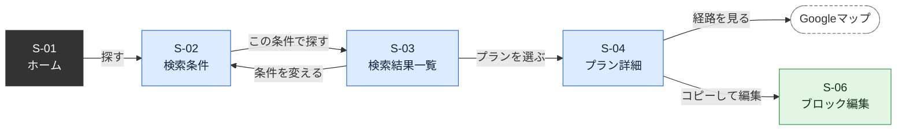

#### プランを作って公開する（v11 で変更）

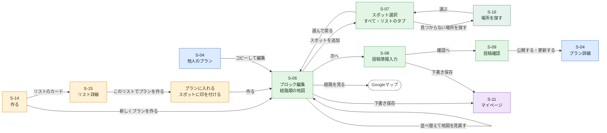

S-06、S-08、S-09 は1つの作成画面の3つのステップで、編集内容を共有する。各ステップの戻るボタンで前のステップに戻れる。

#### スポットの投稿とキャンペーン（v11）

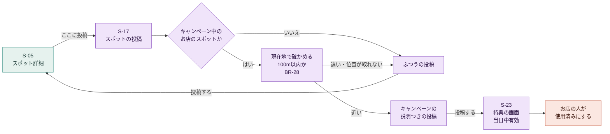

#### お店の申請と管理者の審査（v11）

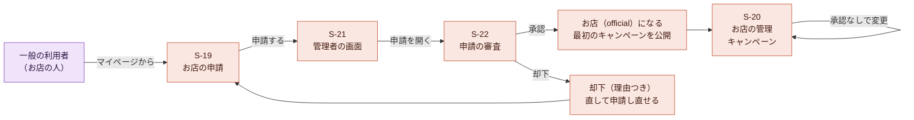

#### ランキングとマイページ

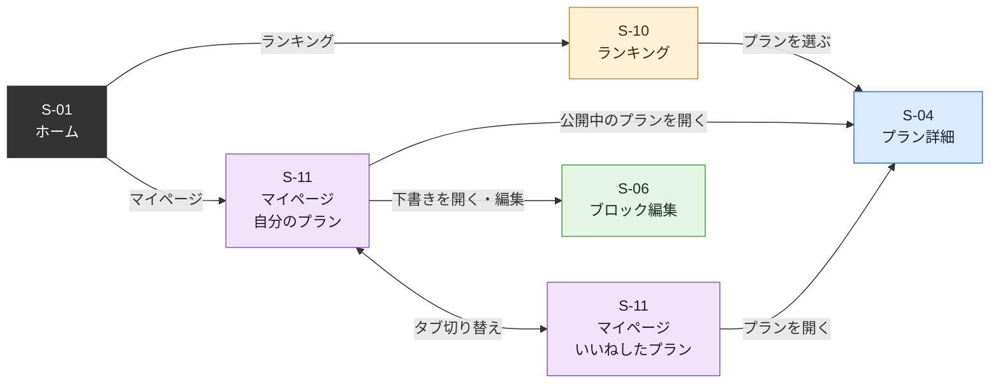

#### ログインの扱い

| 状況 | 動き |
| --- | --- |
| ログインしていない状態で、S-12 以外のURLを開いた | S-12 に移る。開こうとしたURLを `redirect` に付ける |
| S-12 でログイン・登録した | `redirect` の画面に移る。なければ S-01 |
| ログイン済みで S-12 を開いた | S-01 に移る |
| S-11 でログアウトした | S-12 に移る |

### 6.4 画面ごとの詳細

#### S-01 ホーム

下部タブは出さない（6.1）。

| 要素 | 内容 |
| --- | --- |
| ロゴ | 画面上部にアプリのロゴ（`Logo` 部品）。ロゴ画像ができるまでは、サイト名「旅ノート金沢」の文字を太字で表示する。画像ができたら `Logo` 部品の中身だけを差し替える（P-05） |
| マイページ | 右上にマイページへのアイコンボタン（CircleUser、aria-label「マイページ」）→ `/mypage` |
| 説明 | 「みんなの旅ノートから、金沢の旅を組み立てよう」 |
| ボタン | 「地図で探す」（Map）→ `/map`、「プランを探す」（Search）→ `/search`、「プランを作る」（CirclePlus）→ `/create`（v11 で変更） |
| ランキング | 見出し「定番以外ランキング」、上位3件のプランカード（順位付き）。カードを押すと S-04。「もっと見る」→ `/ranking?type=minor` |
| 出典 | 画面の一番下に、スポットデータの出典（使ったオープンデータの名前と提供元、公式観光サイト）と、地図と場所の情報の出典（「© OpenFreeMap © OpenMapTiles Data from OpenStreetMap」「場所の情報：© OpenStreetMap contributors」）を小さく表示する |

| 状態 | 表示 |
| --- | --- |
| 読み込み中 | スケルトン3枚 |
| 0件 | 「まだプランがありません」 |
| エラー | エラー表示 |

使うAPI：`getRanking({ type: 'minor', limit: 3 })`

#### S-02 検索条件

| 要素 | 内容 |
| --- | --- |
| ヘッダー | 「プランを探す」 |
| ランキング（v11） | タグ選択の上に「ランキングを見る」（Trophy）→ `/ranking?type=minor`。下部タブからランキングをなくしたため |
| タグ選択 | 「テーマ」「天気」の見出しごとにタグを並べる。タグはアイコン付きのチップで、押すと選択・解除 |
| 選択のクリア | 「選択をクリア」（1つ以上選択中のみ） |
| 下部ボタン | 「この条件で探す」。選択数があれば「（N件選択中）」を添える。0件でも押せる（全件表示） |
- URLの `tags` で選択済みの状態から始める（S-03 の「条件を変える」から戻ったとき）
- 押すと `/search/results?tags=...`（0件なら `/search/results`）へ移る

使うAPI：`getTags()`

#### S-03 検索結果一覧

| 要素 | 内容 |
| --- | --- |
| ヘッダー | 戻る（`/search?tags=...`）、「検索結果」 |
| 条件 | 選んだタグのチップ（押せない）と「条件を変える」。タグなしのときは「すべてのプラン」 |
| 件数 | 「N件のプラン」 |
| 一覧 | プランカード。カードを押すと S-04 |
| もっと見る | 次のページがあるときだけ表示 |

| 状態 | 表示 |
| --- | --- |
| 読み込み中 | スケルトン5枚 |
| 0件 | SearchX アイコン、「条件に合うプランが見つかりませんでした」、「条件を変える」ボタン |
| エラー | エラー表示 |

使うAPI：`searchPlans({ tagIds, page })`

#### S-04 プラン詳細

| 要素 | 内容 |
| --- | --- |
| ヘッダー | 戻る（ブラウザの履歴で戻る。履歴がなければ `/`）。右側は作成者本人のときだけメニュー（EllipsisVertical）：「編集」「非公開に戻す」（公開中のみ） |
| タイトル | タイトル。下書きなら「下書き」ラベル |
| 作成者 | 「〇〇さんのプラン」、公開日 |
| コピー元 | コピー元があれば「〇〇さんのプランをもとに作成」（押すとコピー元の S-04） |
| タグ | タグのチップ |
| いいね | Heart アイコンと数。押すといいね・取り消し（BR-08）。本人のプランは数だけ |
| 操作 | 「全体のナビ」（Navigation）→ `/plans/:planId/navi`（v11）、「コピーして編集」（Copy）→ `/plans/new?step=blocks&from=:planId`、「スポットをリストに保存」（ListPlus、v11、BR-18）、「共有」（Share2、本人のみ、v11、BR-30） |
| 経路順の地図 | ブロックの上に、経路順の地図（`RouteMap`、表示だけ。BR-22）。初めは閉じておき、「経路順を地図で見る」（Route）で開く（v11） |
| ブロック | ブロック一覧（表示モード）。スポットブロックのスポット名を押すと S-05。キャンペーン中のお店には「キャンペーン中」のラベル（v11）。移動手段ブロックの「経路を見る」でGoogleマップを新しいタブで開く |

| 状態 | 表示 |
| --- | --- |
| 読み込み中 | スケルトン |
| 見つからない（削除済み、非公開、他人の下書き） | 「このプランは見つかりません」とホームへのボタン |
| エラー | エラー表示 |

| 操作 | 結果 |
| --- | --- |
| 非公開に戻す | 確認ダイアログ → `unpublishPlan` → トースト「非公開にしました」→ そのまま下書きとして表示 |
| 編集 | `/plans/:planId/edit?step=blocks` |
| スポットをリストに保存 | 新しいリストを作ってスポットを入れる → トースト「リスト『〇〇』に保存しました」と「開く」→ S-15 |

使うAPI：`getPlan(planId)`、`hasLiked(planId)`、`likePlan`、`unlikePlan`、`unpublishPlan`、`createListFromSpots`

#### S-06 ブロック編集（step=blocks）

| 要素 | 内容 |
| --- | --- |
| ヘッダー | 戻る（未保存なら確認、BR-15）、「プランを作成」または「プランを編集」、右に「ブロック N/30」 |
| コピー中の表示 | コピーして作るときは「〇〇さんのプランをもとに作成中」 |
| リストの表示 | リストから作るときは「リスト『〇〇』から作成中」（v11） |
| スポットブロック | キャンペーン中のお店には「キャンペーン中」のラベル（v11、BR-27） |
| 経路順の地図 | ブロックの上に、経路順の地図（`RouteMap`、BR-22）。画面の作りは下の「S-06 の地図の部分」（v11） |
| ブロック | ブロック一覧（編集モード）（7.5） |
| 追加ボタン | 「スポットを追加」（Plus）→ S-07 を開く、「コメントを追加」（Plus）→ 末尾にコメントブロックを追加して入力欄にカーソル。30個に達したら押せなくし「ブロックは30個までです」 |
| 下部ボタン | 「下書き保存」（Save。公開中のプランの編集では出さない）、「次へ」（ArrowRight）→ `step=info` |

| 操作 | 結果 |
| --- | --- |
| スポットブロックのつまみを長押ししてドラッグ | 並べ替え。移動手段は BR-04 で付け直す。経路順の地図と直線距離の合計をすぐ直し、前の並びとの差を出す（BR-22） |
| 上へ・下へボタン | 1つずつ移動 |
| 削除ボタン | 確認なしで削除 |
| 移動手段ブロックのラベルを押す | 4つの移動手段の選択肢（アイコン付き）を表示し、選ぶと変更 |
| 経路順の地図のピンを押す | そのスポットブロックまでスクロールし、少しの間ブロックを目立たせる |
| 経路を見る | Googleマップを新しいタブで開く |
| 下書き保存 | 保存 → トースト「下書きを保存しました」→ `/mypage?tab=mine` |
| 次へ | `step=info` |

| 状態 | 表示 |
| --- | --- |
| ブロックが0個 | MapPin アイコン、「スポットを追加して旅の流れを作りましょう」。経路順の地図は出さない |
| スポットが1つ | 経路順の地図にピンを1つ出し、合計は出さない |
| 編集するプランの読み込み中 | スケルトン |
| 他人のプランの編集URL、存在しないプラン | 「このプランは編集できません」とホームへのボタン |

S-06 の地図の部分（v11）

K54 で決定。地図の部分に常に出すものは、左上の直線距離と、右下の「i」「地図を閉じる」だけにする。説明の文は「i」ボタンで開く。

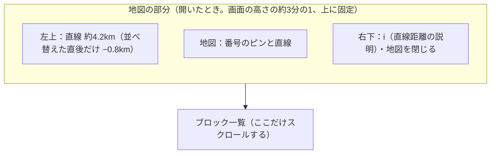

| 部分 | 内容 |
| --- | --- |
| 開け閉め | 初めは開いておく。「地図を閉じる」で細い帯（「直線 約4.2km」と「地図を開く」）になる。開け閉めはこの端末に覚える |
| 固定 | 開いているときは画面の上に固定し、ブロック一覧だけがスクロールする（並べ替えた結果がすぐ見えるように） |
| 左上の札 | 「直線 約N.Nkm」。並べ替えた直後だけ差（−0.8km）を添える |
| i ボタン | 「直線距離です。実際の道のりや時間は、各区間の『経路を見る』で確かめてください」 |

使うAPI：`getPlan(planId)`（編集時、コピー時）、`getList(listId)`（リストから作るとき）、`savePlan`

#### S-07 スポット選択

S-06 の上に画面いっぱいに出すシートとして表示する。v11 で、登録されたすべてのスポットから選び、リストに保存したものを見分けられる形にした（K31、K56 で決定、BR-18）。

| 要素 | 内容 |
| --- | --- |
| 見出し | 「スポットを追加」、閉じる（X） |
| タブ | 「すべて」「リスト」の2つ（K56）。初めは「すべて」。リストから作ったプランでは「リスト」で、そのリストを選んだ状態から始める |
| 見え方の切り替え | 「一覧」「地図」の2択（見出しの右の小さな切り替え。初めは一覧）。どちらのタブでも使える |
| 「すべて」タブ | 登録されたすべてのスポット。エリアごと（エリアのない利用者のスポットは「その他」）に並べる。リストに保存したスポットには、Bookmark のアイコンと保存しているリストの名前（「冬の金沢 1日目」など。2つ以上なら「冬の金沢 1日目 ほか1件」）を出し、行の背景を `--color-list-highlight` にする |
| 「リスト」タブ | 自分のリストに保存したスポットだけ。上にリストのチップ（「すべてのリスト」と各リストの名前）を並べ、選んだリストのスポットにする。行には保存しているリストの名前を出す |
| 絞り込み | 「スポット名で絞り込み」（画面の中で絞り込む）、「定番以外だけ」。どちらのタブでも使える |
| 一覧の行 | 写真（小さな丸。写真がなければ縁の色だけの丸）、スポット名、定番・起点・デモ・キャンペーン中のラベル、紹介文か住所（1行で省略） |
| 地図 | `MapView`。「すべて」タブでは写真のピン（BR-24）に加え、リストに保存したスポットのピンを大きくして Bookmark の札を付ける。「リスト」タブでは、そのリストのスポットだけを出す。ピンを押すと下に小さなシート（名前、保存しているリスト、「追加する」） |
| 場所を探す | 一覧の下に「見つからない場所を探す」（Search）→ S-16。選んだ候補はスポットとして登録してからプランに加える（BR-20） |

- 使用中止のスポットは出さない（リストに入っていれば、「リスト」タブにだけ「使用中止」として押せない形で出す）
- 押したスポットを末尾に追加してシートを閉じ、追加したブロックまでスクロールする
- 直前のスポットと同じものは押せなくし、「直前と同じスポットは続けて追加できません」と表示する
- 地図に出ないスポット（写真のないスポット、K50）も、一覧には出す

| 状態 | 表示 |
| --- | --- |
| リストに保存したスポットがない | 「リスト」タブに Bookmark アイコンと「リストに保存したスポットはありません」 |
| 読み込み中 | スケルトン |
| エラー | エラー表示 |

使うAPI：`getSpots()`、`getLists()`、`registerSpot`

#### S-08 投稿情報入力（step=info）

| 要素 | 内容 |
| --- | --- |
| ヘッダー | 戻る（`step=blocks`）、「投稿情報」 |
| タイトル | 入力欄、「N/50」。コピー時は例文に元のタイトルを表示 |
| タグ | S-02 と同じタグ選択の部品 |
| 写真 | スポットブロックごとに、スポット名と、写真の縮小表示または「写真を追加」（ImagePlus）。写真があれば「変更」「削除」 |
| 下部ボタン | 「下書き保存」（公開中のプランの編集では出さない）、「確認へ」→ `step=confirm` |
- 写真は選んだ時点で縮小してアップロードし、終わるまで回転アイコンを表示する（BR-13）
- 入力の確認はここでは行わず、S-09 でまとめて表示する

使うAPI：`getTags()`、`uploadPlanImage`、`savePlan`

#### S-09 投稿確認（step=confirm）

| 要素 | 内容 |
| --- | --- |
| ヘッダー | 戻る（`step=info`）、「投稿内容の確認」 |
| 確認結果 | 公開条件（BR-06）を満たさない項目があれば、CircleAlert アイコン付きで一覧表示し、項目ごとに直すステップへ移るボタン（「ブロック編集へ」「投稿情報へ」） |
| プレビュー | S-04 と同じ見た目でタイトル、タグ、ブロックを表示（いいね、コピー、メニューは出さない） |
| 下部ボタン | 新規・下書きなら「公開する」（Send）、公開中のプランの編集なら「更新する」。確認結果に問題があれば押せない |

| 操作 | 結果 |
| --- | --- |
| 公開する・更新する | 保存 → 一時保存を消す → トースト「公開しました」または「更新しました」→ `/plans/:planId`（履歴を置き換え、戻るで作成画面に戻らないようにする） |
| 保存時にデータベース側の確認で失敗 | 確認結果の一覧にその内容を表示 |

使うAPI：`savePlan`

#### S-10 ランキング

| 要素 | 内容 |
| --- | --- |
| ヘッダー | 「ランキング」 |
| 切り替え | 「総合」「定番以外」の2択（URLの `type`） |
| 説明 | 定番以外のとき「定番スポット以外を含むプランのランキングです」 |
| 一覧 | 順位付きのプランカード（最大20件） |

| 状態 | 表示 |
| --- | --- |
| 読み込み中 | スケルトン5枚 |
| 0件 | Trophy アイコン、「まだランキングに入るプランがありません」 |
| エラー | エラー表示 |

使うAPI：`getRanking({ type, limit: 20 })`

#### S-11 マイページ

見た目は 7.7（雪の茶屋街）。要素と動きは次のとおり。

| 要素 | 内容 |
| --- | --- |
| 背景 | 夕暮れの雪の茶屋街（空、両側の町家の格子、提灯の灯り）。雪が降り続ける（7.7） |
| ヘッダー | 「マイページ」、左にサイト名、右に「ログアウト」（LogOut）→ ログアウトして S-12 へ |
| 利用者 | 丸い顔（表示名の最初の1文字）、「〇〇さん」（表示名）、時間に合わせたあいさつの吹き出し（5〜11時「おはようございます」、11〜17時「こんにちは」、それ以外「こんばんは」） |
| 検索の入口 | Search アイコンと「探す」。押すと `/search` |
| 切り替え | 「自分のプラン」「いいねしたプラン」「自分の投稿」の3択（URLの `tab`。`mine`、`liked`、`posts`）（v11 で「自分の投稿」を追加） |
| お店・管理者の入口（v11） | 利用者の下に、種類に合わせて1つ出す。一般：「お店として申請する」（Store）→ `/official/apply`。審査中なら「申請を審査中です」、却下されたら「申請が却下されました（理由）」と「申請し直す」。お店：「お店の管理」（Store）→ `/official`。管理者：「管理者の画面」（ShieldCheck）→ `/admin` |
| 一覧 | 写真のカード（7.7）の格子。1枚目は横いっぱい、2枚目からは2列。2枚目以降が奇数のときは、最後の1枚も横いっぱい |
| 自分のプラン | 更新日時の新しい順。カード左上に「公開中」（Globe）または「下書き」（FilePen）のラベル。カード右上のメニュー（EllipsisVertical）：「編集」「非公開に戻す」（公開中のみ）「削除」 |
| いいねしたプラン | いいねした日時の新しい順。カード右上の Heart ボタンで取り消し（一覧から消える） |
| 自分の投稿（v11） | 投稿日時の新しい順。写真のカード（`PlanTile` と同じ形。写真は投稿の1枚目、下敷きにスポット名とひとことの1行目）。非表示にされた投稿は「管理者が非表示にしました」のラベル。有効な特典があれば「特典を見る」（Ticket）→ S-23。カード右上のメニュー：「編集」「削除」 |
| 浮かぶボタン | 「プランを作る」（CirclePlus）。下部タブの上に固定し、押すと `/create`（v11 で変更） |
| 食べ歩き | 浮かぶボタンの右に、Utensils と「食べ歩き」の丸いステッカー。押すとタグ「食事」で検索（`/search/results?tags=1`） |

| 操作 | 結果 |
| --- | --- |
| 公開中のカードを押す | S-04 |
| 下書きのカードを押す | `/plans/:planId/edit?step=blocks` |
| 非公開に戻す | 確認ダイアログ → トースト「非公開にしました」 |
| 削除 | 確認ダイアログ（「このプランを削除します。元に戻せません。」、赤いボタン「削除する」）→ トースト「削除しました」 |

| 状態 | 表示 |
| --- | --- |
| 読み込み中 | 写真のカードの形をしたすりガラスの枠3つ（1つ目は横いっぱい） |
| 自分のプランが0件 | すりガラスの箱の中に、Inbox アイコン、「まだプランがありません」、「プランを作る」ボタン |
| いいねしたプランが0件 | すりガラスの箱の中に、Heart アイコン、「いいねしたプランはまだありません」、「プランを探す」ボタン |
| 自分の投稿が0件 | すりガラスの箱の中に、Camera アイコン、「まだ投稿がありません」、「地図でスポットを探す」ボタン |
| エラー | すりガラスの箱の中に、エラー表示 |

使うAPI：`getMyPlans()`、`getLikedPlans()`、`getMySpotPosts()`、`getMyApplication()`、`getTags()`、`unpublishPlan`、`deletePlan`、`unlikePlan`、`deleteSpotPost`、`signOut`

#### S-12 ログイン・登録

| 要素 | 内容 |
| --- | --- |
| 背景 | 雪の茶屋街（`SnowScene`、7.7） |
| ヘッダー | 「ログイン」または「新規登録」。戻るボタンはない（ログイン必須のため） |
| ロゴ | 画面上部に縦書きの題字。右に雪の結晶の飾り（Snowflake）、`Logo` 部品、朱色の落款「金沢」。左に「みんなの旅ノートから、金沢の旅を組み立てよう」（6.5 の `homeLead`）を「、」の後ろで2行に分けて置く |
| 切り替え | 「ログイン」「新規登録」の2択（URLの `mode`） |
| ログイン | メールアドレス、パスワード、「ログイン」ボタン（LogIn） |
| 新規登録 | 表示名、メールアドレス、パスワード（「8文字以上」と表示）、「登録する」ボタン（UserPlus） |
| 案内 | 「パスワードを忘れた場合は、チームに連絡してください」。すりガラスの箱の下に置く |

- 切り替え、入力欄、ボタンは、1つのすりガラスの箱に入れる（7.7）
- 入力の誤りは各入力欄の下に表示する（BR-05）。送れなかったときは、最初に誤りのある入力欄にカーソルを移す。誤りのある欄を直しはじめたら、その欄の誤りの文を消す
- パスワードの入力欄の右端に、文字を見せる・隠すを切り替えるボタン（Eye / EyeOff、読み上げは「パスワードを表示する」）を置く
- 入力欄で Enter を押すと次の入力欄へ進む。パスワードの欄で押すと送る
- 送れなかったとき、対応している端末（Android など）では短く2回震わせる
- 送ったあと、結果が出るまで金沢の大樋焼の茶碗でお抹茶を点て、金箔を浮かべる絵（`TeaScene`、7.7）を画面全体に出し、「加賀の一服を点てています」と表示する。点て終えたら「お待たせしました」に変える。絵は、画面のどこかをタップする、「スキップ」ボタン（ArrowRight）を押す、Esc キーを押す、のどれかでスキップできる。スキップすると、ログインが終わりしだいすぐ次の画面へ移る（ログインの途中なら、終わるまで絵を出したまま待つ）。スキップしなければ、ログインがすぐ終わっても絵は最後まで見せる（約4.5秒）。失敗したら絵を閉じて、入力に戻る
- 成功したらトースト「ログインしました」または「登録しました」を出し、`redirect` の画面（なければ `/`）へ移る
- ログイン済みで開いた場合は S-01 へ移る

| 失敗 | メッセージ |
| --- | --- |
| メールアドレスかパスワードが違う | メールアドレスまたはパスワードが違います |
| 登録済みのメールアドレス | このメールアドレスはすでに登録されています |
| パスワードが短い | パスワードは8文字以上で入力してください |

使うAPI：`signIn`、`signUp`

#### S-05 スポット詳細（v11）

K37 で決定。

| 要素 | 内容 |
| --- | --- |
| ヘッダー | 戻る、スポット名 |
| 種類 | 「定番」「定番以外」「起点」のラベル。キャンペーン中なら「キャンペーン中」（Ticket） |
| 小さな地図 | スポットの位置にピン1つ（`MapView`、動かせない。高さ160px）。押すと `/map?spot=:spotId` |
| 情報 | 紹介文（登録済みスポット）、住所（利用者のスポット）、エリア |
| 操作 | 「リストに追加」（BookmarkPlus）→ リストを選ぶシート、「ここに投稿」（Camera）→ `/posts/new?spot=:spotId`（K37 で、Googleマップで開くボタンは置かないと決定） |
| キャンペーン | キャンペーン中なら、画像、題名、特典の内容、お知らせ文、期間。「お店の近くからこのスポットに投稿すると受けられます」と添える（BR-28） |
| 投稿 | スポットの投稿（`SpotPostCard`）を新しい順に20件ずつ、「もっと見る」で次の20件。キャンペーンで投稿したものには「キャンペーン参加」のラベル |
| このスポットを含むプラン | 公開中のプランのうち、このスポットを含むものを、いいね数の多い順に最大5件（`PlanCard`） |
| 出典 | 利用者のスポットは「場所の情報：© OpenStreetMap contributors」 |

| 状態 | 表示 |
| --- | --- |
| 読み込み中 | スケルトン |
| 見つからない | 「このスポットは見つかりません」とホームへのボタン |
| 使用中止 | 「このスポットは使用中止です」の注意を上に出す。「リストに追加」「ここに投稿」は押せない |
| 投稿が0件 | Camera アイコン、「まだ投稿がありません。行ったら最初の投稿をしてみませんか」 |
| エラー | エラー表示 |

使うAPI：`getSpot(spotId)`、`getSpotPosts({ spotId, page })`、`getPlansBySpot(spotId)`、`getLists()`、`addSpotToList`

#### S-13 地図（v11）

| 要素 | 内容 |
| --- | --- |
| ヘッダー | 左にサイト名、「地図」 |
| 検索欄 | 地図の上に丸い検索欄「スポットを探す」（Search）。押すと S-16 |
| 絞り込み | 検索欄の下に「定番以外だけ」の切り替えのチップ（URL の `minor=1`） |
| 地図 | 金沢市の地図（`MapView`、BR-24）。使用中のスポットのピン |
| ピンのシート | ピンを押すと下からシート。スポット名、種類のラベル、紹介文か住所、投稿の写真（最大5枚を横に並べる）、「詳細」→ S-05、「リストに追加」（BookmarkPlus）、「ここに投稿」（Camera） |
| 現在地 | 右下に「現在地」（LocateFixed）。押したときだけ端末の現在地を使い、金沢市の中なら移動する。外なら「現在地が金沢市の外です」。保存も送信もしない |

- ピンを選ぶと URL の `spot` を変える（戻るでシートを閉じられる。共有したURLを開くと同じピンが選ばれる）
- 初めは金沢市の中心（金沢駅と兼六園の間）を、主な観光地が入る大きさで出す

| 状態 | 表示 |
| --- | --- |
| 読み込み中 | 地図の上に回転アイコン |
| 地図の失敗 | 「地図を読み込めませんでした」と再読み込みボタン |
| スポットの読み込み失敗 | トーストで通信エラー。地図はそのまま |

使うAPI：`getSpots()`、`getSpotPosts`（シートの写真）、`getLists()`、`addSpotToList`

#### S-14 作る（v11）

下部タブ「作る」の画面。プランの作り方を選ぶ（BR-18、K31）。

| 要素 | 内容 |
| --- | --- |
| ヘッダー | 左にサイト名、「作る」 |
| 新しく作る | 大きなボタン「新しくプランを作る」（CirclePlus）と説明「地図にあるすべてのスポットから選んで作ります。リストに保存した場所は上に出ます」→ `/plans/new` |
| リストから作る | 見出し「リストから作る」と「新しいリスト」（ListPlus）。リストのカード（`ListCard`）：名前、スポットの数、最初の3スポットの名前、更新日。更新の新しい順。押すと S-15 |
| そのほか | 「プランを探してコピーする」→ `/search`、「下書きの続きを書く」→ `/mypage?tab=mine` |

| 状態 | 表示 |
| --- | --- |
| リストが0件 | 「リストから作る」の下に、Bookmark アイコン、「行きたい場所をリストに保存すると、ここからプランを作れます」、「地図で探す」ボタン |
| 読み込み中 | リストの部分にスケルトン3枚 |
| エラー | リストの部分にエラー表示（「新しく作る」は使える） |

使うAPI：`getLists()`、`createList`

#### S-15 リスト詳細（v11）

| 要素 | 内容 |
| --- | --- |
| ヘッダー | 戻る、リストの名前、右にメニュー（EllipsisVertical）：「名前を変える」「リストを削除」 |
| 地図 | リストのスポットのピン（`MapView`、番号は付けない）。高さは画面の約3分の1 |
| 一覧 | スポットの行：スポット名、種類のラベル、紹介文か住所。行を押すと S-05。右に「リストから外す」（X） |
| 追加 | 「場所を探して追加」（Search）→ S-16、「地図で探す」→ `/map` |
| プランを作る | 下部に固定の「このリストでプランを作る」（CirclePlus）。押すと、スポットに印を付ける画面に切り替わる（初めは全部に印。印は2つ以上で「作る」を押せる。1つでも作れるが、公開にはスポットが2つ必要と添える）→ `/plans/new?step=blocks&list=:listId&spots=...` |

| 操作 | 結果 |
| --- | --- |
| リストから外す | 確認なしで外し、トースト「外しました」と「元に戻す」（3秒） |
| リストを削除 | 確認ダイアログ「このリストを削除します。このリストから作ったプランは残ります。」→ S-14 |

| 状態 | 表示 |
| --- | --- |
| スポットが0件 | MapPin アイコン、「スポットがありません」、「場所を探して追加」ボタン。「このリストでプランを作る」は押せない |
| 見つからない・他人のリスト | 「このリストは見つかりません」とホームへのボタン |
| 読み込み中・エラー | スケルトン・エラー表示 |

使うAPI：`getList(listId)`、`renameList`、`deleteList`、`removeSpotFromList`、`addSpotToList`

#### S-16 場所を探す（v11）

元の画面の上に画面いっぱいに重ねて出す。URL は変えない。

| 要素 | 内容 |
| --- | --- |
| 見出し | 戻る（ArrowLeft）、検索欄「スポット名を入力」 |
| このサイトのスポット | 入力するたびに、このサイトのスポット（`getSpots()` の結果）を画面の中で絞り込んで最大10件。スポット名、種類のラベル、紹介文か住所 |
| 場所を探す | 一覧の下に「見つからないときは：OpenStreetMap で探す」（Search）ボタン。押したときだけ Nominatim で探す（BR-19）。押したあと1秒は押せない |
| 場所の候補 | 名前、場所の種類、住所（短くしたもの）。すでにこのサイトにある場所（`osm_ref` が同じ）は、このサイトのスポットとして出す |
| 出典 | 候補の下に「場所の情報：© OpenStreetMap contributors」 |

- 候補を選ぶと BR-20 の確かめを行う。近くに同じ名前のスポットがあればそれに置き換え、近くに別のスポットがあれば「近くに〇〇があります」と先に見せる
- 選んだあとの動きは開いた元の画面が決める（S-13 はピンのシート、S-07 はリストに入れてプランに追加、S-15 はリストに追加、S-17 は投稿するスポット、S-19 はお店のスポット）
- 登録はこの時点では行わず、選んだ元の画面で「リストに追加」などを押したときに行う

| 状態 | 表示 |
| --- | --- |
| 入力なし | 「スポット名を入れてください（例：にし茶屋街、鈴木大拙館）」 |
| このサイトのスポットが0件 | 「このサイトには見つかりませんでした」と「OpenStreetMap で探す」ボタンを目立たせる |
| 候補が0件 | SearchX、「見つかりませんでした。名前を変えて探してください。見つからない場所は、チームに連絡してください」 |
| 金沢市の外だけ見つかった | 「金沢市の中の場所だけ登録できます」 |
| 検索を止めている | 「現在、場所の検索は利用できません」（BR-19） |
| 検索の失敗 | 「場所の検索に失敗しました。時間をおいてもう一度お試しください」 |

使うAPI：`getSpots()`、`searchPlaces(query)`

#### S-17 スポットの投稿（v11）

| 要素 | 内容 |
| --- | --- |
| ヘッダー | 戻る（入力中なら確認）、「スポットを投稿」または「投稿を編集」 |
| 位置の確認（キャンペーン中のお店のスポットを選んだとき） | 「キャンペーン中のお店です。お店の近くにいれば特典を受けられます」と「現在地で確かめる」（LocateFixed）。押す前に位置の使い方の説明（BR-28）。確かめた結果（対象・対象外と約Nm）を出す |
| キャンペーン | 対象と分かったときだけ、上に出す（`CampaignPanel`）：画像、題名、特典の内容、お知らせ文、説明、「投稿すると特典の画面が出ます。お店の人に見せてください」。そのあと「この投稿は『キャンペーン参加』と表示されます」と小さく添える（BR-28） |
| スポット | 選んだスポットの名前。未選択なら「スポットを選ぶ」→ S-16。編集のときは変えられない |
| 写真 | 「写真を追加」（ImagePlus）。1〜4枚。選んだ時点で縮小してアップロード（BR-13）。並べた写真に「削除」。写真の注意（BR-21） |
| ひとこと | 入力欄、「N/300」 |
| 下部ボタン | 「投稿する」（Send）または「更新する」。スポット、写真1枚以上、ひとことがそろうまで押せない |

| 操作 | 結果 |
| --- | --- |
| 投稿する | 保存（必要ならスポットの登録も、BR-20）→ トースト「投稿しました」→ キャンペーンの対象者なら S-23、そうでなければ S-05（履歴を置き換え） |
| 更新する | 保存 → トースト「更新しました」→ S-05 |

| 状態 | 表示 |
| --- | --- |
| お店が自分のお店のスポットを選んだ | 「自分のお店のスポットには投稿できません」 |
| 使用中止のスポット | 「このスポットには投稿できません」 |
| 他人の投稿の編集URL | 「この投稿は編集できません」とホームへのボタン |

使うAPI：`getSpot`、`checkCampaignEligibility`、`uploadSpotPostImage`、`registerSpot`、`saveSpotPost`、`getSpotPost(postId)`（編集）

#### S-18 全体のナビ（v11）

K29 で決定（BR-23）。

| 要素 | 内容 |
| --- | --- |
| ヘッダー | 戻る、「全体のナビ」 |
| プラン | タイトル、スポットの数、経路順の地図（`RouteMap`、表示だけ。高さ160px） |
| 全体を1本で開く | 移動手段の選択（徒歩・車・自転車。初めは徒歩）、出発地の選択（「最初のスポットから」「現在地から」）、「全体をGoogleマップで開く」（Map）。経由地が9か所を超えるときは「1〜11番目を開く」「11〜15番目を開く」のように分けたボタン。「スマホではGoogleマップのアプリで開いてください」の案内。「バスは区間ごとに開いてください」と添える |
| 区間ごと | 「1 金沢駅 → 2 近江町市場」の行を順に並べる。プランの移動手段のアイコンと名前、「開く」（Navigation）。区間の間のコメントブロックは小さく表示 |

- スポットが1つのプランは「スポットが2つ以上のプランで使えます」

使うAPI：`getPlan(planId)`

#### S-24 共有されたプラン（v11）

共有リンク（BR-30）を開いた人に見せる。ログインしていなくても見られる。

| 要素 | 内容 |
| --- | --- |
| ヘッダー | サイト名（ロゴ）、「共有されたプラン」 |
| プラン | タイトル、「〇〇さんのプラン」、タグ、経路順の地図、ブロック一覧（表示モード）、区間の「経路を見る」 |
| 全体のナビ | S-18 と同じ「全体を1本で開く」と区間ごとの URL |
| 案内 | ログインしていない人には「旅ノート金沢に登録すると、このプランをコピーして自分のプランを作れます」と「ログイン・登録」→ S-12（戻り先は S-04 ではなく `/shared/:token`） |

| 状態 | 表示 |
| --- | --- |
| 共有が止められた・リンクが違う | 「このプランは共有されていません」 |

使うAPI：`getSharedPlan(token)`

### 6.5 共通のメッセージ

画面をまたいで使う文言は `src/constants/messages.ts` にまとめ、各画面で書き換えない。

| 種類 | 文言 |
| --- | --- |
| 通信エラー | 通信に失敗しました。電波の良いところでもう一度お試しください |
| 想定外のエラー | エラーが発生しました。時間をおいてもう一度お試しください |
| ログインの期限切れ | ログインの有効期限が切れました。もう一度ログインしてください |
| 権限がない | この操作はできません |
| 再読み込みボタン | もう一度読み込む |
| 未保存の確認 | 編集内容が保存されていません。移動しますか？ |
| 復元の確認 | 前回の編集内容を復元しますか？ |
| 非公開の確認 | このプランを非公開にします。検索やランキングに表示されなくなります。 |
| 削除の確認 | このプランを削除します。元に戻せません。 |
| （v11）リストの削除の確認 | このリストを削除します。このリストから作ったプランは残ります。 |
| （v11）投稿の削除の確認 | この投稿を削除します。元に戻せません。 |
| （v11）リストに入れた | リスト「〇〇」に入れました |
| （v11）すでにリストにある | リストに入っています |
| （v11）場所の検索の停止 | 現在、場所の検索は利用できません |
| （v11）場所の検索の失敗 | 場所の検索に失敗しました。時間をおいてもう一度お試しください |
| （v11）金沢市の外 | 金沢市の中の場所だけ登録できます |
| （v11）見られないページ | このページは見られません |
| （v11）写真の注意 | 人の顔がはっきり写った写真や、他の人が撮った写真は載せないでください。生成AIで作った画像は載せないでください |
| （v11）直線距離の注意 | 直線距離です。実際の道のりは「経路を見る」で確かめてください |

### 6.6 お店と管理者の画面（v11、第3段階）

ここに書く画面は第3段階（I-36〜I-40）で作る。業務ルールは BR-25〜BR-29。

#### S-19 お店の申請

| 要素 | 内容 |
| --- | --- |
| ヘッダー | 戻る、「お店として申請する」 |
| 説明 | 「金沢市内のお店・施設の方は、申請して承認されると、キャンペーンを載せられます。審査は金沢市の担当者（管理者）が行います」 |
| お店のスポット | 「スポットを選ぶ」→ S-16。すでにお店があるスポットは選べない |
| お店の情報 | お店の名前（30文字まで）、お店の紹介（300文字まで） |
| 担当者 | 担当者の名前（30文字まで）、メールアドレス、電話番号。「ほかの利用者には表示しません」と添える |
| 最初のキャンペーン（任意） | 「キャンペーンも一緒に申請する」を選ぶと、BR-27 の項目の入力欄を出す（`CampaignForm`） |
| 同意 | 「投稿の内容への頼み（良いことを書いてなど）をしない」「画像は権利を持つものだけを使い、生成AIで作った画像を使わない」の2つに印を付ける |
| 下部ボタン | 「申請する」（Send）→ 確認ダイアログ → トースト「申請しました」→ `/mypage` |

- 審査中の申請があるときは、この画面に「審査中です」と出し、入力欄は出さない
- 却下されたあとに開くと、前の内容を入れた状態から始める

使うAPI：`getMyApplication()`、`submitApplication`、`uploadCampaignImage`

#### S-20 お店の管理

| 要素 | 内容 |
| --- | --- |
| ヘッダー | 戻る、「お店の管理」 |
| お店 | お店の名前、スポット名（押すと S-05）、紹介。「お店の情報を変える」（名前と紹介。承認はいらない） |
| 停止中 | お店が停止されていれば「管理者がお店を停止しました（理由）」を上に出し、キャンペーンを使えなくする |
| キャンペーン | 今のキャンペーン（状態：予定・実施中・終了・管理者が停止）。「キャンペーンを作る」「変える」「終える」（`CampaignForm`）。承認はいらない（BR-27） |
| 実績 | このキャンペーンで出した特典の数、使用済みの数（数だけ。誰が受けたかは出さない） |

- 特典の対象になるのは、お店のスポットから100m以内で投稿した人（BR-28）。お店のスポットの位置がずれていると対象にならないので、「スポットの位置が違うときは管理者に連絡してください」と出す

使うAPI：`getMyShop()`、`updateShop`、`saveCampaign`、`endCampaign`、`uploadCampaignImage`

#### S-21 管理者の画面

| 要素 | 内容 |
| --- | --- |
| ヘッダー | 戻る、「管理者の画面」 |
| 切り替え | 「申請」「お店」「投稿」の3択（URL の `tab`） |
| 申請 | 審査中を古い順、その下に審査済みを新しい順。お店の名前、スポット名、申請日。押すと S-22 |
| お店 | お店の一覧：名前、スポット名、状態、今のキャンペーンの題名。メニュー：「お店を停止」「再開」「キャンペーンを停止」「再開」（理由を書くダイアログ） |
| 投稿 | スポットの投稿を新しい順に20件ずつ。メニュー：「非表示にする」「再表示する」。スポット名を押すと S-05 のメニューから「スポットを使用中止にする」 |

使うAPI：`getApplications()`、`getShops()`、`getAllSpotPosts({ page })`、`setShopStatus`、`setCampaignStatus`、`setSpotPostHidden`、`setSpotActive`

#### S-22 申請の審査

| 要素 | 内容 |
| --- | --- |
| ヘッダー | 戻る、「申請の審査」 |
| 内容 | 申請の全項目（担当者と連絡先を含む）、スポットの小さな地図、最初のキャンペーンのプレビュー（S-17 と同じ見た目） |
| 操作 | 「承認する」（Check）、「却下する」（X、理由の入力が必須） |

- 承認・却下のあとはトーストを出して S-21 に戻る。審査済みの申請はボタンを出さず結果だけを出す

使うAPI：`getApplication(applicationId)`、`reviewApplication`

#### S-23 特典の画面

| 要素 | 内容 |
| --- | --- |
| ヘッダー | 戻る、「特典」 |
| 特典 | お店の名前、特典の内容（大きく）、キャンペーンの題名、受け取った日時、「本日 23:59 まで有効」（BR-28） |
| 動く表示 | 現在の時刻（秒まで）と、ゆっくり回る模様。画面の写真ではないことをお店の人が確かめるため |
| 使用済みにする | 「お店の人が押してください：使用済みにする」→ 確認ダイアログ → 「使用済み」と使った日時を表示 |

| 状態 | 表示 |
| --- | --- |
| 有効期限切れ | 「この特典の有効期限が切れました」 |
| 使用済み | 「使用済み（日時）」 |
| 他人の特典 | 「この特典は見られません」 |

使うAPI：`getReward(rewardId)`、`useReward(rewardId)`


## 7. UIデザインルール

### 7.1 基本方針

| ルール | 内容 |
| --- | --- |
| 絵文字を使わない | 画面の文字、ボタン、入力欄の例文、通知、サンプルデータのすべてで使わない |
| アイコンは Lucide だけ | lucide-react のみ。他のアイコン集、自作SVG、画像のアイコンを混ぜない |
| 生成AIで作った画像を使わない | 授業の生成AI利用のガイドラインにより、生成AIで作った画像をアプリに載せない。ロゴや写真は人が作る・撮る |
| 左線のアクセントカードを使わない | カードの左側だけに色線を引くデザイン（`border-left` での強調）を使わない。上側だけの色線や `box-shadow` での代用もしない |
| 共通の値だけを使う | 色、余白、文字サイズ、角丸は `styles/variables.css` の変数だけを使い、色コードや数値を直接書かない |
| 共通部品を使う | ボタン、カード、タグなどは 7.6 の共通部品を使い、画面ごとに作らない |
| S-11・S-12 だけの見た目 | S-11 と S-12 は 7.7 の見た目（雪の茶屋街）にする。7.7 で認めたもの（影、すりガラス、グラデーション、明朝の見出し、写真のカード）は S-11 と S-12 の中だけで使い、ほかの画面では使わない |

### 7.2 デザイントークン（styles/variables.css）

色は K15 で決定（加賀五彩の藍と金）。S-11 の雪の茶屋街の色（`--color-snow-*`）は K26 で決定（`--color-snow-danger` は K27）。変数名と値は確定。

| 変数 | 値 | 用途 |
| --- | --- | --- |
| `--color-primary` | #2B4C7E | メインの色（藍）。主ボタン、選択中のタブ、リンク |
| `--color-primary-weak` | #E8EEF6 | メインの色の薄い版。アイコンのバッジ、選択中のタグの背景 |
| `--color-accent` | #B8892B | アクセント（金）。順位の表示など |
| `--color-text` | #1F2A37 | 本文 |
| `--color-text-sub` | #5B6675 | 補足の文字 |
| `--color-border` | #D5DCE4 | 枠線 |
| `--color-bg` | #F7F8FA | 画面の背景 |
| `--color-surface` | #FFFFFF | カードの背景 |
| `--color-comment-bg` | #F6F1E7 | コメントブロックの背景 |
| `--color-like` | #D64545 | いいね済みのハート |
| `--color-danger` | #C0392B | 削除などの危険な操作 |
| `--color-success` | #2E7D4F | 成功の通知 |
| `--color-tag-food` | #C4553A | タグ「食事」のアイコン（朱） |
| `--color-tag-scenery` | #3F7D4E | タグ「景観」のアイコン（緑） |
| `--color-tag-history` | #2B4C7E | タグ「歴史」のアイコン（藍） |
| `--color-tag-photo` | #A0457A  | タグ「写真」のアイコン（赤紫） |
| `--color-tag-relaxed` | #2F8A7E | タグ「ゆったり」のアイコン（青緑） |
| `--color-tag-quick` | #6B5CA5 | タグ「時短」のアイコン（紫） |
| `--color-tag-budget` | #A17A1F | タグ「コスパ」のアイコン（金茶） |
| `--color-tag-cozy` | #8A5A2B | タグ「くつろぎ」のアイコン（茶） |
| `--color-tag-sunny` | #C86A00 | タグ「晴れ」のアイコン（オレンジ） |
| `--color-tag-cloudy` | #5E6F82 | タグ「曇り」のアイコンの線（灰） |
| `--color-tag-cloudy-fill` | #CFD8E2 | タグ「曇り」のアイコンの雲の塗り |
| `--color-tag-rainy` | #2F7FC1 | タグ「雨」のアイコン（青） |
| `--color-pin-minor` | #2B4C7E | （v11）地図の定番以外のピン（藍） |
| `--color-pin-major` | #8A94A3 | （v11）地図の定番のピン（灰） |
| `--color-pin-hub` | #1F2A37 | （v11）地図の起点のピン（墨） |
| `--color-route-line` | #B8892B | （v11）経路順の地図の直線と番号のピン（金） |
| `--color-campaign` | #C4553A | （v11）キャンペーンの札とラベル（朱） |
| `--color-list-highlight` | #FFF6E0 | （v11）S-07 の「すべて」タブで、リストに保存したスポットの行の背景（薄い金） |

S-11 と S-12 の雪の茶屋街（7.7）で使う色。S-11 と S-12 以外では使わない。

| 変数 | 値 | 用途 |
| --- | --- | --- |
| `--color-snow-sky-1`〜`--color-snow-sky-6` | #2C2E5C、#4C4C86、#8577AB、#A48F9F、#6D5148、#3A2A24 | 夕暮れの空（上から下へ）と町家の足もと |
| `--color-snow-page` | #241F33 | PCで見たときの、列の外側 |
| `--color-snow-wood` / `--color-snow-wood-dark` | #5A3A2C / #2B1B15 | 町家の壁 |
| `--color-snow-lattice` | rgb(25 14 10 / 0.75) | 町家の木の格子 |
| `--color-snow-lantern` | rgb(255 190 120 / 0.35) | 提灯の灯り |
| `--color-snow-flake` | rgb(255 255 255 / 0.55) | 雪の結晶の飾り |
| `--color-snow-glass` | rgb(255 255 255 / 0.86) | 明るいすりガラス（検索の入口、0件・エラーの箱） |
| `--color-snow-glass-dark` | rgb(255 255 255 / 0.16) | 暗い地の上のすりガラス（選んでいない切り替え、読み込み中の枠） |
| `--color-snow-glass-line` | rgb(255 255 255 / 0.5) | すりガラスと写真のカードの縁 |
| `--color-snow-bar` | rgb(36 31 51 / 0.25) | ヘッダーのすりガラス |
| `--color-snow-tabbar` | rgb(250 247 252 / 0.8) | 下部タブのすりガラス |
| `--color-snow-ink` / `--color-snow-ink-sub` | #2E2A3D / #4A4560 | すりガラスの上の文字 / 補足の文字 |
| `--color-snow-accent` | #3F3B78 | 選択中の下部タブ、顔の文字 |
| `--color-snow-avatar` | #D9CFE8 | 顔の地 |
| `--color-snow-photo` | #5A4A6E | 写真の読み込み前 |
| `--color-snow-placeholder` / `--color-snow-placeholder-text` | #4D4470 / rgb(255 255 255 / 0.28) | 写真がないプランの札 / 札の中のスポット名 |
| `--color-snow-caption` | rgb(20 14 26 / 0.82) | 写真の上の文字の下敷き |
| `--color-snow-chip` | rgb(30 22 40 / 0.45) | 写真の上のボタン |
| `--color-snow-like` | #FF8FA3 | 暗い地の上のいいね済みのハート |
| `--color-snow-sticker` | #C2462B | 食べ歩きのステッカー、S-12 の落款 |
| `--color-snow-ohi` | #9B5524 | S-12 のお茶の絵の茶碗（大樋焼の飴色の釉薬） |
| `--color-snow-ohi-dark` | #4F2412 | 茶碗の影と高台 |
| `--color-snow-ohi-rim` | #C27A3A | 茶碗の口と、釉薬が流れたすじ |
| `--color-snow-gold` | #D4A944 | 金箔 |
| `--color-snow-gold-light` | #F6E3A1 | 金箔の光るところ |
| `--color-snow-matcha` | #6E8A34 | お茶 |
| `--color-snow-matcha-foam` | #B5C97A | お茶の泡 |
| `--color-snow-bamboo` | #DCC89A | 茶筅 |
| `--color-snow-danger` | #A12D22 | S-12 のすりガラスの箱の中の、入力の誤り（`--color-danger` ではすりガラスの上で 4.5:1 に届かないため。K27） |
| `--color-snow-ring` | rgb(63 59 120 / 0.2) | S-12 の入力欄を押したときの、まわりの光 |
| `--color-snow-danger-ring` | rgb(161 45 34 / 0.18) | S-12 の誤りのある入力欄を押したときの、まわりの光 |

| 変数 | 値 | 用途 |
| --- | --- | --- |
| `--space-1`〜`--space-6` | 4px、8px、12px、16px、24px、32px | 余白 |
| `--radius-sm` / `--radius-md` / `--radius-full` | 8px / 12px / 9999px | 角丸（小さい部品 / カード / 丸いラベル） |
| `--radius-lg` | 16px | S-11 の写真のカードとすりガラスの箱（7.7） |
| `--font-size-xs`〜`--font-size-xl` | 12px、14px、16px、18px、22px | 文字サイズ（本文は16px） |
| `--font-size-2xl` | 28px | S-11 の名前と、大きい写真のカードのタイトル（7.7） |
| `--font-family` | 'Hiragino Sans', 'Hiragino Kaku Gothic ProN', 'BIZ UDPGothic', Meiryo, 'Noto Sans JP', 'Noto Sans CJK JP', sans-serif | 文字の種類（Webフォントは読み込まない）。Windows の system-ui は細い游ゴシックUIになり読みにくいため、Mac・iPhone はヒラギノ角ゴ、Windows は BIZ UDPゴシック（なければメイリオ）、Android は Noto Sans が選ばれる順にする（K26） |
| `--font-family-mincho` | 'Hiragino Mincho ProN', 'Yu Mincho', 'YuMincho', 'BIZ UDPMincho', 'Noto Serif JP', serif | S-11 の見出しの明朝（7.7。Webフォントは読み込まない） |
| `--shadow-snow-raised` / `--shadow-snow-soft` / `--shadow-snow-text` | 0 8px 24px rgb(20 12 30 / 0.35) / 0 6px 16px rgb(20 12 30 / 0.3) / 0 2px 8px rgb(20 12 30 / 0.45) | S-11 の影（写真のカードと浮かぶボタン / 顔と検索の入口 / 暗い地の上の白い文字）（7.7） |
| `--blur-snow` | 12px | S-11 のすりガラスのぼかし（7.7） |
| `--tap-min` | 44px | 押せる場所の最小サイズ |
| `--header-height` / `--tabbar-height` | 56px / 64px | ヘッダーと下部タブの高さ |
| `--z-header` / `--z-tabbar` / `--z-sheet` / `--z-dialog` / `--z-toast` | 10 / 20 / 30 / 40 / 50 | 重なり順 |

文字と背景の色の組み合わせは、コントラスト比 4.5:1 以上にする。

タグのアイコンの色（`--color-tag-*`）は、チップの背景（選択中の `--color-primary-weak` を含む）に対してコントラスト比 3:1 以上にする。色を付けるのはアイコンだけで、タグの文字の色は変えない。

### 7.3 アイコンの対応表

対応は `src/lib/icons.ts` に1か所でまとめ、各画面はそこから使う。新しい対応が必要なときも icons.ts に追加する。

| 区分 | 対象 | アイコン |
| --- | --- | --- |
| 下部タブ | 地図 / 探す / 作る / マイページ | `Map` / `Search` / `CirclePlus` / `CircleUser` |
| ランキング | ランキングを見る（S-02、S-01） | `Trophy` |
| ブロック | スポット / コメント | `MapPin` / `MessageSquareText` |
| 移動手段 | 徒歩 / バス / 自転車 / 車 | `Footprints` / `Bus` / `Bike` / `Car` |
| 経路順の地図（v11） | 直線距離の説明 | `Info` |
| 共有（v11） | プランの共有 | `Share2` |
| 経路 | 経路を見る、全体のナビ、区間を開く | `Navigation` |
| 経路（v11） | 経路順を地図で見る / 全体をGoogleマップで開く / 開いた区間 | `Route` / `Map` / `Check` |
| 地図（v11） | 現在地・現在地で確かめる | `LocateFixed` |
| リスト（v11） | リスト / リストに追加 / 新しいリスト・リストに保存 | `Bookmark` / `BookmarkPlus` / `ListPlus` |
| 投稿（v11） | ここに投稿・投稿なし | `Camera` |
| お店・管理者（v11） | お店 / 管理者 / キャンペーン・特典 / 承認 | `Store` / `ShieldCheck` / `Ticket` / `Check` |
| タグ | 食事 / 景観 / 歴史 / 写真 | `Utensils` / `Mountain` / `Landmark` / `Camera` |
| タグ | ゆったり / 時短 / コスパ / くつろぎ | `Leaf` / `Timer` / `Wallet` / `Coffee` |
| タグ | 晴れ / 雨 / 曇り | `Sun` / `CloudRain` / `Cloud` |
| プラン | 定番以外を含む | `Compass` |
| プラン | 公開中 / 下書き | `Globe` / `FilePen` |
| 操作 | いいね（済みは塗りつぶし） | `Heart` |
| 操作 | コピーして編集 / 編集 / 削除 | `Copy` / `Pencil` / `Trash2` |
| 操作 | 並べ替えのつまみ / 上へ / 下へ | `GripVertical` / `ChevronUp` / `ChevronDown` |
| 操作 | 追加 / 写真を追加 | `Plus` / `ImagePlus` |
| 操作 | 下書き保存 / 次へ / 公開する | `Save` / `ArrowRight` / `Send` |
| 操作 | 非公開に戻す / その他のメニュー | `EyeOff` / `EllipsisVertical` |
| 操作 | 戻る / 閉じる | `ArrowLeft` / `X` |
| 操作 | ログイン / 登録 / ログアウト | `LogIn` / `UserPlus` / `LogOut` |
| 操作 | パスワードを見せる / 隠す（S-12） | `Eye` / `EyeOff` |
| 状態 | 読み込み中 / 再読み込み | `LoaderCircle` / `RotateCw` |
| 状態 | 注意 / 検索結果なし / 一覧が空 | `CircleAlert` / `SearchX` / `Inbox` |
| 状態 | 写真なし | `Image` |
| 飾り | 雪の結晶（S-11・S-12 の背景、S-12 のロゴの上、7.7） | `Snowflake` |

使い方

- `import { MapPin } from 'lucide-react'` のように、使うものだけを読み込む
- 大きさは本文中20px、下部タブ24px。線の太さは標準（2）
- 色は周りの文字色に合わせる（`currentColor`）
- 重要な操作はアイコンと文字を並べる。アイコンだけのボタンには `aria-label` を付け、文字と並ぶ飾りのアイコンには `aria-hidden` を付ける

### 7.4 カード

| 用途 | デザイン |
| --- | --- |
| 通常のカード | 四辺同じ1pxの枠線（`--color-border`）、角丸12px、白い背景、余白16px。影は付けない |
| 種類の区別 | 左上に、薄い色の円（32px、`--color-primary-weak`）の中にアイコンを入れたバッジと、種類名の文字 |
| 強調 | 背景全体を薄い色にする、または四辺の枠線の色を変える |
| ラベル | 角丸の小さなラベル（アイコン＋文字） |
| S-11 の写真のカード | 7.7 のとおり（影と角丸16pxを使う。S-11 だけ） |

### 7.5 ブロックの見た目

| ブロック | 表示モード（S-04、S-09） | 編集モード（S-06） |
| --- | --- | --- |
| スポット | 通常のカード。MapPin のバッジとスポット名。写真があればカード下部に表示（横幅いっぱい、縦横比4:3） | 表示モードに加え、右上に並べ替えのつまみ（GripVertical）、上へ・下へ、削除（Trash2） |
| 移動手段 | カードにしない。前後のカードの間に縦の点線と、丸いラベル（移動手段のアイコンと名前）、横に「経路を見る」（Navigation） | ラベルを押すと移動手段を選べる。並べ替え・削除はできない |
| コメント | 枠線なしで背景が `--color-comment-bg` のカード。MessageSquareText のアイコンと本文 | 本文が入力欄になり「N/500」を表示。右上に並べ替えのつまみ、上へ・下へ、削除 |


図の「MapPin」などは、実際の画面では Lucide のアイコンとして表示される。

### 7.6 共通部品

画面ごとに作らず、必ずこの共通部品を使う。引数を変えるときは 12.2 の手順に従う。

| 部品 | 置き場所 | 主な引数 | 使う画面 |
| --- | --- | --- | --- |
| `AppLayout` | components/common | `showTabBar` | 全画面 |
| `PageHeader` | components/common | `title`、`showSiteName?`（左にサイト名を出し、押すとホームへ）、`backTo?`（省略時はブラウザの戻る）、`right?` | 全画面 |
| `Logo` | components/common | `size: 'lg' \| 'sm'` | S-01、S-12 |
| `SnowScene` | components/common | なし | S-11、S-12（雪の茶屋街の背景、7.7） |
| `BottomTabBar` | components/common | なし（URLで選択状態を決める） | 6.1 の画面 |
| `Button` | components/common | `variant: 'primary' \| 'secondary' \| 'ghost' \| 'danger'`、`icon?`、`loading?`、`disabled?`、`fullWidth?` | 全画面 |
| `IconButton` | components/common | `icon`、`label`（aria-label）、`onClick` | 全画面 |
| `TagChip` | components/common | `tag`、`selected?`、`onToggle?` | S-02〜S-04、S-08 |
| `TagSelector` | components/common | `tags`、`selectedIds`、`onChange` | S-02、S-08 |
| `PlanCard` | components/common | `plan: PlanSummary`、`rank?`、`showStatus?`、`menu?`、`trailing?` | S-01、S-03、S-10 |
| `PlanCardSkeleton` | components/common | なし | 一覧の読み込み中（S-11 を除く） |
| `StatusLabel` | components/common | `status` | S-04、S-11 |
| `EmptyState` | components/common | `icon`、`title`、`action?` | 一覧の0件 |
| `ErrorState` | components/common | `message?`、`onRetry` | 読み込み失敗 |
| `SegmentedControl` | components/common | `options`、`value`、`onChange` | S-10、S-11、S-12 |
| `BottomSheet` | components/common | `open`、`title`、`onClose` | S-07 |
| `ConfirmDialog` | components/common | `title`、`message`、`confirmLabel`、`danger?`、`onConfirm` | S-04、S-06、S-11 |
| `useToast` | components/common | `show({ type, message })` | 全画面 |
| `BlockList` | components/blocks | `blocks`、`mode: 'view' \| 'edit'`、編集用の操作関数 | S-04、S-06、S-09 |
| `SpotBlockCard` / `MoveConnector` / `CommentBlockCard` | components/blocks | 各ブロックのデータ、`mode` | BlockList の中 |
| `MapView`（v11） | components/map | `spots: Spot[]`、`selectedSpotId?`、`onSelectSpot?`、`interactive?`、`fitToSpots?`、`height` | S-05、S-13、S-15、S-22 |
| `RouteMap`（v11） | components/map | `stops: RouteStop[]`、`onSelectStop?` | S-04、S-06 |
| `SpotSheet`（v11） | components/map | `spot`、`onClose` | S-13 |
| `PlaceSearch`（v11） | components/map | `open`、`onSelect(result: SpotOrCandidate)`、`onClose` | S-16 として S-07、S-13、S-15、S-17、S-19 |
| `AddToListSheet`（v11） | components/common | `spot: SpotOrCandidate`、`open`、`onClose` | S-05、S-13、S-16 |
| `ListCard`（v11） | components/common | `list: ListSummary` | S-14 |
| `SpotPostCard`（v11） | components/common | `post: SpotPost`、`menu?` | S-05、S-21 |
| `CampaignPanel`（v11） | components/common | `campaign: Campaign` | S-05、S-17、S-22 |
| `CampaignForm`（v11） | components/common | `value`、`onChange` | S-19、S-20 |
| `MapAttribution`（v11） | components/map | なし | 場所の情報の出典（S-05、S-16、S-01） |

S-11 は `PlanCard` の代わりに、画面のフォルダに置いた写真のカード `PlanTile` を使う（7.7）。それ以外の共通部品（SegmentedControl、EmptyState、ErrorState、StatusLabel など）は S-11 でもそのまま使い、見た目だけを S-11 の CSS で変える（引数は変えない）。S-12 も同じく、`Logo`、`SegmentedControl`、`Button`、入力欄の部品 をそのまま使い、見た目だけを S-12 の CSS で変える。

`PlanCard` の表示内容：写真（なければ `--color-primary-weak` の背景に Image アイコン）、タイトル、ルートの要約（BR-12）、作成者、いいね数、タグ（最大3つ）、定番以外を含むなら「定番以外を含む」ラベル（Compass）。

### 7.7 S-11 マイページと S-12 ログイン・登録の見た目（雪の茶屋街）

K26 で決定し、K27 で S-12 に広げた。マイページとログイン・登録画面を、夕暮れの雪の茶屋街の見た目にする。7.1〜7.4 のうち、ここで認めたものは S-11 と S-12 の中だけで使う。

**S-11 マイページ**

| 部分 | 見た目 |
| --- | --- |
| 背景 | 夕暮れの空（`--color-snow-sky-1`〜`6` のグラデーション）、両側の町家の壁と木の格子、提灯の灯りを CSS だけで描く。画像は使わない（7.1） |
| 雪 | 白い小さな点の2層が、速さを変えて降り続ける。このページでずっと動いているのはこれだけ。端末で「視差効果を減らす」などの動きを減らす設定をしている人には止めて表示する |
| 飾り | 雪の結晶（Snowflake）を2つ、画面の端に薄く置く |
| 文字 | 背景の上の文字は白（`--color-surface`）に `--shadow-snow-text`。名前、ヘッダー、写真のカードのタイトル、浮かぶボタンは明朝（`--font-family-mincho`） |
| すりガラス | ヘッダー、下部タブ、検索の入口、切り替え、0件・エラーの箱。半透明の地（`--color-snow-glass` など）に `backdrop-filter: blur(var(--blur-snow))`、縁は `--color-snow-glass-line` |
| 写真のカード（`PlanTile`） | 角丸 `--radius-lg`、影 `--shadow-snow-raised`、縁 `--color-snow-glass-line`。カード全体にプランの写真（`coverImageUrl`）。写真がないプランは、夕暮れ色の地に最初のスポット名を縦書きで薄く入れた札。下部に暗い下敷き（`--color-snow-caption`）を敷き、タイトル（2行まで）と「スポットNか所・いいねN」。縦横比は横いっぱいのカードが 16:10、2列のカードが 5:4 |
| 下部タブ | 明るいすりガラス。選択中のタブは `--color-snow-accent` の角丸の枠で囲む |
| 浮かぶボタン | 白い地、明朝の「プランを作る」、`--shadow-snow-raised` |
| 食べ歩きのステッカー | `--color-snow-sticker` の丸、白い縁取り、少し傾ける |

- 写真は利用者が投稿したものだけを表示する。見本や確認のために、生成AIで作った画像を載せない（7.1）
- 文字と背景の組み合わせは、すりガラスや写真の上でもコントラスト比 4.5:1 以上にする（写真の上は暗い下敷きで確保する）

**S-12 ログイン・登録**（K27）

| 部分 | 見た目 |
| --- | --- |
| 背景・雪・飾り | S-11 と同じ（`SnowScene`） |
| ヘッダー | 薄いすりガラス（`--color-snow-bar`）に、白い明朝の見出し |
| ロゴ | 縦書き（右から左へ読む）。雪の結晶（Snowflake）、白い明朝のサイト名（`--font-size-2xl`、`--shadow-snow-text`）、落款（`--color-snow-sticker` の角の丸い四角に白い明朝の「金沢」、少し傾ける）。左に明朝のひとことを縦書き2行で、サイト名より少し下げて始める |
| すりガラスの箱 | 切り替え、入力欄、ボタンを入れる。地は `--color-snow-glass`、縁は `--color-snow-glass-line`、角丸 `--radius-lg`、影 `--shadow-snow-raised`。箱の中だけ、`--color-primary` を `--color-snow-accent`、`--color-primary-weak` を `--color-snow-avatar`、文字を `--color-snow-ink` / `--color-snow-ink-sub`、`--color-danger` を `--color-snow-danger` に置き換える |
| 切り替え | 丸い札。選んでいる方は白い地に `--shadow-snow-soft` |
| ボタン | 丸い形、明朝の文字、`--shadow-snow-soft` |
| 案内 | 箱の下に、背景の上の白い文字（`--shadow-snow-text`） |
| お茶の絵（`TeaScene`） | ログイン・登録の結果を待つあいだ、`--color-snow-page` の地に提灯の灯りを重ねた画面全体に出す。茶碗は金沢の大樋焼（おおひやき）：飴色の釉薬（`--color-snow-ohi`）で、上から流れたすじがあり、手でつくったように少し不ぞろいな半筒形。お茶が満ちる → 茶筅が下りて左右に振られ、泡が立つ → 茶筅が上がる → 金箔が4枚ひらひらと舞い落ち、泡の上にのる → 湯気が3すじ立つ。CSS だけで描き、画像は使わない（7.1）。文字は白い明朝で「加賀の一服を点てています」、点て終えたら「お待たせしました」。動きを減らす設定の人には、金箔ののった点て終えたお茶を止めたまま見せ、待たせない |
| スキップボタン | お茶の絵の下のほうに、「スキップ」と ArrowRight のボタン。地は `--color-snow-glass-dark`、縁は `--color-snow-glass-line`、白い文字、角丸 `--radius-full`。絵が出たらすぐこのボタンにカーソルを置き、キーボードの Enter でもスキップできるようにする。画面のどこをタップしてもスキップできる |
| 動き | ずっと動くのは背景の雪だけ。開いたときに一度だけ、雪の結晶がひとつ左右に揺れながら落ち、サイト名とひとことが筆で書くように上から現れ、書き終えたら落款を押す（合わせて約3秒）。入力の箱は動かさず、開いてすぐ入力できるようにする。切り替えると入力欄をさっと入れ替える。送れなかったときは箱を、だんだん小さくなるように横に揺らし、誤りの文はそっと出す。ボタンは押すと少し沈む。動きを減らす設定の人には、どれも動かさない |
| 手触り | 切り替えの白い札は、選んだ方へすべるように動く（少しだけ行きすぎて戻る）。入力欄を押すと、ふちが `--color-snow-accent` に変わり、まわりが `--color-snow-ring` で光る（誤りのある欄は `--color-snow-danger` と `--color-snow-danger-ring`）。送るボタンは、マウスを乗せると少し浮き、押すと沈む。パスワードの目のボタンは押すと少し縮む。押したときに端末が出す青い四角は消し、キーボードで動かす人には `--color-snow-accent` の枠でいまの場所を見せる。動きを減らす設定の人には、どれも動かさない |

- `TeaScene`（お茶の絵）は S-12 でしか使わないので `src/pages/S12Login/` に置く
- `SnowScene`（背景）は S-11 と S-12 で使うので `src/components/common/` に置く（11.1、7.6）。`PlanTile`（写真のカード）は S-11 でしか使わないので、`src/pages/S11MyPage/` に置く

### 7.8 レスポンシブ（v11）

2026-10-30 に PM が決定。スマホを基準にしたまま、タブレットと PC でも使いやすい並べ方にする。並べ方は K57 で決定。

| 区分 | 画面の幅 | 並べ方 |
| --- | --- | --- |
| スマホ | 767px まで（基準は375px。360〜430px で崩れない） | 今のまま。1列、下部タブ |
| タブレット | 768〜1023px | 1列のまま、内容の最大幅を720pxに広げる。一覧のカードは2列。下部タブのまま |
| PC | 1024px 以上 | 下部タブの代わりに、画面の左に縦のメニュー（幅220px。サイト名、地図・探す・作る・マイページ）。内容の最大幅は1200px。画面ごとの並べ方は下の表 |

PC での画面ごとの並べ方

| 画面 | 並べ方 |
| --- | --- |
| S-13 地図 | 地図を画面いっぱいにし、ピンのシートは右側のパネル（幅400px） |
| S-06 ブロック編集 | 左にブロック一覧（幅480px）、右に経路順の地図（残りの幅、上に固定）。地図を閉じる操作は出さない |
| S-07 スポット選択 | 大きなダイアログ（幅960px）。左に一覧、右に地図を並べ、切り替えはなし |
| S-04 プラン詳細、S-24 共有されたプラン | 左に情報とブロック、右に経路順の地図（上に固定） |
| S-18 全体のナビ | 左に全体を1本で開く・区間ごと、右に経路順の地図 |
| S-15 リスト詳細 | 左にスポットの一覧、右に地図 |
| S-05 スポット詳細 | 左に情報と投稿、右に地図とキャンペーン |
| 一覧（S-01 のランキング、S-03、S-10、S-14 のリスト） | カードを3列 |
| 入力の画面（S-08、S-09、S-12、S-17、S-19、S-20、S-22） | 中央に幅640pxの列 |
| S-11・S-12（雪の茶屋街） | 背景は画面いっぱい、内容は中央。S-11 の写真のカードは3列 |
| ボトムシート（S-07 以外） | 画面中央のダイアログ |

- 幅の区切り（768px、1024px）は CSS の `@media` に直接書く。CSS の変数は `@media` の中で使えないため、7.1 の「数値を直接書かない」の例外はこの2つだけにする
- PC では並べ替えをマウスのドラッグで行う（長押しはいらない）。上下ボタンも残す
- 押せる場所の大きさ（44px 以上）は PC でも保つ
- 横向きのスマホ（高さが低い）では、S-06 の地図を初めは閉じておく
- 画面の幅が変わったとき（スマホを横にしたときなど）も、入力中の内容や地図の位置を保つ

## 8. 技術構成

### 8.1 採用技術

実装はAI（Claude）で行うため、AIが別の技術や書き方を混ぜないようにここで明示する。初期実装（I-01）で導入し、その時点の最新安定版を `package-lock.json` で固定する。以後、バージョンは上げない。

| 区分 | 採用 | パッケージ | 使い方の決まり |
| --- | --- | --- | --- |
| 言語 | TypeScript | typescript | strict。`any` は使わない |
| ビルド | Vite | vite、@vitejs/plugin-react | `react-ts` テンプレートで作る |
| UI | React | react、react-dom | 関数コンポーネントとフックだけ |
| 画面の切り替え | React Router | react-router | `createBrowserRouter` と `RouterProvider` で定義する。loader / action などのデータ機能と framework モードは使わない |
| サーバーデータの取得 | TanStack Query | @tanstack/react-query | v5 の書き方（`useQuery({ queryKey, queryFn })`）。キーは `api/queryKeys.ts` のものだけ |
| データベース・認証・写真 | Supabase | @supabase/supabase-js | v2。`lib/supabase.ts` と `api/` からだけ使う |
| ブロックの並べ替え | dnd-kit | @dnd-kit/core、@dnd-kit/sortable、@dnd-kit/utilities | 新しい `@dnd-kit/react` は使わない |
| アイコン | Lucide | lucide-react | 7.3 |
| スタイル | CSS Modules | （Vite 標準） | 7章 |
| テスト | Vitest | vitest | `lib/` の関数とモックの並び順だけをテストする（11.6） |
| 整形・チェック | ESLint、Prettier | eslint、prettier ほか | 設定は I-01 で作り、以後変えない |
| データベースの変更・型の生成 | Supabase CLI | supabase（開発用） | 実装担当が使う |
| 公開 | Vercel | — | main を自動で本番に公開。プルリクエストごとにプレビューURL |
| 実行環境 | Node.js（LTS）、npm | — | `.nvmrc` で固定。yarn、pnpm は使わない |
| 経路表示 | Googleマップ | — | URLを開くだけ（10.8）。APIキーは使わない |
| 地図の表示（v11） | MapLibre GL JS | maplibre-gl | K41 で承認。React 用の包み（react-map-gl など）は使わず、`components/map/` の部品の中だけで直接使う。地図を使う画面だけで読み込む（BR-24）。ピンのまとめ（クラスタ）が必要になったら、maplibre-gl の機能を使う |
| 背景の地図（v11） | OpenFreeMap | —（URL を指定するだけ） | キー不要。形は `https://tiles.openfreemap.org/styles/liberty`。出典を消さない（BR-24） |
| 場所の検索（v11） | OpenStreetMap Nominatim | —（`fetch` で呼ぶ） | 利用条件を守る（BR-19）。`api/places.ts` の中だけで呼ぶ |

使わないもの（AIが提案しても入れない）

| 使わないもの | 代わりに使うもの |
| --- | --- |
| Next.js、Remix、React Router の framework モード | Vite と React Router（上表） |
| Redux、Zustand などの状態管理ライブラリ | TanStack Query、useState / useReducer、ログイン状態だけ Context |
| Tailwind CSS、styled-components、UIライブラリ（MUI など） | CSS Modules と共通部品（7.6） |
| axios | supabase-js |
| フォームライブラリ（react-hook-form など）、zod | 自前の入力確認（`validatePlan` など） |
| 他のアイコン集、絵文字 | lucide-react |
| 画像圧縮ライブラリ | canvas を使った自前の縮小（`api/storage.ts`） |
| APIキーが必要な Google Maps の機能（Maps JavaScript API、Places API、Routes API など） | 経路URLを開くだけ。地図は OpenFreeMap、場所の検索は Nominatim |
| react-map-gl、Leaflet、Mapbox、supercluster | maplibre-gl を直接使う |
| heic2any などの画像の形式を変えるライブラリ | canvas での自前の縮小（iPhone の Safari は HEIC を canvas で扱える） |
| TravelSeek のコード（Next.js、Tailwind CSS、zod で書かれている） | 考え方と画面の流れだけを取り入れ、このリポジトリの書き方で作り直す |
| サイトの中での経路計算（移動時間、乗り換え） | Googleマップの URL（BR-16）。サイトの中で計算するのは直線距離だけ（BR-22） |
| QRコードのライブラリ | 使わない（K42 で、お店の近くかどうかの確かめを GPS にしたため不要） |

この表以外のライブラリを追加するときは、PMの承認を得る（12.2）。

### 8.2 システム構成

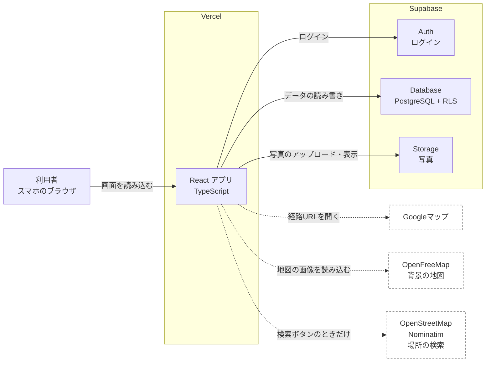

- ブラウザから Supabase を直接呼ぶ。誰が何を読み書きできるかはデータベースのRLS（行単位のアクセス制御）で守る
- 複数の処理をまとめて行うもの（プランの保存、検索）だけ、データベース内の関数（RPC）にする
- （v11）OpenFreeMap と Nominatim はブラウザから直接呼ぶ（K35）。独自のサーバーは作らない
- （v11）スポットの登録、スポットの投稿、申請の審査、位置の確認、特典の発行のように、権限や重複の確かめが要るものも RPC にする（10.9）

### 8.3 開発環境

| 項目 | 方針 |
| --- | --- |
| ソースコード | 代表者の個人GitHubアカウントに公開リポジトリを1つ作り、他の2人をコラボレーターに追加する |
| 公開 | 代表者の個人Vercelアカウントでリポジトリを連携する |
| Supabase | 開発用プロジェクトを1つ作り、全員で共有する。データベースの構造はマイグレーションでだけ変える（9.5） |
| データベースの変更履歴 | SQLを `supabase/migrations/` にファイルで残す |
| 秘密の値 | `.env.local` に書き、GitHubには上げない。Vercelには管理画面で登録する |

環境変数

```
VITE_SUPABASE_URL=https://xxxx.supabase.co
VITE_SUPABASE_ANON_KEY=（Supabaseの公開用キー。anon key または publishable key と表示される）
VITE_USE_MOCK=false   # true にするとSupabaseの代わりにモックのデータを使う（9.6）
VITE_PLACE_SEARCH_ENABLED=true   # （v11）false にすると Nominatim の検索を止める（BR-19）
```

公開リポジトリで守ること

| ルール | 理由 |
| --- | --- |
| `.env.local` は `.gitignore` に入れ、コミットしない | 誰でもコードを見られるため |
| 管理者用のキー（service_role / secret key）はどこにも書かない | 漏れるとRLSを無視して全データを操作される |
| サンプル投稿の写真は、チームで撮影したものか利用が許可されたものだけ | リポジトリと公開サイトの両方に載るため |
| 実在する個人のメールアドレスや名前をサンプルデータに入れない | 同上 |

## 9. データ設計

テーブル、ビュー、RPC、RLSの変更は、マイグレーション（9.5）で行う。

### 9.1 ER図

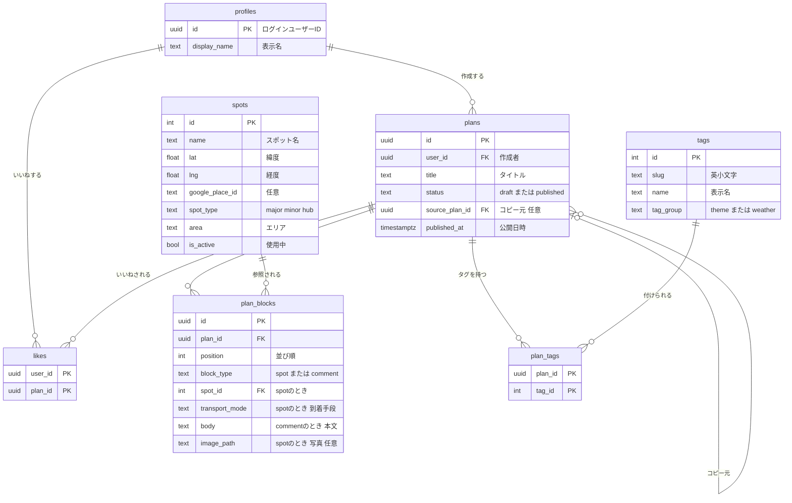

（v11）増えるテーブルとのつながり。上の図のテーブルのうち、関係するものだけを再掲した。

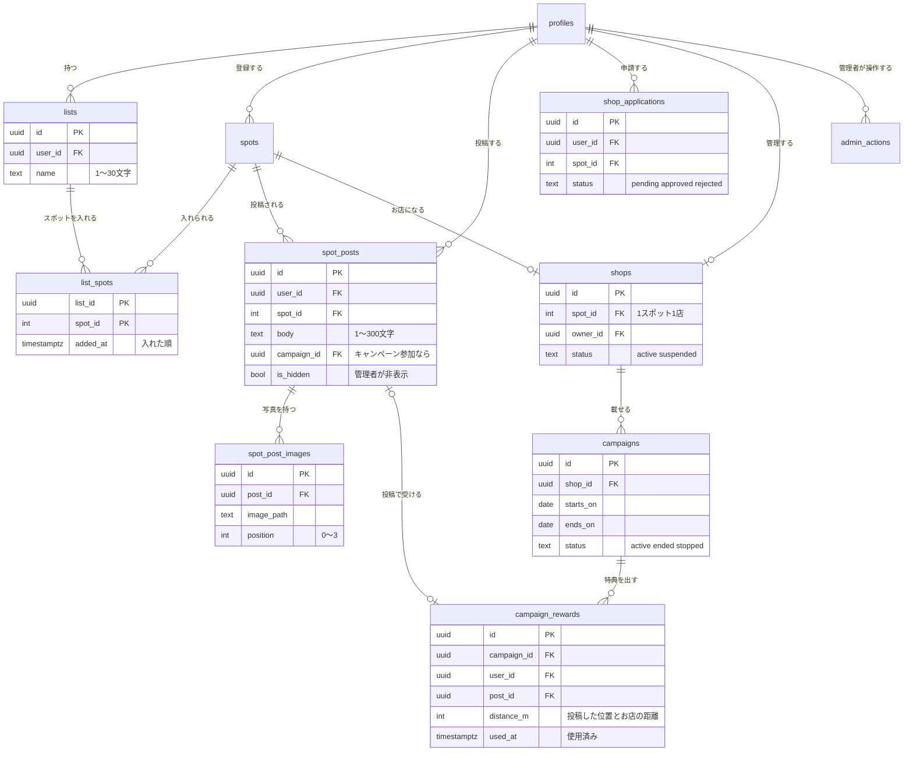

### 9.2 テーブル定義

**profiles**（利用者の表示情報。メールアドレスとパスワードは Supabase Auth が持つ）

| 列 | 型 | 制約 | 説明 |
| --- | --- | --- | --- |
| id | uuid | 主キー、auth.users を参照、利用者削除時に一緒に削除 |  |
| display_name | text | 必須、1〜20文字 | 表示名 |
| role | text | （v11）‘user’、‘official’、‘admin’ のいずれか。既定値 ‘user’ | 利用者の種類（BR-25）。本人は変えられない |
| created_at | timestamptz | 既定値 now() |  |

新規登録時、登録情報（`raw_user_meta_data.display_name`）からトリガーで自動作成する。

**spots**（スポットのマスタ。金沢市内のスポットだけ。開発側は 9.6 の方法で、利用者は RPC `register_spot` で登録する。v11 で変更）

| 列 | 型 | 制約 | 説明 |
| --- | --- | --- | --- |
| id | int | 主キー。開発側の登録はスプレッドシートの id（1〜99999）をそのまま使う。利用者の登録は連番 `spots_user_id_seq`（100001 から）（BR-17） |  |
| name | text | 必須、1〜50文字。（v11）重複不可をやめる（同じ名前のお店が別の場所にあるため。重複は BR-20 で防ぐ） | スポット名 |
| description | text | 開発側の登録は必須（60文字程度）。利用者の登録は空 | 短い紹介文 |
| lat, lng | double precision | 必須 | 緯度・経度 |
| google_place_id | text | 任意 | Googleマップの場所ID |
| spot_type | text | 必須、‘major’、‘minor’、‘hub’ のいずれか | 定番、定番以外、起点 |
| area | text | 開発側の登録は必須（9.6 のエリア一覧のどれか）。利用者の登録は空 | エリア |
| is_active | boolean | 必須、既定値 true | false なら使用中止（BR-17） |
| sort_order | int | 既定値 0 | 一覧での表示順 |
| source | text | （v11）‘curated’ または ‘user’。既定値 ‘curated’ | 誰が登録したか |
| osm_ref | text | （v11）任意、重複不可 | OpenStreetMap の ID（`node/123` など） |
| address | text | （v11）任意、100文字まで | 利用者の登録の住所（Nominatim の住所を短くしたもの） |
| place_kind | text | （v11）任意 | 場所の種類（「観光名所」など。9.8）。場所の検索の候補の表示（S-16）に使う。開発側の登録も、Claude が Nominatim の結果から同じ表で付ける（K62。PM は書かない） |
| created_by | uuid | （v11）任意、profiles を参照、利用者削除時は null | 登録した利用者 |
| is_demo | boolean | （v11）既定値 false | デモ用のスポット（金沢工業大学）。金沢市の範囲の確かめから外す（BR-17） |
| cover_image_path | text | （v11）任意 | 開発側の登録のスポットの、地図のピンに使うチームの写真（`spot-covers/{id}.jpg`） |
| created_at | timestamptz | （v11）既定値 now() |  |

- （v11）チェック制約：`source = 'curated'` なら description と area が必須、`source = 'user'` なら osm_ref が必須で id が 100001 以上
- （v11）緯度・経度が金沢市の範囲（BR-19）に入っていることをチェック制約で確かめる

**tags**（固定タグのマスタ）

| 列 | 型 | 制約 | 説明 |
| --- | --- | --- | --- |
| id | int | 主キー |  |
| slug | text | 必須、重複不可、英小文字 | アイコンとの対応に使う |
| name | text | 必須、重複不可 | 表示名 |
| tag_group | text | ‘theme’ または ‘weather’ | 画面でのまとまり |
| sort_order | int | 既定値 0 | 表示順 |

初期データ（確定。id は 9.7 のとおり）

| id | tag_group | name | slug |
| --- | --- | --- | --- |
| 1 | theme | 食事 | food |
| 2 | theme | 景観 | scenery |
| 3 | theme | 歴史 | history |
| 4 | theme | 写真 | photo |
| 5 | theme | ゆったり | relaxed |
| 6 | theme | 時短 | quick |
| 7 | theme | コスパ | budget |
| 8 | theme | くつろぎ | cozy |
| 9 | weather | 晴れ | sunny |
| 10 | weather | 雨 | rainy |
| 11 | weather | 曇り | cloudy |

**plans**（旅行プラン）

| 列 | 型 | 制約 | 説明 |
| --- | --- | --- | --- |
| id | uuid | 主キー、自動生成 |  |
| user_id | uuid | 必須、profiles を参照、利用者削除時に一緒に削除 | 作成者 |
| title | text | 必須（空文字可）、50文字以内 | 下書きは空でもよい |
| status | text | ‘draft’ または ‘published’、既定値 ‘draft’ |  |
| source_plan_id | uuid | 任意、plans を参照、参照先削除時は null | コピー元 |
| created_at | timestamptz | 既定値 now() |  |
| updated_at | timestamptz | 既定値 now()、更新時にトリガーで更新 |  |
| published_at | timestamptz | 公開中なら必須、下書きなら null | BR-09 |
| share_token | text | （v11）任意、重複不可、32文字 | 共有リンクの合言葉（BR-30）。null なら共有していない |

**plan_blocks**（ブロック）

| 列 | 型 | 制約 | 説明 |
| --- | --- | --- | --- |
| id | uuid | 主キー、自動生成 |  |
| plan_id | uuid | 必須、plans を参照、プラン削除時に一緒に削除 |  |
| position | int | 必須、0〜29、(plan_id, position) で重複不可 | 並び順 |
| block_type | text | ‘spot’ または ‘comment’ |  |
| spot_id | int | spots を参照 | spot のとき必須、comment のとき null |
| transport_mode | text | ‘walk’、‘bus’、‘bicycle’、‘car’ または null | spot のときだけ。comment のとき null |
| body | text | 1〜500文字 | comment のとき必須、spot のとき null |
| image_path | text | 任意 | spot のときだけ |

種類ごとの組み合わせはチェック制約で守る（spot なら spot_id あり・body なし、comment なら body あり・spot_id と transport_mode と image_path なし）。

**plan_tags**

| 列 | 型 | 制約 |
| --- | --- | --- |
| plan_id | uuid | (plan_id, tag_id) が主キー。プラン削除時に一緒に削除 |
| tag_id | int | tags を参照 |

**likes**

| 列 | 型 | 制約 |
| --- | --- | --- |
| user_id | uuid | (user_id, plan_id) が主キー。利用者削除時に一緒に削除 |
| plan_id | uuid | プラン削除時に一緒に削除 |
| created_at | timestamptz | 既定値 now()。「いいねしたプラン」の並び順に使う |

インデックス：plans (status, published_at)、plans (user_id)、plan_tags (tag_id)、likes (plan_id)

**（v11）lists**（行きたい場所のリスト。BR-18）

| 列 | 型 | 制約 | 説明 |
| --- | --- | --- | --- |
| id | uuid | 主キー、自動生成 |  |
| user_id | uuid | 必須、profiles を参照、利用者削除時に一緒に削除 | 持ち主 |
| name | text | 必須、1〜30文字 |  |
| created_at, updated_at | timestamptz | 既定値 now()。スポットを入れる・外すときも updated_at を更新 |  |

1人20個までは、追加のトリガーで確かめる。

**（v11）list_spots**

| 列 | 型 | 制約 | 説明 |
| --- | --- | --- | --- |
| list_id | uuid | (list_id, spot_id) が主キー。リスト削除時に一緒に削除 |  |
| spot_id | int | spots を参照 |  |
| added_at | timestamptz | 既定値 now() | 並び順 |

1リスト30件までは、追加のトリガーで確かめる。

**（v11）spot_posts**（スポットの投稿。BR-21）

| 列 | 型 | 制約 | 説明 |
| --- | --- | --- | --- |
| id | uuid | 主キー、自動生成 |  |
| user_id | uuid | 必須、profiles を参照、利用者削除時に一緒に削除 |  |
| spot_id | int | 必須、spots を参照 |  |
| body | text | 必須、1〜300文字 | ひとこと |
| campaign_id | uuid | 任意、campaigns を参照 | キャンペーンで投稿したとき（「キャンペーン参加」のラベル） |
| is_hidden | boolean | 既定値 false | 管理者が非表示にした |
| created_at, updated_at | timestamptz | 既定値 now() |  |

**（v11）spot_post_images**

| 列 | 型 | 制約 | 説明 |
| --- | --- | --- | --- |
| id | uuid | 主キー、自動生成 |  |
| post_id | uuid | 必須、spot_posts を参照、投稿削除時に一緒に削除 |  |
| image_path | text | 必須 | Storage のパス |
| position | int | 0〜3、(post_id, position) で重複不可 |  |

**（v11）shop_applications**（お店の申請。BR-26）

| 列 | 型 | 制約 | 説明 |
| --- | --- | --- | --- |
| id | uuid | 主キー、自動生成 |  |
| user_id | uuid | 必須、profiles を参照 | 申請した人 |
| spot_id | int | 必須、spots を参照 | お店のスポット |
| shop_name | text | 必須、1〜30文字 |  |
| introduction | text | 0〜300文字 |  |
| contact_name | text | 必須、1〜30文字 | 担当者（本人と管理者だけが読める） |
| contact_email | text | 必須、メールアドレスの形式 | 同上 |
| contact_phone | text | 必須、数字とハイフン、20文字まで | 同上 |
| campaign_draft | jsonb | 任意 | 最初のキャンペーン（BR-27 の項目） |
| status | text | ‘pending’、‘approved’、‘rejected’。既定値 ‘pending’ |  |
| reject_reason | text | 任意、200文字まで |  |
| reviewed_by | uuid | 任意、profiles を参照 | 審査した管理者 |
| created_at, reviewed_at | timestamptz |  |  |

1人が持てる ‘pending’ の申請は1つ（部分的な一意の制約）。

**（v11）shops**（お店。BR-25〜BR-27）

| 列 | 型 | 制約 | 説明 |
| --- | --- | --- | --- |
| id | uuid | 主キー、自動生成 |  |
| spot_id | int | 必須、重複不可、spots を参照 | 1スポットに1店 |
| owner_id | uuid | 必須、重複不可、profiles を参照 | お店のアカウント（1人1店） |
| name | text | 必須、1〜30文字 |  |
| introduction | text | 0〜300文字 |  |
| status | text | ‘active’ または ‘suspended’。既定値 ‘active’ |  |
| created_at, updated_at | timestamptz |  |  |

**（v11）campaigns**（BR-27）

| 列 | 型 | 制約 | 説明 |
| --- | --- | --- | --- |
| id | uuid | 主キー、自動生成 |  |
| shop_id | uuid | 必須、shops を参照 |  |
| title | text | 必須、1〜30文字 | 題名 |
| benefit | text | 必須、1〜50文字 | 特典の内容 |
| notice | text | 0〜200文字 | お知らせ文 |
| description | text | 0〜500文字 | 説明 |
| image_path | text | 任意 | 画像 |
| starts_on, ends_on | date | 必須。ends_on は starts_on 以上、90日以内 | 期間（日本時間の日付） |
| status | text | ‘active’、‘ended’（お店が終えた）、‘stopped’（管理者が停止）。既定値 ‘active’ |  |
| created_at, updated_at | timestamptz |  |  |

1つのお店で ‘active’ のキャンペーンは1つ（部分的な一意の制約）。

**（v11）campaign_rewards**（特典。BR-28）

| 列 | 型 | 制約 | 説明 |
| --- | --- | --- | --- |
| id | uuid | 主キー、自動生成 |  |
| campaign_id | uuid | 必須、campaigns を参照。(campaign_id, user_id) で重複不可 | 1人1キャンペーン1回 |
| user_id | uuid | 必須、profiles を参照 |  |
| post_id | uuid | 任意、spot_posts を参照、投稿削除時は null | もとの投稿 |
| issued_at | timestamptz | 既定値 now() | 受け取った日時。その日のうち（日本時間の23:59まで）有効 |
| distance_m | int | 必須、0〜100 | 投稿したときの位置とお店のスポットの距離（m）。位置そのものは保存しない（BR-28） |
| used_at | timestamptz | 任意 | 使用済みにした日時 |

**（v11）admin_actions**（管理者の操作の記録。BR-29）

| 列 | 型 | 制約 | 説明 |
| --- | --- | --- | --- |
| id | bigint | 主キー、自動採番 |  |
| admin_id | uuid | 必須、profiles を参照 |  |
| action | text | 必須（‘approve_application’、‘reject_application’、‘suspend_shop’、‘resume_shop’、‘stop_campaign’、‘resume_campaign’、‘hide_post’、‘show_post’、‘deactivate_spot’） |  |
| target_id | text | 必須 | 対象の id |
| reason | text | 任意、200文字まで |  |
| created_at | timestamptz | 既定値 now() |  |

（v11）インデックス：spots (source)、list_spots (spot_id)、spot_posts (spot_id, created_at)、spot_posts (user_id)、campaigns (shop_id, status)、shop_applications (status)

### 9.3 ビュー plan_summaries

一覧系の画面すべてで使う、プランの要約。`security_invoker = true` を付けて作り、RLS が効くようにする。

| 列 | 型 | 内容 |
| --- | --- | --- |
| id, user_id, title, status, source_plan_id |  | plans の列 |
| created_at, updated_at, published_at | timestamptz | plans の列 |
| author_name | text | 作成者の表示名 |
| like_count | int | いいね数 |
| spot_count | int | スポットブロックの数 |
| has_minor_spot | boolean | BR-02 |
| spot_names | text[] | スポット名を並び順で（ルートの要約用） |
| tag_ids | int[] | タグID |
| cover_image_path | text | 並び順で最初の写真 |

**（v11）ビュー spot_summaries**

地図、S-07、S-16 で使う、スポットの要約。`security_invoker = true`。

| 列 | 型 | 内容 |
| --- | --- | --- |
| spots の列 |  | id、name、description、lat、lng、google_place_id、spot_type、area、is_active、source、address、place_kind |
| post_count | int | 表示中の投稿の数 |
| latest_image_path | text | 表示中の投稿の、いちばん新しい写真。なければ spots.cover_image_path |
| on_map | boolean | latest_image_path があれば true（地図に出す。BR-24、K50） |
| active_campaign_id | uuid | キャンペーン中なら、そのキャンペーン（お店が active で、期間中で、status が active） |

### 9.4 アクセス制御（RLS）

サイトはログイン必須なので、データベースもログインユーザー（`authenticated`）にだけ読み書きを許す。未ログイン（`anon`）にはどのテーブルも許可しない。

| テーブル | 読む | 作る | 変える | 消す |
| --- | --- | --- | --- | --- |
| profiles | ログインユーザー | トリガーのみ | 本人（表示名だけ。role は変えられない） | 不可 |
| spots, tags | ログインユーザー | 不可（v11：spots は RPC `register_spot` だけ） | 不可（v11：管理者は spots の is_active だけ RPC で変えられる） | 不可 |
| plans | status = ‘published’ ならログインユーザー、それ以外は本人 | 本人（user_id = 自分） | 本人 | 本人 |
| plan_blocks, plan_tags | 親のプランが読めるなら | 親のプランの本人 | 親のプランの本人 | 親のプランの本人 |
| likes | ログインユーザー | 本人。ただし自分のプランには不可、公開中のプランのみ | 不可 | 本人 |

| （v11）lists、list_spots | 本人 | 本人 | 本人 | 本人 |
| （v11）spot_posts、spot_post_images | is_hidden = false ならログインユーザー。非表示は本人と管理者 | RPC `save_spot_post` だけ | RPC `save_spot_post` だけ（本人） | 本人 |
| （v11）shop_applications | 本人と管理者 | 本人（RPC `submit_application`） | 不可（審査は RPC `review_application`） | 不可 |
| （v11）shops | ログインユーザー | RPC だけ | 本人（name、introduction だけ） | 不可 |
| （v11）campaigns | ログインユーザー | 本人のお店（status が active のお店だけ） | 本人のお店（status を ‘stopped’ にはできない、‘stopped’ のものは変えられない） | 不可 |
| （v11）campaign_rewards | 本人と、そのお店の本人（数を数えるため） | RPC `save_spot_post` だけ | RPC `use_reward` だけ | 不可 |
| （v11）admin_actions | 管理者 | RPC だけ | 不可 | 不可 |

- 「管理者」は `profiles.role = 'admin'`。判定はデータベースの関数 `is_admin()` で行い、RLS と RPC で使う
- 担当者の名前と連絡先は shop_applications にだけ置き、本人と管理者以外が読めないようにする

RPC（search_plans、save_plan、v11 で増えるもの。10.9）の実行権限も `authenticated` にだけ与える。

Storage（バケット `plan-images`）

| 操作 | 許可 |
| --- | --- |
| 読む | 公開バケット（画像のURLを知っていれば表示できる。URLは推測できないランダムな名前） |
| アップロード | ログインユーザーが `{自分のユーザーID}/` の中だけ |
| 削除 | 本人のフォルダの中だけ |
| 大きさ・種類 | 5MBまで、image/jpeg のみ（ブラウザで変換してから送るため） |

（v11）バケット `spot-post-images` と `campaign-images` も、`plan-images` と同じ決まり（公開バケット、`{自分のユーザーID}/` の中だけアップロード・削除、5MB まで、image/jpeg のみ）にする。

（v11）バケット `spot-covers`（開発側の登録のスポットの、地図のピン用のチームの写真）は、公開バケット（読むのは誰でも）にし、画面からのアップロードと削除は許さない（ポリシーを作らない）。写真は実装担当が Supabase の管理画面から `{スポットの id}.jpg` の名前で上げる（I-42）。5MB まで、image/jpeg のみ。上げる前に長辺1280px に縮め、撮影場所などの情報を消す（BR-13）

### 9.5 データベースの変更の手順

- 変更は `supabase/migrations/{日時}_{内容}.sql` のファイルで行い、管理画面での直接変更はしない（初期データの確認を除く）
- テーブルを変えたら型を作り直す：`supabase gen types typescript --project-id {プロジェクトID} > src/types/database.ts`
- マイグレーションと型の更新は同じプルリクエストに入れる
- タグ（9.2）と 9.7 の13件のスポットは、初期データとしてマイグレーションに含める（`supabase db push` で入る）。それ以降のスポットは 9.6 の取り込みで入れる。（v11）開発側の登録（id 1〜33）の本番の種類は、定番の調査のあと I-42 の取り込みで付け直す（BR-17、K61）。デモ用のスポット（9.7）は I-26 のマイグレーションで入れる

### 9.6 スポットデータの作り方

仕組みは実装担当（Claude）が作り、データ集めはPMが取りまとめる。

（v11）開発側が集めて登録するのは、定番と起点（K49）とデモ用のスポット（K53）だけ。定番は Web の情報でよく取り上げられるものを調べて決める（K58、K60）。定番以外の場所は、利用者が場所の検索と投稿で登録する（BR-20）。下の「段階2：集め方」は、v11 より前に P-04 で行った分（金沢市オープンデータ「文化財一覧」「公園一覧」から定番以外の20件、id 14〜33。PR #63）で終わりにし、これ以上は行わない。

PM は 19.4 の形式の一覧（名前、区分、根拠、写真、紹介文、補足）だけを作る。緯度・経度、住所、エリア、紹介文など、下のスプレッドシートの残りの列は実装担当の Claude が補い、PM が確かめてから取り込む（P-17、I-42）。開発側のスポットには、地図のピン用のチームの写真を付ける（P-12、K50）。

#### 段階

| 段階 | いつ | 内容 | 担当 |
| --- | --- | --- | --- |
| 1 モック | I-04 | 9.7 のモックデータを作り、APIの形とデータの項目を確定させる | 実装担当 |
| 2 収集 | P-04 | 共有スプレッドシートにスポットを集める。件数は多いほどよい | PM（メンバーも協力） |
| 3 取り込み | I-20 で仕組みを作り、P-04 の後に実行 | スプレッドシートをCSVで書き出し、変換スクリプトでデータベースに入れる | 実装担当 |
| 4 追加 | 随時 | スプレッドシートに行を足し、段階3を繰り返す | 実装担当 |

#### 段階1：モックデータ

9.7 のデータを `src/api/mock/` に置く。本物の api と同じ関数名・同じ戻り値の形にする。

- モックのログインは、どのメールアドレスとパスワードでもテスト太郎としてログインする
- モックの検索とランキングも BR-01、BR-11 の並び順で返す
- モックの保存は画面を再読み込みするまで覚えておく（メモリ上）

#### 段階2：集め方

| 対象 | 集め方 |
| --- | --- |
| 定番の大半 | 公的なオープンデータ（石川県オープンデータカタログの金沢市のデータなど）から取り込む。利用条件と出典の書き方を確認し（T4）、スプレッドシートの source 列に書く |
| 漏れた定番、定番以外（隠れた名所など） | メンバーが手作業で追加する。緯度・経度はGoogleマップで場所を右クリックして確認する。プレイスIDは Google の「Place ID Finder」のページで調べる（任意） |
| 紹介文 | 自分たちの言葉で書く。観光サイトの文章は写さない。オープンデータの紹介文は、利用条件で許される場合だけ使う |
| 定番かどうか | 9.7 の基準に従う（v11。調べた定番の一覧に入るものが定番、交通の拠点は起点） |

スプレッドシートの列（列名と順番を変えない。変換スクリプトがこの形を前提にする）

| 列 | 必須 | 内容 | 例 |
| --- | --- | --- | --- |
| id | 必須 | 連番。一度振ったら変えない・使い回さない（BR-17）。1〜99999（v11。100001 からは利用者の登録が使う）。利用者のスポットを開発側の登録に切り替えるときは、その id をそのまま使う | 1 |
| name | 必須 | スポット名（金沢市内のみ） | 兼六園 |
| spot_type | 必須 | major / minor / hub | major |
| area | 必須 | 下のエリア一覧のどれか | 兼六園周辺 |
| description | 必須 | 紹介文。60文字程度 | 加賀藩の大名庭園。四季ごとに違う景色が楽しめる |
| lat | 必須 | 緯度（小数） | 36.5621 |
| lng | 必須 | 経度（小数） | 136.6625 |
| google_place_id | 任意 | Googleマップのプレイス ID |  |
| sort_order | 任意 | エリア内での表示順。空なら id 順 |  |
| is_active | 必須 | TRUE / FALSE | TRUE |
| source | 必須 | 出典。オープンデータならデータ名、手作業なら「チーム調査」 | チーム調査 |
| added_by | 必須 | 追加した人 |  |
| checked | 必須 | PMが確認済みなら TRUE。TRUE の行だけ取り込む | TRUE |
| osm_ref | 任意 | （v11）OpenStreetMap の ID（`node/123` など）。Claude が Nominatim で調べて入れる。利用者が同じ場所を二重に登録するのを防ぐのに使う（BR-20） | node/2146147847 |
| place_kind | 任意 | （v11）場所の種類。Claude が Nominatim の分類から 9.8 の表で付ける（K62） | 公園・庭園 |
| address | 任意 | （v11）住所（9.8 と同じ、短くした形） | 石川県金沢市兼六町 |
| cover_image | 任意 | （v11）地図のピン用のチームの写真のファイル名。取り込みで `cover_image_path` を `spot-covers/{id}.jpg` にする | kenrokuen.jpg |
| basis | 定番は必須 | （v11）定番の根拠。載っていた情報源の記号（19.4）。データベースには入れず、記録としてこのファイルに残す | A/B/C/E |

例の緯度・経度は書き方の例。実際の値は必ず地図で確認する。

エリア一覧：金沢駅周辺、近江町市場周辺、香林坊・長町武家屋敷跡周辺、兼六園周辺、ひがし茶屋街周辺、寺町・にし茶屋街周辺、金石・大野周辺、湯涌温泉周辺、森本周辺、その他

公式観光サイト「金沢旅物語」のスポット検索のエリア分けに合わせている。公式サイトのページにエリアが書かれていればそれを使い、なければ近いエリアか「その他」にする。

#### 段階3：取り込み

スプレッドシートをAIに渡して毎回SQLを書かせると、件数が多いときに写し間違いが起きる。そこで、変換スクリプトをAIに一度だけ作らせ、以後はそれを実行する。

1. PMがスプレッドシートの内容を確認し、checked を TRUE にする
2. 実装担当がCSVで書き出し、`supabase/data/spots.csv` としてコミットする
3. 変換スクリプト `scripts/import-spots.mjs` を実行する（`npm run import-spots`。追加のライブラリを使わず Node.js だけで動かす）。スクリプトは次を行う
    - 必須の列が空でないか、spot_type と area の値が決まったものか、id が重複していないかを確認する
    - 緯度・経度が金沢市の付近（緯度 36.4〜36.7、経度 136.5〜136.9）に入っているかを確認する
    - （v11）定番の行に basis があるか、place_kind が 9.8 の一覧のものかを確認する
    - 問題があれば行番号と理由を表示して止まる
    - 問題がなければ `supabase/seed/spots.sql` を作る。中身は id をキーにした upsert（あれば更新、なければ追加）で、削除はしない
4. 開発用のデータベースで実行し（Supabase 管理画面の SQL Editor に貼り付けるか、psql で実行する）、件数を確認する

出典はホーム（S-01）の一番下に表示する（K21 で決定）。

### 9.7 定番の基準とモックデータ

実装ではこの節のデータをそのまま `src/api/mock/` に入れる。実装するAIは発表スライドなどの背景を知らないため、データの中身はここで確定させる。

#### 定番の基準（v11。K58 で決定）

Web の情報で、金沢の観光スポットとしてよく取り上げられる場所を定番（major）とする。選び方は次のとおり（K60 で決定）。調べた結果は、19.4 の一覧（情報源と、どの情報源に載っていたか）として残す。

- 金沢の観光スポットを紹介する情報源を、先に6つ以上決める。公式の観光サイト（金沢旅物語、ほっと石川旅ねっとなど）と、大手の旅行サイトの「金沢の観光スポット」の記事やランキング（じゃらん、るるぶ、トリップアドバイザーなど）から選ぶ
- 各情報源の「おすすめ」「定番」の一覧か、人気順の上位20件（20件に満たなければ全部）に載っている場所を数える
- 半分以上の情報源に載る場所を定番にする（6つなら3つ以上）
- 数えるときの場所のまとまり（K63 で決定）：呼び方の違い（「金沢城」と「金沢城公園」など）は同じ場所とする。中の施設（茶屋街の中のお茶屋など）が載っていたら、外側の場所にも1つ数える。同じ情報源で外側と中の両方が載っていても、外側は1つと数える。中の施設そのものも、単独で基準を満たせば定番にする。中の施設を含めて数えたときは、一覧の note に書く
- 定番に入らなかった中の施設を利用者が登録すると定番以外になる。このサイトは場所の範囲（面）を持たず「定番の中にある」を判定できないため、デモではこれでよいとする（K63）
- 件数の目安は20〜30件。50件を超える、または10件に満たないときは、数える範囲（上位20件）を見直す
- Deep Research などの AI は、情報源を探したり、載っている場所を拾い出したりするのに使ってよい。AI が挙げた情報源は、PM が実際にページを開いて、その場所が載っていることを確かめる（AI が存在しないページや内容を書くことがあるため）

- 交通の拠点（金沢駅など）は起点（hub）とする
- 定番の調査のあとに利用者が登録するものは、すべて定番以外（minor）とする（BR-20）
- 以前（K19）は、公式観光サイト「金沢旅物語」のモデルコース「初めての金沢観光なら！絶対外せない定番スポット1日コース」の6件（近江町市場、長町武家屋敷跡界隈、金沢21世紀美術館、兼六園、金沢城公園・玉泉院丸庭園、ひがし茶屋街）で固定していた。にし茶屋街などを定番以外とする根拠を示せなかったため、v11 で取り消した
- 実際に金沢市で使うときは、金沢市の担当者と相談して決める（19.1 A-09）

#### モックのスポット（13件）

緯度・経度は公式観光サイト（金沢旅物語）の各スポットのページの地図から取得した（国立工芸館のみ、るるぶの地図から取得）。紹介文はチームの言葉で書いた。このデータは本番のスポットデータ（スプレッドシート）の最初の13行としても使う。（v11）ただし本番の spot_type は、定番の調査の結果で付け直す（K61）。モックの spot_type は、BR-02 などを試すために下のまま固定する（調査の結果に合わせて変えない）。

| id | name | spot_type | area | description | lat | lng |
| --- | --- | --- | --- | --- | --- | --- |
| 1 | 金沢駅 | hub | 金沢駅周辺 | 鼓門ともてなしドームが迎える金沢の玄関口。多くの路線バスがここから出る | 36.578342 | 136.647983 |
| 2 | 近江町市場 | major | 近江町市場周辺 | 鮮魚や青果の店が並ぶ「金沢の台所」。海鮮丼や食べ歩きが楽しめる | 36.571665 | 136.656146 |
| 3 | 長町武家屋敷跡界隈 | major | 香林坊・長町武家屋敷跡周辺 | 土塀と石畳の路地が続く、加賀藩士の屋敷が並んでいた一帯 | 36.563617 | 136.650760 |
| 4 | 金沢21世紀美術館 | major | 兼六園周辺 | ガラス張りの円形の建物が目印の現代美術館。無料で入れる場所もある | 36.560896 | 136.658152 |
| 5 | 兼六園 | major | 兼六園周辺 | 日本三名園の一つに数えられる加賀藩の大名庭園。冬の雪吊りが有名 | 36.562128 | 136.662652 |
| 6 | 金沢城公園・玉泉院丸庭園 | major | 兼六園周辺 | 加賀藩前田家の居城跡。復元された櫓や門と、夜のライトアップが見どころ | 36.565771 | 136.659622 |
| 7 | ひがし茶屋街 | major | ひがし茶屋街周辺 | 格子戸の茶屋建築が並ぶ、金沢を代表する茶屋街 | 36.572630 | 136.666446 |
| 8 | にし茶屋街 | minor | 寺町・にし茶屋街周辺 | 犀川の近くにある小さな茶屋街。ひがし茶屋街より落ち着いた雰囲気 | 36.556757 | 136.647402 |
| 9 | 妙立寺（忍者寺） | minor | 寺町・にし茶屋街周辺 | 隠し階段や落とし穴など仕掛けの多い寺。「忍者寺」と呼ばれる。見学は予約制 | 36.555384 | 136.648997 |
| 10 | 尾山神社 | minor | 香林坊・長町武家屋敷跡周辺 | 前田利家とまつを祀る神社。ステンドグラスのある神門が珍しい | 36.566081 | 136.655416 |
| 11 | 鈴木大拙館 | minor | 兼六園周辺 | 仏教哲学者・鈴木大拙を伝える館。水鏡の庭で静かに過ごせる | 36.557822 | 136.661199 |
| 12 | 国立工芸館 | minor | 兼六園周辺 | 東京から移転した工芸とデザインの国立美術館。明治期の建物を活用している | 36.559034 | 136.661715 |
| 13 | 石川県立図書館 | minor | その他 | 円形の大閲覧室が特徴の図書館。本に囲まれた空間を見に訪れる人も多い | 36.548953 | 136.679911 |

全スポットとも `google_place_id` は空、`is_active` は true、`sort_order` は 0。

#### モックのタグ

9.2 の初期データに、次の id を振る。

| id | name | slug | tag_group |
| --- | --- | --- | --- |
| 1 | 食事 | food | theme |
| 2 | 景観 | scenery | theme |
| 3 | 歴史 | history | theme |
| 4 | 写真 | photo | theme |
| 5 | ゆったり | relaxed | theme |
| 6 | 時短 | quick | theme |
| 7 | コスパ | budget | theme |
| 8 | くつろぎ | cozy | theme |
| 9 | 晴れ | sunny | weather |
| 10 | 雨 | rainy | weather |
| 11 | 曇り | cloudy | weather |

#### モックの利用者

| id | displayName | email |
| --- | --- | --- |
| `mock-user-taro` | テスト太郎 | taro@example.com |
| `mock-user-hanako` | テスト花子 | hanako@example.com |

モックではどのメールアドレスとパスワードでもテスト太郎としてログインする。

#### モックのプラン（4件）

ブロックは上から順。「→ 徒歩」などは、次のスポットブロックの `transportMode`。

| id | タイトル | 作成者 | 状態 | タグ | いいね数 | コピー元 |
| --- | --- | --- | --- | --- | --- | --- |
| `mock-plan-1` | にぎわいを避けて歩く寺町・にし茶屋街 | テスト花子 | 公開中 | 歴史、ゆったり、写真 | 5 | なし |
| `mock-plan-2` | 初めての金沢 定番1日コース | テスト太郎 | 公開中 | 景観、食事、写真 | 8 | なし |
| `mock-plan-3`（タイトル空） | — | テスト太郎 | 下書き | なし | 0 | なし |
| `mock-plan-4` | 定番コースに尾山神社を足したプラン | テスト花子 | 公開中 | 歴史、時短 | 2 | `mock-plan-2` |

| プラン | ブロック |
| --- | --- |
| mock-plan-1 | 金沢駅 → バス → 長町武家屋敷跡界隈 → 徒歩 → にし茶屋街 → コメント「ひがし茶屋街より人が少なく、写真が撮りやすい」 → 徒歩 → 妙立寺（忍者寺） → コメント「見学は予約制なので事前に申し込む」 |
| mock-plan-2 | 金沢駅 → バス → 近江町市場 → コメント「海鮮丼は朝のうちが空いている」 → 徒歩 → 金沢21世紀美術館 → 徒歩 → 兼六園 → 徒歩 → 金沢城公園・玉泉院丸庭園 → バス → ひがし茶屋街 |
| mock-plan-3 | 金沢21世紀美術館 → 徒歩 → 国立工芸館 → 徒歩 → 鈴木大拙館 |
| mock-plan-4 | 金沢駅 → バス → 近江町市場 → 徒歩 → 尾山神社 → 徒歩 → 金沢城公園・玉泉院丸庭園 → 徒歩 → 兼六園 |
- 公開日時は mock-plan-2 が 2026-10-01、mock-plan-1 が 2026-10-05、mock-plan-4 が 2026-10-08（いずれも 10:00 日本時間）
- 写真はなし（`imageUrl` は null）
- テスト太郎は mock-plan-1 と mock-plan-4 にいいね済み

このデータで確認できること

| 確認すること | 使うデータ |
| --- | --- |
| 定番以外を含む（BR-02） | mock-plan-1、mock-plan-4 は true、mock-plan-2 は false（金沢駅は起点なので数えない） |
| 検索の並び順（BR-01） | 「写真」で検索すると、一致数が同じ mock-plan-1 と mock-plan-2 のうち、定番以外を含む mock-plan-1 が先 |
| ランキング（BR-11） | 総合は mock-plan-2、mock-plan-1、mock-plan-4 の順。定番以外は mock-plan-1、mock-plan-4 の順 |
| 下書きが他人に見えない | mock-plan-3 はテスト太郎のマイページにだけ出る。タイトル空なので「無題のプラン」と表示 |
| コピー元の表示（BR-07） | mock-plan-4 に「テスト太郎さんのプランをもとに作成」 |
| 自分のプランにいいねできない（BR-08） | テスト太郎で mock-plan-2 を開くと、いいねボタンが出ない |

#### （v11）デモ用のスポット（本番とモックの両方）

金沢工業大学は金沢市の外（野々市市）にあるが、デモでお店の役に使うため、例外として登録する（BR-17、K53）。

| id | name | spot_type | area | description | lat | lng | address | osm_ref | place_kind | is_demo |
| --- | --- | --- | --- | --- | --- | --- | --- | --- | --- | --- |
| 90001 | 金沢工業大学 | minor | その他 | 扇が丘キャンパス。このサイトのデモで、お店の申請とキャンペーンを試すために使う | 36.530922 | 136.627583 | 石川県野々市市扇が丘7-1 | way/295949646 | 場所 | true |

- 位置と osm_ref は、2026-10-30 に Nominatim で確かめた値。P-14 の前に PM が地図で確かめる
- id は開発側の範囲（1〜99999）のうち、定番の取り込み（I-42 は、登録済みの最大の id の次から順に振る）とぶつからない 90001 にする
- `source = 'curated'`、`is_active = true`、`sort_order = 0`。チームの写真（`spot-covers/90001.jpg`）は P-12 で撮り、I-42 で上げる
- 緯度・経度は 9.2 のチェック制約の範囲（BR-19 の四角の範囲）に入る。住所が金沢市でないため、利用者が場所の検索から同じ場所を登録しようとしても `register_spot` では登録できない（このスポットが近くのスポットとして案内される。BR-20）
- モックの `getSpots` にも入れる（S-13 などで「デモ」のラベルを確かめるため）

#### （v11）モックの追加データ

| 種類 | 内容 |
| --- | --- |
| 利用者の種類 | テスト太郎は一般、テスト花子は管理者。お店の確認用に `mock-user-shop`（表示名「テスト茶房」、お店）を加える |
| 利用者のスポット | id 100001「金沢港クルーズターミナル」（minor、lat 36.6079、lng 136.6145、address「石川県金沢市無量寺町」、osm_ref `way/884746182`、place_kind「建物」）、id 100002「テスト茶房」（minor、にし茶屋街の近く lat 36.5570、lng 136.6480、osm_ref `node/0000000001`。モック専用の架空のお店） |
| リスト | テスト太郎の「冬の金沢 1日目」（金沢駅、近江町市場、鈴木大拙館、にし茶屋街、金沢港クルーズターミナル）と「雨の日」（石川県立図書館、国立工芸館） |
| スポットの投稿 | テスト花子の「にし茶屋街」への投稿（ひとこと「朝のうちは人が少なく、格子の町並みがゆっくり見られた」）、テスト太郎の「金沢港クルーズターミナル」への投稿（ひとこと「夕方に行くと海に沈む夕日が見られる」）。モックの写真は用意しない（写真がないときの表示になる。本物では写真は必須） |
| お店とキャンペーン | お店「テスト茶房」（スポット 100002）。キャンペーン「投稿で抹茶ラテ割引」（特典「抹茶ラテ 100円引き」、期間 2026-11-01〜2026-12-31）。モックの `checkCampaignEligibility` は、渡された位置がスポット 100002 から100m以内なら対象にする |
| 申請 | テスト太郎の審査中の申請はなし。管理者の画面の確認用に、架空の利用者 `mock-user-applicant` の審査中の申請を1件（お店の名前「テスト雑貨店」、連絡先は example.com の架空のもの） |
| 場所の検索 | `searchPlaces` のモックは、次の3件から名前に入力の文字を含むものを返す：金沢港クルーズターミナル（osm_ref `way/884746182`）、にし茶屋街（`node/2146147847`、このサイトの id 8 と同じ場所）、テスト用の金沢市の外の場所「白山比咩神社」（金沢市の外なので、BR-20 の確かめで登録できないことを確かめる） |

- 実在のお店の名前や連絡先をモックに入れない（8.3）

### 9.8 （v11）場所の候補の扱い

Nominatim の結果（`category` と `type`）のうち、次は候補に出さない（BR-19）。

| 除く種類 | 理由 |
| --- | --- |
| `highway/*`（バス停、信号など） | 観光の場所でない。名前が同じでも混ざる |
| `amenity/bicycle_rental`、`amenity/parking`、`amenity/parking_entrance` | 同上（まちのりの貸し出し場所など） |
| `public_transport/*`、`railway/platform` | 同上 |
| `place/*`（町名など）、`boundary/*` | 範囲が広く、スポットにならない |

場所の種類の表示（`place_kind`）は、主なものだけ日本語にし、それ以外は「場所」とする。

| category/type | 表示 |
| --- | --- |
| `tourism/attraction`、`tourism/viewpoint` | 観光名所 |
| `tourism/museum`、`tourism/gallery` | 博物館・美術館 |
| `amenity/place_of_worship` | 寺社 |
| `amenity/cafe`、`amenity/restaurant`、`amenity/fast_food` | 飲食店 |
| `shop/*` | お店 |
| `leisure/park`、`leisure/garden` | 公園・庭園 |
| `historic/*` | 史跡 |
| `building/*` | 建物 |

- （v11）開発側の登録の place_kind も、I-42 で Claude が Nominatim の結果からこの表で付ける（K62）。PM の一覧には種類を書かない

- 金沢市かどうかは `display_name` に「金沢市」が入っているかで判定する（`address.city` に入らないことがあるため。BR-19）
- 住所は、Nominatim の `display_name` から「日本」と郵便番号を除き、「石川県金沢市」から後ろを100文字まで使う
- 判定は `lib/places.ts` の `filterPlaceCandidates()` で行い、テストする（11.6）

## 10. API設計

画面から Supabase を直接呼ばず、必ず `src/api/` の関数を通す（ESLint で禁止する、12.1）。

### 10.1 方針

| 項目 | 決まり |
| --- | --- |
| 書き方 | `async` 関数で、10.3 の名前と引数・戻り値のとおりにする |
| 名前の変換 | データベースの `snake_case` と画面の `camelCase` の変換は api の中で行う |
| 失敗 | 失敗したら `ApiError` を投げる（10.2）。戻り値で失敗を表さない |
| 見つからない | `getPlan` は見つからない・権限がないとき `null` を返す（エラーにしない） |
| 写真のURL | `image_path` から公開URLへの変換は api の中で行い、画面には URL で渡す |
| モック | `VITE_USE_MOCK=true` のとき、同じ名前・同じ形のモック実装を使う（9.6） |
| 外部サービス（v11） | Nominatim を呼ぶのは `api/places.ts` の `searchPlaces` だけ。Supabase ではなく `fetch` で呼ぶ（BR-19）。地図の画像（OpenFreeMap）は maplibre-gl が読み込むので api を通さない |
| 利用者の種類（v11） | `getCurrentUser` の戻り値に `role` を入れる。画面の出し分けに使うが、守るのはデータベース（9.4） |

### 10.2 エラーの決まり

```tsx
// src/api/errors.ts
export type ErrorCode =
  | 'NETWORK'       // 通信できない
  | 'UNAUTHORIZED'  // ログインしていない、ログインが切れた
  | 'FORBIDDEN'     // 権限がない（RLSで拒否）
  | 'NOT_FOUND'     // 対象がない
  | 'VALIDATION'    // 入力の確認で失敗（issues に詳細）
  | 'AUTH_INVALID_CREDENTIALS' // メールアドレスかパスワードが違う
  | 'AUTH_EMAIL_TAKEN'         // 登録済みのメールアドレス
  | 'LIMIT_REACHED'            // （v11）リストの数・リストのスポット数などの上限
  | 'OUT_OF_AREA'              // （v11）金沢市の外の場所
  | 'PLACE_SEARCH_DISABLED'    // （v11）場所の検索を止めている（BR-19）
  | 'PLACE_SEARCH_FAILED'      // （v11）Nominatim の失敗、回数の制限（429）
  | 'CAMPAIGN_NOT_ELIGIBLE'    // （v11）特典の対象でない（期限切れなど）
  | 'UNKNOWN';

export class ApiError extends Error {
  code: ErrorCode;
  issues: ValidationIssue[]; // VALIDATION のときだけ中身がある
}
```

| 元のエラー | ErrorCode |
| --- | --- |
| fetch の失敗、オフライン | NETWORK |
| 認証エラー（401、JWTの期限切れ） | UNAUTHORIZED |
| Postgres の 42501（RLS違反） | FORBIDDEN |
| RPC の例外で、メッセージが 10.6 の検証コード | VALIDATION |
| Supabase Auth の「認証情報が違う」 | AUTH_INVALID_CREDENTIALS |
| Supabase Auth の「登録済み」 | AUTH_EMAIL_TAKEN |
| （v11）RPC の例外で、メッセージが `LIMIT_REACHED`、`OUT_OF_AREA`、`CAMPAIGN_NOT_ELIGIBLE` | 同じ名前のコード |
| （v11）`VITE_PLACE_SEARCH_ENABLED=false` | PLACE_SEARCH_DISABLED |
| （v11）Nominatim の 4xx・5xx、または fetch の失敗 | PLACE_SEARCH_FAILED |
| それ以外 | UNKNOWN |

画面は `ErrorCode` ごとに 6.5 の文言を表示する。`UNAUTHORIZED` のときはログイン画面へ移す。

### 10.3 関数一覧

| 関数 | 引数 → 戻り値 | 実体 | ログイン | 画面 |
| --- | --- | --- | --- | --- |
| `getTags` | `() → Tag[]` | tags を sort_order 順に取得 | 必要 | S-02, S-08 |
| `getSpots` | `() → Spot[]` | 使用中のスポットを spot_summaries からエリア、sort_order、id の順に全件取得（v11：利用者のスポットも含む。エリアが空のものは最後） | 必要 | S-13, S-16 |
| `searchPlans` | `({ tagIds: number[], page: number }) → SearchResult` | RPC search_plans | 必要 | S-03 |
| `getRanking` | `({ type: 'overall' \| 'minor', limit: number }) → PlanSummary[]` | plan_summaries を BR-11 の順で取得 | 必要 | S-01, S-10 |
| `getPlan` | `(planId: string) → PlanDetail \| null` | plans とブロック、タグ、作成者、コピー元、いいね数 | 必要 | S-04, S-06 |
| `savePlan` | `(input: SavePlanInput) → { id: string }` | RPC save_plan | 必要 | S-06, S-08, S-09 |
| `unpublishPlan` | `(planId: string) → void` | plans を更新（status = draft、published_at = null） | 必要 | S-04, S-11 |
| `deletePlan` | `(planId: string) → void` | 写真を削除してから plans を削除（BR-10） | 必要 | S-11 |
| `uploadPlanImage` | `(file: File) → { path: string, url: string }` | 縮小・変換して Storage へ（BR-13） | 必要 | S-08 |
| `likePlan` / `unlikePlan` | `(planId: string) → void` | likes に追加 / 削除。すでに同じ状態ならエラーにしない | 必要 | S-04, S-11 |
| `hasLiked` | `(planId: string) → boolean` | likes を確認 | 必要 | S-04 |
| `getMyPlans` | `() → PlanSummary[]` | 自分のプランを更新日時の新しい順 | 必要 | S-11 |
| `getLikedPlans` | `() → PlanSummary[]` | いいねしたプランをいいね日時の新しい順 | 必要 | S-11 |
| `signUp` | `({ email, password, displayName }) → AuthUser` | Supabase Auth | — | S-12 |
| `signIn` | `({ email, password }) → AuthUser` | Supabase Auth | — | S-12 |
| `signOut` | `() → void` | Supabase Auth | — | S-11 |
| `getCurrentUser` | `() → AuthUser \| null` | 現在のログイン状態（v11：role を含む） | — | useAuth |

（v11）増える関数

| 関数 | 引数 → 戻り値 | 実体 | 画面 |
| --- | --- | --- | --- |
| `getSpot` | `(spotId: number) → SpotDetail \| null` | spot_summaries と、キャンペーン中ならそのキャンペーン | S-05, S-17 |
| `searchPlaces` | `(query: string) → PlaceCandidate[]` | Nominatim（BR-19、9.8）。結果の `osm_ref` がすでに spots にあれば、`existingSpotId` を入れて返す | S-16 |
| `registerSpot` | `(candidate: PlaceCandidate) → { spotId: number; reused: boolean }` | RPC register_spot（BR-20） | S-05, S-07, S-13, S-15, S-17, S-19 |
| `getLists` | `() → ListSummary[]` | 自分のリストを更新の新しい順 | S-07, S-14, リストを選ぶシート |
| `getList` | `(listId: string) → ListDetail \| null` | リストとスポット（入れた順） | S-06, S-07, S-15 |
| `createList` | `({ name: string }) → { id: string }` | lists に追加 | S-14 |
| `createListFromSpots` | `({ name: string; spotIds: number[] }) → { id: string }` | リストを作ってスポットをまとめて入れる（F-44） | S-04 |
| `renameList` / `deleteList` | `(listId, name)` / `(listId) → void` | lists を更新 / 削除 | S-15 |
| `addSpotToList` | `(listId: string, spotId: number) → { added: boolean }` | list_spots に追加。すでにあれば `added: false` | S-05, S-07, S-13, S-15 |
| `removeSpotFromList` | `(listId: string, spotId: number) → void` | list_spots から削除 | S-15 |
| `getSpotPosts` | `({ spotId: number; page: number }) → { items: SpotPost[]; hasMore: boolean }` | 表示中の投稿を新しい順に20件ずつ | S-05, S-13 |
| `getSpotPost` | `(postId: string) → SpotPost \| null` | 編集用（本人のみ） | S-17 |
| `getMySpotPosts` | `() → SpotPost[]` | 自分の投稿（非表示を含む）を新しい順。有効な特典の id を含む | S-11 |
| `saveSpotPost` | `(input: SaveSpotPostInput) → { id: string; rewardId: string \| null }` | RPC save_spot_post。キャンペーン中のお店では、確かめた位置も渡す（BR-28） | S-17 |
| `deleteSpotPost` | `(postId: string) → void` | 写真を消してから spot_posts を削除 | S-11, S-17 |
| `uploadSpotPostImage` | `(file: File) → { path: string; url: string }` | BR-13 | S-17 |
| `getPlansBySpot` | `(spotId: number) → PlanSummary[]` | そのスポットを含む公開中のプランを、いいね数の多い順に5件 | S-05 |
| `checkCampaignEligibility` | `({ spotId: number; lat: number; lng: number; accuracy: number }) → { eligible: boolean; distanceM: number \| null; campaign: Campaign \| null }` | RPC check_campaign_eligibility（BR-28）。位置は保存しない | S-17 |
| `createShareLink` / `stopShareLink` | `(planId: string) → { url: string }` / `(planId: string) → void` | plans の share_token を作る / 消す（BR-30） | S-04 |
| `getSharedPlan` | `(token: string) → PlanDetail \| null` | RPC get_shared_plan。ログインしていなくても呼べる（BR-30） | S-24 |
| `getReward` / `useReward` | `(rewardId) → CampaignReward \| null` / `(rewardId) → void` | 本人の特典 / RPC use_reward | S-23 |
| `getMyApplication` | `() → ShopApplication \| null` | 自分のいちばん新しい申請 | S-11, S-19 |
| `submitApplication` | `(input: ApplicationInput) → { id: string }` | RPC submit_application | S-19 |
| `getMyShop` / `updateShop` | `() → ShopDetail \| null` / `(input) → void` | 自分のお店、キャンペーン、特典の数 | S-20 |
| `saveCampaign` / `endCampaign` | `(input: CampaignInput) → { id: string }` / `(campaignId) → void` | campaigns に追加・更新 / status = ended | S-20 |
| `uploadCampaignImage` | `(file: File) → { path: string; url: string }` | BR-13 | S-19, S-20 |
| `getApplications` / `getApplication` / `reviewApplication` | `() → ShopApplication[]` / `(id) → ShopApplication \| null` / `({ id, approve: boolean, reason? }) → void` | 管理者のみ。審査は RPC review_application | S-21, S-22 |
| `getShops` / `setShopStatus` / `setCampaignStatus` | 管理者のみ | RPC admin_set_status | S-21 |
| `getAllSpotPosts` / `setSpotPostHidden` / `setSpotActive` | 管理者のみ | RPC admin_set_status | S-21 |

画面側だけで完結する処理（API ではない）

| 関数 | 置き場所 | 内容 |
| --- | --- | --- |
| `buildDirectionsUrl(from: Spot, to: Spot, mode: TransportMode): string` | lib/mapsUrl.ts | 10.8 |
| （v11）`buildWholeRouteUrls(spots: Spot[], mode: 'walk' \| 'bicycle' \| 'car', fromCurrentLocation: boolean): string[]` | lib/mapsUrl.ts | 10.8、BR-23。経由地9か所ごとに分けた URL の配列 |
| （v11）`toRouteStops(blocks): RouteStop[]` | lib/route.ts | スポットブロックを並び順の番号付きの点にする。同じスポットはまとめる（BR-22） |
| （v11）`distanceKm(a, b)`、`totalDistanceKm(stops)` | lib/geo.ts | 2点間の直線距離（球面での距離） |
| （v11）`isInKanazawa(lat, lng)` | lib/geo.ts | BR-19 の範囲に入るか |
| （v11）`filterPlaceCandidates(results)` | lib/places.ts | 9.8 の除く種類、金沢市の住所、表示の作り方 |
| `normalizeBlocks(blocks)` | lib/blocks.ts | BR-04 の整え方 |
| `toDisplayBlocks(blocks): DisplayBlock[]` | lib/blocks.ts | 移動手段ブロックを差し込む |
| `validatePlan(input, mode: 'draft' \| 'publish'): ValidationIssue[]` | lib/blocks.ts | BR-06。10.6 のコードを返す |
| `planToEditorState(plan, { copy: boolean })` | lib/blocks.ts | 詳細データを編集用に変換。コピー時は BR-07 |
| `formatDate`、`formatRoute` | lib/format.ts | BR-12 |

### 10.4 RPC：search_plans

```
search_plans(p_tag_ids int[] default '{}', p_page int default 0, p_page_size int default 20)
returns table (plan_summaries の全列, match_count int, total_count bigint)
```

- 公開中のプランだけを対象に、BR-01 の条件と並び順で返す
- `total_count` は条件に合う全件数（各行に同じ値）
- api 側では `hasMore = (page + 1) * pageSize < totalCount` として `SearchResult` を返す

### 10.5 RPC：save_plan

```
save_plan(p_plan jsonb) returns uuid
```

`p_plan` は `SavePlanInput` を `snake_case` にした JSON。処理の順番：

1. ログインしていなければ例外 `UNAUTHORIZED`
2. `id` があれば、本人のプランか確認。違えば例外 `FORBIDDEN`
3. `status` に応じて BR-06 の確認を行い、問題があれば最初の検証コードで例外
4. プランを作成または更新（BR-09 の公開日時のルールを適用）
5. ブロックとタグを全部消して、送られた順に入れ直す（position は 0 から振り直す）
6. プランIDを返す

1つの処理（トランザクション）なので、途中で失敗したら全部取り消される。

### 10.6 検証コード

画面の `validatePlan()` と RPC の `save_plan` で同じコードを使う。

| コード | 条件 | メッセージ | 確認する場面 | 直す画面 |
| --- | --- | --- | --- | --- |
| TITLE_REQUIRED | タイトルが空 | タイトルを入力してください | 公開 | S-08 |
| TITLE_TOO_LONG | 50文字を超える | タイトルは50文字以内で入力してください | 下書き・公開 | S-08 |
| SPOTS_TOO_FEW | スポットが2つ未満 | スポットを2つ以上追加してください | 公開 | S-06 |
| TAGS_REQUIRED | タグが0個 | タグを1つ以上選んでください | 公開 | S-08 |
| BLOCKS_TOO_MANY | ブロックが30個を超える | ブロックは30個までです | 下書き・公開 | S-06 |
| COMMENT_TOO_LONG | コメントが500文字を超える | コメントは500文字以内で入力してください | 下書き・公開 | S-06 |
| SAME_SPOT_ADJACENT | 隣り合う同じスポット | 同じスポットが続いています | 下書き・公開 | S-06 |
| TRANSPORT_INVALID | 移動手段が BR-04 に合わない | 移動手段の設定に誤りがあります | 下書き・公開 | S-06 |

`TRANSPORT_INVALID` は、画面で `normalizeBlocks()` を通していれば起きない。起きた場合は実装の誤り。

### 10.7 型定義（src/types/models.ts）

画面と api の受け渡しには必ずこの型を使う。形を変える場合は 12.2 の手順に従う。

```tsx
export type TransportMode = 'walk' | 'bus' | 'bicycle' | 'car';
export type PlanStatus = 'draft' | 'published';
export type SpotType = 'major' | 'minor' | 'hub';

export type Spot = {
  id: number;
  name: string;
  description: string | null;
  lat: number;
  lng: number;
  placeId: string | null;
  spotType: SpotType;
  area: string;
  isActive: boolean; // 使用中止のスポットも、既存のプランの表示では返る
};

export type Tag = {
  id: number;
  slug: string;
  name: string;
  group: 'theme' | 'weather';
};

export type SpotBlock = {
  id: string;
  type: 'spot';
  spot: Spot;
  transportMode: TransportMode | null; // 最初のスポットは null（BR-04）
  imagePath: string | null;
  imageUrl: string | null;
};

export type CommentBlock = {
  id: string;
  type: 'comment';
  body: string;
};

export type Block = SpotBlock | CommentBlock;

export type MoveBlock = {
  type: 'move';
  key: string;            // 表示用のキー（到着側ブロックのID + '-move'）
  from: Spot;
  to: Spot;
  mode: TransportMode;
  targetBlockId: string;  // 移動手段を変えるときに更新するスポットブロックのID
};

export type DisplayBlock = Block | MoveBlock;

export type PlanDetail = {
  id: string;
  title: string;
  status: PlanStatus;
  author: { id: string; displayName: string };
  sourcePlan: { id: string; authorName: string } | null; // BR-07
  tags: Tag[];
  likeCount: number;
  publishedAt: string | null;
  updatedAt: string;
  blocks: Block[];
};

export type PlanSummary = {
  id: string;
  title: string;
  status: PlanStatus;
  authorId: string;
  authorName: string;
  likeCount: number;
  spotCount: number;
  spotNames: string[];
  tagIds: number[];
  hasMinorSpot: boolean;
  coverImageUrl: string | null;
  publishedAt: string | null;
  updatedAt: string;
};

export type SearchResult = {
  items: PlanSummary[];
  totalCount: number;
  hasMore: boolean;
};

export type SavePlanInput = {
  id: string | null;            // null なら新規
  title: string;
  status: PlanStatus;
  sourcePlanId: string | null;
  tagIds: number[];
  blocks: Array<
    | { type: 'spot'; spotId: number; transportMode: TransportMode | null; imagePath: string | null }
    | { type: 'comment'; body: string }
  >;
};

export type ValidationCode =
  | 'TITLE_REQUIRED' | 'TITLE_TOO_LONG' | 'SPOTS_TOO_FEW' | 'TAGS_REQUIRED'
  | 'BLOCKS_TOO_MANY' | 'COMMENT_TOO_LONG' | 'SAME_SPOT_ADJACENT' | 'TRANSPORT_INVALID';

export type ValidationIssue = {
  code: ValidationCode;
  message: string;
  step: 'blocks' | 'info';  // 直すステップ
};

export type AuthUser = {
  id: string;
  email: string;
  displayName: string;
  role: UserRole; // v11
};

// ---- ここから v11 で増える型 ----
export type UserRole = 'user' | 'official' | 'admin';

// Spot に足す項目（既存の項目はそのまま）
//   source: 'curated' | 'user';
//   address: string | null;      // 利用者のスポットの住所
//   placeKind: string | null;    // 「観光名所」など（9.8）
//   area: string | null;         // 利用者のスポットは null
//   postCount: number;
//   latestImageUrl: string | null;
//   hasActiveCampaign: boolean;

export type SpotDetail = Spot & {
  campaign: Campaign | null; // キャンペーン中なら
  shopName: string | null;
};

export type PlaceCandidate = {
  osmRef: string;              // 'node/2146147847' など
  name: string;
  lat: number;
  lng: number;
  address: string;
  placeKind: string;
  existingSpotId: number | null; // すでに登録されていれば
};

export type SpotOrCandidate =
  | { kind: 'spot'; spot: Spot }
  | { kind: 'candidate'; candidate: PlaceCandidate };

export type ListSummary = {
  id: string;
  name: string;
  spotCount: number;
  spotIds: number[];          // リストを選ぶシートで「入っています」を出すため
  firstSpotNames: string[];   // 最初の3つ
  updatedAt: string;
};

export type ListDetail = {
  id: string;
  name: string;
  spots: Spot[];              // 入れた順。使用中止のものも返す
  updatedAt: string;
};

export type RouteStop = {
  spot: Spot;
  numbers: number[];          // 同じスポットが2回なら [1, 5]
  blockIds: string[];
};

export type SpotPost = {
  id: string;
  spot: { id: number; name: string };
  author: { id: string; displayName: string };
  body: string;
  imageUrls: string[];
  isCampaign: boolean;        // 「キャンペーン参加」のラベル
  isHidden: boolean;
  rewardId: string | null;    // 本人の有効な特典（getMySpotPosts だけ）
  createdAt: string;
  updatedAt: string;
};

export type SaveSpotPostInput = {
  id: string | null;          // null なら新規
  spotId: number;
  body: string;
  imagePaths: string[];       // 1〜4枚
  position: { lat: number; lng: number; accuracy: number } | null; // キャンペーン中のお店で確かめた位置（保存しない）
};

export type Campaign = {
  id: string;
  shopId: string;
  shopName: string;
  title: string;
  benefit: string;
  notice: string;
  description: string;
  imageUrl: string | null;
  startsOn: string;           // YYYY-MM-DD
  endsOn: string;
  status: 'active' | 'ended' | 'stopped';
};

export type CampaignInput = Omit<Campaign, 'id' | 'shopId' | 'shopName' | 'imageUrl' | 'status'> & {
  id: string | null;
  imagePath: string | null;
};

export type CampaignReward = {
  id: string;
  campaign: Campaign;
  issuedAt: string;
  expiresAt: string;          // 受け取った日の 23:59（日本時間）
  usedAt: string | null;
};

export type ShopApplication = {
  id: string;
  spot: { id: number; name: string };
  shopName: string;
  introduction: string;
  contactName: string;        // 本人と管理者だけに返る
  contactEmail: string;
  contactPhone: string;
  campaignDraft: CampaignInput | null;
  status: 'pending' | 'approved' | 'rejected';
  rejectReason: string | null;
  createdAt: string;
  reviewedAt: string | null;
};

export type ApplicationInput = Omit<ShopApplication, 'id' | 'spot' | 'status' | 'rejectReason' | 'createdAt' | 'reviewedAt'> & {
  spotId: number;
};

export type ShopDetail = {
  id: string;
  spot: { id: number; name: string };
  name: string;
  introduction: string;
  status: 'active' | 'suspended';
  campaign: Campaign | null;
  rewardCount: number;
  usedRewardCount: number;
};
```

### 10.8 Googleマップの経路URL

```
https://www.google.com/maps/dir/?api=1
  &origin={出発スポット名}&origin_place_id={場所ID}
  &destination={到着スポット名}&destination_place_id={場所ID}
  &travelmode={移動手段}
```

| 移動手段 | travelmode |
| --- | --- |
| 徒歩 | walking |
| バス | transit |
| 自転車 | bicycling（T2 の結果次第で walking） |
| 車 | driving |

- 場所IDがないスポットは、名前の代わりに「緯度,経度」を入れ、place_id は付けない
- 値は URL エンコードする
- 区間の URL では経由地は使わない。経由地を使うと公共交通機関を指定できないため（BR-16）

（v11）全体のナビの「全体を1本で開く」（BR-23）

```
https://www.google.com/maps/dir/?api=1
  &origin={1番目の緯度,経度}            … 「現在地から」のときは付けない
  &destination={最後の緯度,経度}
  &waypoints={2番目}|{3番目}|…            … 9か所まで。「|」はエンコードする
  &travelmode={walking | bicycling | driving}
```

- 経由地は「緯度,経度」で書く（名前より確実で、URL が短い）。経由地の place_id は使わない
- スポットが11か所以上のときは、1本目を1〜11番目（出発、経由地9、到着）、2本目を11番目から、のように、前の到着地を次の出発地にして分ける
- URL は2,048文字まで。超えないことをテストで確かめる（11.6）
- 「現在地から」のときは origin を付けず、1番目のスポットを最初の経由地にする

### 10.9 （v11）増える RPC

どれも `security definer` で作り、最初に `auth.uid()` を確かめる。失敗したら 10.2 のコードで例外を出す。

| RPC | 内容 |
| --- | --- |
| `register_spot(p_candidate jsonb) returns table(spot_id int, reused boolean)` | BR-20。金沢市の範囲（`isInKanazawa` と同じ範囲）でなければ `OUT_OF_AREA`。osm_ref が同じスポット、または 50m 以内で名前が同じスポットがあればその id を `reused = true` で返す。なければ `spots_user_id_seq` で id を振って追加する |
| `save_spot_post(p_post jsonb) returns table(post_id uuid, reward_id uuid)` | BR-21、BR-28。投稿と写真を保存する。お店の本人が自分のお店のスポットに投稿しようとしたら `FORBIDDEN`。新規で、投稿のスポットがキャンペーン中のお店のスポットで、渡された位置がお店のスポットから100m以内（精度100m以下）で、キャンペーンが期間中で、まだ特典を受けていなければ、`campaign_id` を付けて特典を発行する（距離だけを保存し、位置は保存しない） |
| `check_campaign_eligibility(p_spot_id int, p_lat float8, p_lng float8, p_accuracy float8) returns table(eligible boolean, distance_m int, campaign_id uuid)` | BR-28。保存はしない。投稿画面で対象かどうかを見せるために使う |
| `get_shared_plan(p_token text) returns jsonb` | BR-30。`anon` にも実行を許す。share_token が合うプランだけを返す（作成者の表示名のほかの利用者の情報は返さない） |
| `use_reward(p_reward_id uuid) returns void` | 本人の特典で、受け取った日のうち（日本時間）で、未使用なら used_at を入れる。そうでなければ `CAMPAIGN_NOT_ELIGIBLE` |
| `submit_application(p_input jsonb) returns uuid` | BR-26。一般の利用者で、審査中の申請がなく、スポットにお店がないときだけ受け付ける |
| `review_application(p_id uuid, p_approve boolean, p_reason text) returns void` | 管理者のみ。承認なら、申請者の role を official にし、shops と、campaign_draft があれば campaigns を作る。却下なら理由を必須にする。admin_actions に記録する |
| `admin_set_status(p_target text, p_id text, p_value text, p_reason text) returns void` | 管理者のみ。お店（active / suspended）、キャンペーン（active / stopped）、投稿（hidden / shown）、スポット（active / inactive）を変え、admin_actions に記録する |

## 11. フロントエンド設計

### 11.1 フォルダ構成

```
travel-note/
├─ CLAUDE.md                     … AI向けの共通ルール（12.4）
├─ docs/requirements.md          … この要件定義書
├─ docs/handoff.md              … 実装引き継ぎ
├─ .github/                      … CI、プルリクエストのひな形
├─ scripts/
│   └─ import-spots.mjs          … スポットCSVの変換（9.6）
├─ supabase/
│   ├─ migrations/               … テーブル・RLS・RPC
│   ├─ data/spots.csv            … スポットデータ（9.6）
│   └─ seed/                     … タグ・スポットの投入用SQL
├─ vercel.json                   … 全URLを index.html へ
└─ src/
    ├─ main.tsx, App.tsx         … 起動とURLの定義
    ├─ types/
    │   ├─ database.ts           … 自動生成
    │   └─ models.ts             … 10.7
    ├─ api/                      … 10.3 の関数
    │   ├─ errors.ts, queryKeys.ts
    │   ├─ tags.ts, spots.ts, plans.ts, likes.ts, storage.ts, auth.ts
    │   ├─ places.ts, lists.ts, spotPosts.ts      … （v11）
    │   ├─ campaigns.ts, shops.ts, admin.ts       … （v11、第3段階）
    │   └─ mock/                 … モックの実装とデータ（9.6）
    ├─ lib/
    │   ├─ supabase.ts           … Supabaseへの接続
    │   ├─ mapsUrl.ts, format.ts, icons.ts
    │   ├─ geo.ts, route.ts, places.ts           … （v11）直線距離、経路順、場所の候補
    │   └─ blocks.ts             … ブロックの整え方・確認
    ├─ constants/messages.ts     … 共通の文言（6.5）
    ├─ hooks/useAuth.ts          … ログイン状態
    ├─ components/
    │   ├─ common/               … 7.6 の共通部品
    │   ├─ blocks/               … ブロックの部品
    │   └─ map/                  … （v11）地図の部品。maplibre-gl はここでだけ使う
    ├─ pages/
    │   ├─ S01Home/, S10Ranking/, S11MyPage/, S12Login/, NotFound/
    │   ├─ S02Search/, S03SearchResults/, S04PlanDetail/
    │   ├─ PlanEditor/           … S-06〜S-09（1つの画面の3ステップ）
    │   ├─ S05Spot/, S13Map/, S14Create/, S15List/, S17Post/, S18Navi/, S24Shared/   … （v11）
    │   └─ S19Apply/, S20Shop/, S21Admin/, S22Review/, S23Reward/             … （v11、第3段階）
    └─ styles/
        ├─ variables.css         … 7.2
        └─ global.css            … 全体の初期化
```

- 1つの画面でしか使わない部品は、その画面のフォルダの中に置く
- 2つ以上の画面で使う部品は `components/common/` に置く。追加したときは、PMに伝えて要件定義書の 7.6 に追記してもらう

### 11.2 データの取得（TanStack Query）

画面は `useQuery` / `useMutation` を通して api の関数を呼ぶ。キャッシュのキーは `api/queryKeys.ts` に定義したものだけを使う。

| キー | 関数 | 再取得までの時間 |
| --- | --- | --- |
| `['tags']` | getTags | 再取得しない |
| `['spots']` | getSpots | 再取得しない |
| `['plans', 'search', tagIds]` | searchPlans（ページ送りあり） | 30秒 |
| `['plans', 'ranking', type, limit]` | getRanking | 30秒 |
| `['plans', 'detail', planId]` | getPlan | 30秒 |
| `['plans', 'mine']` | getMyPlans | 30秒 |
| `['plans', 'liked']` | getLikedPlans | 30秒 |
| `['likes', 'has', planId]` | hasLiked | 30秒 |
| （v11）`['spots', 'detail', spotId]` | getSpot | 30秒 |
| （v11）`['spots', 'posts', spotId]` | getSpotPosts（ページ送りあり） | 30秒 |
| （v11）`['places', query]` | searchPlaces | 再取得しない（同じ言葉で Nominatim を呼び直さない。BR-19） |
| （v11）`['lists']` | getLists | 30秒 |
| （v11）`['lists', 'detail', listId]` | getList | 30秒 |
| （v11）`['posts', 'mine']` | getMySpotPosts | 30秒 |
| （v11）`['plans', 'bySpot', spotId]` | getPlansBySpot | 30秒 |
| （v11）`['shared', token]` | getSharedPlan | 30秒 |
| （v11）`['shop', 'mine']`、`['applications', 'mine']`、`['admin', ...]` | 第3段階の関数 | 30秒 |

操作のあとに古くするキー

| 操作 | 古くするキー |
| --- | --- |
| savePlan、unpublishPlan、deletePlan | `['plans']` 全体 |
| likePlan、unlikePlan | `['plans']` 全体、`['likes', 'has', planId]` |
| signIn、signUp、signOut | すべて |
| （v11）registerSpot | `['spots']` |
| （v11）createList、renameList、deleteList、addSpotToList、removeSpotFromList、createListFromSpots | `['lists']` 全体 |
| （v11）saveSpotPost、deleteSpotPost | `['spots']` 全体、`['posts', 'mine']` |
| （v11）第3段階の操作 | `['spots']`、`['shop']`、`['applications']`、`['admin']` 全体 |

### 11.3 ログイン状態

- `App.tsx` で `AuthProvider` を置き、`useAuth()` で `{ user: AuthUser | null, isLoading: boolean }` を取得する
- `/login` 以外のすべてのルートを `RequireAuth` で囲む。未ログインなら現在のURL（パスとクエリ）を `redirect` に付けて `/login` へ移す
- `isLoading` の間は、画面の代わりに読み込み中の表示を出す（ログイン画面へ一瞬移るのを防ぐ）
- api が `UNAUTHORIZED` を投げたら、トースト「ログインの有効期限が切れました。もう一度ログインしてください」を出して `/login` へ移す
- 各画面は「ログイン済み」を前提に作ってよい（`user` が null の場合の分岐を各画面に書かない）

### 11.4 作成画面の状態

S-06〜S-09 は `/plans/new` と `/plans/:planId/edit` の1つの画面で、`step` で表示を切り替える。状態は `useReducer` で1か所にまとめる。

```tsx
type EditorBlock =
  | { key: string; type: 'spot'; spot: Spot; transportMode: TransportMode | null;
      imagePath: string | null; imageUrl: string | null }
  | { key: string; type: 'comment'; body: string };

type EditorState = {
  version: 2;                     // 一時保存の形式の版（v11 で 2 に上げる。1 の一時保存は捨てる）
  planId: string | null;          // 新規なら null
  listId: string | null;          // （v11）プランを作るときに選んだリスト。S-07 の最初のリストに使う。保存はしない
  originalStatus: PlanStatus | null; // 編集開始時の状態。公開中なら「下書き保存」を出さない
  sourcePlan: { id: string; authorName: string; title: string } | null;
  title: string;
  tagIds: number[];
  blocks: EditorBlock[];
  dirty: boolean;                 // 未保存の変更があるか
  savedAt: string | null;         // 一時保存した日時
};
```

| 操作（action） | 内容 |
| --- | --- |
| `LOAD` | 新規、編集、コピー、一時保存からの復元で状態を入れる |
| `ADD_SPOT` | 末尾にスポットを追加 |
| `ADD_COMMENT` | 末尾に空のコメントを追加 |
| `UPDATE_COMMENT` | コメント本文を変更 |
| `MOVE_BLOCK` | `from` 番目を `to` 番目へ移動 |
| `REMOVE_BLOCK` | ブロックを削除 |
| `SET_TRANSPORT` | スポットブロックの移動手段を変更 |
| `SET_TITLE` / `TOGGLE_TAG` | タイトル、タグを変更 |
| `SET_IMAGE` / `REMOVE_IMAGE` | 写真を設定・削除 |
| `MARK_SAVED` | 保存後、planId を入れて dirty を false にする |
- ブロックの並びを変える操作のあとは、必ず `normalizeBlocks()` を通す
- 一時保存のキーは `travel-note:editor:{planId または new}`。値は EditorState をそのまま JSON にしたもの。`version` が違えば捨てる
- コピー時（`from` あり）も新規と同じ `new` のキーを使う

### 11.5 ルーティング

| パス | 画面 | 囲み |
| --- | --- | --- |
| `/login` | LoginPage | なし（ログイン済みなら `/` へ） |
| `/` | HomePage | RequireAuth |
| `/search` | SearchPage | RequireAuth |
| `/search/results` | SearchResultsPage | RequireAuth |
| `/plans/new` | PlanEditorPage | RequireAuth |
| `/plans/:planId` | PlanDetailPage | RequireAuth |
| `/plans/:planId/edit` | PlanEditorPage | RequireAuth |
| `/ranking` | RankingPage | RequireAuth |
| `/mypage` | MyPage | RequireAuth |
| （v11）`/map` | MapPage | RequireAuth |
| （v11）`/spots/:spotId` | SpotPage | RequireAuth |
| （v11）`/create` | CreatePage | RequireAuth |
| （v11）`/lists`、`/lists/:listId` | ListsPage、ListPage | RequireAuth |
| （v11）`/shared/:token` | SharedPlanPage | なし（ログイン不要。BR-30） |
| （v11）`/posts/new`、`/posts/:postId/edit` | SpotPostPage | RequireAuth |
| （v11）`/plans/:planId/navi` | NaviPage | RequireAuth |
| （v11）`/official/apply`、`/official` | ApplyPage、ShopPage | RequireAuth（`/official` は RequireRole official） |
| （v11）`/admin`、`/admin/applications/:applicationId` | AdminPage、ReviewPage | RequireAuth と RequireRole admin |
| （v11）`/rewards/:rewardId` | RewardPage | RequireAuth |
| `*` | NotFoundPage | RequireAuth |
- 画面が変わったら一番上までスクロールする（ブラウザの戻るでは元の位置に戻す）

### 11.6 テスト

画面のテストは書かず、間違えると全員に影響する `lib/` の関数と、モックの並び順だけを Vitest でテストする。CI で毎回実行する。

| 対象 | 最低限のテスト |
| --- | --- |
| `normalizeBlocks` | 先頭のスポットの移動手段が空になる。2つ目以降が空なら徒歩になる。並べ替え後も BR-04 を満たす |
| `toDisplayBlocks` | 2つ目以降の各スポットの直前に移動手段ブロックが1つ入る。間にコメントがある場合も次のスポットの直前に入る |
| `validatePlan` | 10.6 の各コードが、下書きと公開で正しく出る |
| `buildDirectionsUrl` | 4つの移動手段で travelmode が正しい。場所IDの有無で origin が変わる。日本語がエンコードされる |
| `formatDate`、`formatRoute` | BR-12 の例のとおりになる |
| （v11）`buildWholeRouteUrls` | 経由地が9か所までになる。11か所以上で前の到着地を次の出発地にして分かれる。「現在地から」で origin が付かない。2,048文字を超えない |
| （v11）`toRouteStops` | コメントを飛ばして番号が振られる。同じスポットが2回出ると番号がまとまる |
| （v11）`totalDistanceKm` | 金沢駅〜兼六園などの既知の2点で、直線距離が正しい範囲に入る |
| （v11）`isInKanazawa`、`filterPlaceCandidates` | 範囲の外を除く。バス停・レンタサイクルを除く。住所が金沢市でないものを除く。種類の表示が 9.8 のとおり |
| （v11）モックの `registerSpot` | 同じ osm_ref で既存の id が返る。金沢市の外で OUT_OF_AREA になる |
| モックの `searchPlans`、`getRanking` | 9.7 の「このデータで確認できること」の並び順になる |

## 12. 開発ルール

### 12.1 コーディング規約

| 項目 | 決まり |
| --- | --- |
| ファイル名 | 部品は `PlanCard.tsx` と `PlanCard.module.css` を同じフォルダに置く。関数は `camelCase.ts`、フックは `useXxx.ts` |
| 書き出し | 名前付き（`export function PlanCard`）だけを使う。`export default` は使わない |
| 読み込み | `@/` を `src/` の別名にする（`import { Button } from '@/components/common/Button'`） |
| 型 | `any` を使わない。api と画面の受け渡しは models.ts の型だけを使う |
| Supabase | `@supabase/supabase-js` を読み込めるのは `lib/supabase.ts` と `api/` だけ（ESLint の no-restricted-imports で禁止） |
| 状態 | 画面をまたぐ状態はログイン状態だけ（AuthProvider）。それ以外はサーバーのデータを TanStack Query、画面内の状態を useState / useReducer で持つ |
| スタイル | CSS Modules のみ。色・余白・文字サイズは variables.css の変数。`!important` とインラインの style は使わない |
| 文言 | 画面の文字は日本語。共通の文言は constants/messages.ts |
| 日付 | `lib/format.ts` の関数を使う |
| コメント | 業務ルールに関わる処理には BR 番号を書く（`// BR-04`） |
| ライブラリ | 8.1 以外のライブラリを追加しない。必要ならPMの承認を得る（12.2） |
| 整形 | Prettier の設定に従う。保存時に自動整形する |

### 12.2 変更に承認が必要なもの

実装は1人の Claude が全範囲を行うため、ファイルごとの担当は決めない。ただし、要件定義書とコードを常に一致させるため、次のものは決まった手順で変える。

| 対象 | 決まり |
| --- | --- |
| `docs/requirements.md`、`docs/handoff.md` | PMだけが変更する。実装中に要件と違う動きにしたい場合や、要件の誤りに気づいた場合は、PMに伝えて直してもらう |
| `package.json` の依存関係 | 8.1 以外のライブラリの追加・更新は、PMの承認を得てから行う |
| `models.ts`、api の関数の形、共通部品の引数、`variables.css`、`icons.ts`、`messages.ts` | 要件定義書（10.7、10.3、7.6、7.2、7.3、6.5）に書かれた形から変える場合は、先にPMに要件定義書を直してもらってから変える |

### 12.3 main への取り込みのルール

基本の流れ：コミット → push → プルリクエストを作る → 作った人以外が確認する → 確認した人が取り込む（マージ）。

| ルール | 内容 |
| --- | --- |
| 作業の単位 | Issue（13.2）ごとにブランチとプルリクエストを作る |
| ブランチ名 | `{種類}/{Issue ID}-{内容}`。種類は `feat`（機能）、`fix`（修正）、`chore`（設定など）。例：`feat/I-13-block-editor`、`fix/I-21-like-count`。PMが要件定義書を直すときは `docs/` |
| コミット | `種類(対象): 内容`。例：`feat(S-04): いいねボタンを追加`、`fix(BR-04): 先頭スポットの移動手段を空にする` |
| 確認する人 | プルリクエストを作った人以外の1人。実装担当のプルリクエストは、PMかメンバーが確認する |
| 確認すること | プルリクエストの本文（変更の要約、確認してほしい点）と変更内容を読む。Vercel のプレビューURLで画面を触る。CI が通っていることを見る。問題があればプルリクエストにコメントし、作った人が直す |
| 取り込める条件 | CI（lint、typecheck、test、build）が通り、作った人以外が確認を終えていること |
| 取り込む人 | 確認した人。プルリクエストを作った人は自分で取り込まない |
| 取り込み方 | Squash and merge |
| GitHub の設定 | ブランチ保護などの設定はしない。上のルールをチームで守る |
| main への直接 push | しない（設定で禁止はしないが、ルールとして守る） |
| 取り込んだ後 | 取り込んだ人が Vercel の本番URLで、変更した画面が動くことを確認する |
| PMの確認 | PMは毎日本番URLを触り、気づいたことを Issue にする |

コンフリクトが起きたときのルール

コンフリクトも、取り込む前に解消して確認を受ける。

| 状況 | 対処 |
| --- | --- |
| プルリクエストにコンフリクトが出た | 取り込む人は取り込まず、作った人に知らせる。作った人が自分のブランチに main を取り込んで解消し、CI を通してから push する。確認する人は、解消後の変更を確認してから取り込む |
| `docs/` で衝突 | main の内容を採用する（`docs/` はPMだけが変更するため） |
| `package-lock.json` で衝突 | main の内容を採用し、`npm install` で作り直す |
| それ以外 | 作った人が Claude と一緒に直し、CI を通し直す |
| main が壊れた（ビルドの失敗、本番の表示崩れ） | 原因の取り込みを GitHub の Revert ボタンで取り消す。取り消しもプルリクエストとして、作った人以外が確認して取り込む。その後、原因を直したプルリクエストを出し直す |

自動チェック（GitHub Actions、プルリクエストごと）

| チェック | コマンド | 内容 |
| --- | --- | --- |
| lint | `npm run lint` | ESLint |
| typecheck | `npm run typecheck` | `tsc --noEmit` |
| test | `npm test` | Vitest（11.6） |
| build | `npm run build` | Vite のビルド |

プルリクエストに書くこと（ひな形を `.github/pull_request_template.md` に置く）

- 対象の Issue、画面ID・機能ID・業務ルール
- やったこと（変更の要約）
- 確認してほしい点
- スマホ幅のスクリーンショット（Vercel のプレビューURLで撮影）
- 確認したこと（読み込み中、0件、エラーの表示を含む）

### 12.4 AIの使い方

- 作業を始めるとき、`CLAUDE.md`、`docs/requirements.md`、`docs/handoff.md` を読ませる
- 頼むときは「I-12 の S-04 のいいねボタン（F-24、BR-08）を作って」のように ID で範囲を指定する
- AIに書かせたコードは、実装担当が差分を読んでからコミットする
- 要件に書いていないことで迷ったら、AIに決めさせずPMに相談し、決まったことを要件定義書に追記する

`CLAUDE.md` に書く内容

```markdown
# このリポジトリのルール

## 最初に読むもの
- docs/requirements.md（要件定義書。要件の唯一の正）と docs/handoff.md（進め方）
- 画面ID（S-）、機能ID（F-）、業務ルール（BR-）、Issue（I-）で範囲を確認する

## 変更してよい範囲
- docs/ は変更しない。要件と違う動きにしたいときや、要件の誤りに気づいたときは、作業者に伝える
- 新しいライブラリを追加しない。使う技術は要件定義書 8.1 のとおり
- models.ts、api の関数の形、共通部品の引数、variables.css を要件定義書と違う形にしない
- 頼まれていない整形、名前の変更、リファクタリングをしない

## 書き方
- TypeScript strict。any を使わない。export default を使わない。import は @/ から
- データの取得は src/api の関数と src/api/queryKeys.ts のキーで TanStack Query（v5）を使う
- 画面の切り替えは react-router の createBrowserRouter。loader/action と framework モードは使わない
- @supabase/supabase-js を画面のコードから直接使わない
- スタイルは CSS Modules。色・余白・文字サイズは src/styles/variables.css の変数だけ
- 業務ルールに関わる処理には BR 番号のコメントを付ける
- （v11）maplibre-gl は src/components/map の中だけで使う。Google Maps の API（キーが要るもの）は使わない
- （v11）Nominatim は src/api/places.ts の searchPlaces だけから呼ぶ。入力のたびに呼ばない（検索ボタンのときだけ）。利用条件は要件定義書 BR-19
- （v11）利用者の種類（role）による出し分けは画面でも行うが、守るのはデータベースの RLS と RPC
- （v11）docs/handoff.md の8章「v11 で変えてはいけない決定」を守る

## UIのルール
- 絵文字は画面・データ・メッセージ・コメントのどこにも使わない
- アイコンは lucide-react だけ。対応は src/lib/icons.ts を使う
- 生成AIで作った画像をアプリに載せない
- カードの左側だけに色線を引くデザイン（border-left による強調）は使わない。上側だけの色線や box-shadow での代用もしない
- カードは四辺同じ1pxの枠線と角丸12px。種類の区別はアイコンのバッジと文字で行う
- ボタン、カード、タグなどは src/components/common の部品を使う
- 読み込み中、0件、エラーの3つの状態を必ず作る

## コンフリクトを直すとき
- docs/ と package-lock.json は main の内容を採用する（package-lock.json は npm install で作り直す）

## 終わる前に
- npm run lint、npm run typecheck、npm test、npm run build がすべて通ることを確認する
- プルリクエストの本文に、変更の要約と確認してほしい点を書く
- プルリクエストを自分で取り込まない（取り込みは確認した別の人が行う）
```

### 12.5 完了の条件

プルリクエストを取り込む前に、次をすべて満たす。

- CI（lint、typecheck、test、build）が通る
- プルリクエストを作った人以外が確認している（取り込みもその人が行う）
- Vercel のプレビューURLを実際のスマホで開き、幅375pxで崩れていない。（v11）PC（幅1280px）とタブレット（幅768px）でも崩れていない（7.8）
- 6.4 に書いた読み込み中、0件、エラーの表示がある
- 絵文字がなく、アイコンは 7.3 の対応どおり
- 共通部品と variables.css の変数を使っている
- 要件定義書と違う動きにしたい場合は、先にPMに相談して要件定義書を直している

## 13. 開発の進め方

### 13.1 実装の進め方

実装は、実装担当が1人の Claude を使ってすべての範囲を行う。画面ごとに担当を分けないことで、部品や書き方のばらつきと、統合するときの食い違いを防ぐ。

| 項目 | 決まり |
| --- | --- |
| 渡すもの | この要件定義書（`docs/requirements.md`）と「実装引き継ぎ.md」（`docs/handoff.md`）の2つ |
| 作業の単位 | 13.2 の Issue。I-01〜I-23 は終わっている。（v11）I-24〜I-42 を上から順に進める。Issue ごとにブランチとプルリクエストを作る |
| 取り込み | 12.3 のとおり |
| 人が行う作業 | P-01〜P-17（13.2）。開発環境の準備（P-01）は Claude が作業を始める前に終わらせる。（v11）P-10 は終わっている |
| 初期実装の後 | 改善や不具合の修正も、Issue を作り、同じ手順で実装担当の Claude が行う |

### 13.2 Issue 一覧

GitHub の Issue として登録して進捗を管理する。各 Issue の本文（やること、終わりの条件）は「実装引き継ぎ.md」にあり、Claude が `gh` コマンドでまとめて登録する。I- は Claude が実装するもの、P- は人（主にPM）が行うもの。（v11）I-24 以降と P-11 以降は GitHub に登録しない（2026-10-30 PM 決定）。「実装引き継ぎ.md」の本文を作業の単位として使い、ブランチ名とプルリクエストに ID を書く。

**Claude が行うもの（上から順に進める）**

| ID | タイトル | 先に終わっている必要があるもの | 要件定義書の該当箇所 |
| --- | --- | --- | --- |
| I-01 | リポジトリの初期設定 | P-01 | 8.1、8.3、11.1、12.4 |
| I-02 | CI・プルリクエストのひな形 | I-01 | 12.3 |
| I-03 | デザイントークンと共通の関数 | I-01 | 7.2、7.3、6.5、BR-12、10.8、11.6 |
| I-04 | 型定義・APIの形・モック | I-01 | 9.7、10、11.2 |
| I-05 | 共通部品と仮ロゴ | I-03 | 7.4、7.6 |
| I-06 | ルーティング・レイアウト・ログイン必須の仕組み | I-04、I-05 | 6.1、11.3、11.5、BR-14 |
| I-07 | S-12 ログイン・登録 | I-06 | 6.4 S-12、BR-05、BR-14 |
| I-08 | lib/blocks.ts とテスト | I-04 | BR-03、BR-04、BR-06、10.6、11.6 |
| I-09 | ブロックの部品（表示モード・編集モード） | I-05、I-08 | 7.5、7.6 |
| I-10 | S-01 ホーム | I-06 | 6.4 S-01、BR-11 |
| I-11 | S-02 検索条件・S-03 検索結果 | I-06 | 6.4 S-02・S-03、BR-01 |
| I-12 | S-04 プラン詳細 | I-09、I-11 | 6.4 S-04、BR-07〜BR-09、BR-16 |
| I-13 | S-06 ブロック編集・S-07 スポット選択 | I-09 | 6.4 S-06・S-07、11.4、BR-03、BR-04 |
| I-14 | S-08 投稿情報・S-09 投稿確認・一時保存 | I-13 | 6.4 S-08・S-09、BR-06、BR-13、BR-15 |
| I-15 | S-10 ランキング | I-06 | 6.4 S-10、BR-11 |
| I-16 | S-11 マイページ | I-06 | 6.4 S-11、BR-09、BR-10 |
| I-17 | Supabase：テーブル・RLS・トリガー・Storage・初期データ | I-04、P-01 | 9.1〜9.5、9.7 |
| I-18 | Supabase：ビュー・RPC | I-17 | 9.3、10.4〜10.6 |
| I-19 | 本物の API の実装と切り替え | I-18、I-07、I-10〜I-16 | 10.1〜10.3、BR-13 |
| I-20 | スポットデータの取り込みスクリプト | I-17 | 9.6 |
| I-21 | 結合テストと修正 | I-19、I-20 | 14 |
| I-22 | S-11 マイページを雪の茶屋街の見た目にする | I-16 | 6.4 S-11、7.2、7.3、7.7 |
| I-23 | S-12 ログイン・登録を雪の茶屋街の見た目にする | I-07、I-22 | 6.4 S-12、7.2、7.6、7.7 |

**（v11）Claude が行うもの**。検討事項はすべて決まった（2026-10-30）。本文（やること、終わりの条件）は「実装引き継ぎ.md」の9章。上から順に進める（0.2 の段階）。

| ID | タイトル | 先に終わっている必要があるもの | 要件定義書の該当箇所 |
| --- | --- | --- | --- |
| I-24 | レスポンシブの土台（`AppLayout` の PC 用の左のメニュー、幅の区切り、既存の画面の PC・タブレットの並べ方） | P-10 | 6.1、7.8 |
| I-25 | 地図の土台（maplibre-gl、`MapView`、写真のピンと写真の束、出典、金沢市の範囲） | P-10 | 8.1、BR-24、7.6 |
| I-26 | データベース：スポットの拡張・リスト・スポットの投稿・プランの共有（マイグレーション、RLS、RPC、Storage、型の作り直し） | P-10 | 9.1〜9.4、9.8、10.9、BR-17〜BR-21、BR-30 |
| I-27 | 型・API・モックの追加（第1・第2段階の分） | I-26 | 9.7、10.1〜10.3、10.7、11.2 |
| I-28 | S-16 場所を探すとスポットの登録（Nominatim） | I-27 | 6.4 S-16、BR-19、BR-20、9.8 |
| I-29 | S-17 スポットの投稿、S-05 スポット詳細、S-11 の「自分の投稿」 | I-28 | 6.4 S-05・S-11・S-17、BR-13、BR-21 |
| I-30 | S-13 地図、下部タブの変更（4つ）、S-01・S-02 の入口 | I-24、I-25、I-29 | 6.1、6.4 S-01・S-02・S-13、BR-24 |
| I-31 | S-14 作る、S-15 リスト、リストを選ぶシート、S-04 の「スポットをリストに保存」 | I-30 | 6.4 S-04・S-14・S-15、BR-18 |
| I-32 | S-07 スポット選択の変更（すべてのスポット、リストの強調、一覧と地図） | I-31 | 6.4 S-07、BR-18 |
| I-33 | 経路順の地図（S-06・S-04） | I-25、I-32 | BR-22、6.4 S-04・S-06 |
| I-34 | S-18 全体のナビ | I-33 | BR-23、6.4 S-18、10.8 |
| I-35 | プランの共有（S-04 の共有、S-24） | I-34 | BR-30、6.4 S-24 |
| I-36 | データベース：利用者の種類・お店・申請・キャンペーン・特典・管理者の記録 | I-35 | 9.1〜9.4、10.9、BR-25〜BR-29 |
| I-37 | 型・API・モックの追加（第3段階の分）、RequireRole | I-36 | 10.3、10.7、11.5 |
| I-38 | S-19 お店の申請、S-20 お店の管理 | I-37 | 6.6 S-19・S-20、BR-26、BR-27 |
| I-39 | 位置の確認と特典（S-17 のキャンペーン、S-23） | I-38 | 6.6 S-23、BR-28 |
| I-40 | S-21・S-22 管理者の画面 | I-37 | 6.6 S-21・S-22、BR-29 |
| I-41 | v11 の結合テストと修正 | I-35、I-39、I-40 | 14（IT-10〜IT-20） |
| I-42 | （実装後）定番・起点の一覧からスポットデータを作って取り込む。位置、住所、osm_ref、エリア、紹介文の下書き、種類を補い、確かめてほしい行を報告する。取り込みのスクリプトに v11 の列を足す | I-41、P-17 | BR-17、9.6、9.7、19.4 |

**人が行うもの**

| ID | タイトル | 担当 | 先に終わっている必要があるもの | 要件定義書の該当箇所 |
| --- | --- | --- | --- | --- |
| P-01 | 開発環境の準備（GitHub、Supabase、Vercel） | 実装担当 | なし | 8.3、「実装引き継ぎ.md」 |
| P-02 | 確認・取り込みをする人の決定 | PM | なし | 12.3 |
| P-03 | オープンデータの確認（T4）。（v11）済み（PR #63 で金沢市オープンデータを使った） | PM | なし | 9.6、16.2 |
| P-04 | スポットデータ集め。（v11）済み（PR #63 で定番以外の20件を追加。これ以後の開発側の登録は P-17） | PM（メンバーも協力） | P-03 | 9.6 |
| P-05 | ロゴ画像の作成と差し替えの依頼 | PM | なし | 6.4 S-01 |
| P-06 | スマホ実機での動作確認（T1〜T3） | PM | I-12、I-13 | 16.2 |
| P-07 | サンプル投稿15件 | 全員 | I-21 | Q14、K17 |
| P-08 | 効果検証用の Googleフォーム | PM | なし | 1.2、Q20 |
| P-09 | 発表前の最終確認（Supabase の停止確認を含む） | PM、実装担当 | P-07 | 15 |
| P-10 | v11 の検討事項（K28〜K63）への回答と、maplibre-gl の追加の承認（2026-10-30 に完了） | PM | なし | 16.1 |
| P-11 | 動作確認 T5〜T10 | PM | T5 は I-28 の前、T6 は I-30、T7 は I-33、T8・T9 は I-34、T10 は I-39 の後 | 16.2 |
| P-12 | 定番と起点のチームの写真（地図のピン用）を撮る。撮れたものから P-17 の一覧の photo の列に書く | PM（メンバーも協力） | P-10 | BR-17、K50 |
| P-13 | サンプルのスポットの投稿（チームで撮った写真で、定番以外を中心に15件程度）。定番の登録（I-42）のあとに行う | 全員 | I-29、I-42 | BR-21 |
| P-14 | 管理者アカウントとお店役（金沢工業大学）のアカウントの準備。管理者の role の設定は実装担当が Supabase の管理画面で行う | PM、実装担当 | I-36 | BR-25、K53 |
| P-15 | キャンペーンのデモの準備（金沢工業大学として申請し、キャンペーンを登録する。施設の近くから投稿して特典を出す練習） | PM | I-39、P-14 | BR-26〜BR-28、K39、K53 |
| P-16 | 教員への確認（デモで金沢工業大学をお店の役にすること、特典つきの投稿の表示） | PM | なし | K39、K48 |
| P-17 | 定番・起点の調査と一覧づくり：K60 の決まりで Web の情報を調べ、19.4 の形式の一覧（定番一覧.csv、情報源一覧.csv）を作って実装担当に渡す。I-42 で Claude が補った内容を確かめる。デモの利用者が使い始める前に終える（K59） | PM（メンバーも協力） | P-10 | BR-17、9.7、19.4 |

## 14. 結合テストのシナリオ

I-21 で Claude が確認できる範囲を確認し、その後スマホの実機で全員が確認する。

| ID | シナリオ | 手順 | 期待する結果 |
| --- | --- | --- | --- |
| IT-01 | 探す | ログイン → ホーム → 探す → タグを2つ選ぶ → 検索 → プランを開く → 経路を見る | 一致数の多い順、同数なら定番以外を含むプランが先に出る。Googleマップが正しい区間と移動手段で開く |
| IT-02 | 作成から公開まで | 登録 → 作る → スポット3つとコメント1つを追加 → 並べ替え → 移動手段を変更 → 次へ → タイトル・タグ・写真 → 確認 → 公開 | 詳細画面に移り、並び、移動手段、写真が保存どおり。検索とマイページに出る |
| IT-03 | 下書きと再開 | 作る → スポット1つ → 下書き保存 → マイページ → 下書きを開く → 追加 → 公開を試す | 下書きは他の利用者から見えない。スポット1つでは公開できず、理由が表示される |
| IT-04 | コピー | 他人のプランの詳細 → コピーして編集 → タイトル入力 → 公開 | タイトルと写真は引き継がれず、ブロックとタグは引き継がれる。「〇〇さんのプランをもとに作成」が表示される |
| IT-05 | いいね | 他人のプランにいいね → マイページのいいねしたプラン → 取り消し | 数が増減し、一覧に出入りする。ランキングに反映される。自分のプランにはいいねできない |
| IT-06 | 非公開と削除 | 自分の公開中のプランを非公開 → 検索とランキングを確認 → 削除 | 非公開にすると他の利用者の検索・ランキングから消える。削除すると詳細URLが「見つかりません」になる |
| IT-07 | ログイン必須 | ログアウトした状態で、プラン詳細のURLを直接開く → ログイン | S-12 に移り、ログイン後にそのプラン詳細が開く。ログイン済みで `/login` を開くとホームに移る |
| IT-08 | 権限 | 別の利用者でログインし、他人の下書きの詳細URLと編集URLを直接開く | どちらも「見つかりません」または「編集できません」になる |
| IT-09 | バスの経路 | プランの移動手段ブロックをバスにして保存 → 詳細画面で経路を見る | Googleマップがその1区間を公共交通機関で開き、経路と時間が表示される |
| IT-10 | 地図からリストへ（v11） | 地図 → 「定番以外だけ」→ 写真のピンを押す → リストに追加（新しいリスト）→ リストを開く | 定番以外のピンだけになる。リストにスポットが入る。同じスポットをもう一度入れると「リストに入っています」 |
| IT-11 | 場所の検索と登録（v11） | S-16 で「金沢港クルーズターミナル」→ OpenStreetMap で探す → 選ぶ → リストに追加。別の利用者で同じ場所を探して追加。「金沢工業大学」でも探す | 1回目で利用者のスポットが登録される。2回目は同じスポットが使われる（重複しない）。バス停などは候補に出ない。金沢市の外（野々市市）は登録できない |
| IT-12 | 新しく作る（v11） | 作る → 新しくプランを作る → スポットを追加 → 「すべて」「リスト」のタブを切り替える → 一覧と地図を切り替える | 「すべて」ではリストに保存したスポットに、リストの名前と印が付く。「リスト」では保存したスポットだけになり、リストのチップで絞れる。地図では保存したスポットのピンが大きく、札が付く |
| IT-13 | リストから作り、順番を直す（v11） | リスト（5スポット）→ このリストでプランを作る → 1つの印を外す → 作る → 経路順の地図を見る → 往復している2つを並べ替える | 4つのスポットブロックがリストの順にでき、移動手段は徒歩。地図に番号のピンと直線が出る。並べ替えると地図と直線距離が変わり、差（−N.Nkm）が出る |
| IT-14 | 全体のナビ（v11） | 公開したプラン（12スポット）→ 全体のナビ → 区間を開く（バスの区間を含む）→ 全体を1本で開く（徒歩）→ 現在地から | 区間ごとに正しい出発地・目的地・手段で開く。全体は2本の URL に分かれ、Googleマップのアプリで経由地どおりに開く |
| IT-15 | スポットの投稿（v11） | スポット詳細 → ここに投稿 → 写真2枚・ひとこと → 投稿 → 地図を見る → 編集 → 削除 | 投稿がスポット詳細に出て、地図のピンがその写真になる。別の利用者からも見える。保存された写真に撮影場所の情報がない。削除すると消える |
| IT-16 | プランの共有（v11） | 自分の下書きのプランの共有リンクを作る → ログアウトした別のブラウザで開く → 共有を止める → もう一度開く | ログインしなくてもプランと経路順の地図、全体のナビが見られる。いいね・コピーはできない。止めると「このプランは共有されていません」 |
| IT-17 | お店の申請と審査（v11） | 一般の利用者で金沢工業大学として申請（キャンペーンつき）→ 管理者で却下（理由）→ 申請し直し → 承認 → お店の管理を開く | 却下の理由がマイページに出る。承認するとお店になり、キャンペーンが公開され、地図のピン、S-07、プランのスポットブロックに「キャンペーン中」が出る |
| IT-18 | 位置の確認と特典（v11） | 別の利用者でお店のスポットの投稿画面 → 現在地で確かめる（お店の近く）→ 投稿 → 特典の画面 → 使用済みにする → もう一度投稿する。お店から離れた場所でも確かめる | 近いとキャンペーンの説明つきの投稿画面になり、投稿すると特典の画面が出て使用済みにできる。2回目は特典が出ない。投稿に「キャンペーン参加」のラベル。離れていると対象外と距離が出て、ふつうの投稿になる。翌日には特典が期限切れになる |
| IT-19 | 権限（v11） | 一般の利用者で他人のリストの URL、S-20、S-21 を開く。お店で自分のお店のスポットに投稿する。データベースに直接 role を変える要求を送る | どれも見られない・できない。role は変わらない |
| IT-20 | レスポンシブ（v11） | 主な画面（S-01、S-04、S-06、S-07、S-13、S-17、S-11）を幅375px、768px、1280px で開く。S-06 で並べ替える | どの幅でも崩れない。PC では左のメニューになり、S-06 でブロックと地図が左右に並び、並べ替えるとすぐ地図が変わる |

## 15. 非機能要件

| 項目 | 内容 |
| --- | --- |
| 端末 | スマホ。iPhone の Safari、Android の Chrome の最新版。（v11）PC の Chrome、Edge、Safari の最新版でも使える |
| 画面幅 | （v11）スマホは375px を基準に360〜430px で崩れない。タブレット（768px）と PC（1280px、1920px）でも崩れない（7.8） |
| 操作 | 押せる場所は44px以上。主な操作は画面下部に置く |
| 並べ替え | 長押し（250ミリ秒）してからドラッグ。上下ボタンも併設 |
| 表示速度 | 一覧は20件ずつ。写真は画面に入ってから読み込む（`loading="lazy"`） |
| 見やすさ | 文字と背景のコントラスト比 4.5:1 以上。アイコンだけのボタンに aria-label |
| 安全 | 他人の下書きの閲覧、他人のプランの変更は RLS で防ぐ（IT-08 で確認）。管理者用のキーをフロントに置かない |
| 運用 | Supabase の無料プランは使われない期間が続くと停止するため、発表の前日に実装担当が動作を確認する |
| （v11）外部サービスの利用条件 | Nominatim は BR-19、OpenFreeMap と OpenStreetMap は出典を表示する（BR-24）。どちらも保証のない無料のサービスなので、止まっても地図と検索以外は使えるようにする |
| （v11）地図の速さ | 地図の画面は、開いてから3秒以内（スマホ、4G）にピンが出る。maplibre-gl は地図を使う画面に入ったときに読み込み、ほかの画面の表示を遅くしない |
| （v11）個人の情報 | 現在地は押したときだけ使い、保存も送信もしない。写真の撮影場所の情報は消す（BR-13）。申請の連絡先は本人と管理者だけが読める（9.4） |
| （v11）容量 | Supabase の無料プランの保存容量（写真）を超えないよう、写真は 1280px・JPEG に縮小する。発表までの投稿の数なら足りる見込み。P-09 で使用量を確かめる |

## 16. 検討事項

### 16.0 v11 の評価（2026-10-30）

K63 の回答で、v11 の検討事項はすべて決まった。画面、機能、データの形、定番の決め方と登録の進め方が固まったので、「実装引き継ぎ.md」に I-24〜I-42 の本文を書き、実装に入る。

最終点検（2026-10-30）で直したもの

- 開発側のスポットの写真を置くバケット `spot-covers` の決まりがなかったので足した（9.4）
- デモ用のスポット（金沢工業大学）の位置などのデータがなく、マイグレーションを書けなかったので足した（9.7）
- 13.1 の Issue の範囲、P-11 の時期、v11 では行わない P-03・P-04・T4 を直した（13.1、13.2、16.2）
- 12.4 の `CLAUDE.md` の箇条書きの書き方をそろえ、v11 の決まりを読む行を足した

実装の前と途中で確かめること（16.2）

- T5（Nominatim でどれくらい見つかるか）は、I-28 を始める前に行う。見つからない割合が大きければ、K34 の「見つからない場所は登録できない」を見直す
- T6〜T10 は、該当する Issue が終わったら行う（13.2 の P-11）
- 実装の途中で要件の誤りや足りないところが見つかったときは、新しい検討事項（K64 から）として 16.1 に書く

### 16.1 未確定の検討事項

なし（2026-10-30 時点）。

### 16.2 動作確認が必要なもの

| No | 内容 | 担当 | タスク |
| --- | --- | --- | --- |
| T1 | 区間ごとの経路URLが、スマホで開いたときにGoogleマップのアプリで正しく表示されるか。バスの区間で公共交通機関の経路と時間が出るか（金沢の路線バス、周遊バス） | PM | P-06 |
| T2 | 自転車モードが日本国内で経路を表示できるか。表示できない場合、自転車は徒歩モードで開く（`mapsUrl.ts` の対応表を1か所変えるだけで切り替えられるように作る） | PM | P-06 |
| T3 | dnd-kit の長押しドラッグがスマホで誤作動しないか。問題があれば上下ボタンだけにする | PM | P-06 |
| T4 | 金沢市の観光施設のオープンデータがあるか。ある場合、利用条件（ライセンス、出典の書き方）と、名前・緯度経度・紹介文の列があるか。（v11）済み（金沢市オープンデータ「文化財一覧」「公園一覧」、CC BY。PR #63） | PM | P-03 |
| T5 | （v11）Nominatim で、チームが行きたい定番以外の場所（20件程度。小さなお店や寺を含む）がどれくらい見つかるか。見つからない割合が大きい場合は、K34 の「見つからない場所は登録できない」を見直す | PM | P-11 |
| T6 | （v11）OpenFreeMap の地図が、スマホで日本語の地名で読みやすく出るか。金沢市の範囲に絞ったときに動かしにくくないか | PM | P-11 |
| T7 | （v11）経路順の地図とブロックの長押しドラッグを同じ画面に置いたとき、地図をなぞる操作と並べ替えがぶつからないか | PM | P-11 |
| T8 | （v11）全体を1本で開く URL が、スマホの Googleマップのアプリで経由地どおりに開くか（iPhone、Android）。ブラウザでは3か所までになることの確認 | PM | P-11 |
| T9 | （v11）経由地のある URL で travelmode=transit を指定したときの Googleマップの動き（BR-16 の前提の確認） | PM | P-11 |
| T10 | （v11）建物の中（デモの会場を含む）で、スマホの現在地の誤差が100m 以下になるか。お店のスポットの位置から100m 以内と判定されるか。だめなら K51 の基準を見直す | PM | P-11 |

## 17. 決定事項の記録

| No | 内容 | 決定 |
| --- | --- | --- |
| Q1 | 言語 | TypeScript |
| Q2 | 経験者 | いる。土台作りもAIを使って行う |
| Q3 | 主な端末 | スマホ |
| Q4 | マイページ | 「自分のプラン（公開中・下書き）」と「いいねしたプラン」の2タブ。ブックマーク機能は作らない |
| Q5 | 利用後アンケート | サイトに入れない |
| Q6 | 公開時の確認 | タイトル必須、スポット2つ以上、タグ1つ以上 |
| Q7 | 写真 | スポットブロックごとに1枚 |
| Q8 | 公開済みプラン | 編集可、非公開に戻すのも可 |
| Q9 | ランキングの期間 | 全期間 |
| Q10 | ブロック数の上限 | 30個 |
| Q13 | タグ | 9.2 の初期データで確定 |
| Q14 | サンプル投稿 | 15件程度。半分以上は定番以外を含める |
| Q15 | ログイン | メールアドレスとパスワード。メール送信なし |
| Q16 | GitHub・Vercel | 代表者の個人アカウント。他のメンバーはGitHubのコラボレーター |
| Q17 | Supabaseの停止確認 | 発表の前日に実装担当が確認する |
| Q18 | パスワード忘れ | チームに連絡してもらい、実装担当が管理画面で再設定する |
| Q19 | リポジトリ | 最後まで公開で進める |
| Q20 | 効果検証 | 検証段階でGoogleフォームを別に作る |
| K01 | スポットの種類 | 定番、定番以外、起点の3つ |
| K02 | スポットデータの集め方 | 定番の大半はオープンデータから、漏れた定番と隠れた名所はメンバーが手作業で追加。共有スプレッドシートにまとめ、変換スクリプトで取り込む（9.6）。件数は多いほどよい |
| K03 | 定番の基準 | 公式観光サイトを基準にする。詳細は K19（v11 の K58 で取り消し） |
| K04 | 作成画面 | 1つの画面の3ステップ。保存は「下書き保存」「公開する・更新する」のときだけ |
| K05 | 技術スタック | 8.1 のとおり（TanStack Query を含む）。使わないものも 8.1 に明記 |
| K06 | モックで並行開発 | 初期実装の最初（I-04）で 9.7 のモックデータを作り、APIの形とデータの項目を確定させる。本番データは後から取り込む |
| K07 | コピー | スポット、移動手段、コメント、タグを引き継ぐ。タイトルと写真は引き継がない |
| K08 | 自分のプランへのいいね | できない |
| K09 | ホーム | ロゴ、説明、2つのボタン、定番以外ランキング上位3件（K22 で更新） |
| K10 | コメントの追加位置 | 末尾に追加し、並べ替えで動かす |
| K11 | 同じスポット | 複数回可。隣り合わせは不可 |
| K12 | 日程 | 決めない。13.2 の Issue に沿って柔軟に進める |
| K13 | 担当 | 2026-10-22 に変更。担当の枠は設けず、実装担当1人が Claude で全範囲を実装する（13.1） |
| K14 | main への取り込み | 2026-10-22 に変更。プルリクエストを作った人以外が確認し、その人が取り込む。GitHub の設定はせずルールとして守る（12.3）。範囲チェックと contract の手順は廃止 |
| K15 | テーマカラー・サイト名 | 藍（#2B4C7E）と金（#B8892B）。サイト名は仮に「旅ノート金沢」（後で変更可） |
| K16 | ログイン画面の下部タブ | 出さない |
| K17 | サンプル投稿 | 各メンバーのテスト用アカウントで、初期実装の後に画面から投稿する（P-07） |
| K18 | 経路の見せ方 | 区間ごとの「経路を見る」だけ。全体の経路表示と地図表示は作らない |
| K19 | 定番の基準 | 公式観光サイトの定番モデルコースの6件で固定（9.7）。モックデータも要件定義書で確定（定番の基準は v11 の K58 で取り消し。モックデータはそのまま） |
| K20 | エリア | スポットにエリアを持たせ、S-07 で絞り込む。エリアの分け方は、回答後に公式観光サイトの分け方へ変更した（9.6） |
| K21 | 出典表示 | ホームの一番下に表示する |
| K22 | 下部タブ | 探す・作る・ランキング・マイページの4つ。ホーム、作成画面、ログイン画面では出さない |
| K23 | ロゴ | 画像ができるまで文字の仮ロゴ（`Logo` 部品）。画像はPMが用意し、部品の中身だけ差し替える |
| K24 | ログイン | サイトはログイン必須。未ログインならどの画面からでも S-12 へ。ホーム右上のアイコンからマイページへ |
| K25 | 人によるコードの確認 | プルリクエストを作った人以外の1人が確認してから取り込む。プルリクエストの作成と取り込みは別の人が行う（12.3） |
| K26 | マイページの見た目 | 雪の茶屋街の見た目にする（6.4 S-11、7.7）。色・影・ぼかし・明朝は 7.2 の変数で持ち、S-11 の中だけで使う。飾りは Snowflake（7.3）。あわせて、Windows でも読みやすいよう書体の指定の順番を変える（7.2） |
| K27 | ログイン・登録画面の見た目 | S-11 と同じ雪の茶屋街の見た目にする（6.4 S-12、7.7）。背景の `SnowScene` を共通部品にする（7.6）。ログイン・登録のあいだにお抹茶を点てる絵を出す。すりガラスの上の入力の誤りの色 `--color-snow-danger` と、お茶の絵（大樋焼の茶碗、金箔）の色を追加する（7.2）。パスワードを見せるボタン、Enter で次の欄へ進むなど、入力の手触りを整える（6.4 S-12、7.3、7.7）。ログイン中のお茶の絵は、タップなどでスキップできるようにする（6.4 S-12、7.7） |
| — | チーム | 5人。PM1人、実装担当1人、メンバー3人 |
| — | 実装体制 | 1人の Claude が全範囲を実装する。担当の枠は設けない（13.1） |
| — | アイコン | 絵文字は使わず、lucide-react に統一 |
| — | カード | 左線のアクセントカードは使わない |
| — | 対象地域 | 金沢市内のスポットに限る |
| — | 要件定義書の管理 | この1ファイルを上書きして更新する |
| —（v11） | 対象地域と地図の範囲 | 2026-10-30 に PM が決定。金沢限定のサイトにする。TravelSeek は日本全体だったが、地図の範囲も金沢市だけにする（BR-24） |
| —（v11） | 地図と場所の検索 | 2026-10-30 に PM が決定。背景の地図は OpenFreeMap、スポット名からの場所の検索は OpenStreetMap Nominatim を使う。Google の Places API で場所を探す案（2026-10-23 に検討）は採らない（キーと費用が要り、保存の制限が厳しいため） |
| —（v11） | 経路 | 2026-10-30 に PM が決定。スポット間も全体も、経路と手段は Googleマップの URL を作るだけにし、サイトの中で経路を計算しない（TravelSeek の経路計算は持ってこない） |
| —（v11） | プランの作り方 | 2026-10-30 に PM が決定。リストを選んでから、リストのスポットでプランを作る。ブロックの操作、コメント、プランの投稿、ランキングは残す |
| —（v11） | 追加する機能 | 2026-10-30 に PM が決定。地図、場所の検索、リスト、スポットの投稿、経路順の地図、当日の全体のナビ、お店の official アカウント（申請と承認）、管理者アカウント（金沢市の職員を想定）、キャンペーン。細かい決まりは K28〜K48 |
| —（v11） | TravelSeek のコード | 技術構成が違う（Next.js、Tailwind CSS）ため、コードは持ってこず、考え方と画面の流れだけを取り入れる（8.1） |
| —（v11） | リストの位置づけ | 2026-10-30 に PM が決定。リストは行きたい場所を保存しておく入れ物。プランのコピーや既存のプランの編集もできる。スポット追加のときに、リストに保存したものを上に出し、リストの名前を見せる（BR-18） |
| —（v11） | レスポンシブ | 2026-10-30 に PM が決定。UI をレスポンシブにする（7.8）。並べ方の詳細は K57 |
| K28 | 移動手段ブロック | 残す。既定は徒歩で、選ぶブロックも今のまま（BR-04） |
| K29 | 全体のナビ | 全体を1本の URL で開く（徒歩・車・自転車）。区間ごとの URL もそれぞれ置く。公共交通のデータを得たら手段を足せる作りにしておく（BR-23） |
| K30 | 経路順の地図 | S-06 の上に開け閉めできる地図（初めは開く）、直線距離の合計と並べ替える前との差を出す、短い順の提案も作る。画面がごちゃごちゃしないよう工夫する（K54） |
| K31 | 下部タブ | 地図、探す、作る、マイページの4つ。ランキングは探すとホームから。作る画面は「新しく作る」（すべてのスポットから選び、リストのものは目立たせる）と「リストから作る」に分ける |
| K32 | リスト | 複数持てる（1人20個・1つ30件）。共有しない。プランは共有できるようにしたい（K52） |
| K33 | プランの作り方 | リストから作るときは、選んだスポットをまとめてブロックにする。S-07 からも場所を探して足せる。プランのスポットを新しいリストに保存できる |
| K34 | 利用者のスポット | 名前は OpenStreetMap のものだけ、見つからない場所は登録しない、定番以外として扱う（定番は開発側が先に登録する）、PM の確認は待たない。二重登録を防ぐ |
| K35 | Nominatim の呼び方 | ブラウザから直接呼ぶ。利用者が増えたら Supabase の Edge Function を通す |
| K36 | スポットの投稿 | 写真1〜4枚（必須）、ひとこと1〜300文字（必須）、いいねなし、ほかの項目なし |
| K37 | スポット詳細 | このスポットを含む公開中のプランを出す。Googleマップで開くボタンは置かない |
| K38 | 地図のピン | 投稿の写真を丸く入れたピン。写真のないスポットの扱いは K50 |
| K39 | お店のデモ | 授業ではデモにとどめる。金沢工業大学がお店として official アカウントを申請し、キャンペーンを登録する役（扱いは K53） |
| K40 | 段階 | 3段階に分ける（作る順番の整理。日程は気にしない）。開発側が登録するスポットは定番だけにし、それ以外は利用者の登録（定番以外）とする（起点の扱いは K49） |
| K41 | ライブラリ | maplibre-gl を承認。QRコードは、1回目の案で「お店に置いて来店を確かめる」ために使う予定だったが、K42 で GPS に決まったので使わない |
| K42 | お店の近くかの確かめ方 | 端末の現在地（GPS）。特典は1人1キャンペーン1回、お店の人が使用済みにする。位置のごまかしは、その日にその施設を使うことに変わりがないので許容する（BR-28） |
| K43 | お店のアカウント | 一般の利用者として登録してから申請し、承認でお店になる |
| K44 | キャンペーンの審査 | 最初のキャンペーンだけ申請と一緒に審査し、あとは承認なしで自由に変えられる。管理者はあとから止められる |
| K45 | 管理者アカウント | 実装担当が Supabase の管理画面で role を admin にする |
| K46 | キャンペーンの決まり | BR-27 の項目、同時に1つ、期間は最長90日 |
| K47 | キャンペーンの見せ方 | 投稿画面に加え、地図のピン、スポット詳細、スポット追加、プランのスポットブロックにも出し、来店前・プランを考える段階で見えるようにする |
| K48 | ステマ対策 | 「キャンペーン参加」のラベルを自動で付ける。特典は投稿の内容にかかわらず出す。お店は投稿の内容への頼みを書かない |
| —（v11） | 短い順の提案 | 2026-10-30 に PM が決定。今回は作らない（K30 の③を取り消す）。決まりと画面の案は19章に残す |
| K49 | 起点 | 起点も開発側で登録する。主要な施設や観光地は、実装が終わったら開発側で登録する（P-17）。今の登録済みのスポットを定番とするかは K58 |
| K50 | 地図に出すスポット | 写真のあるものだけを地図（S-13）に出す。定番・起点はチームの写真を付ける。写真のないものも一覧・リスト・プランでは使える |
| K51 | キャンペーンの対象 | 投稿したスポットがお店のスポットと同じで、現在地がお店から100m以内、位置の誤差が100m以下 |
| K52 | プランの共有 | ログインしなくても見られる共有リンク（見るだけ、作成者がいつでも止められる。下書きも可） |
| K53 | デモの施設 | 金沢工業大学をデモ用のスポットとして開発側が登録する（金沢市の外の例外） |
| K54 | S-06 の地図の部分 | 推奨の画面（短い順の提案をやめたので、提案のボタンと帯はなくした） |
| K55 | 短い順の提案の決まり | 推奨の決まり。ただし提案そのものを作らないことにしたので、19章に残す |
| K56 | S-07 の画面 | 「すべて」「リスト」のタブで切り替える。一覧・地図の切り替え、リストの印、地図での強調は推奨のとおり |
| K57 | レスポンシブの並べ方 | 7.8 のとおり |
| K58 | 定番の決め方 | K19 を取り消す。デモでは、Web の情報で金沢の観光スポットとしてよく取り上げられるものを開発側が調べて定番として登録し、それ以降に利用者が登録するものは定番以外とする。にし茶屋街を定番以外とする根拠がなかったため。実際に金沢市で使うときは、金沢市の担当者と相談する（19.1 A-09）。選び方の基準は K60 |
| K59 | 開発側の登録の時期 | デモの利用者が使い始める前に行う。利用者のスポットからの切り替えは考えない |
| —（v11） | 開発側の登録の進め方 | PM が定番・起点の一覧（19.4 の形式、CSV）を作って渡し、位置や紹介文など Claude が補えるものは実装担当の Claude が補って登録する（P-17、I-42） |
| —（v11） | 写真のないスポット | K50 の読み方で確定。写真のないスポットを出さないのは地図（S-13）だけ。経路順の地図、S-07、S-15 では色の丸で出す |
| K60 | 定番の選び方 | 6つ以上の情報源（公式の観光サイトと大手の旅行サイト）を先に決め、各情報源の「おすすめ」「定番」の一覧か人気順の上位20件に載る場所を数え、半分以上に載る場所を定番にする。情報源と、どの情報源に載っていたかを残す（9.7、19.4） |
| K61 | 調査で定番に入らなかった今のスポット | 開発側の登録のまま、種類を定番以外にする。紹介文とエリアもそのまま。モックの種類は試験のために今のまま固定する |
| K62 | 種類 | PM の一覧には種類を書かない。`place_kind` は任意の列で、候補の表示（S-16）にしか使わないため、開発側の登録も Claude が Nominatim の結果から 9.8 の表で付ける。9.8 の表に種類を足す案は取りやめ。一覧の形式は spots の列に合わせて作り直した（19.4） |
| K63 | 定番を数えるときの場所のまとまり | 外側の場所にまとめて数える。呼び方の違いは同じ場所、中の施設は外側の場所にも1つ数える（同じ情報源では外側は1つ）。中の施設も単独で基準を満たせば定番。中の施設を含めて数えたときは note に書く（9.7） |
| —（v11） | お茶の絵のスキップ | PR #62 の内容を取り込む。ログイン中のお茶の絵は、タップ、「スキップ」ボタン、Esc でスキップできる（6.4 S-12、7.7） |
| —（v11） | オープンデータの20件 | PR #63 を取り込む。金沢市オープンデータから足した定番以外の20件（id 14〜33）は、開発側の登録の定番以外として残し、K61 と同じに扱う（BR-17、9.6） |
| —（v11） | Issue の登録 | v11 の Issue（I-24 以降、P-11 以降）は GitHub に登録しない。「実装引き継ぎ.md」の本文を作業の単位として使い、ブランチ名とプルリクエストに ID を書く（13.2） |

## 18. 変更履歴

| 日付 | 内容 |
| --- | --- |
| 2026-10-14 | 初版。「機能要件_画面遷移.md」「機能要件_画面遷移_MVP.md」「技術選定_API設計_v1〜v3.md」を統合し、業務ルール、画面ごとの詳細、共通部品、エラーと検証コード、作成画面の状態、開発ルール、進め方、結合テストを追加。対象地域を金沢市内に限定。検討事項 K01〜K17 を追加 |
| 2026-10-14 | K01〜K17 の回答を反映。チーム体制（PM＋実装4枠）と担当範囲を追加。技術スタックと使わないものを明記（8.1）。main への取り込みとコンフリクトのルールを追加（12.2、12.3）。スポットデータの作り方（9.6）、経路の見せ方（BR-16）、スポットデータのルール（BR-17）を追加。スポットに area と is_active を追加。下部タブをホームなしの4つに変更。テスト（11.6）と動作確認 T1〜T4 を追加。検討事項 K18〜K22 を追加 |
| 2026-10-14 | K12、K14、K18〜K22 の回答を反映。全画面の遷移図を追加（6.3）。ホームの仕様を変更（下部タブなし、ロゴ、マイページの入口）。定番の基準とモックデータを確定（9.7）。エリアの分け方を公式観光サイトに合わせた。タスク一覧とアローダイアグラムを追加（13.4、13.5）。検討事項 K23、K24 を追加 |
| 2026-10-14 | K23、K24 の回答を反映し、検討事項がなくなった。サイトをログイン必須に変更（3章、BR-14、6章、9.4、11.3、11.5、IT-07）。初期実装を1人の Claude で行う方針と Issue 一覧を追加（13章）。アローダイアグラムとタスク一覧を Issue 一覧に置き換え |
| 2026-10-22 | 担当の枠（担当1〜4）を廃止し、実装担当1人が Claude で全範囲を実装する体制に変更（0.1、4.1、6.2、11章、12章、13章）。範囲チェック、ブランチの接頭辞、contract の手順を廃止。授業の生成AI利用ガイドラインに合わせ、生成AIで作った画像を使わないルールを追加（7.1）し、人によるコードの確認を検討事項 K25 として追加 |
| 2026-10-22 | K25 を決定。プルリクエストは作った人以外が確認して取り込む（作成と取り込みは別の人）。GitHub のブランチ保護の設定はしない。コンフリクトも取り込む前に作った人が解消し、確認を受ける（12.3）。P-02 を「確認・取り込みをする人の決定」に変更 |
| 2026-10-23 | タグのアイコンにタグごとの色を付けた（7.2 に `--color-tag-*` を追加、#54） |
| 2026-10-23 | v05。K26 を決定。S-11 マイページを雪の茶屋街の見た目に変更（6.4 S-11、7.1、7.4、7.6、7.7 を追加）。S-11 の色・影・ぼかし・明朝・角丸・文字サイズの変数を追加し、書体の指定を変更（7.2）。雪の結晶のアイコンを追加（7.3）。I-22 を追加（13.2） |
| 2026-10-30 | v06。K27 を決定。S-12 ログイン・登録を雪の茶屋街の見た目に変更（6.4 S-12、7.1、7.3、7.7）。`SnowScene` を共通部品に移し、`Logo` の使う画面に S-12 を追加（7.6）。`--color-snow-danger` とお茶の絵の色を追加（7.2）。ログイン・登録のあいだのお茶の絵を追加（6.4 S-12、7.7）。I-23 を追加（13.2）。2026-10-30：入力の手触り（パスワードを見せるボタン、Enter で次の欄、誤りの欄へのカーソル移動、入力欄の光）を追加（6.4 S-12、7.2、7.3、7.7）。お茶の絵を、金沢の大樋焼の茶碗と金箔にした（6.4 S-12、7.2、7.7）。ログイン中のお茶の絵をスキップできるようにした（6.4 S-12、7.7） |
| 2026-10-30 | v07 案（Notion に v07 として保存）。JPHACKS の TravelSeek の機能（地図、場所の検索、リスト、スポットの投稿、当日のナビ、経路順の地図）と、お店・管理者・キャンペーンの機能を追加する案を作成。金沢限定（地図の範囲も金沢市）を決定。v07 の概要（0.2）、案の評価（16.0）、検討事項 K28〜K48（16.1）、動作確認 T5〜T9 を追加。1.1〜1.4、2章、3章、4.1（F-06、F-08、F-09、F-34〜F-36、F-41〜F-44、F-51、F-52、F-61〜F-66）、BR-04、BR-13、BR-16、BR-17 を変更し、BR-18〜BR-29 を追加。6.1（下部タブを5つに）、6.2、6.3（全画面の遷移図と目的ごとの図）、6.4（S-01、S-04、S-06、S-07、S-11 の変更と、S-05、S-13〜S-18 の追加）、6.5、6.6（S-19〜S-23）を変更・追加。7.2、7.3、7.5、7.6、8.1〜8.3、9.1〜9.4、9.6〜9.8、10.1〜10.3、10.7〜10.9、11.1、11.2、11.4〜11.6、12.4、13.2（I-24〜I-41、P-10〜P-15）、14（IT-10〜IT-17）、15 を変更。K18 と、1.3 の範囲外だった「スポット詳細画面」「利用者によるスポットの追加」「管理画面」、Q4 の「ブックマーク機能は作らない」を取り消す。検討事項がなくなるまで v07 の実装は始めない |
| 2026-10-30 | v08 案（v07 案の2回目。Notion に v08 として保存）。K28〜K48 の回答と追加の要望を反映。リストを「保存する入れ物」にし、作る画面を「新しく作る」「リストから作る」に分けた（BR-18、S-14、S-07）。移動手段は今のまま（BR-04）。全体のナビを徒歩・車・自転車の1本の URL と区間ごとの URL にした（BR-23、S-18）。短い順の提案を追加し、S-06 の地図の部分の画面を整理した（BR-22、6.4 S-06）。下部タブを4つにした（6.1）。写真のピン（BR-24）。キャンペーンの対象を GPS で判定するようにし、QRコードをやめた（BR-28、9.2、10.9）。特典の有効期限を当日中にした。プランの共有（BR-30、S-24）、レスポンシブ（7.8、6.1、15、12.5）を追加。Nominatim の市の判定を住所の文字で行うようにした（BR-19、9.8）。再評価（16.0）と、検討事項 K49〜K57、動作確認 T10 を追加。Issue を I-24〜I-41、P-10〜P-16 に組み直し、結合テストを IT-10〜IT-20 にした |
| 2026-10-30 | v09 案（v07 案の3回目。Notion に v09 として保存）。K49〜K57 の回答を反映。短い順の提案をやめ、19章「今後の検討・追加事項」に移した（0.2、1.3、4.1、BR-22、6.3、6.4 S-06、7.2、7.3、10.3、11.6、13.2、14）。S-07 を「すべて」「リスト」のタブにした。起点と主要な施設・観光地の登録を実装後の作業（P-17）にした。デモ用のスポット（`is_demo`）を追加（BR-17、9.2）。写真のないスポットを出さないのは地図（S-13）だけにした（BR-22、BR-24）。再評価（16.0）と検討事項 K58、K59 を追加 |
| 2026-10-30 | v10 案。K58、K59 の回答を反映。定番の決め方を「Web の情報でよく取り上げられるものを開発側が調べて登録する」に変え、K19 を取り消した（2章、BR-17、9.5〜9.7）。開発側の登録を、PM が渡す一覧（19.4）から Claude が補って行う形にし、スプレッドシートに place_kind、address、cover_image、basis の列を足した（9.6）。利用者のスポットからの切り替えの決まりを外した。I-42 を追加し、P-10、P-12、P-13、P-17 を変更（13.2、19.2）。19.1 に A-09、19.4 を追加。本文の版の呼び方を v07 から v10 に改めた（v07〜v09 は Notion に保存）。BR-19 の見出しの重複を直した。再評価（16.0）と検討事項 K60〜K62 を追加 |
| 2026-10-30 | v11 案。K60〜K62 の回答を反映。定番の選び方（6つ以上の情報源のうち半分以上に載る場所）を 9.7 に書いた。調査で定番に入らなかった今のスポットは定番以外として残す（BR-17）。PM の一覧に種類を書かないことにし、place_kind は Claude が Nominatim の結果から付ける（9.2、9.6、9.8）。19.4 の一覧の形式を spots の列に合わせて作り直し、CSV の例を足した。本文の版の呼び方を v11 に改めた。再評価（16.0）と検討事項 K63 を追加 |
| 2026-10-30 | v11。K63 の回答を反映し、v11 の検討事項がすべて決まった（9.7、19.4、16.0、16.1）。13.2 の v11 の Issue の説明と P-10 を更新。最終点検で、バケット `spot-covers`（9.4）、デモ用のスポットのデータ（9.5、9.7、BR-17）、13.1、P-03・P-04・P-11・T4、12.4 を直した。「実装引き継ぎ.md」に v11 の進め方と I-24〜I-42、P-11〜P-17 の本文を書いた |
| 2026-10-30 | v11 をリポジトリに入れる前に、PR #62（ログイン中のお茶の絵のスキップ。6.4 S-12、7.7、17 K27）を取り込み、PR #63（オープンデータの定番以外の20件、id 14〜33）に合わせて BR-17、9.5〜9.7、19.4、13.2（P-03、P-04）、16.2（T4）を直した。v11 の Issue は GitHub に登録しないことにした（13.2）。17章に記録を追加 |

## 19. 今後の検討・追加事項

今回（v11）は作らないが、あとで検討・追加するもの。追加するときは、検討事項（16.1）として改めて決めてから要件に入れる。

### 19.1 機能の候補

| No | 内容 | 今回作らない理由 | 追加するときのメモ |
| --- | --- | --- | --- |
| A-01 | 距離が短くなる順番の提案（旧 F-10） | 機能が増えて S-06 がごちゃごちゃするのを避けるため（2026-10-30 に PM が決定） | 19.3 に、決めた決まり（K55）と画面の案（K54）を残した |
| A-02 | 公共交通での全体のナビ | Googleマップは経由地のある経路で公共交通を出せない（BR-16） | 金沢で導入するときに、交通事業者から路線・時刻表のデータをもらえたら、サイトの中で公共交通の全体のルートを出す。全体のナビの移動手段は `lib/mapsUrl.ts` の1か所の一覧で持っているので、選択肢を足すだけで画面に出る（BR-23） |
| A-03 | Nominatim を Supabase の Edge Function 経由で呼ぶ | 授業の範囲の利用者数では、ブラウザから直接呼んでも利用条件（全体で1秒1回）を超えない見込み（K35） | 利用者が増えたら切り替える。`api/places.ts` だけを変えればよい作りにしてある |
| A-04 | 写真のないスポットも地図に出す（色の丸のピン） | 地図は写真で選ぶ場所にするため（K50） | 投稿が少なく地図がさびしい場合に検討する |
| A-05 | リストの共有・共同編集 | プランの共有で足りるため（K32） | TravelSeek にあった、合言葉付きの共有リンクの形が使える |
| A-06 | 通報の機能 | 管理者が直接非表示にできるため（BR-29） | 投稿が増えて管理者だけでは見きれなくなったら |
| A-07 | キャンペーンの効果の集計（お店向けの画面） | 授業ではデモにとどめるため（K39） | 今は特典の数と使用済みの数だけを出している（S-20） |
| A-08 | 実在のお店での運用 | お店との取り決め、特典の費用、個人の情報の管理が要り、授業の範囲を超えるため（K39） | 始める前に教員と、金沢市の担当者に確認する |
| A-09 | 金沢市で使うときの定番の決め方 | デモでは Web の情報で決める（K58、K60） | 実際に金沢市で使うときは、金沢市の担当者と相談して決める。観光の統計（観光地ごとの入込客数など）を使う方法もある |

### 19.2 実装のあとに行う作業

上から順に行い、デモの利用者が使い始める前に終える（K59）。

| No | 内容 | 担当 | 該当 |
| --- | --- | --- | --- |
| P-12 | 定番と起点のチームの写真（地図のピン用）を撮る。撮れたものから一覧に書けばよい | PM（メンバーも協力） | K50 |
| P-17 | 定番・起点の調査と一覧づくり（19.4 の形式）。I-42 で Claude が補った内容を確かめる | PM（メンバーも協力） | BR-17、9.7、19.4、K58、K60 |
| I-42 | 一覧からスポットデータを作って取り込む（Claude が位置、住所、エリア、紹介文などを補う） | 実装担当（Claude） | 9.6、19.4 |
| P-13 | サンプルのスポットの投稿（定番以外を中心に15件程度） | 全員 | BR-21 |

### 19.3 短い順の提案（A-01）の案

2026-10-30 に決めた決まり（K55）と画面の案（K54）。追加するときの出発点にする。

決まり

- 「短い順を提案」を押したときだけ計算する。勝手に並べ替えない
- 動かさないもの：最初のスポット（出発地）。最後のスポットが最初と同じスポット（戻ってくる）なら、最後も動かさない
- コメントブロックは、直前のスポットと一緒に動く。最初のスポットより前のコメントは先頭のまま
- 移動手段は到着側のブロックについたまま動く（手で並べ替えたときと同じ）。並べ替えたあと「移動手段を見直してください」と知らせる
- 計算：動かすスポットが9個以下なら全部の順番を調べる。10個以上なら、近い順につないだあと、線が交差するところを入れ替えて短くする（2-opt）。画面の中で1秒以内に終える
- 短くならないときは「今の順番が、直線ではいちばん短い順番です」と出す。スポットが3つ未満のときはボタンを押せなくする
- 直線距離で計算したもので、道のりや移動時間とは違うことを書く

画面の案（S-06 の地図の部分に足す）

- 地図の右上に「短い順を提案」（Lightbulb）を1つだけ置く
- 提案を見ているときだけ、地図の下に帯を出す：「提案：約N.Nkm 短くなります」「この順にする」「やめる」と、小さく「直線距離での提案です」
- 地図に提案の順番を点線で重ね、今の順番を薄くする。提案を見ている間は、ブロック一覧を薄くして触れないようにする
- 「この順にする」のあとはトースト「並べ替えました。移動手段を見直してください」と「元に戻す」（Undo2）

### 19.4 定番・起点の一覧の形式（P-17、I-42）

PM が作って実装担当の Claude に渡す一覧。今のスポットのデータ（9.2 の spots）の列に合わせて、PM が書く列と Claude が補う列を分けた。PM が書くのは、調べないと分からないことだけにする。種類は書かない（K62）。

#### spots の列と、用意する人

| spots の列 | 内容 | 用意する人 | 一覧の列 |
| --- | --- | --- | --- |
| name | スポット名（50文字まで） | PM | name |
| spot_type | 定番（major）か起点（hub） | PM | category（空なら定番） |
| cover_image_path | 地図のピン用のチームの写真（K50） | PM が写真を用意し、Claude がパスを付ける | photo（任意） |
| description | 60文字程度の紹介文 | Claude が下書きする。PM が書いたときはそれを使う | description（任意） |
| id | 1〜99999 の番号。登録済みのスポット（id 1〜33）と同じ場所は、その id のまま。新しい場所は、登録済みの最大の id（90001 を除く）の次から（BR-17） | Claude | — |
| lat、lng | 緯度・経度 | Claude（Nominatim で調べる） | — |
| osm_ref | OpenStreetMap の ID | Claude（Nominatim で調べる） | — |
| address | 住所（9.8 と同じ、短くした形） | Claude（Nominatim で調べる） | — |
| place_kind | 場所の種類（観光名所、寺社など） | Claude（Nominatim の分類から 9.8 の表で付ける） | — |
| area | エリア（9.6 のエリア一覧のどれか） | Claude（位置と住所から選ぶ） | — |
| source、is_active、sort_order、is_demo、google_place_id、created_by、created_at | 決まった値 | Claude（'curated'、true、0、false、空、空、自動） | — |
| （データベースに入れない） | 定番の根拠。載っていた情報源（K60） | PM | basis |

開発側の登録済みのスポット（id 1〜33）のうち、PM の一覧に入らなかったものは、Claude が種類を定番以外に付け直す（K61）。一覧には定番と起点だけを書けばよい。

#### 渡すもの

- `定番一覧.csv`：定番と起点の一覧（1行に1か所）
- `情報源一覧.csv`：数えた情報源の一覧（1行に1つ）
- 写真のフォルダ：`定番一覧.csv` の photo に書いたファイル名の写真（チームが撮ったもの。生成AIの画像は使わない）

Excel や Google スプレッドシートで作ってよい。渡すときは「CSV UTF-8（コンマ区切り）」で保存する（Excel のファイルのまま読むにはライブラリの追加が要るため。8.1）。1行目には下の列名をそのまま（英字で）書く。文の中にコンマがあっても、Excel が自動で囲むのでそのままでよい。

#### 定番一覧.csv

| 列 | 必須 | 内容 |
| --- | --- | --- |
| name | 必須 | 場所の名前。公式サイトなどで使われている名前。登録済みのスポットと同じ場所は、その名前と同じに書く（9.7 と `supabase/data/spots.csv`。例：金沢城公園・玉泉院丸庭園） |
| category | 任意 | 「定番」か「起点」。空なら定番 |
| basis | 定番は必須 | 載っていた情報源の記号を「/」で区切って並べる（`情報源一覧.csv` の code）。起点は空 |
| photo | 任意 | 写真のファイル名。1か所に1枚 |
| description | 任意 | 紹介文（60文字程度）。空なら Claude が下書きする。観光サイトの文章は写さない |
| note | 任意 | 場所を見分けるための補足（同じ名前の場所が別にある、どの入口か など）や、中の施設を含めて数えたこと（K63） |

例（basis の記号は書き方の例で、調査の結果ではない）

```csv
name,category,basis,photo,description,note
兼六園,定番,A/B/C/D/E/F,kenrokuen.jpg,,
ひがし茶屋街,定番,A/B/C/E,,,中のお茶屋を含めて数えた
金沢城公園・玉泉院丸庭園,定番,A/B/D/F,,,金沢城公園と玉泉院丸庭園を1つとして数えた
金沢駅,起点,,kanazawa_station.jpg,,
```

#### 情報源一覧.csv

| 列 | 必須 | 内容 |
| --- | --- | --- |
| code | 必須 | 記号（A、B、C…）。`定番一覧.csv` の basis で使う |
| name | 必須 | 情報源の名前（サイト名と、記事やページの名前） |
| url | 必須 | 数えたページの URL。PM が実際に開いて確かめたもの |
| checked_on | 必須 | 確かめた日（YYYY-MM-DD） |
| range | 必須 | 数えた範囲（「おすすめスポットの一覧」「人気順の上位20件」など） |

例

```csv
code,name,url,checked_on,range
A,金沢旅物語 おすすめスポット,（数えたページのURL）,2026-11-10,おすすめスポットの一覧
B,（旅行サイトの名前と記事の名前）,（数えたページのURL）,2026-11-10,人気順の上位20件
```

#### Claude が行うこと（I-42）

- 足りない列（上の表で「Claude」のもの）を補い、`supabase/data/spots.csv`（9.6 の列）に行を足す。checked は FALSE にする
- Nominatim は1秒に1回まで（BR-19）。調べた結果はファイルに残し、同じ名前を何度も調べない
- 次の行は「確かめてほしい行」として一覧にして報告する：候補が複数ある、見つからない、金沢市の外、登録済みのスポットとの対応がはっきりしない、basis の記号が `情報源一覧.csv` にない、定番なのに basis が空
- basis の記号の数が、情報源の数の半分に届かない行も報告する（K60 の基準を満たしていない）

#### 進め方

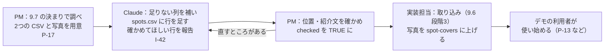

- 写真を Storage に上げるのと、本番のデータベースで取り込みを実行するのは人が行う（秘密の値が要るため）
- 一覧を足したり直したりしたときも、同じ流れを繰り返す（取り込みは id をキーにした上書きなので、二重にはならない。9.6）
