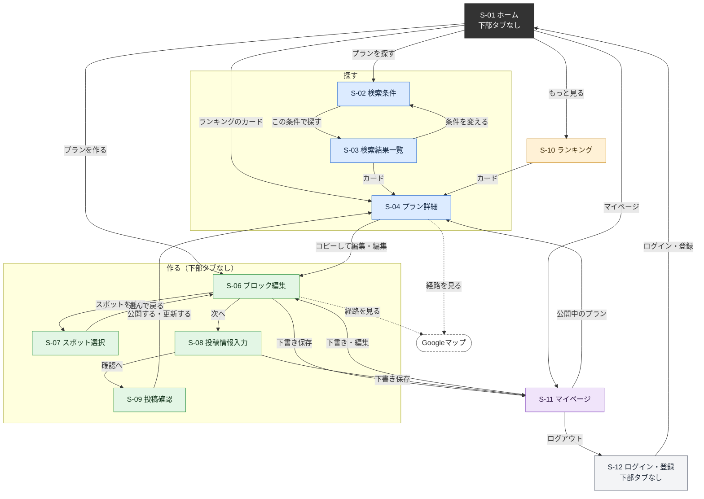
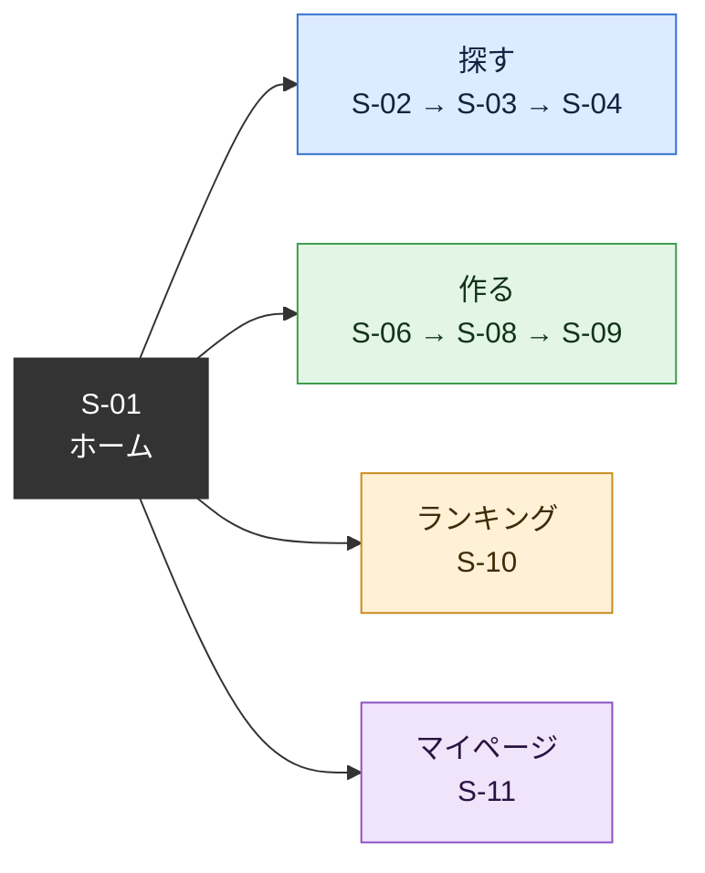
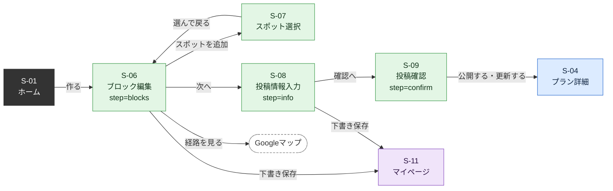
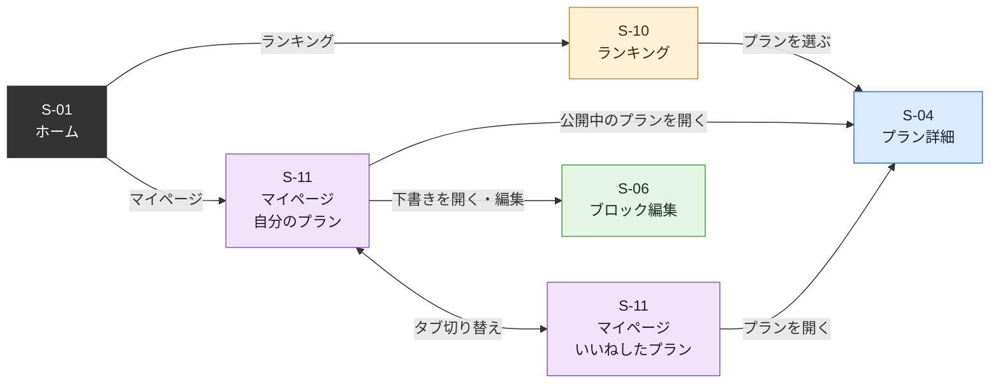
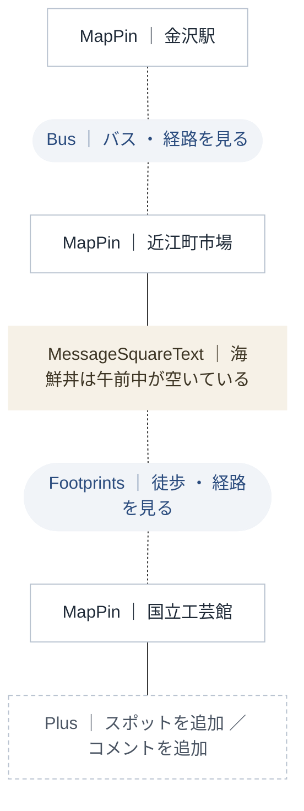
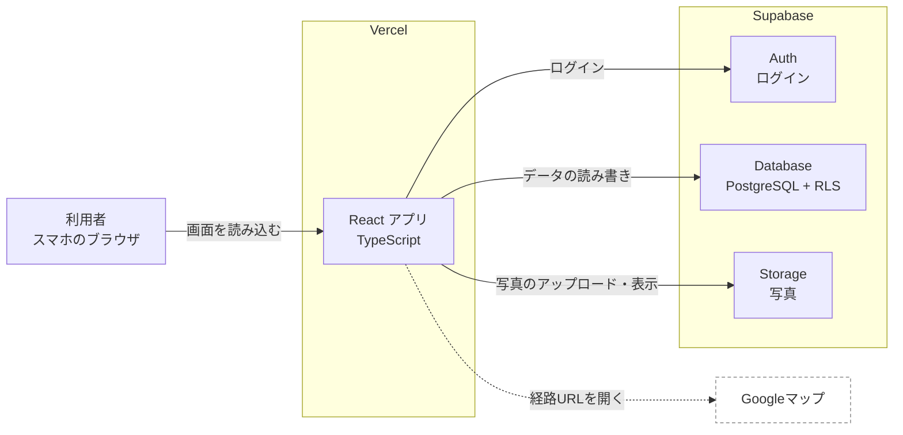
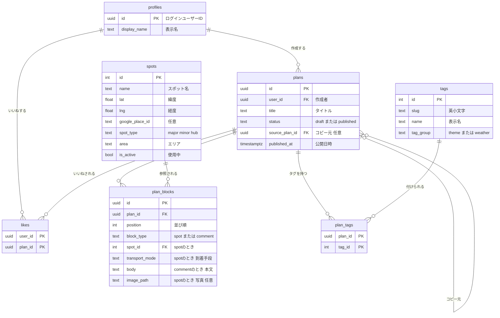

# 旅ノートサイト 要件定義書

チーム CCCA305A-1 / プロジェクトテーマ：金沢らしさを観光客に広めるには

最終更新：2026-10-14（変更の記録は「18. 変更履歴」）

## 0. この文書の使い方

- この文書が要件の唯一の正。今後の変更はすべてこのファイルを上書きして行う
- これまでの「機能要件_画面遷移.md」「機能要件_画面遷移_MVP.md」「技術選定_API設計_v1〜v3.md」の内容はすべてこの文書に統合した。以後は参照しない
- リポジトリには `docs/requirements.md` として置き、AIに作業させるときは必ず読ませる
- 現在、未確定の検討事項はない。今後、検討事項が出たら【K26】のように番号を付けて本文に印を付け、「16. 検討事項」への回答で確定・修正する

ID の種類

| 接頭辞 | 意味 | 例 |
| --- | --- | --- |
| F- | 機能 | F-11 ブロックでプランを組み立てる |
| S- | 画面 | S-06 ブロック編集 |
| BR- | 業務ルール（画面をまたぐ決まりごと） | BR-04 移動手段の扱い |
| IT- | 結合テストのシナリオ | IT-02 作成から公開まで |
| K- | 検討事項（未確定） | K01 |
| Q- | 過去の確認事項（決定済み） | Q15 |
| T- | 実装前の動作確認 | T1 |
| I- / P- | Issue（13.2）。I- は Claude が実装するもの、P- は人が行うもの | I-13 S-06 ブロック編集 |

コード、ブランチ名、プルリクエスト、AIへの指示では、この ID で対象を指定する。

### 0.1 チーム体制

5人で開発する。実装は、実装担当の1人が Claude を使ってすべての範囲を行う。画面ごとに担当を分けない（13.1）。

| 役割 | 人数 | 主な仕事 |
| --- | --- | --- |
| PM | 1 | 要件定義書の管理、検討事項の決定、ライブラリ追加の承認、結合テストの進行、スポットデータの取りまとめ |
| 実装担当 | 1 | Claude を使って全範囲を実装する。Supabase の管理（パスワードの再設定、停止の確認など）も行う。誰が担当するかはPMが決める |
| メンバー | 3 | スポットデータ集め、スマホでの動作確認、サンプル投稿 |

プルリクエストの確認と取り込み（マージ）は、作った人以外が行う（12.3）。実装担当が作ったプルリクエストは、PMかメンバーが確認して取り込む。

## 1. プロジェクト概要

### 1.1 背景と目的

| 項目 | 内容 |
| --- | --- |
| 問題点 | 金沢を訪れる観光客は多いが、金沢らしさを知っている人は少ない。観光客は兼六園、ひがし茶屋街、近江町市場などの一部に集中し、それ以外の場所が知られていない |
| 真の課題 | 定番以外の情報発信が少ない。多様な文化資源が利益優先の情報発信の中で埋もれている。多様な移動手段が示されていない |
| 解決策 | 観光客が旅行プランを投稿・検索・コピーできる旅ノートサイト。定番以外のスポットを含むプランを目立たせる |
| 目標 | 県内県外を問わず9割の人に金沢らしさを知ってもらう |

### 1.2 MVPで確かめること

- タグ検索で、定番以外のスポットを含むプランに出会えるか
- ブロックを並べる操作で、旅行プランを迷わず組み立てられるか
- 使った人が「金沢らしさを知れた」と感じるか（サイトの外のGoogleフォームで確認する）

### 1.3 範囲

| 範囲内（MVP） | 範囲外 |
| --- | --- |
| タグによるプラン検索と閲覧 | フリーワード検索 |
| ブロックによるプラン作成、下書き、公開 | スポット詳細画面 |
| 他人のプランのコピー | カテゴリ別ランキング |
| いいね、ランキング（総合、定番以外） | サイト内アンケート |
| 金沢市内のスポット（金沢駅などの交通の起点を含む） | 金沢市外のスポット |
| マイページ（自分のプラン、いいねしたプラン） | 利用者によるスポットの追加 |
| メールアドレスとパスワードでのログイン | メール送信（確認メール、パスワード再設定） |
|  | プラン全体の経路を1つの地図で表示すること（BR-16） |
|  | 表示名の変更、退会、管理画面、多言語、通知 |

目的が金沢の魅力発信であるため、扱うスポットは金沢市の区域内に限る。スポットのデータの作り方は 9.6。

### 1.4 想定する利用者

金沢を訪れる、または訪れる予定の観光客。旅行の計画中と旅行中に、スマホのブラウザで使う。

## 2. 用語集

画面の文言とコード上の名前を揃えるための対応表。AIへの指示もこの用語を使う。

| 用語 | 意味 | コード上の名前 |
| --- | --- | --- |
| プラン | 1回の旅行の行程。ブロックの並びとタイトル、タグを持つ | `Plan` |
| ブロック | プランを構成する部品 | `Block` |
| スポットブロック | 訪れる場所を表すブロック | `SpotBlock`、`type: 'spot'` |
| 移動手段ブロック | スポット間の移動を表すブロック。データベースには保存せず、画面で生成する | `MoveBlock`、`type: 'move'` |
| コメントブロック | 自由記述のブロック | `CommentBlock`、`type: 'comment'` |
| スポット | 開発側が登録した場所のマスタ | `Spot` |
| スポットの種類 | 定番、定番以外、起点の3種類 | `spotType: 'major' \| 'minor' \| 'hub'` |
| 起点 | 金沢駅などの交通の拠点。定番以外の判定に使わない | `'hub'` |
| エリア | スポットのおおまかな地域。公式観光サイトの分け方に合わせる（9.6） | `area` |
| 定番 | 公式観光サイトの定番モデルコースに含まれる6件（9.7） | `'major'` |
| 定番以外を含む | プランに定番以外のスポットが1つ以上あること | `hasMinorSpot` |
| 移動手段 | 徒歩、バス、自転車、車 | `TransportMode: 'walk' \| 'bus' \| 'bicycle' \| 'car'` |
| タグ | 検索に使う固定のキーワード | `Tag` |
| 下書き | 本人だけが見られる状態 | `status: 'draft'` |
| 公開 | 誰でも見られる状態 | `status: 'published'` |
| 非公開に戻す | 公開中のプランを下書きに戻すこと | `unpublish` |
| いいね | プランへの評価。マイページから見返せる | `Like` |
| コピー元 | コピーして作ったプランの元のプラン | `sourcePlan` |
| 作成者 | プランを作った利用者 | `author` |
| 表示名 | 利用者が登録時に決める名前 | `displayName` |

## 3. 利用者と権限

サイトはログイン必須。ログインしていない状態では、ログイン・登録画面（S-12）以外は表示しない（K24、BR-14）。

| 操作 | 未ログイン | ログインユーザー | 作成者本人 |
| --- | --- | --- | --- |
| ログイン・新規登録（S-12） | できる | — | — |
| S-12 以外の画面 | できない（S-12 へ移る） | できる | できる |
| 公開プランの検索・閲覧・ランキング・経路を見る・コピーして編集 | — | できる | できる |
| 新規作成・下書き保存・公開 | — | できる | — |
| 下書きの閲覧 | — | できない | できる |
| 編集・非公開に戻す・削除 | — | できない | できる |
| いいね | — | できる | できない（自分のプランには不可） |

## 4. 機能要件

### 4.1 機能一覧

| ID | 機能 | 内容 | 画面 |
| --- | --- | --- | --- |
| F-01 | キーワード検索 | 固定タグを複数選択して検索する | S-02 |
| F-03 | 検索結果一覧 | 一致したプランをカードで表示する（BR-01） | S-03 |
| F-04 | 定番以外の優先表示 | 一致数が同じなら定番以外を含むプランを上位に出す（BR-01） | S-03 |
| F-05 | プラン詳細の閲覧 | ブロック形式でプランを表示する | S-04 |
| F-07 | Googleマップで経路を開く | 移動手段ブロックごとに、その1区間の経路URLを生成して開く（10.8、BR-16） | S-04, S-06 |
| F-11 | ブロックでプランを組み立てる | スポット、移動手段、コメントのブロックを並べる（BR-03） | S-06 |
| F-12 | スポットブロックの追加 | スポット一覧から選んで追加する | S-07 |
| F-13 | ブロックの並べ替え・削除 | 長押しドラッグまたは上下ボタンで並べ替える。削除する | S-06 |
| F-14 | 移動手段ブロック | スポットの間に自動で入り、移動手段を選ぶ（BR-04） | S-06 |
| F-15 | コメントブロック | 自由記述のブロックを追加する | S-06 |
| F-16 | 他のプランをコピーして編集 | 表示中のプランを作成画面に取り込む（BR-07） | S-04, S-06 |
| F-17 | 下書き保存 | 非公開のまま保存する | S-06, S-08 |
| F-18 | 投稿情報の入力 | タイトル、タグ、スポットごとの写真を入力する | S-08 |
| F-19 | 投稿 | 公開条件を確認して公開する（BR-06） | S-09 |
| F-21 | 総合ランキング | いいね数の多い順（BR-11） | S-10 |
| F-22 | 定番以外ランキング | 定番以外を含むプランだけのランキング（BR-11） | S-10, S-01 |
| F-24 | いいね | いいねを付ける・取り消す（BR-08） | S-04, S-11 |
| F-31 | ユーザー登録・ログイン | メールアドレスとパスワード（BR-14） | S-12 |
| F-32 | マイページ | 自分のプランといいねしたプランを見る。自分のプランの編集・非公開・削除 | S-11, S-04 |

欠番：F-02（フリーワード検索）、F-06（スポット詳細）、F-23（カテゴリ別ランキング）、F-33（利用後アンケート）は MVP の範囲外。

## 5. 業務ルール

画面をまたいで守る決まりごと。実装では該当する BR 番号をコメントに書く。

### BR-01 検索

- 選んだタグのどれか1つでも一致したプランを出す（OR検索）
- タグを1つも選ばない場合は、公開中のプランをすべて出す
- 並び順：①一致したタグ数が多い順 ②定番以外を含むプランが先 ③いいね数が多い順 ④公開日時が新しい順 ⑤プランIDの順（並びを安定させるため）
- 20件ずつ表示し、「もっと見る」ボタンで次の20件を読み込む
- 該当件数を表示する
- 対象は公開中のプランだけ

### BR-02 定番以外を含む

- プランのスポットブロックに、種類が「定番以外（minor）」のスポットが1つ以上あれば「定番以外を含む」とする
- 「起点（hub）」のスポット（金沢駅など）は判定に使わない

### BR-03 ブロックの構成

- データベースに保存するブロックはスポットとコメントの2種類。移動手段ブロックは画面で生成する（BR-04）
- 1プランに保存できるブロックは30個まで（スポットとコメントの合計。移動手段ブロックは数えない）
- コメントブロックはどの位置にも置ける（先頭や末尾も可）
- 同じスポットを1プランに複数回入れてよい（例：金沢駅に戻る）。ただし、コメントを除いて隣り合う位置に同じスポットは置けない
- コメントブロックは追加時に末尾に入り、並べ替えで好きな位置に動かす

### BR-04 移動手段

- 移動手段は「そのスポットへ何で来たか」として、到着側のスポットブロックが持つ
- 最初のスポットブロックの移動手段は空（null）。2つ目以降は必ず値を持つ
- 新しく追加したスポットの移動手段は「徒歩」
- 並べ替えで最初になったスポットは移動手段を空にし、最初でなくなったスポットは「徒歩」にする
- 画面では、2つ目以降の各スポットブロックの直前に移動手段ブロックを表示する。間にコメントがある場合も、次のスポットの直前に表示する
- この整え方は `lib/blocks.ts` の `normalizeBlocks()` で行い、ブロックを変更するたびと保存の直前に必ず呼ぶ

### BR-05 入力の制限

| 項目 | 制限 | 前後の空白 |
| --- | --- | --- |
| タイトル | 50文字以内。公開時は1文字以上 | 取り除く |
| コメント | 1〜500文字 | 取り除く。保存時に空のコメントブロックは自動で取り除く |
| 表示名 | 1〜20文字。他の人と同じでもよい | 取り除く |
| メールアドレス | メールアドレスの形式 | 取り除く |
| パスワード | 8〜72文字 | そのまま |
| 写真 | 1スポットブロックにつき1枚。画像ファイルのみ | — |

### BR-06 保存時と公開時の確認

| 確認 | 下書き保存 | 公開・更新 |
| --- | --- | --- |
| ブロックが30個以下 | 確認する | 確認する |
| タイトルが50文字以内 | 確認する | 確認する |
| コメントが500文字以内 | 確認する | 確認する |
| タイトルがある | 確認しない | 確認する |
| スポットが2つ以上 | 確認しない | 確認する |
| タグが1つ以上 | 確認しない | 確認する |
| 隣り合う同じスポットがない | 確認する | 確認する |

画面（`validatePlan()`）とデータベース（`save_plan`）の両方で同じ確認をする。エラーのコードとメッセージは 10.6 で共通にする。

### BR-07 コピー

| 引き継ぐもの | 引き継がないもの |
| --- | --- |
| スポットブロック、移動手段、コメントブロック、タグ | タイトル（空にする。入力欄の例文に元のタイトルを表示）、写真 |
- コピーしたプランには、コピー元のプランIDを記録し、詳細画面に「〇〇さんのプランをもとに作成」と表示する
- コピー元が削除された場合、記録は空になり表示も消える。コピー元が非公開になった場合も表示しない
- 自分のプランもコピーできる

### BR-08 いいね

- 1人1プランにつき1回。もう一度押すと取り消す
- 自分のプランにはいいねできない（ボタンを出さず、数だけ表示する）
- 押した瞬間に画面の表示を切り替え、失敗したら元に戻してエラーを通知する

### BR-09 公開と非公開

- 初めて公開したとき、または非公開から再び公開したときに、公開日時を現在時刻にする
- 公開中のプランを編集して更新しても、公開日時は変えない（更新日時だけ変わる）
- 非公開に戻すと、状態を下書きにして公開日時を空にする。いいねは残す
- 非公開のプランは、検索、ランキング、他の人の「いいねしたプラン」に出ない
- 公開中のプランを編集している間も、保存するまでは元の内容が公開され続ける

### BR-10 削除

- 確認ダイアログを出してから削除する。元に戻せない
- プラン、ブロック、タグの対応、いいねを一緒に削除する
- そのプランの写真も削除する（失敗しても削除自体は完了させる）
- このプランをコピー元にしているプランは残り、コピー元の記録だけが空になる
- 削除はマイページ（S-11）からだけ行える

### BR-11 ランキング

- 対象は公開中のプランだけ。期間は全期間
- 総合：いいね数が多い順、同数なら公開日時が新しい順
- 定番以外：定番以外を含むプランだけを同じ順で並べる
- 上位20件を表示し、1位から順に番号を振る（同数でも番号は分けない）
- ホーム（S-01）には定番以外ランキングの上位3件を表示する

### BR-12 表示の形式

| 項目 | 形式 | 例 |
| --- | --- | --- |
| 日付 | 日本時間で YYYY/MM/DD | 2026/10/14 |
| いいね数 | 数字のみ | 12 |
| ルートの要約 | 最初の3スポットを「→」でつなぎ、残りは「ほかN件」 | 金沢駅 → 近江町市場 → 国立工芸館 ほか2件 |
| タイトルのない下書き | 「無題のプラン」 |  |
| 作成者 | 「〇〇さんのプラン」 | ひろとさんのプラン |

日付とルートの要約は `lib/format.ts` の関数で作り、各画面で独自に書かない。

### BR-13 写真

- 選んだ画像はブラウザで長辺1280px以下に縮小し、JPEG（品質0.8）に変換してからアップロードする
- アップロードはファイルを選んだ時点で行う（ログインが必要）
- 保存先は `plan-images/{ユーザーID}/{ランダムなID}.jpg`
- 読み込めない画像は「この画像は読み込めません」と通知する
- 写真を変更・削除しても、古いファイルはMVPでは消さない（プラン削除時だけ消す）

### BR-14 ログイン

- メールアドレスとパスワードで登録・ログインする。メールは送信しない（Supabaseのメール確認はオフ）
- 登録するとすぐにログイン状態になる
- ログイン状態はブラウザに保持され、閉じても続く
- パスワードを忘れた場合は、チームに連絡してもらい、実装担当がSupabaseの管理画面で再設定する
- サイトはログイン必須。ログインしていない状態で S-12 以外の画面を開くと、開こうとしたURLを `redirect` に付けて S-12 に移る
- ログイン後は、開こうとしていた画面に移る（`redirect` がなければホーム）。戻り先は `/` で始まるサイト内のURLだけを受け付ける（`//` で始まるものは不可）
- ログアウトすると S-12 に移る
- ログインの有効期限が切れた状態で操作した場合（API が UNAUTHORIZED を返した場合）も、S-12 に移る

### BR-15 未保存の変更

- 作成画面（S-06〜S-09）の編集内容は、変更のたびにブラウザ（localStorage）に自動で一時保存する（11.4）
- 保存せずに作成画面から離れようとしたら、「編集内容が保存されていません。移動しますか？」と確認する
- 作成画面を開いたときに一時保存が残っていれば、「前回の編集内容を復元しますか？」と聞く
- 保存に成功したら一時保存を消す

### BR-16 経路の見せ方

- Googleマップは、経由地を指定すると公共交通機関（バス）の経路を出せない（徒歩と車だけになる）。そのため、プラン全体を1本の経路として開くことはしない
- 移動手段ブロックごとに、前後2つのスポットだけを出発地と目的地にした1区間のURLを作る。経由地を使わないので、バスを含むすべての移動手段で経路と所要時間を表示できる
- プラン全体の経路をまとめて開くボタンや、全スポットを1つの地図に並べる表示は作らない（K18 で決定）

### BR-17 スポットデータ

- 対象は金沢市の区域内のスポットだけ
- スポットIDは一度振ったら変えない・使い回さない（プランのブロックが参照しているため）
- 一覧から外したいスポットは削除せず、「使用中止」（is_active = false）にする。新しいプランでは選べなくなるが、すでに使っているプランでは表示される
- 作り方は 9.6

## 6. 画面仕様

### 6.1 共通レイアウト

| 要素 | 仕様 |
| --- | --- |
| 画面幅 | スマホの幅いっぱい。PCでは中央に幅480pxの列で表示 |
| ヘッダー | 高さ56px、上部に固定。左に戻るボタン（必要な画面のみ）、中央に画面名、右に画面ごとの操作 |
| ホームへの戻り方 | 下部タブにホームはない。S-02、S-10、S-11 のヘッダー左にサイト名「旅ノート金沢」を表示し、押すとホームへ移る |
| 下部タブ | 高さ64px、下部に固定。探す、作る、ランキング、マイページの4つ |
| 下部タブを出す画面 | S-02、S-03、S-04、S-10、S-11 |
| 下部タブを出さない画面 | S-01（ホームは独自の入口ボタンがあるため）、S-06〜S-09（作成画面は独自の下部ボタンがあるため）、S-12 |
| 下部タブの選択状態 | URLの先頭で判定。`/search` 探す、`/ranking` ランキング、`/mypage` マイページ。S-04 ではどれも選択しない。「作る」は押すと S-06 へ移るだけ（S-06 では下部タブを出さない） |
| 通知（トースト） | 画面下部（下部タブがあればその上）に表示し、3秒で消える。成功、エラー、お知らせの3種類 |
| 読み込み中 | 一覧はカードの形の灰色の枠（スケルトン）、ボタンは中に回転アイコン |
| エラー | 画面全体の読み込み失敗は「エラー表示」（アイコン、メッセージ、再読み込みボタン）。操作の失敗はトースト |
| 存在しないURL | 「ページが見つかりません」とホームへのボタン |

### 6.2 画面一覧

| 画面ID | 画面名 | URL | ログイン |
| --- | --- | --- | --- |
| S-01 | ホーム | `/` | 必要 |
| S-02 | 検索条件 | `/search?tags=2,3`（tags は任意） | 必要 |
| S-03 | 検索結果一覧 | `/search/results?tags=2,3` | 必要 |
| S-04 | プラン詳細 | `/plans/:planId` | 必要（下書きは本人のみ） |
| S-06 | ブロック編集 | `/plans/new?step=blocks`、`/plans/:planId/edit?step=blocks` | 必要 |
| S-07 | スポット選択 | S-06 の上に重ねて表示（URLなし） | 必要 |
| S-08 | 投稿情報入力 | 同上の `step=info` | 必要 |
| S-09 | 投稿確認 | 同上の `step=confirm` | 必要 |
| S-10 | ランキング | `/ranking?type=overall` または `type=minor` | 必要 |
| S-11 | マイページ | `/mypage?tab=mine` または `tab=liked` | 必要 |
| S-12 | ログイン・登録 | `/login?mode=login&redirect=戻り先`（mode は login または signup） | 不要 |
- コピーして作るときは `/plans/new?step=blocks&from=:planId`
- `step` がないときは `blocks` として扱う。`tags` は数字以外を無視し、小さい順に並べて扱う
- S-05 は欠番（スポット詳細、範囲外）

### 6.3 画面遷移図

#### 全画面の遷移図

全画面とその間の移動を1枚に描いたもの。下部タブ（探す、作る、ランキング、マイページ）とヘッダーのサイト名による移動は、多くの画面から同じようにできるため線を省き、下の表にまとめた。点線は外部のGoogleマップへの移動。サイトはログイン必須で、ログインしていない状態でどの画面を開いても S-12 に移り、ログイン後に開こうとしていた画面へ移る（BR-14）。



図から省いた移動

| きっかけ | 移動元 | 移動先 |
| --- | --- | --- |
| 下部タブ「探す」「作る」「ランキング」「マイページ」 | S-02、S-03、S-04、S-10、S-11 | S-02、S-06、S-10、S-11 |
| ヘッダーのサイト名 | S-02、S-10、S-11 | S-01 |
| ヘッダーの戻る | S-03、S-04、S-06〜S-09 | 1つ前の画面（作成画面の中は前のステップ） |
| ログイン・登録の完了 | S-12 | 開こうとしていた画面（BR-14） |

以下は目的ごとに分けた図。

#### 全体の地図

ホームの入口と下部タブから、4つの機能に移れる。



#### プランを探す


#### プランを作って公開する



S-06、S-08、S-09 は1つの作成画面の3つのステップで、編集内容を共有する。各ステップの戻るボタンで前のステップに戻れる。

#### ランキングとマイページ



#### ログインの扱い

| 状況 | 動き |
| --- | --- |
| ログインしていない状態で、S-12 以外のURLを開いた | S-12 に移る。開こうとしたURLを `redirect` に付ける |
| S-12 でログイン・登録した | `redirect` の画面に移る。なければ S-01 |
| ログイン済みで S-12 を開いた | S-01 に移る |
| S-11 でログアウトした | S-12 に移る |

### 6.4 画面ごとの詳細

#### S-01 ホーム

下部タブは出さない（6.1）。

| 要素 | 内容 |
| --- | --- |
| ロゴ | 画面上部にアプリのロゴ（`Logo` 部品）。ロゴ画像ができるまでは、サイト名「旅ノート金沢」の文字を太字で表示する。画像ができたら `Logo` 部品の中身だけを差し替える（P-05） |
| マイページ | 右上にマイページへのアイコンボタン（CircleUser、aria-label「マイページ」）→ `/mypage` |
| 説明 | 「みんなの旅ノートから、金沢の旅を組み立てよう」 |
| ボタン | 「プランを探す」（Search）→ `/search`、「プランを作る」（CirclePlus）→ `/plans/new` |
| ランキング | 見出し「定番以外ランキング」、上位3件のプランカード（順位付き）。カードを押すと S-04。「もっと見る」→ `/ranking?type=minor` |
| 出典 | 画面の一番下に、スポットデータの出典（使ったオープンデータの名前と提供元、公式観光サイト）を小さく表示する |

| 状態 | 表示 |
| --- | --- |
| 読み込み中 | スケルトン3枚 |
| 0件 | 「まだプランがありません」 |
| エラー | エラー表示 |

使うAPI：`getRanking({ type: 'minor', limit: 3 })`

#### S-02 検索条件

| 要素 | 内容 |
| --- | --- |
| ヘッダー | 「プランを探す」 |
| タグ選択 | 「テーマ」「天気」の見出しごとにタグを並べる。タグはアイコン付きのチップで、押すと選択・解除 |
| 選択のクリア | 「選択をクリア」（1つ以上選択中のみ） |
| 下部ボタン | 「この条件で探す」。選択数があれば「（N件選択中）」を添える。0件でも押せる（全件表示） |
- URLの `tags` で選択済みの状態から始める（S-03 の「条件を変える」から戻ったとき）
- 押すと `/search/results?tags=...`（0件なら `/search/results`）へ移る

使うAPI：`getTags()`

#### S-03 検索結果一覧

| 要素 | 内容 |
| --- | --- |
| ヘッダー | 戻る（`/search?tags=...`）、「検索結果」 |
| 条件 | 選んだタグのチップ（押せない）と「条件を変える」。タグなしのときは「すべてのプラン」 |
| 件数 | 「N件のプラン」 |
| 一覧 | プランカード。カードを押すと S-04 |
| もっと見る | 次のページがあるときだけ表示 |

| 状態 | 表示 |
| --- | --- |
| 読み込み中 | スケルトン5枚 |
| 0件 | SearchX アイコン、「条件に合うプランが見つかりませんでした」、「条件を変える」ボタン |
| エラー | エラー表示 |

使うAPI：`searchPlans({ tagIds, page })`

#### S-04 プラン詳細

| 要素 | 内容 |
| --- | --- |
| ヘッダー | 戻る（ブラウザの履歴で戻る。履歴がなければ `/`）。右側は作成者本人のときだけメニュー（EllipsisVertical）：「編集」「非公開に戻す」（公開中のみ） |
| タイトル | タイトル。下書きなら「下書き」ラベル |
| 作成者 | 「〇〇さんのプラン」、公開日 |
| コピー元 | コピー元があれば「〇〇さんのプランをもとに作成」（押すとコピー元の S-04） |
| タグ | タグのチップ |
| いいね | Heart アイコンと数。押すといいね・取り消し（BR-08）。本人のプランは数だけ |
| 操作 | 「コピーして編集」（Copy）→ `/plans/new?step=blocks&from=:planId` |
| ブロック | ブロック一覧（表示モード）。移動手段ブロックの「経路を見る」でGoogleマップを新しいタブで開く |

| 状態 | 表示 |
| --- | --- |
| 読み込み中 | スケルトン |
| 見つからない（削除済み、非公開、他人の下書き） | 「このプランは見つかりません」とホームへのボタン |
| エラー | エラー表示 |

| 操作 | 結果 |
| --- | --- |
| 非公開に戻す | 確認ダイアログ → `unpublishPlan` → トースト「非公開にしました」→ そのまま下書きとして表示 |
| 編集 | `/plans/:planId/edit?step=blocks` |

使うAPI：`getPlan(planId)`、`hasLiked(planId)`、`likePlan`、`unlikePlan`、`unpublishPlan`

#### S-06 ブロック編集（step=blocks）

| 要素 | 内容 |
| --- | --- |
| ヘッダー | 戻る（未保存なら確認、BR-15）、「プランを作成」または「プランを編集」、右に「ブロック N/30」 |
| コピー中の表示 | コピーして作るときは「〇〇さんのプランをもとに作成中」 |
| ブロック | ブロック一覧（編集モード）（7.5） |
| 追加ボタン | 「スポットを追加」（Plus）→ S-07 を開く、「コメントを追加」（Plus）→ 末尾にコメントブロックを追加して入力欄にカーソル。30個に達したら押せなくし「ブロックは30個までです」 |
| 下部ボタン | 「下書き保存」（Save。公開中のプランの編集では出さない）、「次へ」（ArrowRight）→ `step=info` |

| 操作 | 結果 |
| --- | --- |
| スポットブロックのつまみを長押ししてドラッグ | 並べ替え。移動手段は BR-04 で付け直す |
| 上へ・下へボタン | 1つずつ移動 |
| 削除ボタン | 確認なしで削除 |
| 移動手段ブロックのラベルを押す | 4つの移動手段の選択肢（アイコン付き）を表示し、選ぶと変更 |
| 経路を見る | Googleマップを新しいタブで開く |
| 下書き保存 | 保存 → トースト「下書きを保存しました」→ `/mypage?tab=mine` |
| 次へ | `step=info` |

| 状態 | 表示 |
| --- | --- |
| ブロックが0個 | MapPin アイコン、「スポットを追加して旅の流れを作りましょう」 |
| 編集するプランの読み込み中 | スケルトン |
| 他人のプランの編集URL、存在しないプラン | 「このプランは編集できません」とホームへのボタン |

使うAPI：`getPlan(planId)`（編集時、コピー時）、`savePlan`

#### S-07 スポット選択

S-06 の上に下から出るシート（ボトムシート）として表示する。

| 要素 | 内容 |
| --- | --- |
| 見出し | 「スポットを追加」、閉じる（X） |
| 絞り込み | 「スポット名で絞り込み」。入力した文字を名前に含むスポットだけ表示（画面内で絞り込む） |
| エリアと種類の絞り込み | エリアの選択（すべて、9.6 のエリア一覧）と、「定番以外だけ」の切り替え |
| 一覧 | スポット名、紹介文（1行で省略）、定番なら「定番」ラベル、起点なら「起点」ラベル。エリアごとに見出しを付けて並べる |
- 使用中止（is_active = false）のスポットは出さない
- スポットが数百件になっても、すべて読み込んでから画面内で絞り込む（件数が1,000を超えたら見直す）
- 押したスポットを末尾に追加してシートを閉じ、追加したブロックまでスクロールする
- 直前のスポットと同じものは押せなくし、「直前と同じスポットは続けて追加できません」と表示する

使うAPI：`getSpots()`

#### S-08 投稿情報入力（step=info）

| 要素 | 内容 |
| --- | --- |
| ヘッダー | 戻る（`step=blocks`）、「投稿情報」 |
| タイトル | 入力欄、「N/50」。コピー時は例文に元のタイトルを表示 |
| タグ | S-02 と同じタグ選択の部品 |
| 写真 | スポットブロックごとに、スポット名と、写真の縮小表示または「写真を追加」（ImagePlus）。写真があれば「変更」「削除」 |
| 下部ボタン | 「下書き保存」（公開中のプランの編集では出さない）、「確認へ」→ `step=confirm` |
- 写真は選んだ時点で縮小してアップロードし、終わるまで回転アイコンを表示する（BR-13）
- 入力の確認はここでは行わず、S-09 でまとめて表示する

使うAPI：`getTags()`、`uploadPlanImage`、`savePlan`

#### S-09 投稿確認（step=confirm）

| 要素 | 内容 |
| --- | --- |
| ヘッダー | 戻る（`step=info`）、「投稿内容の確認」 |
| 確認結果 | 公開条件（BR-06）を満たさない項目があれば、CircleAlert アイコン付きで一覧表示し、項目ごとに直すステップへ移るボタン（「ブロック編集へ」「投稿情報へ」） |
| プレビュー | S-04 と同じ見た目でタイトル、タグ、ブロックを表示（いいね、コピー、メニューは出さない） |
| 下部ボタン | 新規・下書きなら「公開する」（Send）、公開中のプランの編集なら「更新する」。確認結果に問題があれば押せない |

| 操作 | 結果 |
| --- | --- |
| 公開する・更新する | 保存 → 一時保存を消す → トースト「公開しました」または「更新しました」→ `/plans/:planId`（履歴を置き換え、戻るで作成画面に戻らないようにする） |
| 保存時にデータベース側の確認で失敗 | 確認結果の一覧にその内容を表示 |

使うAPI：`savePlan`

#### S-10 ランキング

| 要素 | 内容 |
| --- | --- |
| ヘッダー | 「ランキング」 |
| 切り替え | 「総合」「定番以外」の2択（URLの `type`） |
| 説明 | 定番以外のとき「定番スポット以外を含むプランのランキングです」 |
| 一覧 | 順位付きのプランカード（最大20件） |

| 状態 | 表示 |
| --- | --- |
| 読み込み中 | スケルトン5枚 |
| 0件 | Trophy アイコン、「まだランキングに入るプランがありません」 |
| エラー | エラー表示 |

使うAPI：`getRanking({ type, limit: 20 })`

#### S-11 マイページ

| 要素 | 内容 |
| --- | --- |
| ヘッダー | 「マイページ」、右に「ログアウト」（LogOut）→ ログアウトして S-12 へ |
| 利用者 | 「〇〇さん」（表示名） |
| 切り替え | 「自分のプラン」「いいねしたプラン」の2択（URLの `tab`） |
| 自分のプラン | プランカードに「公開中」（Globe）または「下書き」（FilePen）のラベル。更新日時の新しい順。カード右上のメニュー（EllipsisVertical）：「編集」「非公開に戻す」（公開中のみ）「削除」 |
| いいねしたプラン | プランカード。いいねした日時の新しい順。カード右上の Heart ボタンで取り消し（一覧から消える） |

| 操作 | 結果 |
| --- | --- |
| 公開中のカードを押す | S-04 |
| 下書きのカードを押す | `/plans/:planId/edit?step=blocks` |
| 非公開に戻す | 確認ダイアログ → トースト「非公開にしました」 |
| 削除 | 確認ダイアログ（「このプランを削除します。元に戻せません。」、赤いボタン「削除する」）→ トースト「削除しました」 |

| 状態 | 表示 |
| --- | --- |
| 自分のプランが0件 | Inbox アイコン、「まだプランがありません」、「プランを作る」ボタン |
| いいねしたプランが0件 | Heart アイコン、「いいねしたプランはまだありません」、「プランを探す」ボタン |

使うAPI：`getMyPlans()`、`getLikedPlans()`、`unpublishPlan`、`deletePlan`、`unlikePlan`、`signOut`

#### S-12 ログイン・登録

| 要素 | 内容 |
| --- | --- |
| ヘッダー | 「ログイン」または「新規登録」。戻るボタンはない（ログイン必須のため） |
| ロゴ | 画面上部に `Logo` 部品 |
| 切り替え | 「ログイン」「新規登録」の2択（URLの `mode`） |
| ログイン | メールアドレス、パスワード、「ログイン」ボタン（LogIn） |
| 新規登録 | 表示名、メールアドレス、パスワード（「8文字以上」と表示）、「登録する」ボタン（UserPlus） |
| 案内 | 「パスワードを忘れた場合は、チームに連絡してください」 |
- 入力の誤りは各入力欄の下に表示する（BR-05）
- 成功したらトースト「ログインしました」または「登録しました」を出し、`redirect` の画面（なければ `/`）へ移る
- ログイン済みで開いた場合は S-01 へ移る

| 失敗 | メッセージ |
| --- | --- |
| メールアドレスかパスワードが違う | メールアドレスまたはパスワードが違います |
| 登録済みのメールアドレス | このメールアドレスはすでに登録されています |
| パスワードが短い | パスワードは8文字以上で入力してください |

使うAPI：`signIn`、`signUp`

### 6.5 共通のメッセージ

画面をまたいで使う文言は `src/constants/messages.ts` にまとめ、各画面で書き換えない。

| 種類 | 文言 |
| --- | --- |
| 通信エラー | 通信に失敗しました。電波の良いところでもう一度お試しください |
| 想定外のエラー | エラーが発生しました。時間をおいてもう一度お試しください |
| ログインの期限切れ | ログインの有効期限が切れました。もう一度ログインしてください |
| 権限がない | この操作はできません |
| 再読み込みボタン | もう一度読み込む |
| 未保存の確認 | 編集内容が保存されていません。移動しますか？ |
| 復元の確認 | 前回の編集内容を復元しますか？ |
| 非公開の確認 | このプランを非公開にします。検索やランキングに表示されなくなります。 |
| 削除の確認 | このプランを削除します。元に戻せません。 |

## 7. UIデザインルール

### 7.1 基本方針

| ルール | 内容 |
| --- | --- |
| 絵文字を使わない | 画面の文字、ボタン、入力欄の例文、通知、サンプルデータのすべてで使わない |
| アイコンは Lucide だけ | lucide-react のみ。他のアイコン集、自作SVG、画像のアイコンを混ぜない |
| 生成AIで作った画像を使わない | 授業の生成AI利用のガイドラインにより、生成AIで作った画像をアプリに載せない。ロゴや写真は人が作る・撮る |
| 左線のアクセントカードを使わない | カードの左側だけに色線を引くデザイン（`border-left` での強調）を使わない。上側だけの色線や `box-shadow` での代用もしない |
| 共通の値だけを使う | 色、余白、文字サイズ、角丸は `styles/variables.css` の変数だけを使い、色コードや数値を直接書かない |
| 共通部品を使う | ボタン、カード、タグなどは 7.6 の共通部品を使い、画面ごとに作らない |

### 7.2 デザイントークン（styles/variables.css）

色は K15 で決定（加賀五彩の藍と金）。変数名と値は確定。

| 変数 | 値 | 用途 |
| --- | --- | --- |
| `--color-primary` | #2B4C7E | メインの色（藍）。主ボタン、選択中のタブ、リンク |
| `--color-primary-weak` | #E8EEF6 | メインの色の薄い版。アイコンのバッジ、選択中のタグの背景 |
| `--color-accent` | #B8892B | アクセント（金）。順位の表示など |
| `--color-text` | #1F2A37 | 本文 |
| `--color-text-sub` | #5B6675 | 補足の文字 |
| `--color-border` | #D5DCE4 | 枠線 |
| `--color-bg` | #F7F8FA | 画面の背景 |
| `--color-surface` | #FFFFFF | カードの背景 |
| `--color-comment-bg` | #F6F1E7 | コメントブロックの背景 |
| `--color-like` | #D64545 | いいね済みのハート |
| `--color-danger` | #C0392B | 削除などの危険な操作 |
| `--color-success` | #2E7D4F | 成功の通知 |
| `--color-tag-food` | #C4553A | タグ「食事」のアイコン（朱） |
| `--color-tag-scenery` | #3F7D4E | タグ「景観」のアイコン（緑） |
| `--color-tag-history` | #2B4C7E | タグ「歴史」のアイコン（藍） |
| `--color-tag-photo` | #A0457A  | タグ「写真」のアイコン（赤紫） |
| `--color-tag-relaxed` | #2F8A7E | タグ「ゆったり」のアイコン（青緑） |
| `--color-tag-quick` | #6B5CA5 | タグ「時短」のアイコン（紫） |
| `--color-tag-budget` | #A17A1F | タグ「コスパ」のアイコン（金茶） |
| `--color-tag-cozy` | #8A5A2B | タグ「くつろぎ」のアイコン（茶） |
| `--color-tag-sunny` | #C86A00 | タグ「晴れ」のアイコン（オレンジ） |
| `--color-tag-cloudy` | #5E6F82 | タグ「曇り」のアイコンの線（灰） |
| `--color-tag-cloudy-fill` | #CFD8E2 | タグ「曇り」のアイコンの雲の塗り |
| `--color-tag-rainy` | #2F7FC1 | タグ「雨」のアイコン（青） |

| 変数 | 値 | 用途 |
| --- | --- | --- |
| `--space-1`〜`--space-6` | 4px、8px、12px、16px、24px、32px | 余白 |
| `--radius-sm` / `--radius-md` / `--radius-full` | 8px / 12px / 9999px | 角丸（小さい部品 / カード / 丸いラベル） |
| `--font-size-xs`〜`--font-size-xl` | 12px、14px、16px、18px、22px | 文字サイズ（本文は16px） |
| `--font-family` | system-ui, -apple-system, “Hiragino Sans”, “Noto Sans JP”, sans-serif | 文字の種類（Webフォントは読み込まない） |
| `--tap-min` | 44px | 押せる場所の最小サイズ |
| `--header-height` / `--tabbar-height` | 56px / 64px | ヘッダーと下部タブの高さ |
| `--z-header` / `--z-tabbar` / `--z-sheet` / `--z-dialog` / `--z-toast` | 10 / 20 / 30 / 40 / 50 | 重なり順 |

文字と背景の色の組み合わせは、コントラスト比 4.5:1 以上にする。

タグのアイコンの色（`--color-tag-*`）は、チップの背景（選択中の `--color-primary-weak` を含む）に対してコントラスト比 3:1 以上にする。色を付けるのはアイコンだけで、タグの文字の色は変えない。

### 7.3 アイコンの対応表

対応は `src/lib/icons.ts` に1か所でまとめ、各画面はそこから使う。新しい対応が必要なときも icons.ts に追加する。

| 区分 | 対象 | アイコン |
| --- | --- | --- |
| 下部タブ | 探す / 作る / ランキング / マイページ | `Search` / `CirclePlus` / `Trophy` / `CircleUser` |
| ブロック | スポット / コメント | `MapPin` / `MessageSquareText` |
| 移動手段 | 徒歩 / バス / 自転車 / 車 | `Footprints` / `Bus` / `Bike` / `Car` |
| 経路 | 経路を見る | `Navigation` |
| タグ | 食事 / 景観 / 歴史 / 写真 | `Utensils` / `Mountain` / `Landmark` / `Camera` |
| タグ | ゆったり / 時短 / コスパ / くつろぎ | `Leaf` / `Timer` / `Wallet` / `Coffee` |
| タグ | 晴れ / 雨 / 曇り | `Sun` / `CloudRain` / `Cloud` |
| プラン | 定番以外を含む | `Compass` |
| プラン | 公開中 / 下書き | `Globe` / `FilePen` |
| 操作 | いいね（済みは塗りつぶし） | `Heart` |
| 操作 | コピーして編集 / 編集 / 削除 | `Copy` / `Pencil` / `Trash2` |
| 操作 | 並べ替えのつまみ / 上へ / 下へ | `GripVertical` / `ChevronUp` / `ChevronDown` |
| 操作 | 追加 / 写真を追加 | `Plus` / `ImagePlus` |
| 操作 | 下書き保存 / 次へ / 公開する | `Save` / `ArrowRight` / `Send` |
| 操作 | 非公開に戻す / その他のメニュー | `EyeOff` / `EllipsisVertical` |
| 操作 | 戻る / 閉じる | `ArrowLeft` / `X` |
| 操作 | ログイン / 登録 / ログアウト | `LogIn` / `UserPlus` / `LogOut` |
| 状態 | 読み込み中 / 再読み込み | `LoaderCircle` / `RotateCw` |
| 状態 | 注意 / 検索結果なし / 一覧が空 | `CircleAlert` / `SearchX` / `Inbox` |
| 状態 | 写真なし | `Image` |

使い方

- `import { MapPin } from 'lucide-react'` のように、使うものだけを読み込む
- 大きさは本文中20px、下部タブ24px。線の太さは標準（2）
- 色は周りの文字色に合わせる（`currentColor`）
- 重要な操作はアイコンと文字を並べる。アイコンだけのボタンには `aria-label` を付け、文字と並ぶ飾りのアイコンには `aria-hidden` を付ける

### 7.4 カード

| 用途 | デザイン |
| --- | --- |
| 通常のカード | 四辺同じ1pxの枠線（`--color-border`）、角丸12px、白い背景、余白16px。影は付けない |
| 種類の区別 | 左上に、薄い色の円（32px、`--color-primary-weak`）の中にアイコンを入れたバッジと、種類名の文字 |
| 強調 | 背景全体を薄い色にする、または四辺の枠線の色を変える |
| ラベル | 角丸の小さなラベル（アイコン＋文字） |

### 7.5 ブロックの見た目

| ブロック | 表示モード（S-04、S-09） | 編集モード（S-06） |
| --- | --- | --- |
| スポット | 通常のカード。MapPin のバッジとスポット名。写真があればカード下部に表示（横幅いっぱい、縦横比4:3） | 表示モードに加え、右上に並べ替えのつまみ（GripVertical）、上へ・下へ、削除（Trash2） |
| 移動手段 | カードにしない。前後のカードの間に縦の点線と、丸いラベル（移動手段のアイコンと名前）、横に「経路を見る」（Navigation） | ラベルを押すと移動手段を選べる。並べ替え・削除はできない |
| コメント | 枠線なしで背景が `--color-comment-bg` のカード。MessageSquareText のアイコンと本文 | 本文が入力欄になり「N/500」を表示。右上に並べ替えのつまみ、上へ・下へ、削除 |



図の「MapPin」などは、実際の画面では Lucide のアイコンとして表示される。

### 7.6 共通部品

画面ごとに作らず、必ずこの共通部品を使う。引数を変えるときは 12.2 の手順に従う。

| 部品 | 置き場所 | 主な引数 | 使う画面 |
| --- | --- | --- | --- |
| `AppLayout` | components/common | `showTabBar` | 全画面 |
| `PageHeader` | components/common | `title`、`showSiteName?`（左にサイト名を出し、押すとホームへ）、`backTo?`（省略時はブラウザの戻る）、`right?` | 全画面 |
| `Logo` | components/common | `size: 'lg' \| 'sm'` | S-01 |
| `BottomTabBar` | components/common | なし（URLで選択状態を決める） | 6.1 の画面 |
| `Button` | components/common | `variant: 'primary' \| 'secondary' \| 'ghost' \| 'danger'`、`icon?`、`loading?`、`disabled?`、`fullWidth?` | 全画面 |
| `IconButton` | components/common | `icon`、`label`（aria-label）、`onClick` | 全画面 |
| `TagChip` | components/common | `tag`、`selected?`、`onToggle?` | S-02〜S-04、S-08 |
| `TagSelector` | components/common | `tags`、`selectedIds`、`onChange` | S-02、S-08 |
| `PlanCard` | components/common | `plan: PlanSummary`、`rank?`、`showStatus?`、`menu?`、`trailing?` | S-01、S-03、S-10、S-11 |
| `PlanCardSkeleton` | components/common | なし | 一覧の読み込み中 |
| `StatusLabel` | components/common | `status` | S-04、S-11 |
| `EmptyState` | components/common | `icon`、`title`、`action?` | 一覧の0件 |
| `ErrorState` | components/common | `message?`、`onRetry` | 読み込み失敗 |
| `SegmentedControl` | components/common | `options`、`value`、`onChange` | S-10、S-11、S-12 |
| `BottomSheet` | components/common | `open`、`title`、`onClose` | S-07 |
| `ConfirmDialog` | components/common | `title`、`message`、`confirmLabel`、`danger?`、`onConfirm` | S-04、S-06、S-11 |
| `useToast` | components/common | `show({ type, message })` | 全画面 |
| `BlockList` | components/blocks | `blocks`、`mode: 'view' \| 'edit'`、編集用の操作関数 | S-04、S-06、S-09 |
| `SpotBlockCard` / `MoveConnector` / `CommentBlockCard` | components/blocks | 各ブロックのデータ、`mode` | BlockList の中 |

`PlanCard` の表示内容：写真（なければ `--color-primary-weak` の背景に Image アイコン）、タイトル、ルートの要約（BR-12）、作成者、いいね数、タグ（最大3つ）、定番以外を含むなら「定番以外を含む」ラベル（Compass）。

## 8. 技術構成

### 8.1 採用技術

実装はAI（Claude）で行うため、AIが別の技術や書き方を混ぜないようにここで明示する。初期実装（I-01）で導入し、その時点の最新安定版を `package-lock.json` で固定する。以後、バージョンは上げない。

| 区分 | 採用 | パッケージ | 使い方の決まり |
| --- | --- | --- | --- |
| 言語 | TypeScript | typescript | strict。`any` は使わない |
| ビルド | Vite | vite、@vitejs/plugin-react | `react-ts` テンプレートで作る |
| UI | React | react、react-dom | 関数コンポーネントとフックだけ |
| 画面の切り替え | React Router | react-router | `createBrowserRouter` と `RouterProvider` で定義する。loader / action などのデータ機能と framework モードは使わない |
| サーバーデータの取得 | TanStack Query | @tanstack/react-query | v5 の書き方（`useQuery({ queryKey, queryFn })`）。キーは `api/queryKeys.ts` のものだけ |
| データベース・認証・写真 | Supabase | @supabase/supabase-js | v2。`lib/supabase.ts` と `api/` からだけ使う |
| ブロックの並べ替え | dnd-kit | @dnd-kit/core、@dnd-kit/sortable、@dnd-kit/utilities | 新しい `@dnd-kit/react` は使わない |
| アイコン | Lucide | lucide-react | 7.3 |
| スタイル | CSS Modules | （Vite 標準） | 7章 |
| テスト | Vitest | vitest | `lib/` の関数とモックの並び順だけをテストする（11.6） |
| 整形・チェック | ESLint、Prettier | eslint、prettier ほか | 設定は I-01 で作り、以後変えない |
| データベースの変更・型の生成 | Supabase CLI | supabase（開発用） | 実装担当が使う |
| 公開 | Vercel | — | main を自動で本番に公開。プルリクエストごとにプレビューURL |
| 実行環境 | Node.js（LTS）、npm | — | `.nvmrc` で固定。yarn、pnpm は使わない |
| 経路表示 | Googleマップ | — | URLを開くだけ（10.8）。APIキーは使わない |

使わないもの（AIが提案しても入れない）

| 使わないもの | 代わりに使うもの |
| --- | --- |
| Next.js、Remix、React Router の framework モード | Vite と React Router（上表） |
| Redux、Zustand などの状態管理ライブラリ | TanStack Query、useState / useReducer、ログイン状態だけ Context |
| Tailwind CSS、styled-components、UIライブラリ（MUI など） | CSS Modules と共通部品（7.6） |
| axios | supabase-js |
| フォームライブラリ（react-hook-form など）、zod | 自前の入力確認（`validatePlan` など） |
| 他のアイコン集、絵文字 | lucide-react |
| 画像圧縮ライブラリ | canvas を使った自前の縮小（`api/storage.ts`） |
| APIキーが必要な Google Maps の機能 | 経路URLを開くだけ |

この表以外のライブラリを追加するときは、PMの承認を得る（12.2）。

### 8.2 システム構成



- ブラウザから Supabase を直接呼ぶ。誰が何を読み書きできるかはデータベースのRLS（行単位のアクセス制御）で守る
- 複数の処理をまとめて行うもの（プランの保存、検索）だけ、データベース内の関数（RPC）にする

### 8.3 開発環境

| 項目 | 方針 |
| --- | --- |
| ソースコード | 代表者の個人GitHubアカウントに公開リポジトリを1つ作り、他の2人をコラボレーターに追加する |
| 公開 | 代表者の個人Vercelアカウントでリポジトリを連携する |
| Supabase | 開発用プロジェクトを1つ作り、全員で共有する。データベースの構造はマイグレーションでだけ変える（9.5） |
| データベースの変更履歴 | SQLを `supabase/migrations/` にファイルで残す |
| 秘密の値 | `.env.local` に書き、GitHubには上げない。Vercelには管理画面で登録する |

環境変数

```
VITE_SUPABASE_URL=https://xxxx.supabase.co
VITE_SUPABASE_ANON_KEY=（Supabaseの公開用キー。anon key または publishable key と表示される）
VITE_USE_MOCK=false   # true にするとSupabaseの代わりにモックのデータを使う（9.6）
```

公開リポジトリで守ること

| ルール | 理由 |
| --- | --- |
| `.env.local` は `.gitignore` に入れ、コミットしない | 誰でもコードを見られるため |
| 管理者用のキー（service_role / secret key）はどこにも書かない | 漏れるとRLSを無視して全データを操作される |
| サンプル投稿の写真は、チームで撮影したものか利用が許可されたものだけ | リポジトリと公開サイトの両方に載るため |
| 実在する個人のメールアドレスや名前をサンプルデータに入れない | 同上 |

## 9. データ設計

テーブル、ビュー、RPC、RLSの変更は、マイグレーション（9.5）で行う。

### 9.1 ER図



### 9.2 テーブル定義

**profiles**（利用者の表示情報。メールアドレスとパスワードは Supabase Auth が持つ）

| 列 | 型 | 制約 | 説明 |
| --- | --- | --- | --- |
| id | uuid | 主キー、auth.users を参照、利用者削除時に一緒に削除 |  |
| display_name | text | 必須、1〜20文字 | 表示名 |
| created_at | timestamptz | 既定値 now() |  |

新規登録時、登録情報（`raw_user_meta_data.display_name`）からトリガーで自動作成する。

**spots**（スポットのマスタ。金沢市内のスポットだけを 9.6 の方法で登録し、利用者は追加できない）

| 列 | 型 | 制約 | 説明 |
| --- | --- | --- | --- |
| id | int | 主キー。自動採番せず、スプレッドシートの id をそのまま使う（BR-17） |  |
| name | text | 必須、重複不可 | スポット名 |
| description | text | 必須、60文字程度 | 短い紹介文 |
| lat, lng | double precision | 必須 | 緯度・経度 |
| google_place_id | text | 任意 | Googleマップの場所ID |
| spot_type | text | 必須、‘major’、‘minor’、‘hub’ のいずれか | 定番、定番以外、起点 |
| area | text | 必須、9.6 のエリア一覧のどれか | エリア |
| is_active | boolean | 必須、既定値 true | false なら使用中止（BR-17） |
| sort_order | int | 既定値 0 | 一覧での表示順 |

**tags**（固定タグのマスタ）

| 列 | 型 | 制約 | 説明 |
| --- | --- | --- | --- |
| id | int | 主キー |  |
| slug | text | 必須、重複不可、英小文字 | アイコンとの対応に使う |
| name | text | 必須、重複不可 | 表示名 |
| tag_group | text | ‘theme’ または ‘weather’ | 画面でのまとまり |
| sort_order | int | 既定値 0 | 表示順 |

初期データ（確定。id は 9.7 のとおり）

| id | tag_group | name | slug |
| --- | --- | --- | --- |
| 1 | theme | 食事 | food |
| 2 | theme | 景観 | scenery |
| 3 | theme | 歴史 | history |
| 4 | theme | 写真 | photo |
| 5 | theme | ゆったり | relaxed |
| 6 | theme | 時短 | quick |
| 7 | theme | コスパ | budget |
| 8 | theme | くつろぎ | cozy |
| 9 | weather | 晴れ | sunny |
| 10 | weather | 雨 | rainy |
| 11 | weather | 曇り | cloudy |

**plans**（旅行プラン）

| 列 | 型 | 制約 | 説明 |
| --- | --- | --- | --- |
| id | uuid | 主キー、自動生成 |  |
| user_id | uuid | 必須、profiles を参照、利用者削除時に一緒に削除 | 作成者 |
| title | text | 必須（空文字可）、50文字以内 | 下書きは空でもよい |
| status | text | ‘draft’ または ‘published’、既定値 ‘draft’ |  |
| source_plan_id | uuid | 任意、plans を参照、参照先削除時は null | コピー元 |
| created_at | timestamptz | 既定値 now() |  |
| updated_at | timestamptz | 既定値 now()、更新時にトリガーで更新 |  |
| published_at | timestamptz | 公開中なら必須、下書きなら null | BR-09 |

**plan_blocks**（ブロック）

| 列 | 型 | 制約 | 説明 |
| --- | --- | --- | --- |
| id | uuid | 主キー、自動生成 |  |
| plan_id | uuid | 必須、plans を参照、プラン削除時に一緒に削除 |  |
| position | int | 必須、0〜29、(plan_id, position) で重複不可 | 並び順 |
| block_type | text | ‘spot’ または ‘comment’ |  |
| spot_id | int | spots を参照 | spot のとき必須、comment のとき null |
| transport_mode | text | ‘walk’、‘bus’、‘bicycle’、‘car’ または null | spot のときだけ。comment のとき null |
| body | text | 1〜500文字 | comment のとき必須、spot のとき null |
| image_path | text | 任意 | spot のときだけ |

種類ごとの組み合わせはチェック制約で守る（spot なら spot_id あり・body なし、comment なら body あり・spot_id と transport_mode と image_path なし）。

**plan_tags**

| 列 | 型 | 制約 |
| --- | --- | --- |
| plan_id | uuid | (plan_id, tag_id) が主キー。プラン削除時に一緒に削除 |
| tag_id | int | tags を参照 |

**likes**

| 列 | 型 | 制約 |
| --- | --- | --- |
| user_id | uuid | (user_id, plan_id) が主キー。利用者削除時に一緒に削除 |
| plan_id | uuid | プラン削除時に一緒に削除 |
| created_at | timestamptz | 既定値 now()。「いいねしたプラン」の並び順に使う |

インデックス：plans (status, published_at)、plans (user_id)、plan_tags (tag_id)、likes (plan_id)

### 9.3 ビュー plan_summaries

一覧系の画面すべてで使う、プランの要約。`security_invoker = true` を付けて作り、RLS が効くようにする。

| 列 | 型 | 内容 |
| --- | --- | --- |
| id, user_id, title, status, source_plan_id |  | plans の列 |
| created_at, updated_at, published_at | timestamptz | plans の列 |
| author_name | text | 作成者の表示名 |
| like_count | int | いいね数 |
| spot_count | int | スポットブロックの数 |
| has_minor_spot | boolean | BR-02 |
| spot_names | text[] | スポット名を並び順で（ルートの要約用） |
| tag_ids | int[] | タグID |
| cover_image_path | text | 並び順で最初の写真 |

### 9.4 アクセス制御（RLS）

サイトはログイン必須なので、データベースもログインユーザー（`authenticated`）にだけ読み書きを許す。未ログイン（`anon`）にはどのテーブルも許可しない。

| テーブル | 読む | 作る | 変える | 消す |
| --- | --- | --- | --- | --- |
| profiles | ログインユーザー | トリガーのみ | 本人 | 不可 |
| spots, tags | ログインユーザー | 不可 | 不可 | 不可 |
| plans | status = ‘published’ ならログインユーザー、それ以外は本人 | 本人（user_id = 自分） | 本人 | 本人 |
| plan_blocks, plan_tags | 親のプランが読めるなら | 親のプランの本人 | 親のプランの本人 | 親のプランの本人 |
| likes | ログインユーザー | 本人。ただし自分のプランには不可、公開中のプランのみ | 不可 | 本人 |

RPC（search_plans、save_plan）の実行権限も `authenticated` にだけ与える。

Storage（バケット `plan-images`）

| 操作 | 許可 |
| --- | --- |
| 読む | 公開バケット（画像のURLを知っていれば表示できる。URLは推測できないランダムな名前） |
| アップロード | ログインユーザーが `{自分のユーザーID}/` の中だけ |
| 削除 | 本人のフォルダの中だけ |
| 大きさ・種類 | 5MBまで、image/jpeg のみ（ブラウザで変換してから送るため） |

### 9.5 データベースの変更の手順

- 変更は `supabase/migrations/{日時}_{内容}.sql` のファイルで行い、管理画面での直接変更はしない（初期データの確認を除く）
- テーブルを変えたら型を作り直す：`supabase gen types typescript --project-id {プロジェクトID} > src/types/database.ts`
- マイグレーションと型の更新は同じプルリクエストに入れる
- タグ（9.2）と 9.7 の13件のスポットは、初期データとしてマイグレーションに含める（`supabase db push` で入る）。それ以降のスポットは 9.6 の取り込みで入れる

### 9.6 スポットデータの作り方

仕組みは実装担当（Claude）が作り、データ集めはPMが取りまとめる。

#### 段階

| 段階 | いつ | 内容 | 担当 |
| --- | --- | --- | --- |
| 1 モック | I-04 | 9.7 のモックデータを作り、APIの形とデータの項目を確定させる | 実装担当 |
| 2 収集 | P-04 | 共有スプレッドシートにスポットを集める。件数は多いほどよい | PM（メンバーも協力） |
| 3 取り込み | I-20 で仕組みを作り、P-04 の後に実行 | スプレッドシートをCSVで書き出し、変換スクリプトでデータベースに入れる | 実装担当 |
| 4 追加 | 随時 | スプレッドシートに行を足し、段階3を繰り返す | 実装担当 |

#### 段階1：モックデータ

9.7 のデータを `src/api/mock/` に置く。本物の api と同じ関数名・同じ戻り値の形にする。

- モックのログインは、どのメールアドレスとパスワードでもテスト太郎としてログインする
- モックの検索とランキングも BR-01、BR-11 の並び順で返す
- モックの保存は画面を再読み込みするまで覚えておく（メモリ上）

#### 段階2：集め方

| 対象 | 集め方 |
| --- | --- |
| 定番の大半 | 公的なオープンデータ（石川県オープンデータカタログの金沢市のデータなど）から取り込む。利用条件と出典の書き方を確認し（T4）、スプレッドシートの source 列に書く |
| 漏れた定番、定番以外（隠れた名所など） | メンバーが手作業で追加する。緯度・経度はGoogleマップで場所を右クリックして確認する。プレイスIDは Google の「Place ID Finder」のページで調べる（任意） |
| 紹介文 | 自分たちの言葉で書く。観光サイトの文章は写さない。オープンデータの紹介文は、利用条件で許される場合だけ使う |
| 定番かどうか | 9.7 の基準に従う（定番は6件で固定。それ以外は定番以外、交通の拠点は起点） |

スプレッドシートの列（列名と順番を変えない。変換スクリプトがこの形を前提にする）

| 列 | 必須 | 内容 | 例 |
| --- | --- | --- | --- |
| id | 必須 | 連番。一度振ったら変えない・使い回さない（BR-17） | 1 |
| name | 必須 | スポット名（金沢市内のみ） | 兼六園 |
| spot_type | 必須 | major / minor / hub | major |
| area | 必須 | 下のエリア一覧のどれか | 兼六園周辺 |
| description | 必須 | 紹介文。60文字程度 | 加賀藩の大名庭園。四季ごとに違う景色が楽しめる |
| lat | 必須 | 緯度（小数） | 36.5621 |
| lng | 必須 | 経度（小数） | 136.6625 |
| google_place_id | 任意 | Googleマップのプレイス ID |  |
| sort_order | 任意 | エリア内での表示順。空なら id 順 |  |
| is_active | 必須 | TRUE / FALSE | TRUE |
| source | 必須 | 出典。オープンデータならデータ名、手作業なら「チーム調査」 | チーム調査 |
| added_by | 必須 | 追加した人 |  |
| checked | 必須 | PMが確認済みなら TRUE。TRUE の行だけ取り込む | TRUE |

例の緯度・経度は書き方の例。実際の値は必ず地図で確認する。

エリア一覧：金沢駅周辺、近江町市場周辺、香林坊・長町武家屋敷跡周辺、兼六園周辺、ひがし茶屋街周辺、寺町・にし茶屋街周辺、金石・大野周辺、湯涌温泉周辺、森本周辺、その他

公式観光サイト「金沢旅物語」のスポット検索のエリア分けに合わせている。公式サイトのページにエリアが書かれていればそれを使い、なければ近いエリアか「その他」にする。

#### 段階3：取り込み

スプレッドシートをAIに渡して毎回SQLを書かせると、件数が多いときに写し間違いが起きる。そこで、変換スクリプトをAIに一度だけ作らせ、以後はそれを実行する。

1. PMがスプレッドシートの内容を確認し、checked を TRUE にする
2. 実装担当がCSVで書き出し、`supabase/data/spots.csv` としてコミットする
3. 変換スクリプト `scripts/import-spots.mjs` を実行する（`npm run import-spots`。追加のライブラリを使わず Node.js だけで動かす）。スクリプトは次を行う
    - 必須の列が空でないか、spot_type と area の値が決まったものか、id が重複していないかを確認する
    - 緯度・経度が金沢市の付近（緯度 36.4〜36.7、経度 136.5〜136.9）に入っているかを確認する
    - 問題があれば行番号と理由を表示して止まる
    - 問題がなければ `supabase/seed/spots.sql` を作る。中身は id をキーにした upsert（あれば更新、なければ追加）で、削除はしない
4. 開発用のデータベースで実行し（Supabase 管理画面の SQL Editor に貼り付けるか、psql で実行する）、件数を確認する

出典はホーム（S-01）の一番下に表示する（K21 で決定）。

### 9.7 定番の基準とモックデータ

実装ではこの節のデータをそのまま `src/api/mock/` に入れる。実装するAIは発表スライドなどの背景を知らないため、データの中身はここで確定させる。

#### 定番の基準（K19 で決定）

金沢市観光協会の公式観光サイト「金沢旅物語」のモデルコース「初めての金沢観光なら！絶対外せない定番スポット1日コース」に含まれるスポットを定番（major）とする。2026年10月14日に確認した内容は次の6件。

| 定番スポット | 理由 |
| --- | --- |
| 近江町市場、長町武家屋敷跡界隈、金沢21世紀美術館、兼六園、金沢城公園・玉泉院丸庭園、ひがし茶屋街 | 公式サイトの「定番スポット」モデルコースに含まれる |
- 金沢駅はこのコースの出発地だが、交通の拠点なので起点（hub）とする
- それ以外のスポットはすべて定番以外（minor）とする
- 公式サイトのスポット一覧には「人気定番スポット」という分類もあるが、389件の掲載のうち、にし茶屋街、主計町茶屋街、尾山神社なども含まれている。発表スライドで「認知されていない」としたにし茶屋街が定番になってしまうため、この分類は基準に使わない
- 公式サイトのモデルコースが変わっても、このプロジェクトの定番は上の6件で固定する（変えるときは要件定義書を更新する）

#### モックのスポット（13件）

緯度・経度は公式観光サイト（金沢旅物語）の各スポットのページの地図から取得した（国立工芸館のみ、るるぶの地図から取得）。紹介文はチームの言葉で書いた。このデータは本番のスポットデータ（スプレッドシート）の最初の13行としてもそのまま使う。

| id | name | spot_type | area | description | lat | lng |
| --- | --- | --- | --- | --- | --- | --- |
| 1 | 金沢駅 | hub | 金沢駅周辺 | 鼓門ともてなしドームが迎える金沢の玄関口。多くの路線バスがここから出る | 36.578342 | 136.647983 |
| 2 | 近江町市場 | major | 近江町市場周辺 | 鮮魚や青果の店が並ぶ「金沢の台所」。海鮮丼や食べ歩きが楽しめる | 36.571665 | 136.656146 |
| 3 | 長町武家屋敷跡界隈 | major | 香林坊・長町武家屋敷跡周辺 | 土塀と石畳の路地が続く、加賀藩士の屋敷が並んでいた一帯 | 36.563617 | 136.650760 |
| 4 | 金沢21世紀美術館 | major | 兼六園周辺 | ガラス張りの円形の建物が目印の現代美術館。無料で入れる場所もある | 36.560896 | 136.658152 |
| 5 | 兼六園 | major | 兼六園周辺 | 日本三名園の一つに数えられる加賀藩の大名庭園。冬の雪吊りが有名 | 36.562128 | 136.662652 |
| 6 | 金沢城公園・玉泉院丸庭園 | major | 兼六園周辺 | 加賀藩前田家の居城跡。復元された櫓や門と、夜のライトアップが見どころ | 36.565771 | 136.659622 |
| 7 | ひがし茶屋街 | major | ひがし茶屋街周辺 | 格子戸の茶屋建築が並ぶ、金沢を代表する茶屋街 | 36.572630 | 136.666446 |
| 8 | にし茶屋街 | minor | 寺町・にし茶屋街周辺 | 犀川の近くにある小さな茶屋街。ひがし茶屋街より落ち着いた雰囲気 | 36.556757 | 136.647402 |
| 9 | 妙立寺（忍者寺） | minor | 寺町・にし茶屋街周辺 | 隠し階段や落とし穴など仕掛けの多い寺。「忍者寺」と呼ばれる。見学は予約制 | 36.555384 | 136.648997 |
| 10 | 尾山神社 | minor | 香林坊・長町武家屋敷跡周辺 | 前田利家とまつを祀る神社。ステンドグラスのある神門が珍しい | 36.566081 | 136.655416 |
| 11 | 鈴木大拙館 | minor | 兼六園周辺 | 仏教哲学者・鈴木大拙を伝える館。水鏡の庭で静かに過ごせる | 36.557822 | 136.661199 |
| 12 | 国立工芸館 | minor | 兼六園周辺 | 東京から移転した工芸とデザインの国立美術館。明治期の建物を活用している | 36.559034 | 136.661715 |
| 13 | 石川県立図書館 | minor | その他 | 円形の大閲覧室が特徴の図書館。本に囲まれた空間を見に訪れる人も多い | 36.548953 | 136.679911 |

全スポットとも `google_place_id` は空、`is_active` は true、`sort_order` は 0。

#### モックのタグ

9.2 の初期データに、次の id を振る。

| id | name | slug | tag_group |
| --- | --- | --- | --- |
| 1 | 食事 | food | theme |
| 2 | 景観 | scenery | theme |
| 3 | 歴史 | history | theme |
| 4 | 写真 | photo | theme |
| 5 | ゆったり | relaxed | theme |
| 6 | 時短 | quick | theme |
| 7 | コスパ | budget | theme |
| 8 | くつろぎ | cozy | theme |
| 9 | 晴れ | sunny | weather |
| 10 | 雨 | rainy | weather |
| 11 | 曇り | cloudy | weather |

#### モックの利用者

| id | displayName | email |
| --- | --- | --- |
| `mock-user-taro` | テスト太郎 | taro@example.com |
| `mock-user-hanako` | テスト花子 | hanako@example.com |

モックではどのメールアドレスとパスワードでもテスト太郎としてログインする。

#### モックのプラン（4件）

ブロックは上から順。「→ 徒歩」などは、次のスポットブロックの `transportMode`。

| id | タイトル | 作成者 | 状態 | タグ | いいね数 | コピー元 |
| --- | --- | --- | --- | --- | --- | --- |
| `mock-plan-1` | にぎわいを避けて歩く寺町・にし茶屋街 | テスト花子 | 公開中 | 歴史、ゆったり、写真 | 5 | なし |
| `mock-plan-2` | 初めての金沢 定番1日コース | テスト太郎 | 公開中 | 景観、食事、写真 | 8 | なし |
| `mock-plan-3`（タイトル空） | — | テスト太郎 | 下書き | なし | 0 | なし |
| `mock-plan-4` | 定番コースに尾山神社を足したプラン | テスト花子 | 公開中 | 歴史、時短 | 2 | `mock-plan-2` |

| プラン | ブロック |
| --- | --- |
| mock-plan-1 | 金沢駅 → バス → 長町武家屋敷跡界隈 → 徒歩 → にし茶屋街 → コメント「ひがし茶屋街より人が少なく、写真が撮りやすい」 → 徒歩 → 妙立寺（忍者寺） → コメント「見学は予約制なので事前に申し込む」 |
| mock-plan-2 | 金沢駅 → バス → 近江町市場 → コメント「海鮮丼は朝のうちが空いている」 → 徒歩 → 金沢21世紀美術館 → 徒歩 → 兼六園 → 徒歩 → 金沢城公園・玉泉院丸庭園 → バス → ひがし茶屋街 |
| mock-plan-3 | 金沢21世紀美術館 → 徒歩 → 国立工芸館 → 徒歩 → 鈴木大拙館 |
| mock-plan-4 | 金沢駅 → バス → 近江町市場 → 徒歩 → 尾山神社 → 徒歩 → 金沢城公園・玉泉院丸庭園 → 徒歩 → 兼六園 |
- 公開日時は mock-plan-2 が 2026-10-01、mock-plan-1 が 2026-10-05、mock-plan-4 が 2026-10-08（いずれも 10:00 日本時間）
- 写真はなし（`imageUrl` は null）
- テスト太郎は mock-plan-1 と mock-plan-4 にいいね済み

このデータで確認できること

| 確認すること | 使うデータ |
| --- | --- |
| 定番以外を含む（BR-02） | mock-plan-1、mock-plan-4 は true、mock-plan-2 は false（金沢駅は起点なので数えない） |
| 検索の並び順（BR-01） | 「写真」で検索すると、一致数が同じ mock-plan-1 と mock-plan-2 のうち、定番以外を含む mock-plan-1 が先 |
| ランキング（BR-11） | 総合は mock-plan-2、mock-plan-1、mock-plan-4 の順。定番以外は mock-plan-1、mock-plan-4 の順 |
| 下書きが他人に見えない | mock-plan-3 はテスト太郎のマイページにだけ出る。タイトル空なので「無題のプラン」と表示 |
| コピー元の表示（BR-07） | mock-plan-4 に「テスト太郎さんのプランをもとに作成」 |
| 自分のプランにいいねできない（BR-08） | テスト太郎で mock-plan-2 を開くと、いいねボタンが出ない |

## 10. API設計

画面から Supabase を直接呼ばず、必ず `src/api/` の関数を通す（ESLint で禁止する、12.1）。

### 10.1 方針

| 項目 | 決まり |
| --- | --- |
| 書き方 | `async` 関数で、10.3 の名前と引数・戻り値のとおりにする |
| 名前の変換 | データベースの `snake_case` と画面の `camelCase` の変換は api の中で行う |
| 失敗 | 失敗したら `ApiError` を投げる（10.2）。戻り値で失敗を表さない |
| 見つからない | `getPlan` は見つからない・権限がないとき `null` を返す（エラーにしない） |
| 写真のURL | `image_path` から公開URLへの変換は api の中で行い、画面には URL で渡す |
| モック | `VITE_USE_MOCK=true` のとき、同じ名前・同じ形のモック実装を使う（9.6） |

### 10.2 エラーの決まり

```tsx
// src/api/errors.ts
export type ErrorCode =
  | 'NETWORK'       // 通信できない
  | 'UNAUTHORIZED'  // ログインしていない、ログインが切れた
  | 'FORBIDDEN'     // 権限がない（RLSで拒否）
  | 'NOT_FOUND'     // 対象がない
  | 'VALIDATION'    // 入力の確認で失敗（issues に詳細）
  | 'AUTH_INVALID_CREDENTIALS' // メールアドレスかパスワードが違う
  | 'AUTH_EMAIL_TAKEN'         // 登録済みのメールアドレス
  | 'UNKNOWN';

export class ApiError extends Error {
  code: ErrorCode;
  issues: ValidationIssue[]; // VALIDATION のときだけ中身がある
}
```

| 元のエラー | ErrorCode |
| --- | --- |
| fetch の失敗、オフライン | NETWORK |
| 認証エラー（401、JWTの期限切れ） | UNAUTHORIZED |
| Postgres の 42501（RLS違反） | FORBIDDEN |
| RPC の例外で、メッセージが 10.6 の検証コード | VALIDATION |
| Supabase Auth の「認証情報が違う」 | AUTH_INVALID_CREDENTIALS |
| Supabase Auth の「登録済み」 | AUTH_EMAIL_TAKEN |
| それ以外 | UNKNOWN |

画面は `ErrorCode` ごとに 6.5 の文言を表示する。`UNAUTHORIZED` のときはログイン画面へ移す。

### 10.3 関数一覧

| 関数 | 引数 → 戻り値 | 実体 | ログイン | 画面 |
| --- | --- | --- | --- | --- |
| `getTags` | `() → Tag[]` | tags を sort_order 順に取得 | 必要 | S-02, S-08 |
| `getSpots` | `() → Spot[]` | 使用中のスポットをエリア、sort_order、id の順に全件取得 | 必要 | S-07 |
| `searchPlans` | `({ tagIds: number[], page: number }) → SearchResult` | RPC search_plans | 必要 | S-03 |
| `getRanking` | `({ type: 'overall' \| 'minor', limit: number }) → PlanSummary[]` | plan_summaries を BR-11 の順で取得 | 必要 | S-01, S-10 |
| `getPlan` | `(planId: string) → PlanDetail \| null` | plans とブロック、タグ、作成者、コピー元、いいね数 | 必要 | S-04, S-06 |
| `savePlan` | `(input: SavePlanInput) → { id: string }` | RPC save_plan | 必要 | S-06, S-08, S-09 |
| `unpublishPlan` | `(planId: string) → void` | plans を更新（status = draft、published_at = null） | 必要 | S-04, S-11 |
| `deletePlan` | `(planId: string) → void` | 写真を削除してから plans を削除（BR-10） | 必要 | S-11 |
| `uploadPlanImage` | `(file: File) → { path: string, url: string }` | 縮小・変換して Storage へ（BR-13） | 必要 | S-08 |
| `likePlan` / `unlikePlan` | `(planId: string) → void` | likes に追加 / 削除。すでに同じ状態ならエラーにしない | 必要 | S-04, S-11 |
| `hasLiked` | `(planId: string) → boolean` | likes を確認 | 必要 | S-04 |
| `getMyPlans` | `() → PlanSummary[]` | 自分のプランを更新日時の新しい順 | 必要 | S-11 |
| `getLikedPlans` | `() → PlanSummary[]` | いいねしたプランをいいね日時の新しい順 | 必要 | S-11 |
| `signUp` | `({ email, password, displayName }) → AuthUser` | Supabase Auth | — | S-12 |
| `signIn` | `({ email, password }) → AuthUser` | Supabase Auth | — | S-12 |
| `signOut` | `() → void` | Supabase Auth | — | S-11 |
| `getCurrentUser` | `() → AuthUser \| null` | 現在のログイン状態 | — | useAuth |

画面側だけで完結する処理（API ではない）

| 関数 | 置き場所 | 内容 |
| --- | --- | --- |
| `buildDirectionsUrl(from: Spot, to: Spot, mode: TransportMode): string` | lib/mapsUrl.ts | 10.8 |
| `normalizeBlocks(blocks)` | lib/blocks.ts | BR-04 の整え方 |
| `toDisplayBlocks(blocks): DisplayBlock[]` | lib/blocks.ts | 移動手段ブロックを差し込む |
| `validatePlan(input, mode: 'draft' \| 'publish'): ValidationIssue[]` | lib/blocks.ts | BR-06。10.6 のコードを返す |
| `planToEditorState(plan, { copy: boolean })` | lib/blocks.ts | 詳細データを編集用に変換。コピー時は BR-07 |
| `formatDate`、`formatRoute` | lib/format.ts | BR-12 |

### 10.4 RPC：search_plans

```
search_plans(p_tag_ids int[] default '{}', p_page int default 0, p_page_size int default 20)
returns table (plan_summaries の全列, match_count int, total_count bigint)
```

- 公開中のプランだけを対象に、BR-01 の条件と並び順で返す
- `total_count` は条件に合う全件数（各行に同じ値）
- api 側では `hasMore = (page + 1) * pageSize < totalCount` として `SearchResult` を返す

### 10.5 RPC：save_plan

```
save_plan(p_plan jsonb) returns uuid
```

`p_plan` は `SavePlanInput` を `snake_case` にした JSON。処理の順番：

1. ログインしていなければ例外 `UNAUTHORIZED`
2. `id` があれば、本人のプランか確認。違えば例外 `FORBIDDEN`
3. `status` に応じて BR-06 の確認を行い、問題があれば最初の検証コードで例外
4. プランを作成または更新（BR-09 の公開日時のルールを適用）
5. ブロックとタグを全部消して、送られた順に入れ直す（position は 0 から振り直す）
6. プランIDを返す

1つの処理（トランザクション）なので、途中で失敗したら全部取り消される。

### 10.6 検証コード

画面の `validatePlan()` と RPC の `save_plan` で同じコードを使う。

| コード | 条件 | メッセージ | 確認する場面 | 直す画面 |
| --- | --- | --- | --- | --- |
| TITLE_REQUIRED | タイトルが空 | タイトルを入力してください | 公開 | S-08 |
| TITLE_TOO_LONG | 50文字を超える | タイトルは50文字以内で入力してください | 下書き・公開 | S-08 |
| SPOTS_TOO_FEW | スポットが2つ未満 | スポットを2つ以上追加してください | 公開 | S-06 |
| TAGS_REQUIRED | タグが0個 | タグを1つ以上選んでください | 公開 | S-08 |
| BLOCKS_TOO_MANY | ブロックが30個を超える | ブロックは30個までです | 下書き・公開 | S-06 |
| COMMENT_TOO_LONG | コメントが500文字を超える | コメントは500文字以内で入力してください | 下書き・公開 | S-06 |
| SAME_SPOT_ADJACENT | 隣り合う同じスポット | 同じスポットが続いています | 下書き・公開 | S-06 |
| TRANSPORT_INVALID | 移動手段が BR-04 に合わない | 移動手段の設定に誤りがあります | 下書き・公開 | S-06 |

`TRANSPORT_INVALID` は、画面で `normalizeBlocks()` を通していれば起きない。起きた場合は実装の誤り。

### 10.7 型定義（src/types/models.ts）

画面と api の受け渡しには必ずこの型を使う。形を変える場合は 12.2 の手順に従う。

```tsx
export type TransportMode = 'walk' | 'bus' | 'bicycle' | 'car';
export type PlanStatus = 'draft' | 'published';
export type SpotType = 'major' | 'minor' | 'hub';

export type Spot = {
  id: number;
  name: string;
  description: string | null;
  lat: number;
  lng: number;
  placeId: string | null;
  spotType: SpotType;
  area: string;
  isActive: boolean; // 使用中止のスポットも、既存のプランの表示では返る
};

export type Tag = {
  id: number;
  slug: string;
  name: string;
  group: 'theme' | 'weather';
};

export type SpotBlock = {
  id: string;
  type: 'spot';
  spot: Spot;
  transportMode: TransportMode | null; // 最初のスポットは null（BR-04）
  imagePath: string | null;
  imageUrl: string | null;
};

export type CommentBlock = {
  id: string;
  type: 'comment';
  body: string;
};

export type Block = SpotBlock | CommentBlock;

export type MoveBlock = {
  type: 'move';
  key: string;            // 表示用のキー（到着側ブロックのID + '-move'）
  from: Spot;
  to: Spot;
  mode: TransportMode;
  targetBlockId: string;  // 移動手段を変えるときに更新するスポットブロックのID
};

export type DisplayBlock = Block | MoveBlock;

export type PlanDetail = {
  id: string;
  title: string;
  status: PlanStatus;
  author: { id: string; displayName: string };
  sourcePlan: { id: string; authorName: string } | null; // BR-07
  tags: Tag[];
  likeCount: number;
  publishedAt: string | null;
  updatedAt: string;
  blocks: Block[];
};

export type PlanSummary = {
  id: string;
  title: string;
  status: PlanStatus;
  authorId: string;
  authorName: string;
  likeCount: number;
  spotCount: number;
  spotNames: string[];
  tagIds: number[];
  hasMinorSpot: boolean;
  coverImageUrl: string | null;
  publishedAt: string | null;
  updatedAt: string;
};

export type SearchResult = {
  items: PlanSummary[];
  totalCount: number;
  hasMore: boolean;
};

export type SavePlanInput = {
  id: string | null;            // null なら新規
  title: string;
  status: PlanStatus;
  sourcePlanId: string | null;
  tagIds: number[];
  blocks: Array<
    | { type: 'spot'; spotId: number; transportMode: TransportMode | null; imagePath: string | null }
    | { type: 'comment'; body: string }
  >;
};

export type ValidationCode =
  | 'TITLE_REQUIRED' | 'TITLE_TOO_LONG' | 'SPOTS_TOO_FEW' | 'TAGS_REQUIRED'
  | 'BLOCKS_TOO_MANY' | 'COMMENT_TOO_LONG' | 'SAME_SPOT_ADJACENT' | 'TRANSPORT_INVALID';

export type ValidationIssue = {
  code: ValidationCode;
  message: string;
  step: 'blocks' | 'info';  // 直すステップ
};

export type AuthUser = {
  id: string;
  email: string;
  displayName: string;
};
```

### 10.8 Googleマップの経路URL

```
https://www.google.com/maps/dir/?api=1
  &origin={出発スポット名}&origin_place_id={場所ID}
  &destination={到着スポット名}&destination_place_id={場所ID}
  &travelmode={移動手段}
```

| 移動手段 | travelmode |
| --- | --- |
| 徒歩 | walking |
| バス | transit |
| 自転車 | bicycling（T2 の結果次第で walking） |
| 車 | driving |
- 場所IDがないスポットは、名前の代わりに「緯度,経度」を入れ、place_id は付けない
- 値は URL エンコードする
- 経由地は使わない。経由地を使うと公共交通機関を指定できないため（BR-16）

## 11. フロントエンド設計

### 11.1 フォルダ構成

```
travel-note/
├─ CLAUDE.md                     … AI向けの共通ルール（12.4）
├─ docs/requirements.md          … この要件定義書
├─ docs/handoff.md              … 実装引き継ぎ
├─ .github/                      … CI、プルリクエストのひな形
├─ scripts/
│   └─ import-spots.mjs          … スポットCSVの変換（9.6）
├─ supabase/
│   ├─ migrations/               … テーブル・RLS・RPC
│   ├─ data/spots.csv            … スポットデータ（9.6）
│   └─ seed/                     … タグ・スポットの投入用SQL
├─ vercel.json                   … 全URLを index.html へ
└─ src/
    ├─ main.tsx, App.tsx         … 起動とURLの定義
    ├─ types/
    │   ├─ database.ts           … 自動生成
    │   └─ models.ts             … 10.7
    ├─ api/                      … 10.3 の関数
    │   ├─ errors.ts, queryKeys.ts
    │   ├─ tags.ts, spots.ts, plans.ts, likes.ts, storage.ts, auth.ts
    │   └─ mock/                 … モックの実装とデータ（9.6）
    ├─ lib/
    │   ├─ supabase.ts           … Supabaseへの接続
    │   ├─ mapsUrl.ts, format.ts, icons.ts
    │   └─ blocks.ts             … ブロックの整え方・確認
    ├─ constants/messages.ts     … 共通の文言（6.5）
    ├─ hooks/useAuth.ts          … ログイン状態
    ├─ components/
    │   ├─ common/               … 7.6 の共通部品
    │   └─ blocks/               … ブロックの部品
    ├─ pages/
    │   ├─ S01Home/, S10Ranking/, S11MyPage/, S12Login/, NotFound/
    │   ├─ S02Search/, S03SearchResults/, S04PlanDetail/
    │   └─ PlanEditor/           … S-06〜S-09（1つの画面の3ステップ）
    └─ styles/
        ├─ variables.css         … 7.2
        └─ global.css            … 全体の初期化
```

- 1つの画面でしか使わない部品は、その画面のフォルダの中に置く
- 2つ以上の画面で使う部品は `components/common/` に置く。追加したときは、PMに伝えて要件定義書の 7.6 に追記してもらう

### 11.2 データの取得（TanStack Query）

画面は `useQuery` / `useMutation` を通して api の関数を呼ぶ。キャッシュのキーは `api/queryKeys.ts` に定義したものだけを使う。

| キー | 関数 | 再取得までの時間 |
| --- | --- | --- |
| `['tags']` | getTags | 再取得しない |
| `['spots']` | getSpots | 再取得しない |
| `['plans', 'search', tagIds]` | searchPlans（ページ送りあり） | 30秒 |
| `['plans', 'ranking', type, limit]` | getRanking | 30秒 |
| `['plans', 'detail', planId]` | getPlan | 30秒 |
| `['plans', 'mine']` | getMyPlans | 30秒 |
| `['plans', 'liked']` | getLikedPlans | 30秒 |
| `['likes', 'has', planId]` | hasLiked | 30秒 |

操作のあとに古くするキー

| 操作 | 古くするキー |
| --- | --- |
| savePlan、unpublishPlan、deletePlan | `['plans']` 全体 |
| likePlan、unlikePlan | `['plans']` 全体、`['likes', 'has', planId]` |
| signIn、signUp、signOut | すべて |

### 11.3 ログイン状態

- `App.tsx` で `AuthProvider` を置き、`useAuth()` で `{ user: AuthUser | null, isLoading: boolean }` を取得する
- `/login` 以外のすべてのルートを `RequireAuth` で囲む。未ログインなら現在のURL（パスとクエリ）を `redirect` に付けて `/login` へ移す
- `isLoading` の間は、画面の代わりに読み込み中の表示を出す（ログイン画面へ一瞬移るのを防ぐ）
- api が `UNAUTHORIZED` を投げたら、トースト「ログインの有効期限が切れました。もう一度ログインしてください」を出して `/login` へ移す
- 各画面は「ログイン済み」を前提に作ってよい（`user` が null の場合の分岐を各画面に書かない）

### 11.4 作成画面の状態

S-06〜S-09 は `/plans/new` と `/plans/:planId/edit` の1つの画面で、`step` で表示を切り替える。状態は `useReducer` で1か所にまとめる。

```tsx
type EditorBlock =
  | { key: string; type: 'spot'; spot: Spot; transportMode: TransportMode | null;
      imagePath: string | null; imageUrl: string | null }
  | { key: string; type: 'comment'; body: string };

type EditorState = {
  version: 1;                     // 一時保存の形式の版
  planId: string | null;          // 新規なら null
  originalStatus: PlanStatus | null; // 編集開始時の状態。公開中なら「下書き保存」を出さない
  sourcePlan: { id: string; authorName: string; title: string } | null;
  title: string;
  tagIds: number[];
  blocks: EditorBlock[];
  dirty: boolean;                 // 未保存の変更があるか
  savedAt: string | null;         // 一時保存した日時
};
```

| 操作（action） | 内容 |
| --- | --- |
| `LOAD` | 新規、編集、コピー、一時保存からの復元で状態を入れる |
| `ADD_SPOT` | 末尾にスポットを追加 |
| `ADD_COMMENT` | 末尾に空のコメントを追加 |
| `UPDATE_COMMENT` | コメント本文を変更 |
| `MOVE_BLOCK` | `from` 番目を `to` 番目へ移動 |
| `REMOVE_BLOCK` | ブロックを削除 |
| `SET_TRANSPORT` | スポットブロックの移動手段を変更 |
| `SET_TITLE` / `TOGGLE_TAG` | タイトル、タグを変更 |
| `SET_IMAGE` / `REMOVE_IMAGE` | 写真を設定・削除 |
| `MARK_SAVED` | 保存後、planId を入れて dirty を false にする |
- ブロックの並びを変える操作のあとは、必ず `normalizeBlocks()` を通す
- 一時保存のキーは `travel-note:editor:{planId または new}`。値は EditorState をそのまま JSON にしたもの。`version` が違えば捨てる
- コピー時（`from` あり）も新規と同じ `new` のキーを使う

### 11.5 ルーティング

| パス | 画面 | 囲み |
| --- | --- | --- |
| `/login` | LoginPage | なし（ログイン済みなら `/` へ） |
| `/` | HomePage | RequireAuth |
| `/search` | SearchPage | RequireAuth |
| `/search/results` | SearchResultsPage | RequireAuth |
| `/plans/new` | PlanEditorPage | RequireAuth |
| `/plans/:planId` | PlanDetailPage | RequireAuth |
| `/plans/:planId/edit` | PlanEditorPage | RequireAuth |
| `/ranking` | RankingPage | RequireAuth |
| `/mypage` | MyPage | RequireAuth |
| `*` | NotFoundPage | RequireAuth |
- 画面が変わったら一番上までスクロールする（ブラウザの戻るでは元の位置に戻す）

### 11.6 テスト

画面のテストは書かず、間違えると全員に影響する `lib/` の関数と、モックの並び順だけを Vitest でテストする。CI で毎回実行する。

| 対象 | 最低限のテスト |
| --- | --- |
| `normalizeBlocks` | 先頭のスポットの移動手段が空になる。2つ目以降が空なら徒歩になる。並べ替え後も BR-04 を満たす |
| `toDisplayBlocks` | 2つ目以降の各スポットの直前に移動手段ブロックが1つ入る。間にコメントがある場合も次のスポットの直前に入る |
| `validatePlan` | 10.6 の各コードが、下書きと公開で正しく出る |
| `buildDirectionsUrl` | 4つの移動手段で travelmode が正しい。場所IDの有無で origin が変わる。日本語がエンコードされる |
| `formatDate`、`formatRoute` | BR-12 の例のとおりになる |
| モックの `searchPlans`、`getRanking` | 9.7 の「このデータで確認できること」の並び順になる |

## 12. 開発ルール

### 12.1 コーディング規約

| 項目 | 決まり |
| --- | --- |
| ファイル名 | 部品は `PlanCard.tsx` と `PlanCard.module.css` を同じフォルダに置く。関数は `camelCase.ts`、フックは `useXxx.ts` |
| 書き出し | 名前付き（`export function PlanCard`）だけを使う。`export default` は使わない |
| 読み込み | `@/` を `src/` の別名にする（`import { Button } from '@/components/common/Button'`） |
| 型 | `any` を使わない。api と画面の受け渡しは models.ts の型だけを使う |
| Supabase | `@supabase/supabase-js` を読み込めるのは `lib/supabase.ts` と `api/` だけ（ESLint の no-restricted-imports で禁止） |
| 状態 | 画面をまたぐ状態はログイン状態だけ（AuthProvider）。それ以外はサーバーのデータを TanStack Query、画面内の状態を useState / useReducer で持つ |
| スタイル | CSS Modules のみ。色・余白・文字サイズは variables.css の変数。`!important` とインラインの style は使わない |
| 文言 | 画面の文字は日本語。共通の文言は constants/messages.ts |
| 日付 | `lib/format.ts` の関数を使う |
| コメント | 業務ルールに関わる処理には BR 番号を書く（`// BR-04`） |
| ライブラリ | 8.1 以外のライブラリを追加しない。必要ならPMの承認を得る（12.2） |
| 整形 | Prettier の設定に従う。保存時に自動整形する |

### 12.2 変更に承認が必要なもの

実装は1人の Claude が全範囲を行うため、ファイルごとの担当は決めない。ただし、要件定義書とコードを常に一致させるため、次のものは決まった手順で変える。

| 対象 | 決まり |
| --- | --- |
| `docs/requirements.md`、`docs/handoff.md` | PMだけが変更する。実装中に要件と違う動きにしたい場合や、要件の誤りに気づいた場合は、PMに伝えて直してもらう |
| `package.json` の依存関係 | 8.1 以外のライブラリの追加・更新は、PMの承認を得てから行う |
| `models.ts`、api の関数の形、共通部品の引数、`variables.css`、`icons.ts`、`messages.ts` | 要件定義書（10.7、10.3、7.6、7.2、7.3、6.5）に書かれた形から変える場合は、先にPMに要件定義書を直してもらってから変える |

### 12.3 main への取り込みのルール

基本の流れ：コミット → push → プルリクエストを作る → 作った人以外が確認する → 確認した人が取り込む（マージ）。

| ルール | 内容 |
| --- | --- |
| 作業の単位 | Issue（13.2）ごとにブランチとプルリクエストを作る |
| ブランチ名 | `{種類}/{Issue ID}-{内容}`。種類は `feat`（機能）、`fix`（修正）、`chore`（設定など）。例：`feat/I-13-block-editor`、`fix/I-21-like-count`。PMが要件定義書を直すときは `docs/` |
| コミット | `種類(対象): 内容`。例：`feat(S-04): いいねボタンを追加`、`fix(BR-04): 先頭スポットの移動手段を空にする` |
| 確認する人 | プルリクエストを作った人以外の1人。実装担当のプルリクエストは、PMかメンバーが確認する |
| 確認すること | プルリクエストの本文（変更の要約、確認してほしい点）と変更内容を読む。Vercel のプレビューURLで画面を触る。CI が通っていることを見る。問題があればプルリクエストにコメントし、作った人が直す |
| 取り込める条件 | CI（lint、typecheck、test、build）が通り、作った人以外が確認を終えていること |
| 取り込む人 | 確認した人。プルリクエストを作った人は自分で取り込まない |
| 取り込み方 | Squash and merge |
| GitHub の設定 | ブランチ保護などの設定はしない。上のルールをチームで守る |
| main への直接 push | しない（設定で禁止はしないが、ルールとして守る） |
| 取り込んだ後 | 取り込んだ人が Vercel の本番URLで、変更した画面が動くことを確認する |
| PMの確認 | PMは毎日本番URLを触り、気づいたことを Issue にする |

コンフリクトが起きたときのルール

コンフリクトも、取り込む前に解消して確認を受ける。

| 状況 | 対処 |
| --- | --- |
| プルリクエストにコンフリクトが出た | 取り込む人は取り込まず、作った人に知らせる。作った人が自分のブランチに main を取り込んで解消し、CI を通してから push する。確認する人は、解消後の変更を確認してから取り込む |
| `docs/` で衝突 | main の内容を採用する（`docs/` はPMだけが変更するため） |
| `package-lock.json` で衝突 | main の内容を採用し、`npm install` で作り直す |
| それ以外 | 作った人が Claude と一緒に直し、CI を通し直す |
| main が壊れた（ビルドの失敗、本番の表示崩れ） | 原因の取り込みを GitHub の Revert ボタンで取り消す。取り消しもプルリクエストとして、作った人以外が確認して取り込む。その後、原因を直したプルリクエストを出し直す |

自動チェック（GitHub Actions、プルリクエストごと）

| チェック | コマンド | 内容 |
| --- | --- | --- |
| lint | `npm run lint` | ESLint |
| typecheck | `npm run typecheck` | `tsc --noEmit` |
| test | `npm test` | Vitest（11.6） |
| build | `npm run build` | Vite のビルド |

プルリクエストに書くこと（ひな形を `.github/pull_request_template.md` に置く）

- 対象の Issue、画面ID・機能ID・業務ルール
- やったこと（変更の要約）
- 確認してほしい点
- スマホ幅のスクリーンショット（Vercel のプレビューURLで撮影）
- 確認したこと（読み込み中、0件、エラーの表示を含む）

### 12.4 AIの使い方

- 作業を始めるとき、`CLAUDE.md`、`docs/requirements.md`、`docs/handoff.md` を読ませる
- 頼むときは「I-12 の S-04 のいいねボタン（F-24、BR-08）を作って」のように ID で範囲を指定する
- AIに書かせたコードは、実装担当が差分を読んでからコミットする
- 要件に書いていないことで迷ったら、AIに決めさせずPMに相談し、決まったことを要件定義書に追記する

`CLAUDE.md` に書く内容

```markdown
# このリポジトリのルール

## 最初に読むもの
-docs/requirements.md（要件定義書。要件の唯一の正）と docs/handoff.md（進め方）
-画面ID（S-）、機能ID（F-）、業務ルール（BR-）、Issue（I-）で範囲を確認する

## 変更してよい範囲
-docs/ は変更しない。要件と違う動きにしたいときや、要件の誤りに気づいたときは、作業者に伝える
-新しいライブラリを追加しない。使う技術は要件定義書 8.1 のとおり
-models.ts、api の関数の形、共通部品の引数、variables.css を要件定義書と違う形にしない
-頼まれていない整形、名前の変更、リファクタリングをしない

## 書き方
-TypeScript strict。any を使わない。export default を使わない。import は @/ から
-データの取得は src/api の関数と src/api/queryKeys.ts のキーで TanStack Query（v5）を使う
-画面の切り替えは react-router の createBrowserRouter。loader/action と framework モードは使わない
-@supabase/supabase-js を画面のコードから直接使わない
-スタイルは CSS Modules。色・余白・文字サイズは src/styles/variables.css の変数だけ
-業務ルールに関わる処理には BR 番号のコメントを付ける

## UIのルール
-絵文字は画面・データ・メッセージ・コメントのどこにも使わない
-アイコンは lucide-react だけ。対応は src/lib/icons.ts を使う
-生成AIで作った画像をアプリに載せない
-カードの左側だけに色線を引くデザイン（border-left による強調）は使わない。上側だけの色線や box-shadow での代用もしない
-カードは四辺同じ1pxの枠線と角丸12px。種類の区別はアイコンのバッジと文字で行う
-ボタン、カード、タグなどは src/components/common の部品を使う
-読み込み中、0件、エラーの3つの状態を必ず作る

## コンフリクトを直すとき
-docs/ と package-lock.json は main の内容を採用する（package-lock.json は npm install で作り直す）

## 終わる前に
-npm run lint、npm run typecheck、npm test、npm run build がすべて通ることを確認する
-プルリクエストの本文に、変更の要約と確認してほしい点を書く
-プルリクエストを自分で取り込まない（取り込みは確認した別の人が行う）
```

### 12.5 完了の条件

プルリクエストを取り込む前に、次をすべて満たす。

- CI（lint、typecheck、test、build）が通る
- プルリクエストを作った人以外が確認している（取り込みもその人が行う）
- Vercel のプレビューURLを実際のスマホで開き、幅375pxで崩れていない
- 6.4 に書いた読み込み中、0件、エラーの表示がある
- 絵文字がなく、アイコンは 7.3 の対応どおり
- 共通部品と variables.css の変数を使っている
- 要件定義書と違う動きにしたい場合は、先にPMに相談して要件定義書を直している

## 13. 開発の進め方

### 13.1 実装の進め方

実装は、実装担当が1人の Claude を使ってすべての範囲を行う。画面ごとに担当を分けないことで、部品や書き方のばらつきと、統合するときの食い違いを防ぐ。

| 項目 | 決まり |
| --- | --- |
| 渡すもの | この要件定義書（`docs/requirements.md`）と「実装引き継ぎ.md」（`docs/handoff.md`）の2つ |
| 作業の単位 | 13.2 の Issue（I-01〜I-21）。Issue ごとにブランチとプルリクエストを作る |
| 取り込み | 12.3 のとおり |
| 人が行う作業 | P-01〜P-09（13.2）。開発環境の準備（P-01）は Claude が作業を始める前に終わらせる |
| 初期実装の後 | 改善や不具合の修正も、Issue を作り、同じ手順で実装担当の Claude が行う |

### 13.2 Issue 一覧

GitHub の Issue として登録して進捗を管理する。各 Issue の本文（やること、終わりの条件）は「実装引き継ぎ.md」にあり、Claude が `gh` コマンドでまとめて登録する。I- は Claude が実装するもの、P- は人（主にPM）が行うもの。

**Claude が行うもの（上から順に進める）**

| ID | タイトル | 先に終わっている必要があるもの | 要件定義書の該当箇所 |
| --- | --- | --- | --- |
| I-01 | リポジトリの初期設定 | P-01 | 8.1、8.3、11.1、12.4 |
| I-02 | CI・プルリクエストのひな形 | I-01 | 12.3 |
| I-03 | デザイントークンと共通の関数 | I-01 | 7.2、7.3、6.5、BR-12、10.8、11.6 |
| I-04 | 型定義・APIの形・モック | I-01 | 9.7、10、11.2 |
| I-05 | 共通部品と仮ロゴ | I-03 | 7.4、7.6 |
| I-06 | ルーティング・レイアウト・ログイン必須の仕組み | I-04、I-05 | 6.1、11.3、11.5、BR-14 |
| I-07 | S-12 ログイン・登録 | I-06 | 6.4 S-12、BR-05、BR-14 |
| I-08 | lib/blocks.ts とテスト | I-04 | BR-03、BR-04、BR-06、10.6、11.6 |
| I-09 | ブロックの部品（表示モード・編集モード） | I-05、I-08 | 7.5、7.6 |
| I-10 | S-01 ホーム | I-06 | 6.4 S-01、BR-11 |
| I-11 | S-02 検索条件・S-03 検索結果 | I-06 | 6.4 S-02・S-03、BR-01 |
| I-12 | S-04 プラン詳細 | I-09、I-11 | 6.4 S-04、BR-07〜BR-09、BR-16 |
| I-13 | S-06 ブロック編集・S-07 スポット選択 | I-09 | 6.4 S-06・S-07、11.4、BR-03、BR-04 |
| I-14 | S-08 投稿情報・S-09 投稿確認・一時保存 | I-13 | 6.4 S-08・S-09、BR-06、BR-13、BR-15 |
| I-15 | S-10 ランキング | I-06 | 6.4 S-10、BR-11 |
| I-16 | S-11 マイページ | I-06 | 6.4 S-11、BR-09、BR-10 |
| I-17 | Supabase：テーブル・RLS・トリガー・Storage・初期データ | I-04、P-01 | 9.1〜9.5、9.7 |
| I-18 | Supabase：ビュー・RPC | I-17 | 9.3、10.4〜10.6 |
| I-19 | 本物の API の実装と切り替え | I-18、I-07、I-10〜I-16 | 10.1〜10.3、BR-13 |
| I-20 | スポットデータの取り込みスクリプト | I-17 | 9.6 |
| I-21 | 結合テストと修正 | I-19、I-20 | 14 |

**人が行うもの**

| ID | タイトル | 担当 | 先に終わっている必要があるもの | 要件定義書の該当箇所 |
| --- | --- | --- | --- | --- |
| P-01 | 開発環境の準備（GitHub、Supabase、Vercel） | 実装担当 | なし | 8.3、「実装引き継ぎ.md」 |
| P-02 | 確認・取り込みをする人の決定 | PM | なし | 12.3 |
| P-03 | オープンデータの確認（T4） | PM | なし | 9.6、16.2 |
| P-04 | スポットデータ集め | PM（メンバーも協力） | P-03 | 9.6 |
| P-05 | ロゴ画像の作成と差し替えの依頼 | PM | なし | 6.4 S-01 |
| P-06 | スマホ実機での動作確認（T1〜T3） | PM | I-12、I-13 | 16.2 |
| P-07 | サンプル投稿15件 | 全員 | I-21 | Q14、K17 |
| P-08 | 効果検証用の Googleフォーム | PM | なし | 1.2、Q20 |
| P-09 | 発表前の最終確認（Supabase の停止確認を含む） | PM、実装担当 | P-07 | 15 |

## 14. 結合テストのシナリオ

I-21 で Claude が確認できる範囲を確認し、その後スマホの実機で全員が確認する。

| ID | シナリオ | 手順 | 期待する結果 |
| --- | --- | --- | --- |
| IT-01 | 探す | ログイン → ホーム → 探す → タグを2つ選ぶ → 検索 → プランを開く → 経路を見る | 一致数の多い順、同数なら定番以外を含むプランが先に出る。Googleマップが正しい区間と移動手段で開く |
| IT-02 | 作成から公開まで | 登録 → 作る → スポット3つとコメント1つを追加 → 並べ替え → 移動手段を変更 → 次へ → タイトル・タグ・写真 → 確認 → 公開 | 詳細画面に移り、並び、移動手段、写真が保存どおり。検索とマイページに出る |
| IT-03 | 下書きと再開 | 作る → スポット1つ → 下書き保存 → マイページ → 下書きを開く → 追加 → 公開を試す | 下書きは他の利用者から見えない。スポット1つでは公開できず、理由が表示される |
| IT-04 | コピー | 他人のプランの詳細 → コピーして編集 → タイトル入力 → 公開 | タイトルと写真は引き継がれず、ブロックとタグは引き継がれる。「〇〇さんのプランをもとに作成」が表示される |
| IT-05 | いいね | 他人のプランにいいね → マイページのいいねしたプラン → 取り消し | 数が増減し、一覧に出入りする。ランキングに反映される。自分のプランにはいいねできない |
| IT-06 | 非公開と削除 | 自分の公開中のプランを非公開 → 検索とランキングを確認 → 削除 | 非公開にすると他の利用者の検索・ランキングから消える。削除すると詳細URLが「見つかりません」になる |
| IT-07 | ログイン必須 | ログアウトした状態で、プラン詳細のURLを直接開く → ログイン | S-12 に移り、ログイン後にそのプラン詳細が開く。ログイン済みで `/login` を開くとホームに移る |
| IT-08 | 権限 | 別の利用者でログインし、他人の下書きの詳細URLと編集URLを直接開く | どちらも「見つかりません」または「編集できません」になる |
| IT-09 | バスの経路 | プランの移動手段ブロックをバスにして保存 → 詳細画面で経路を見る | Googleマップがその1区間を公共交通機関で開き、経路と時間が表示される |

## 15. 非機能要件

| 項目 | 内容 |
| --- | --- |
| 端末 | スマホ。iPhone の Safari、Android の Chrome の最新版 |
| 画面幅 | 375px を基準に、360〜430px で崩れない。PC では中央に幅480pxの列 |
| 操作 | 押せる場所は44px以上。主な操作は画面下部に置く |
| 並べ替え | 長押し（250ミリ秒）してからドラッグ。上下ボタンも併設 |
| 表示速度 | 一覧は20件ずつ。写真は画面に入ってから読み込む（`loading="lazy"`） |
| 見やすさ | 文字と背景のコントラスト比 4.5:1 以上。アイコンだけのボタンに aria-label |
| 安全 | 他人の下書きの閲覧、他人のプランの変更は RLS で防ぐ（IT-08 で確認）。管理者用のキーをフロントに置かない |
| 運用 | Supabase の無料プランは使われない期間が続くと停止するため、発表の前日に実装担当が動作を確認する |

## 16. 検討事項

### 16.1 未確定の検討事項

現在なし。実装中に要件に書かれていないことで迷ったら、実装を止めてPMに確認し、決まったことをこの章と本文に追記する。

### 16.2 動作確認が必要なもの

| No | 内容 | 担当 | タスク |
| --- | --- | --- | --- |
| T1 | 区間ごとの経路URLが、スマホで開いたときにGoogleマップのアプリで正しく表示されるか。バスの区間で公共交通機関の経路と時間が出るか（金沢の路線バス、周遊バス） | PM | P-06 |
| T2 | 自転車モードが日本国内で経路を表示できるか。表示できない場合、自転車は徒歩モードで開く（`mapsUrl.ts` の対応表を1か所変えるだけで切り替えられるように作る） | PM | P-06 |
| T3 | dnd-kit の長押しドラッグがスマホで誤作動しないか。問題があれば上下ボタンだけにする | PM | P-06 |
| T4 | 金沢市の観光施設のオープンデータがあるか。ある場合、利用条件（ライセンス、出典の書き方）と、名前・緯度経度・紹介文の列があるか | PM | P-03 |

## 17. 決定事項の記録

| No | 内容 | 決定 |
| --- | --- | --- |
| Q1 | 言語 | TypeScript |
| Q2 | 経験者 | いる。土台作りもAIを使って行う |
| Q3 | 主な端末 | スマホ |
| Q4 | マイページ | 「自分のプラン（公開中・下書き）」と「いいねしたプラン」の2タブ。ブックマーク機能は作らない |
| Q5 | 利用後アンケート | サイトに入れない |
| Q6 | 公開時の確認 | タイトル必須、スポット2つ以上、タグ1つ以上 |
| Q7 | 写真 | スポットブロックごとに1枚 |
| Q8 | 公開済みプラン | 編集可、非公開に戻すのも可 |
| Q9 | ランキングの期間 | 全期間 |
| Q10 | ブロック数の上限 | 30個 |
| Q13 | タグ | 9.2 の初期データで確定 |
| Q14 | サンプル投稿 | 15件程度。半分以上は定番以外を含める |
| Q15 | ログイン | メールアドレスとパスワード。メール送信なし |
| Q16 | GitHub・Vercel | 代表者の個人アカウント。他のメンバーはGitHubのコラボレーター |
| Q17 | Supabaseの停止確認 | 発表の前日に実装担当が確認する |
| Q18 | パスワード忘れ | チームに連絡してもらい、実装担当が管理画面で再設定する |
| Q19 | リポジトリ | 最後まで公開で進める |
| Q20 | 効果検証 | 検証段階でGoogleフォームを別に作る |
| K01 | スポットの種類 | 定番、定番以外、起点の3つ |
| K02 | スポットデータの集め方 | 定番の大半はオープンデータから、漏れた定番と隠れた名所はメンバーが手作業で追加。共有スプレッドシートにまとめ、変換スクリプトで取り込む（9.6）。件数は多いほどよい |
| K03 | 定番の基準 | 公式観光サイトを基準にする。詳細は K19 |
| K04 | 作成画面 | 1つの画面の3ステップ。保存は「下書き保存」「公開する・更新する」のときだけ |
| K05 | 技術スタック | 8.1 のとおり（TanStack Query を含む）。使わないものも 8.1 に明記 |
| K06 | モックで並行開発 | 初期実装の最初（I-04）で 9.7 のモックデータを作り、APIの形とデータの項目を確定させる。本番データは後から取り込む |
| K07 | コピー | スポット、移動手段、コメント、タグを引き継ぐ。タイトルと写真は引き継がない |
| K08 | 自分のプランへのいいね | できない |
| K09 | ホーム | ロゴ、説明、2つのボタン、定番以外ランキング上位3件（K22 で更新） |
| K10 | コメントの追加位置 | 末尾に追加し、並べ替えで動かす |
| K11 | 同じスポット | 複数回可。隣り合わせは不可 |
| K12 | 日程 | 決めない。13.2 の Issue に沿って柔軟に進める |
| K13 | 担当 | 2026-10-22 に変更。担当の枠は設けず、実装担当1人が Claude で全範囲を実装する（13.1） |
| K14 | main への取り込み | 2026-10-22 に変更。プルリクエストを作った人以外が確認し、その人が取り込む。GitHub の設定はせずルールとして守る（12.3）。範囲チェックと contract の手順は廃止 |
| K15 | テーマカラー・サイト名 | 藍（#2B4C7E）と金（#B8892B）。サイト名は仮に「旅ノート金沢」（後で変更可） |
| K16 | ログイン画面の下部タブ | 出さない |
| K17 | サンプル投稿 | 各メンバーのテスト用アカウントで、初期実装の後に画面から投稿する（P-07） |
| K18 | 経路の見せ方 | 区間ごとの「経路を見る」だけ。全体の経路表示と地図表示は作らない |
| K19 | 定番の基準 | 公式観光サイトの定番モデルコースの6件で固定（9.7）。モックデータも要件定義書で確定 |
| K20 | エリア | スポットにエリアを持たせ、S-07 で絞り込む。エリアの分け方は、回答後に公式観光サイトの分け方へ変更した（9.6） |
| K21 | 出典表示 | ホームの一番下に表示する |
| K22 | 下部タブ | 探す・作る・ランキング・マイページの4つ。ホーム、作成画面、ログイン画面では出さない |
| K23 | ロゴ | 画像ができるまで文字の仮ロゴ（`Logo` 部品）。画像はPMが用意し、部品の中身だけ差し替える |
| K24 | ログイン | サイトはログイン必須。未ログインならどの画面からでも S-12 へ。ホーム右上のアイコンからマイページへ |
| K25 | 人によるコードの確認 | プルリクエストを作った人以外の1人が確認してから取り込む。プルリクエストの作成と取り込みは別の人が行う（12.3） |
| — | チーム | 5人。PM1人、実装担当1人、メンバー3人 |
| — | 実装体制 | 1人の Claude が全範囲を実装する。担当の枠は設けない（13.1） |
| — | アイコン | 絵文字は使わず、lucide-react に統一 |
| — | カード | 左線のアクセントカードは使わない |
| — | 対象地域 | 金沢市内のスポットに限る |
| — | 要件定義書の管理 | この1ファイルを上書きして更新する |

## 18. 変更履歴

| 日付 | 内容 |
| --- | --- |
| 2026-10-14 | 初版。「機能要件_画面遷移.md」「機能要件_画面遷移_MVP.md」「技術選定_API設計_v1〜v3.md」を統合し、業務ルール、画面ごとの詳細、共通部品、エラーと検証コード、作成画面の状態、開発ルール、進め方、結合テストを追加。対象地域を金沢市内に限定。検討事項 K01〜K17 を追加 |
| 2026-10-14 | K01〜K17 の回答を反映。チーム体制（PM＋実装4枠）と担当範囲を追加。技術スタックと使わないものを明記（8.1）。main への取り込みとコンフリクトのルールを追加（12.2、12.3）。スポットデータの作り方（9.6）、経路の見せ方（BR-16）、スポットデータのルール（BR-17）を追加。スポットに area と is_active を追加。下部タブをホームなしの4つに変更。テスト（11.6）と動作確認 T1〜T4 を追加。検討事項 K18〜K22 を追加 |
| 2026-10-14 | K12、K14、K18〜K22 の回答を反映。全画面の遷移図を追加（6.3）。ホームの仕様を変更（下部タブなし、ロゴ、マイページの入口）。定番の基準とモックデータを確定（9.7）。エリアの分け方を公式観光サイトに合わせた。タスク一覧とアローダイアグラムを追加（13.4、13.5）。検討事項 K23、K24 を追加 |
| 2026-10-14 | K23、K24 の回答を反映し、検討事項がなくなった。サイトをログイン必須に変更（3章、BR-14、6章、9.4、11.3、11.5、IT-07）。初期実装を1人の Claude で行う方針と Issue 一覧を追加（13章）。アローダイアグラムとタスク一覧を Issue 一覧に置き換え |
| 2026-10-22 | 担当の枠（担当1〜4）を廃止し、実装担当1人が Claude で全範囲を実装する体制に変更（0.1、4.1、6.2、11章、12章、13章）。範囲チェック、ブランチの接頭辞、contract の手順を廃止。授業の生成AI利用ガイドラインに合わせ、生成AIで作った画像を使わないルールを追加（7.1）し、人によるコードの確認を検討事項 K25 として追加 |
| 2026-10-22 | K25 を決定。プルリクエストは作った人以外が確認して取り込む（作成と取り込みは別の人）。GitHub のブランチ保護の設定はしない。コンフリクトも取り込む前に作った人が解消し、確認を受ける（12.3）。P-02 を「確認・取り込みをする人の決定」に変更 |
| 2026-10-23 | タグのアイコンにタグごとの色を付けた（7.2 に `--color-tag-*` を追加、#54） |
